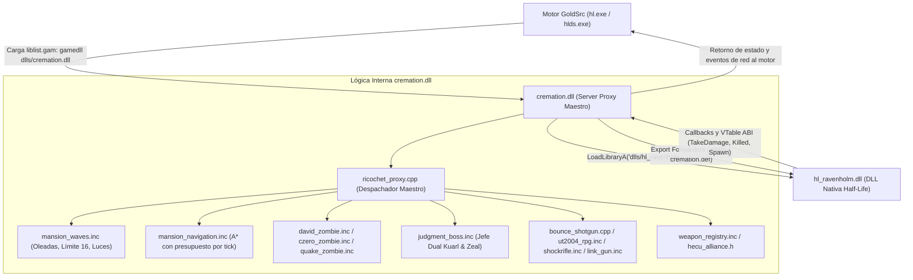
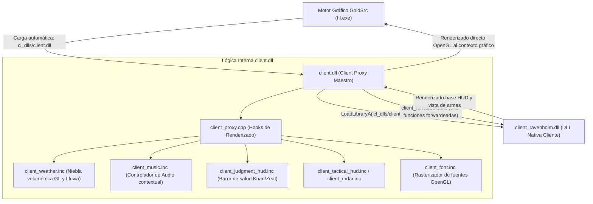

# Auditoría Técnica Integral: Lógica, Arquitectura e Interconexión de DLLs (Cremation Mod)

> **Documento de Auditoría de Código y Arquitectura de Sistemas**  
> **Mod:** Cremation (Motor GoldSrc / Half-Life 1)  
> **Objetivo:** Presentar la arquitectura completa, la cadena de interconexión por proxy de librerías dinámicas y el **código fuente literal y sin modificaciones** contenido en las DLLs de servidor (`cremation.dll`) y cliente (`client.dll`), para su inspección, verificación y auditoría por parte de un agente externo o ingeniero de sistemas.

---

## 1. Arquitectura de Interconexión y Cadena de Proxies

El mod *Cremation* opera bajo un modelo de **arquitectura de intercepción y delegación por proxy (Proxy Dynamic Link Library Pattern)**. Este diseño permite extender, sobreescribir y enriquecer la experiencia de juego nativa de GoldSrc sin requerir descompilación destructiva de la DLL base de Half-Life / Ravenholm, garantizando compatibilidad binaria estricta con el motor (`hl.exe` / `hlds.exe`).

### 1.1 Diagrama de Interconexión del Servidor (`cremation.dll`)



#### Funcionamiento del Proxy de Servidor:
1. El motor GoldSrc lee `liblist.gam` al iniciar el juego y encuentra la directiva `gamedll "dlls/cremation.dll"`.
2. El motor invoca las funciones de exportación `GiveFnptrsToDll` (entregando la tabla de punteros del motor `enginefuncs_t` y las variables globales `globalvars_t`) y `GetEntityAPI2` (obteniendo la tabla de funciones de la DLL `DLL_FUNCTIONS`).
3. `cremation.dll` carga dinámicamente mediante `LoadLibraryA` la librería nativa `dlls/hl_ravenholm.dll`.
4. Mediante `installHooks`, `cremation.dll` interdicta las funciones vitales del juego:
   - `pfnSpawn`, `pfnThink`, `pfnTouch`, `pfnStartFrame`, `pfnPreThink`, `pfnPostThink`, `pfnClientCommand`, `pfnServerActivate`, `pfnEmitSound`.
5. Todas las entidades o funciones no modificadas expresamente por Cremation son delegadas de inmediato a `hl_ravenholm.dll` a través de la tabla de forwarders en la sección `.rdata`.

---

### 1.2 Diagrama de Interconexión del Cliente (`client.dll`)



#### Funcionamiento del Proxy de Cliente:
1. El motor GoldSrc carga automáticamente `cl_dlls/client.dll` al iniciar el cliente gráfico.
2. `client.dll` intercepta `Initialize`, `HUD_Init`, `HUD_VidInit`, `HUD_Redraw`, `HUD_Frame`, `HUD_Key_Event`, etc.
3. Se enlaza en tiempo de ejecución con `cl_dlls/client_ravenholm.dll` para reenviar las más de 500 funciones cliente nativas no interceptadas (`client_forwarders.inc`).
4. Durante `HUD_Redraw`, `client.dll` toma el contexto directo de OpenGL (`wglGetCurrentContext`) para inyectar:
   - La niebla carmesí (`GL_FOG`) con coeficientes volumétricos ajustados a la mansión.
   - Partículas dinámicas de lluvia roja cayendo del cielo.
   - La barra de salud del jefe dual Judgment.
   - El minimapa táctico y radar en tiempo real.

---

### 1.3 Comunicación Inter-DLL (Servidor <---> Cliente)

El servidor y el cliente se sincronizan mediante la tubería nativa de mensajes de red de GoldSrc:
- **Eventos de Audio y Efectos Visuales**: `SVC_TEMPENTITY` con mensajes `TE_BEAMPOINTS` (láseres del Shockrifle y Link Gun), `TE_SPARKS` (chisporroteo al apagarse las lámparas), `TE_EXPLOSION` (detonaciones del RPG y bomba CZ).
- **Control de Estado de Clima y Música**: Comandos de consola y flags de entidades sincronizados en el frame (`mansionState` e índices de mapa).
- **HUD y Radar**: Coordenadas de zombies y jugadores transmitidas en paquetes ligeros de baja frecuencia.

---

## 2. Inventario Exhaustivo de Componentes de Código

| Componente | Tipo / DLL | Líneas | Propósito en el Sistema |
|---|---|---|---|
| `source/ricochet_proxy.cpp` | Servidor (`cremation.dll`) | 1,430 | Despachador maestro del servidor, hooks de motor y puente a `hl_ravenholm.dll`. |
| `source/mansion_waves.h` | Servidor (`cremation.dll`) | 40 | Estructuras de oleadas, umbrales y composición de enemigos. |
| `source/mansion_waves.inc` | Servidor (`cremation.dll`) | 812 | Lógica de oleadas, límite de 16 enemigos, ciclo de apagado de luces cada 60s, IA de asedio y cruce de puentes. |
| `source/mansion_navigation.inc` | Servidor (`cremation.dll`) | 222 | Planificador A* incremental con presupuesto de tiempo por tick y caché de trazas. |
| `source/mansion_cz_respawn.inc` | Servidor (`cremation.dll`) | 48 | Reaparición táctica del zombie que planta la bomba sin avanzar oleada. |
| `source/mansion_revolver_ammo.inc` | Servidor (`cremation.dll`) | 75 | Distribución de cajas de munición y sincronización de pickups nativos. |
| `source/mansion_reactor.inc` | Servidor (`cremation.dll`) | 177 | Zonas seguras, foso de radiación y saltadores del mapa. |
| `source/czero_objective.inc` | Servidor (`cremation.dll`) | 207 | Lógica de objetivo táctico: plantado de bomba y humo defensivo. |
| `source/czero_zombie.inc` | Servidor (`cremation.dll`) | 144 | IA y animaciones del zombie especialista Counter-Strike. |
| `source/david_zombie.inc` | Servidor (`cremation.dll`) | 539 | IA de zombies HotD2 (David, Steve, Johnny con hachas arrojadizas y arrastre). |
| `source/quake_zombie.inc` | Servidor (`cremation.dll`) | 219 | IA del zombie de Quake con regeneración y lanzamiento de carne. |
| `source/judgment_boss.inc` | Servidor (`cremation.dll`) | 237 | Jefe dual Kuarl & Zeal con vida compartida y transición a fase solitaria. |
| `source/bounce_shotgun.h` | Servidor (`cremation.dll`) | 93 | Cabecera y estructuras del proyectil de rebote. |
| `source/bounce_shotgun_balance.h` | Servidor (`cremation.dll`) | 107 | Parámetros de daño, velocidad y rebotes de la escopeta táctica. |
| `source/bounce_shotgun.cpp` | Servidor (`cremation.dll`) | 997 | Físicas de rebote de discos, dispersión y proyectiles especiales. |
| `source/ut2004_rpg.inc` | Servidor (`cremation.dll`) | 188 | Lanzamisiles estilo UT2004 con propulsión y desvío de cohetes. |
| `source/shockrifle.inc` | Servidor (`cremation.dll`) | 53 | Rifle de choque con disparo primario (haz) y secundario (núcleo plasma). |
| `source/link_gun.inc` | Servidor (`cremation.dll`) | 362 | Cañón de plasma Link Gun con haz continuo. |
| `source/link_plasma.inc` | Servidor (`cremation.dll`) | 37 | Manejo de partículas y colisión de plasma. |
| `source/weapon_registry.inc` | Servidor (`cremation.dll`) | 90 | Registro unificado de armas, asignación de slots e inventario inicial. |
| `source/dmc_powerups.inc` | Servidor (`cremation.dll`) | 60 | Powerups de velocidad y daño estilo Deathmatch Classic. |
| `source/heart_pickups.inc` | Servidor (`cremation.dll`) | 73 | Corazones de regeneración de vida al matar enemigos. |
| `source/vostok_cover.inc` | Servidor (`cremation.dll`) | 33 | Coberturas dinámicas de madera en el mapa. |
| `source/humanoid_gibs.inc` | Servidor (`cremation.dll`) | 77 | Sistema de desmembramiento localizado para impactos críticos. |
| `source/hecu_alliance.h` | Servidor (`cremation.dll`) | 16 | Relaciones de facción y hostilidad entre monstruos y soldados. |
| `source/blood_cultist_voices.h` | Servidor (`cremation.dll`) | 168 | Voces y diálogos para los soldados cultistas. |
| `source/blood_zombie_voices.inc` | Servidor (`cremation.dll`) | 40 | Sonidos ambientales y gemidos de la horda. |
| `source/client_proxy.cpp` | Cliente (`client.dll`) | 101 | Despachador maestro de cliente, puente a `client_ravenholm.dll` y hooks GL. |
| `source/client_weather.inc` | Cliente (`client.dll`) | 424 | Sistema de niebla volumétrica rojiza y lluvia roja sobre la mansión. |
| `source/client_music.inc` | Cliente (`client.dll`) | 50 | Reproducción de música ambiental y pistas de combate por oleada. |
| `source/client_judgment_hud.inc` | Cliente (`client.dll`) | 21 | Barra gráfica de salud para el jefe Judgment. |
| `source/client_tactical_hud.inc` | Cliente (`client.dll`) | 101 | Interfaz táctica en pantalla con estado de puertas y objetivos. |
| `source/client_radar.inc` | Cliente (`client.dll`) | 52 | Radar circular en pantalla para detección de enemigos cercanos. |
| `source/client_font.inc` | Cliente (`client.dll`) | 189 | Motor de fuentes tipográficas para dibujo directo en OpenGL. |

---

## 3. Código Literal Completo - Servidor (`cremation.dll`)

A continuación se presenta el código fuente íntegro, literal y sin modificaciones de cada módulo del servidor.


### 3.1 Master Proxy y Enlace con el Motor

#### Archivo: `source/ricochet_proxy.cpp`
- **Ruta Absoluta:** `d:\SteamLibrary\steamapps\common\Half-Life\Cremation\source\ricochet_proxy.cpp`
- **Descripción:** Despachador maestro del servidor, hooks de exportación del motor GoldSrc y puente nativo a hl_ravenholm.dll
- **Líneas:** 1430

`````cpp
// Cremation server extension. Ravenholm keeps ownership of monsters, inventory,
// player state, saves and the shotgun; this module adds the disc weapon and the
// bouncing shotgun, and forwards every inherited export unchanged.
#include "extdll.h"
#undef min
#undef max
#include "entity_handle.h"
#include "ravenholm_abi.h"
#include <algorithm>
#include <array>
#include <vector>
#include <string>
#include <cstring>
#include <cmath>
#include <cstdint>
#include <cstdlib>
#include <cstdio>
#include <memory>
#include <unordered_map>
#include "ricochet_balance.h"
#include "bounce_shotgun.h"
#include "entity_state.h"
#include "raven_ammo.h"
#include "weapon_config.h"
#include "hecu_alliance.h"

// GoldSrc's file-based export reader assumes that export names live in .rdata.
// Reserve space there before linking; finalization never moves names elsewhere.
#pragma section(".rdata",read)
extern "C" __declspec(allocate(".rdata")) const unsigned char cremation_export_reserve[32768] = "CREMATION_EXPORT_RESERVE_BEGIN";

static enginefuncs_t engine{}, hookedEngine{};
static globalvars_t* globals=nullptr;
static DLL_FUNCTIONS raven{};
static HMODULE selfModule=nullptr, ravenModule=nullptr;
#include "forwarders.inc"
static constexpr int SvcTemp=23, SvcWeaponAnim=35, GlockId=2, Mp5Id=4;
static constexpr int Attack=1, Attack2=1<<11, Reload=1<<13;
static constexpr const char* NailViewModel="models/cremation/v_nailgun.mdl";
static constexpr const char* NailPlayerModel="models/cremation/p_nailgun.mdl";
static constexpr const char* PipeWrenchViewModel="models/cremation/v_pipe_wrench.mdl";
static constexpr const char* PipeWrenchPlayerModel="models/cremation/p_pipe_wrench.mdl";
static constexpr const char* RicochetRedModel="models/cremation/v_ricochet_red.mdl";
static int trailSprite=0, flashSprite=0;
static int msgTacticalHUD=0,msgJudgmentHUD=0,msgMansionDoors=0,msgCremationWaveHUD=0;
static int msgLinkMuzzle=0,msgLinkShot=0,msgFlakMuzzle=0;
static int msgWeaponList=0,msgCurWeapon=0,msgItemPickup=0,msgAmmoX=0,msgSetFov=0,msgAmmoPickup=0;
static bool singleGrenadePickup=false;
static int currentMsg=0,currentByte=0,curWeaponId=0;
static bool carrierCurWeapon=false;
static edict_t* messagePlayer=nullptr;
static bool ownAnimation=false;
static int shotgunAmmoIndex=-1,nailAmmoIndex=-1, ammoOffset=-1;
static int grenadeAmmoIndex=-1;
static float lastFrame=0;
static float lastDroppedItemCleanup=0;
static float firstPlayerPostThinkTime=0;
struct HordeProbe {edict_t* entity; int serial; Vector origin; Vector previous; float previousTime; bool jumped=false; float walked=0; Vector patrol{0,0,0}; bool fallback=false,returning=false,combat=false; float initialHealth=0;};
static std::vector<HordeProbe> hordeProbes;
static float hordeReportAt=0;
static int hordeReportsRemaining=0;
static float hordeStartedAt=0;
static constexpr float MansionZombieNoticeRange=640.f;
static void startupTrace(const char* stage,const char* detail="") {
    if(FILE* file=std::fopen("Cremation/startup-diagnostics.txt","a")) {
        std::fprintf(file,"%s %s\n",stage,detail);std::fclose(file);
    }
}

static const char* text(string_t s) { return engine.pfnSzFromIndex(s); }
static bool valid(edict_t* e) { return e && !e->free && !(e->v.flags&FL_KILLME); }
static bool aliveEnemy(edict_t* e) {
    return valid(e) && (e->v.flags&FL_MONSTER) && e->v.deadflag==DEAD_NO && e->v.health>0;
}
static float length(const Vector& a) { return std::sqrt(a.x*a.x+a.y*a.y+a.z*a.z); }
static float length2d(const Vector& a) { return std::sqrt(a.x*a.x+a.y*a.y); }
static Vector normal(const Vector& a) { float n=length(a); return n>.001f ? a*(1.f/n):Vector(0,0,0); }
static float dot(const Vector&a,const Vector&b) { return a.x*b.x+a.y*b.y+a.z*b.z; }
static Vector center(edict_t* e) { return (e->v.absmin+e->v.absmax)*.5f; }
#include "enemy_combat_policy.inc"
static bool ricochet(edict_t* e) {
    return valid(e) && e->v.health>0 && e->v.viewmodel && (!std::strcmp(text(e->v.viewmodel),"models/v_9mmhandgun.mdl") || !std::strcmp(text(e->v.viewmodel),RicochetRedModel));
}
static bool nailgun(edict_t* e) {
    if(!valid(e)||e->v.health<=0||!e->v.viewmodel)return false;
    const char* model=text(e->v.viewmodel);
    return !std::strcmp(model,"models/v_9mmAR.mdl")||!std::strcmp(model,NailViewModel);
}
// Temporary availability switch: keep implementations/assets for reactivation.
static constexpr bool ShotgunsPlayable=false;
static bool mansionGrenadePickup(edict_t* e){return valid(e)&&e->v.targetname&&!std::strcmp(text(e->v.classname),"weapon_handgrenade")&&!std::strncmp(text(e->v.targetname),"mansion_grenade_",16);}
static bool mansionTouchGrenade(edict_t* item,edict_t* player);
static bool disabledShotgunClass(const char* n){return !ShotgunsPlayable&&n&&(!std::strcmp(n,"weapon_shotgun")||!std::strcmp(n,"weapon_winchester1887"));}
static bool pipeWrench(edict_t* e) {
    if(!valid(e)||e->v.health<=0||!e->v.viewmodel)return false;
    const char* model=text(e->v.viewmodel);
    return !std::strcmp(model,"models/v_crowbar.mdl")||!std::strcmp(model,PipeWrenchViewModel);
}
static int pipeWrenchSequence(int sequence) {
    static const int map[]={0,3,4,5,6,8,7,10,9};
    return sequence>=0&&sequence<int(sizeof(map)/sizeof(map[0]))?map[sequence]:0;
}
static void coords(const Vector& p) { engine.pfnWriteCoord(p.x);engine.pfnWriteCoord(p.y);engine.pfnWriteCoord(p.z); }
static void sound(edict_t* e,const char* name) { engine.pfnEmitSound(e,CHAN_WEAPON,name,1,ATTN_NORM,0,100); }
#include "blood_cultist_voices.h"
#include "blood_zombie_voices.inc"
static void hookEmitSound(edict_t* entity,int channel,const char* sample,float volume,float attenuation,int flags,int pitch) {
    if(cultistVoiceSound(entity,channel,sample,flags))return;
    if(zombieVoiceSound(entity,sample,flags))return;
    const char* replacement=sample;
    if(pipeWrench(entity)) {
        if(!std::strcmp(sample,"weapons/cbar_hit1.wav"))replacement="weapons/pwrench_hit1.wav";
        else if(!std::strcmp(sample,"weapons/cbar_hit2.wav"))replacement="weapons/pwrench_hit2.wav";
        else if(!std::strcmp(sample,"weapons/cbar_hitbod1.wav"))replacement="weapons/pwrench_hitbod1.wav";
        else if(!std::strcmp(sample,"weapons/cbar_hitbod2.wav"))replacement="weapons/pwrench_hitbod2.wav";
        else if(!std::strcmp(sample,"weapons/cbar_hitbod3.wav"))replacement="weapons/pwrench_hitbod3.wav";
        else if(!std::strcmp(sample,"weapons/cbar_miss1.wav"))replacement="weapons/pwrench_miss1.wav";
    }
    engine.pfnEmitSound(entity,channel,replacement,volume,attenuation,flags,pitch);
}

struct Effect {
    edict_t* entity=nullptr;
    int serial=0;
    float slowUntil=0,pushUntil=0,baseFrame=1;
    int mode=0,fx=0,movement=MOVETYPE_STEP;
    float alpha=0;
    Vector color{0,0,0};
};
static std::vector<Effect> effects;
struct PlayerState { int buttons=0; float nextFire=0,animUntil=0,nailNextFire=0; bool wasActive=false,wasFlak=false,wasNailgun=false,redMode=false; int charges=balance::MaxCharges; float rechargeAt=0; int sentCharges=-1; };
static std::array<PlayerState,33> players{};
struct Projectile {
    edict_t* entity=nullptr; int serial=0;
    edict_t* owner=nullptr; int ownerSerial=0;
    Vector velocity{0,0,0}; float born=0,nextSteer=0; int bounces=0;
    bool explosive=false;
    float nextParticles=0;
    std::vector<std::pair<edict_t*,int>> slowedTargets;
};
static std::vector<Projectile> discs;
struct NailProjectile {
    edict_t* entity=nullptr; int serial=0;
    edict_t* owner=nullptr; int ownerSerial=0;
    Vector velocity{0,0,0}; float born=0,damage=9.f;
    std::array<edict_t*,2> visuals{};std::array<int,2> visualSerials{};float nextLight=0;
};
static std::vector<NailProjectile> nails;

static Effect* getEffect(edict_t* e,bool create=false) {
    if (!valid(e)) return nullptr;
    int i=engine.pfnIndexOfEdict(e);
    if (i<0 || i>=int(effects.size())) return nullptr;
    auto& s=effects[i];
    if (s.entity!=e || s.serial!=e->serialnumber) {
        if (!create) return nullptr;
        s=Effect{};s.entity=e;s.serial=e->serialnumber;
    }
    return &s;
}
static bool slowed(edict_t* e) { auto s=getEffect(e);return s && s->slowUntil>globals->time && aliveEnemy(e); }
static bool pushed(edict_t* e) { auto s=getEffect(e);return s && s->pushUntil>globals->time && aliveEnemy(e); }
static void blue(edict_t* e) {
    e->v.renderfx=kRenderFxGlowShell;
    e->v.rendermode=kRenderTransTexture;
    e->v.renderamt=175;
    e->v.rendercolor=Vector(55,135,255);
}
static void restoreSlow(Effect& s) {
    auto e=s.entity;
    if(valid(e) && e->serialnumber==s.serial) {
        e->v.rendermode=s.mode;e->v.renderfx=s.fx;e->v.renderamt=s.alpha;
        e->v.rendercolor=s.color;e->v.framerate=s.baseFrame;
    }
    s.slowUntil=0;
}
static void expireEffects() {
    for(auto& s:effects) {
        auto e=s.entity;if(!e)continue;
        if(!valid(e)||e->serialnumber!=s.serial) {s=Effect{};continue;}
        if(s.slowUntil && (s.slowUntil<=globals->time || !aliveEnemy(e)))restoreSlow(s);
        if(s.pushUntil && (s.pushUntil<=globals->time || !aliveEnemy(e))) {
            if(e->v.movetype==MOVETYPE_TOSS)e->v.movetype=s.movement;
            s.pushUntil=0;
        }
    }
}
static void freeze(edict_t* e) {
    if(!aliveEnemy(e))return;
    auto s=getEffect(e,true);if(!s)return;
    if(s->slowUntil<=globals->time) {
        if(s->slowUntil)restoreSlow(*s);
        s->mode=e->v.rendermode;s->fx=e->v.renderfx;s->alpha=e->v.renderamt;
        s->color=e->v.rendercolor;s->baseFrame=e->v.framerate;
    }
    s->slowUntil=globals->time+balance::SlowDuration;
    e->v.framerate=s->baseFrame*balance::SlowFactor;
    blue(e);sound(e,"ricochet/freeze.wav");
}

// CBaseEntity::TakeDamage is virtual slot 11 in Valve's Win32 HLSDK ABI.
// No Ravenholm private fields, class sizes or subclass layouts are accessed.
using TakeDamageFn=int(__thiscall*)(void*,entvars_t*,entvars_t*,float,int);
static void damage(edict_t* e,edict_t* projectile,edict_t* owner,float amount) {
    if(!e->pvPrivateData || !e->v.takedamage || amount<=0)return;
    auto table=*reinterpret_cast<void***>(e->pvPrivateData);
    auto fn=reinterpret_cast<TakeDamageFn>(table[ravenholm_abi::slot::TakeDamage]);
    fn(e->pvPrivateData,&projectile->v,&owner->v,amount,1<<6); // DMG_BLAST
}
// Shared small impulse for the bounce shotgun grenade. Same bookkeeping as the
// disc wave (temporary TOSS physics, AI displacement suppression, restore on
// land/death/expiry) with caller-supplied magnitudes.
static void applyPush(edict_t* e,const Vector& dir,float horizontal,float vertical,float duration) {
    if(!aliveEnemy(e))return;
    auto s=getEffect(e,true);if(!s)return;
    if(s->pushUntil<=globals->time)s->movement=e->v.movetype;
    Vector flat=normal(Vector(dir.x,dir.y,0));
    Vector velocity=e->v.velocity+flat*horizontal;
    float n=length2d(velocity);
    if(n>balance::MaxHorizontalPush) {velocity.x*=balance::MaxHorizontalPush/n;velocity.y*=balance::MaxHorizontalPush/n;}
    velocity.z=std::min(260.f,std::max(velocity.z,vertical));
    e->v.flags&=~FL_ONGROUND;e->v.groundentity=nullptr;
    e->v.movetype=MOVETYPE_TOSS;e->v.velocity=velocity;
    s->pushUntil=globals->time+duration;
}
static void knock(edict_t* e,const Vector& dir,float strength) {
    applyPush(e,dir,balance::BlastPush*strength,balance::BlastLift*strength,balance::PushDuration);
}
static bool canSee(const Vector& from,edict_t* target,edict_t* ignore) {
    TraceResult tr{};Vector to=center(target);
    engine.pfnTraceLine(from,to,0,ignore,&tr);
    return !tr.fStartSolid && (tr.flFraction>=.999f || tr.pHit==target);
}
static void burst(const Projectile& d,const Vector& at) {
    engine.pfnMessageBegin(MSG_PVS,SvcTemp,at,nullptr);
    engine.pfnWriteByte(TE_BEAMCYLINDER);coords(at);coords(at+Vector(0,0,balance::BlastRadius*2));
    engine.pfnWriteShort(trailSprite);engine.pfnWriteByte(0);engine.pfnWriteByte(0);
    engine.pfnWriteByte(3);engine.pfnWriteByte(24);engine.pfnWriteByte(0);
    engine.pfnWriteByte(255);engine.pfnWriteByte(160);engine.pfnWriteByte(55);
    engine.pfnWriteByte(210);engine.pfnWriteByte(0);engine.pfnMessageEnd();
    engine.pfnMessageBegin(MSG_PVS,SvcTemp,at,nullptr);
    engine.pfnWriteByte(TE_SPRITE);coords(at);engine.pfnWriteShort(flashSprite);
    engine.pfnWriteByte(9);engine.pfnWriteByte(200);engine.pfnMessageEnd();
    sound(d.entity,"ricochet/blast.wav");
    if(!valid(d.owner) || d.owner->serialnumber!=d.ownerSerial)return;
    for(int i=globals->maxClients+1;i<globals->maxEntities;++i) {
        auto e=engine.pfnPEntityOfEntIndex(i);if(!aliveEnemy(e))continue;
        Vector offset=center(e)-at;float distance=length(offset);
        if(distance>balance::BlastRadius || !canSee(at,e,d.owner))continue;
        float strength=std::max(.25f,1.f-distance/balance::BlastRadius);
        damage(e,d.entity,d.owner,balance::BlastDamage*strength);
        knock(e,length(offset)>1?offset:d.velocity,strength);
    }
}
static void removeDisc(Projectile& d) {
    if(valid(d.entity) && d.entity->serialnumber==d.serial)engine.pfnRemoveEntity(d.entity);
    d.entity=nullptr;
}
static void steer(Projectile& d,float dt) {
    // RPG-style continuous guidance toward the point under the owner's aim.
    // There is no laser sprite/entity and no automatic enemy selection.
    Vector aim=d.owner->v.v_angle+d.owner->v.punchangle;
    float yaw=aim.y*3.14159265359f/180,pitch=aim.x*3.14159265359f/180;
    Vector direction(std::cos(pitch)*std::cos(yaw),std::cos(pitch)*std::sin(yaw),-std::sin(pitch));
    Vector eye=d.owner->v.origin+d.owner->v.view_ofs,to=eye+direction*8192;
    TraceResult tr{};engine.pfnTraceLine(&eye.x,&to.x,0,d.owner,&tr);
    Vector target=tr.flFraction<1.f?Vector(tr.vecEndPos):to;
    Vector desired=normal(target-d.entity->v.origin);
    Vector current=normal(d.velocity);
    float cosine=std::max(-1.f,std::min(1.f,dot(current,desired)));
    float angle=std::acos(cosine),turn=std::min(angle,balance::GuidanceTurnRate*dt);
    Vector axis(current.y*desired.z-current.z*desired.y,current.z*desired.x-current.x*desired.z,current.x*desired.y-current.y*desired.x);
    if(length(axis)<.001f)axis=std::fabs(current.z)<.9f?Vector(current.y,-current.x,0):Vector(0,current.z,-current.y);
    axis=normal(axis);
    Vector cross(axis.y*current.z-axis.z*current.y,axis.z*current.x-axis.x*current.z,axis.x*current.y-axis.y*current.x);
    Vector next=current*std::cos(turn)+cross*std::sin(turn)+axis*(dot(axis,current)*(1-std::cos(turn)));
    if(length(next)>.5f)d.velocity=normal(next)*balance::DiscSpeed;
}
// Sweep the complete segment against enemy bounds independently of the world
// trace: a primary disc can cross overlapping enemies without teleporting past
// walls, changing its direction or spending a surface reflection.
static bool crossesEnemy(const Vector& from,const Vector& to,edict_t* target) {
    Vector delta=to-from;float enter=0,leave=1;
    for(int axis=0;axis<3;++axis) {
        float start=from[axis],speed=delta[axis];
        float lo=target->v.absmin[axis],hi=target->v.absmax[axis];
        if(std::fabs(speed)<.00001f) {if(start<lo || start>hi)return false;continue;}
        float a=(lo-start)/speed,b=(hi-start)/speed;
        if(a>b)std::swap(a,b);
        enter=std::max(enter,a);leave=std::min(leave,b);
        if(enter>leave)return false;
    }
    return true;
}
static void discParticles(Projectile& d) {
    if(globals->time<d.nextParticles)return;
    d.nextParticles=globals->time+.1f;
    Vector at=d.entity->v.origin,back=normal(d.velocity)*-3.f;
    for(int n=0;n<5;++n) {
        float phase=globals->time*19.f+n*2.39996f+d.serial;
        Vector offset(std::cos(phase)*6.f,std::sin(phase)*6.f,std::sin(phase*1.7f)*5.f);
        Vector start=at+offset,end=start+back+offset*.35f;
        engine.pfnMessageBegin(MSG_PVS,SvcTemp,&at.x,nullptr);
        engine.pfnWriteByte(TE_BEAMPOINTS);coords(start);coords(end);
        engine.pfnWriteShort(trailSprite);
        engine.pfnWriteByte(0);engine.pfnWriteByte(0); // frame / frame rate
        engine.pfnWriteByte(2);engine.pfnWriteByte(3);engine.pfnWriteByte(2); // life / width / noise
        engine.pfnWriteByte(d.explosive?255:60);engine.pfnWriteByte(d.explosive?150:145);engine.pfnWriteByte(d.explosive?40:255);
        engine.pfnWriteByte(220);engine.pfnWriteByte(0);engine.pfnMessageEnd();
    }
}
static void advanceDiscs(float dt) {
    std::vector<edict_t*> targets;
    if(!discs.empty())for(int i=1;i<globals->maxEntities;++i) {
        auto e=engine.pfnPEntityOfEntIndex(i);if(aliveEnemy(e))targets.push_back(e);
    }
    for(auto& d:discs) {
        if(!valid(d.entity) || d.entity->serialnumber!=d.serial) {d.entity=nullptr;continue;}
        if(!valid(d.owner) || d.owner->serialnumber!=d.ownerSerial || d.owner->v.health<=0 || globals->time-d.born>balance::DiscLifetime) {removeDisc(d);continue;}
        if(d.explosive)steer(d,dt);
        float remaining=dt;
        // Bound bounce iterations; trace the entire traveled segment to avoid tunneling.
        for(int sub=0;sub<8 && remaining>0 && d.entity;++sub) {
            Vector from=d.entity->v.origin,to=from+d.velocity*remaining;
            TraceResult tr{};engine.pfnTraceLine(from,to,d.explosive?0:1,d.owner,&tr);
            if(!d.explosive && !tr.fStartSolid && !tr.fAllSolid) {
                Vector stop=tr.flFraction<1?Vector(tr.vecEndPos):to;
                for(auto target:targets)if(aliveEnemy(target) && crossesEnemy(from,stop,target)) {
                    auto identity=std::make_pair(target,target->serialnumber);
                    if(std::find(d.slowedTargets.begin(),d.slowedTargets.end(),identity)==d.slowedTargets.end()) {
                        freeze(target);d.slowedTargets.push_back(identity);
                    }
                }
            }
            if(tr.fStartSolid || tr.fAllSolid) {if(d.explosive)burst(d,from);removeDisc(d);break;}
            if(tr.flFraction>=1) {engine.pfnSetOrigin(d.entity,to);break;}
            Vector at=tr.vecEndPos+tr.vecPlaneNormal*2.f;
            engine.pfnSetOrigin(d.entity,at);
            // Secondary guides but detonates on its first contact. Only the
            // primary freezes targets and survives successive reflections.
            if(d.explosive) {burst(d,at);removeDisc(d);break;}
            if(++d.bounces>5) {removeDisc(d);break;}
            d.velocity=d.velocity-tr.vecPlaneNormal*(2.f*dot(d.velocity,tr.vecPlaneNormal));
            sound(d.entity,"ricochet/bounce.wav");
            remaining*=1.f-tr.flFraction;
        }
        if(d.entity) {discParticles(d);d.entity->v.angles.y+=dt*720;d.entity->v.velocity=Vector(0,0,0);}
    }
    discs.erase(std::remove_if(discs.begin(),discs.end(),[](const Projectile& d){return !d.entity;}),discs.end());
}
static void animation(edict_t* player,int sequence) {
    player->v.weaponanim=sequence;
    ownAnimation=true;
    engine.pfnMessageBegin(MSG_ONE,SvcWeaponAnim,nullptr,player);
    engine.pfnWriteByte(sequence);engine.pfnWriteByte(0);engine.pfnMessageEnd();
    ownAnimation=false;
}
static int sharedAmmo(edict_t* p,int ammoIndex,int spend) {
    if(!p||!p->pvPrivateData||ammoOffset<0||ammoIndex<0||ammoIndex>=32)return 0;
    int* ammo=reinterpret_cast<int*>(static_cast<char*>(p->pvPrivateData)+ammoOffset)+ammoIndex;
    if(*ammo<0||*ammo>250)return 0;
    if(spend>0) {if(*ammo<spend)return -1;*ammo-=spend;}
    return *ammo;
}
#include "link_plasma.inc"
static bool launchNail(edict_t* player,float nailDamage,bool secondary) {
    Vector aim=player->v.v_angle+player->v.punchangle;
    float yaw=aim.y*3.14159265359f/180.f,pitch=aim.x*3.14159265359f/180.f;
    Vector direction(std::cos(pitch)*std::cos(yaw),std::cos(pitch)*std::sin(yaw),-std::sin(pitch));
    Vector right(std::sin(yaw),-std::cos(yaw),0);
    Vector up=normal(Vector(right.y*direction.z-right.z*direction.y,right.z*direction.x-right.x*direction.z,right.x*direction.y-right.y*direction.x));
    Vector eye=player->v.origin+player->v.view_ofs,origin=eye+direction*48.f+right*16.f-up*5.4f;
    TraceResult muzzle{};engine.pfnTraceLine(eye,origin,0,player,&muzzle);
    if(muzzle.flFraction<1.f)origin=muzzle.vecEndPos-direction*2.f;
    auto e=engine.pfnCreateNamedEntity(engine.pfnAllocString("info_target"));
    if(!e)return false;
    raven.pfnSpawn(e);
    e->v.classname=engine.pfnAllocString("cremation_nail");
    e->v.movetype=MOVETYPE_NONE;e->v.solid=SOLID_NOT;e->v.takedamage=0;
    e->v.owner=player;e->v.angles=Vector(aim.x,aim.y,0);e->v.scale=1.f;
    plasmaStyle(e,PlasmaBody,.25f,240);
    Vector mins(-1,-1,-1),maxs(1,1,1);engine.pfnSetSize(e,mins,maxs);engine.pfnSetOrigin(e,origin);
    nails.push_back({e,e->serialnumber,player,player->serialnumber,direction*750.f,globals->time,nailDamage});
    auto& plasma=nails.back();
    plasma.visuals[0]=plasmaLayer(player,origin,PlasmaCore,.22f,255);
    plasma.visuals[1]=plasmaLayer(player,origin,PlasmaHalo,.4f,150);
    for(int i=0;i<2;++i)if(plasma.visuals[i])plasma.visualSerials[i]=plasma.visuals[i]->serialnumber;
    plasmaUpdate(plasma);
    if(msgLinkShot){engine.pfnMessageBegin(MSG_ONE,msgLinkShot,nullptr,player);engine.pfnWriteByte(engine.pfnIndexOfEdict(player));engine.pfnWriteShort(engine.pfnIndexOfEdict(e));for(auto visual:plasma.visuals)engine.pfnWriteShort(valid(visual)?engine.pfnIndexOfEdict(visual):0);coords(direction*750.f);engine.pfnMessageEnd();}

    engine.pfnMessageBegin(MSG_BROADCAST,SvcTemp,nullptr,nullptr);
    engine.pfnWriteByte(TE_BEAMFOLLOW);engine.pfnWriteShort(engine.pfnIndexOfEdict(e));engine.pfnWriteShort(trailSprite);
    engine.pfnWriteByte(1);engine.pfnWriteByte(2);
    engine.pfnWriteByte(secondary?255:35);engine.pfnWriteByte(secondary?35:255);engine.pfnWriteByte(secondary?35:45);
    engine.pfnWriteByte(85);engine.pfnMessageEnd();
    return true;
}
static void removeNail(NailProjectile& nail) {
    for(int i=0;i<2;++i) {
        auto e=nail.visuals[i];
        if(valid(e)&&e->serialnumber==nail.visualSerials[i])engine.pfnRemoveEntity(e);
        nail.visuals[i]=nullptr;
    }
    if(valid(nail.entity)&&nail.entity->serialnumber==nail.serial)engine.pfnRemoveEntity(nail.entity);
    nail.entity=nullptr;
}
static void advanceNails(float dt) {
    for(auto& nail:nails) {
        if(!valid(nail.entity)||nail.entity->serialnumber!=nail.serial) {removeNail(nail);continue;}
        if(!valid(nail.owner)||nail.owner->serialnumber!=nail.ownerSerial||nail.owner->v.health<=0||globals->time-nail.born>6.f) {removeNail(nail);continue;}
        Vector from=nail.entity->v.origin,to=from+nail.velocity*dt;
        TraceResult tr{};engine.pfnTraceLine(from,to,0,nail.owner,&tr);
        if(tr.fStartSolid||tr.fAllSolid) {removeNail(nail);continue;}
        if(tr.flFraction>=1.f) {engine.pfnSetOrigin(nail.entity,to);plasmaUpdate(nail);continue;}
        engine.pfnSetOrigin(nail.entity,tr.vecEndPos);
        auto victim=tr.pHit;
        if(valid(victim)&&victim->v.takedamage>0&&victim->pvPrivateData) {
            auto table=*reinterpret_cast<void***>(victim->pvPrivateData);
            auto takeDamage=reinterpret_cast<TakeDamageFn>(table[ravenholm_abi::slot::TakeDamage]);
            takeDamage(victim->pvPrivateData,&nail.entity->v,&nail.owner->v,nail.damage,0); // DMC nails use DMG_GENERIC.
        }
        removeNail(nail);
    }
    nails.erase(std::remove_if(nails.begin(),nails.end(),[](const NailProjectile& n){return !n.entity;}),nails.end());
}
static bool fireNailgun(edict_t* p,bool secondary) {
    // Continuous secondary is owned by linkPostThink, never by nail projectiles.
    if(secondary)return false;
    const int cost=1;
    if(sharedAmmo(p,nailAmmoIndex,0)<cost)return false;
    if(!launchNail(p,9.f*1.75f,false))return false;
    int remaining=sharedAmmo(p,nailAmmoIndex,cost);
    if(msgAmmoX&&nailAmmoIndex>=0&&remaining>=0) {
        engine.pfnMessageBegin(MSG_ONE,msgAmmoX,nullptr,p);
        engine.pfnWriteByte(nailAmmoIndex);engine.pfnWriteByte(remaining);engine.pfnMessageEnd();
    }
    sound(p,"weapons/ut2004/link_fire.wav");
    animation(p,5);
    p->v.punchangle.x-=.2f;
    return true;
}
#include "humanoid_gibs.inc"
static bool heartRollDeath(edict_t* e);
static edict_t* heartSpawn(const Vector& origin);
static float davidMeleeScale(entvars_t* attacker);
#include "dmc_powerups.inc"
#include "weapon_blood.inc"
#include "link_gun.inc"
#include "ut2004_rpg.inc"
#include "necromancer.inc"
static int bounceSpawn(edict_t* e) { return raven.pfnSpawn ? raven.pfnSpawn(e) : 0; }
static void bounceAnimation(edict_t* p,int sequence) {
 animation(p,sequence);
 if(msgFlakMuzzle&&bounce::isBouncePlayer(p)&&(sequence==1||sequence==2)){engine.pfnMessageBegin(MSG_ONE,msgFlakMuzzle,nullptr,p);engine.pfnWriteByte(sequence);engine.pfnMessageEnd();}
}
static void bouncePush(edict_t* e,const Vector& dir,float horizontal,float vertical,float duration) {
    applyPush(e,dir,horizontal,vertical,duration);
}
static int sharedShells(edict_t* p,int spend) {
    if(!p || !p->pvPrivateData || ammoOffset<0 || shotgunAmmoIndex<0 || shotgunAmmoIndex>=32)return 0;
    int* ammo=reinterpret_cast<int*>(static_cast<char*>(p->pvPrivateData)+ammoOffset)+shotgunAmmoIndex;
    if(*ammo<0 || *ammo>125)return 0;
    if(spend>0) {if(*ammo<spend)return -1;*ammo-=spend;}
    return *ammo;
}
#include "shockrifle.inc"
#include "quake_zombie.inc"
#ifdef CREMATION_ENABLE_VALIDATION
#include "quake_zombie_validation.inc"
#endif
static bool inMansionMove = false;
static int mansionStartWave(){
    if(!globals||!globals->mapname)return 0;
    const char* name=text(globals->mapname);
    if(!name)return 0;
    if(!std::strcmp(name,"cs_mansion"))return 1;
    constexpr char prefix[]="cs_mansion_wave";
    if(std::strncmp(name,prefix,sizeof(prefix)-1))return 0;
    char* end=nullptr;long wave=std::strtol(name+sizeof(prefix)-1,&end,10);
    return end&&!*end&&wave>=1&&wave<=4?int(wave):0;
}
static bool mansionMap(){return mansionStartWave()!=0;}
static bool mansionActor(edict_t* e){return valid(e)&&e->v.targetname&&!std::strncmp(text(e->v.targetname),"mansion_enemy_",14);}
#include "czero_smoke.inc"
#include "czero_zombie.inc"
#include "david_zombie.inc"
#include "heart_pickups.inc"
static bool disabledShotgunActive(edict_t* p){return !ShotgunsPlayable&&bounce::isTfcPlayer(p);}
static void attachBounce() {
    bounce::Host host{};
    host.engine=&engine;host.globals=globals;
    host.shells=sharedShells;
    host.spawn=bounceSpawn;host.sound=sound;host.animation=bounceAnimation;host.push=bouncePush;
    bounce::attach(host);
}
static void launch(edict_t* player,float spread,bool explosive) {
    Vector aim=player->v.v_angle+player->v.punchangle;aim.y+=spread;
    float yaw=aim.y*3.14159265359f/180,pitch=aim.x*3.14159265359f/180;
    Vector direction(std::cos(pitch)*std::cos(yaw),std::cos(pitch)*std::sin(yaw),-std::sin(pitch));
    Vector eye=player->v.origin+player->v.view_ofs;
    Vector origin=eye+direction*16;
    // Keep the muzzle out of walls; the first frame's trace will resolve contact.
    TraceResult tr{};engine.pfnTraceLine(eye,origin,0,player,&tr);
    origin=tr.flFraction<1 ? tr.vecEndPos-direction*2 : origin;
    auto e=engine.pfnCreateNamedEntity(engine.pfnAllocString("info_target"));if(!e)return;
    raven.pfnSpawn(e);
    e->v.classname=engine.pfnAllocString("cremation_disc");
    e->v.movetype=MOVETYPE_NONE;e->v.solid=SOLID_NOT;e->v.takedamage=0;
    e->v.owner=player;e->v.angles=Vector(0,aim.y,0);e->v.scale=1;
    e->v.rendermode=kRenderNormal;e->v.renderfx=kRenderFxGlowShell;e->v.renderamt=8;
    e->v.rendercolor=explosive?Vector(255,150,40):Vector(60,145,255);
    engine.pfnSetModel(e,explosive?"models/ricochet/disc_hard.mdl":"models/ricochet/disc.mdl");
    Vector mins(-4,-4,-4),maxs(4,4,4);engine.pfnSetSize(e,mins,maxs);engine.pfnSetOrigin(e,origin);
    discs.push_back({e,e->serialnumber,player,player->serialnumber,direction*balance::DiscSpeed,globals->time,0,0,explosive});
    engine.pfnMessageBegin(MSG_BROADCAST,SvcTemp,nullptr,nullptr);
    engine.pfnWriteByte(TE_BEAMFOLLOW);engine.pfnWriteShort(engine.pfnIndexOfEdict(e));engine.pfnWriteShort(trailSprite);
    engine.pfnWriteByte(explosive?9:10);engine.pfnWriteByte(explosive?10:12);
    engine.pfnWriteByte(explosive?255:60);engine.pfnWriteByte(explosive?150:145);engine.pfnWriteByte(explosive?40:255);
    engine.pfnWriteByte(190);engine.pfnMessageEnd();
}
static void recharge(PlayerState& s) {
    while(s.charges<balance::MaxCharges && globals->time>=s.rechargeAt) {
        ++s.charges;s.rechargeAt+=balance::RechargeTime;
    }
}
static bool fire(edict_t* p,bool secondary) {
    int index=engine.pfnIndexOfEdict(p);
    if(index<=0 || index>=33)return false;
    auto& state=players[index];recharge(state);
    if(state.charges<=0)return false;
    int needed=secondary?3:1;
    if(discs.size()+needed>balance::MaxProjectiles)return false;
    if(secondary) {launch(p,0,true);launch(p,-balance::TripleSpread,true);launch(p,balance::TripleSpread,true);}
    else launch(p,0,false);
    state.redMode=secondary;
    p->v.viewmodel=engine.pfnAllocString(secondary?RicochetRedModel:"models/v_9mmhandgun.mdl");
    --state.charges;state.rechargeAt=globals->time+balance::RechargeTime;
    animation(p,5);
    sound(p,secondary?"ricochet/altfire.wav":"ricochet/throw.wav");
    p->v.punchangle.x-=secondary?2.f:1.f;
    return true;
}
static int hookWalkMove(edict_t* e,float yaw,float distance,int mode) {
    if(pushed(e))distance=0;
    else if(slowed(e))distance*=balance::SlowFactor;
    if(mansionMap()&&mansionActor(e)&&!inMansionMove)return 1;
    return engine.pfnWalkMove(e,yaw,distance,mode);
}
static void hookMoveToOrigin(edict_t* e,const float* goal,float distance,int mode) {
    if(pushed(e))distance=0;
    else if(slowed(e))distance*=balance::SlowFactor;
    engine.pfnMoveToOrigin(e,goal,distance,mode);
}
static bool invalidFastSequenceLogged=false;
static constexpr const char* RandyModel="models/cremation/hotd2/randy/randy.mdl";
static constexpr const char* RandyCharred="models/cremation/hotd2/randy/randy_charred.mdl";
static bool randyClass(edict_t* e){return valid(e)&&e->v.classname&&(!std::strcmp(text(e->v.classname),"monster_randy")||!std::strcmp(text(e->v.classname),"monster_fastzombie"));}
static void randySetModel(edict_t* e,const char* path){Vector lo=e->v.mins,hi=e->v.maxs;engine.pfnSetModel(e,path);engine.pfnSetSize(e,&lo.x,&hi.x);}
static void* hookModelPtr(edict_t* e) {
    void* model=engine.pfnGetModelPtr(e);
    if(model && randyClass(e)) {
        int count=*reinterpret_cast<int*>(static_cast<unsigned char*>(model)+164);
        if(e->v.sequence<0 || e->v.sequence>=count) {
            // Ravenholm can request activities absent from its fast-zombie model.
            // Its event dispatcher does not reject negative sequence indices.
            if(!invalidFastSequenceLogged){startupTrace("AnimationFallback","fast zombie missing activity: using idle");invalidFastSequenceLogged=true;}
            e->v.sequence=0;e->v.frame=0;e->v.animtime=globals->time;
        }
    }
    return model;
}
// Passive patrol relinquishes control permanently after contact. No cinematic
// state, relationship override or fabricated enemy pointer is installed.
static bool hordeAlert(HordeProbe& probe) {
    if(probe.combat)return true;
    if(probe.initialHealth>0 && probe.entity->v.health<probe.initialHealth)return true;
    for(int client=1;client<=globals->maxClients;++client) {
        auto player=engine.pfnPEntityOfEntIndex(client);
        if(!valid(player)||!(player->v.flags&FL_CLIENT)||player->v.health<=0||player->v.deadflag!=DEAD_NO)continue;
        float distance=length(player->v.origin-probe.entity->v.origin);
        if(distance<384)return true;
        if(distance>MansionZombieNoticeRange)continue;
        Vector eye=probe.entity->v.origin+Vector(0,0,48);
        Vector target=player->v.origin+player->v.view_ofs;
        TraceResult tr{};engine.pfnTraceLine(&eye.x,&target.x,1,probe.entity,&tr);
        if(tr.flFraction>=1 || tr.pHit==player)return true;
    }
    return false;
}
static bool zombieBusy(edict_t* e){
    if(!valid(e)||!aliveEnemy(e))return false;
    if(auto s=davidState(e)){
        if(s->dying||s->johnnyGuarding||s->johnnyThrowing)return true;
        if(davidBusy(e)&&e->v.frame<250.f)return true;
    }
    if(czIs(e))return czMeleeBusy(e);
    if(qzIs(e))return e->v.impulse==QZAttack||e->v.impulse==QZPain||e->v.impulse==QZDown||e->v.impulse==QZRise||e->v.impulse==QZDead;
    if(!engine.pfnGetModelPtr)return false;
    auto data=static_cast<unsigned char*>(engine.pfnGetModelPtr(e));if(!data)return false;
    int count=*reinterpret_cast<int*>(data+164),offset=*reinterpret_cast<int*>(data+168);
    int seq=e->v.sequence;
    if(seq<0||seq>=count)return false;
    int flags=*reinterpret_cast<int*>(data+offset+seq*176+36);
    int act=*reinterpret_cast<int*>(data+offset+seq*176+40);
    if(act==28||act==29||act==30||act==31||act==26||act==27||(act>=70&&act<=76)||act==100||(act>=36&&act<=39)||act==66){
        if(e->v.frame<250.f)return true;
    }
    if(!(flags&1)&&e->v.frame<250.f)return true;
    return false;
}
static void hordeWalkAnimation(edict_t* e) {
    if(zombieBusy(e))return;
    if(auto state=davidState(e)){if(aliveEnemy(e))davidActivity(e->pvPrivateData,nullptr,state->running?4:3);return;}
    if(!engine.pfnGetModelPtr)return;
    auto data=static_cast<unsigned char*>(engine.pfnGetModelPtr(e));if(!data)return;
    int count=*reinterpret_cast<int*>(data+164),offset=*reinterpret_cast<int*>(data+168);
    for(int i=0;i<count;++i)if(*reinterpret_cast<int*>(data+offset+i*176+40)==3) {
        if(e->v.sequence!=i){
            int oldAct=(e->v.sequence>=0&&e->v.sequence<count)?*reinterpret_cast<int*>(data+offset+e->v.sequence*176+40):-1;
            float preserved=(oldAct==3||oldAct==4)?e->v.frame:0.f;
            e->v.sequence=i;e->v.frame=preserved;e->v.animtime=globals->time;
        }
        e->v.framerate=1;return;
    }
}
static void hordeRunAnimation(edict_t* e) {
    if(zombieBusy(e))return;
    if(auto state=davidState(e)){if(aliveEnemy(e))davidActivity(e->pvPrivateData,nullptr,state->running?4:3);return;}
    if(!engine.pfnGetModelPtr)return;
    auto data=static_cast<unsigned char*>(engine.pfnGetModelPtr(e));if(!data)return;
    int count=*reinterpret_cast<int*>(data+164),offset=*reinterpret_cast<int*>(data+168);
    int run=-1,locomotion=-1;
    for(int i=0;i<count;++i){int activity=*reinterpret_cast<int*>(data+offset+i*176+40);
        if(activity==4){run=i;break;}
        if(activity==3&&locomotion<0)locomotion=i;
    }
    // Several original GoldSrc zombie models mark their authored run cycle as
    // ACT_WALK (3), and some have no ACT_RUN entry at all. Keep those models'
    // original locomotion cycle instead of leaving a stale sequence selected.
    if(run<0)run=locomotion;
    if(run>=0){
        if(e->v.sequence!=run){
            int oldAct=(e->v.sequence>=0&&e->v.sequence<count)?*reinterpret_cast<int*>(data+offset+e->v.sequence*176+40):-1;
            float preserved=(oldAct==3||oldAct==4)?e->v.frame:0.f;
            e->v.sequence=run;e->v.frame=preserved;e->v.animtime=globals->time;
        }
        e->v.framerate=1;
    }
}
static void mansionFrame(float dt);
static void mansionRadarFrame();
static void mansionRadarPrecache();
static void mansionActivate();
static void mansionPrecache();
static void startupInventoryPrecache();
static void startupInventoryGive(edict_t* player);
static void reactorPrecache();
static void reactorActivate();
static void reactorFrame();
static void mansionCZRespawnFrame();
#ifdef CREMATION_ENABLE_VALIDATION
static void mansionRulesProbeFrame();
#endif
static void tacticalHudFrame();
static void mansionDoorRepairPostThink(edict_t* player,int buttons);
static bool judgmentIs(edict_t* e);
static void judgmentThink(edict_t* e,float dt);
#include "vostok_cover.inc"
#ifdef CREMATION_ENABLE_VALIDATION
static void vostokProbeFrame();
static void truthProbeFrame();
static void czTacticalProbeFrame();
static void tacticalSaveProbeFrame();
static void tacticalHudProbeFrame();
static void davidProbeFrame();
static void enemyCombatProbeFrame();
static void dmcPreviewFrame();
#endif
static void hookThink(edict_t* e) {
    enemyCombatClearTargets(e);
    if(judgmentIs(e)){judgmentThink(e,.05f);e->v.nextthink=0;return;}
    if(vostokCoverThink(e))return;
    if(czThink(e))return;
    if(qzThink(e))return;
    if(bounce::isSentry(e)) {e->v.nextthink=globals->time+.1f;return;}
    bool incendiary=incendiaryBeforeThink(e);
    edict_t* grenadeOwner=incendiary?e->v.owner:nullptr;int grenadeOwnerSerial=valid(grenadeOwner)?grenadeOwner->serialnumber:0;
    auto s=getEffect(e);
    if(s && s->slowUntil && (!aliveEnemy(e)||globals->time>=s->slowUntil))restoreSlow(*s);
    bool active=slowed(e);
    float expected=active?s->baseFrame*balance::SlowFactor:0;
    if(active)e->v.framerate=expected;
    raven.pfnThink(e);
    incendiaryAfterThink(e,incendiary,grenadeOwner,grenadeOwnerSerial);
    for(const auto& probe:hordeProbes)if(probe.entity==e && probe.fallback && !probe.combat && aliveEnemy(e))hordeWalkAnimation(e);
    if(active && aliveEnemy(e)) {
        if(std::fabs(e->v.framerate-expected)>.0001f)s->baseFrame=e->v.framerate;
        e->v.framerate=s->baseFrame*balance::SlowFactor;blue(e);
    }
}
static void hookStartFrame() {
#ifdef CREMATION_ENABLE_VALIDATION
    tacticalHudProbeFrame();
    dmcPreviewFrame();
    tacticalSaveProbeFrame();
    czTacticalProbeFrame();
    vostokProbeFrame();
    truthProbeFrame();
    czAnimationProbeFrame();
#endif
    czSmokeFrame();
    czBombFrame();
    tacticalHudFrame();
    mansionRadarFrame();
    heartFrame();
#ifdef CREMATION_ENABLE_VALIDATION
    heartProbeFrame();
    czProbeFrame();
#endif
    czVisualCleanup();
#ifdef CREMATION_ENABLE_VALIDATION
    qzProbeFrame();
#endif
    cultistFrame();
    zombieVoiceFrame();
    rpgFrame();
    linkFrame();
    anatomicalGibFrame();
    davidFrame();
#ifdef CREMATION_ENABLE_VALIDATION
    davidProbeFrame();
    enemyCombatProbeFrame();
#endif
    if(raven.pfnStartFrame)raven.pfnStartFrame();
    // Drops are blocked at their creation/command paths. Keep a low-frequency
    // sweep as a fallback for entities created by native death routines.
    if(globals->time-lastDroppedItemCleanup>=.5f){lastDroppedItemCleanup=globals->time;
        for(int i=1;i<globals->maxEntities;++i){auto e=engine.pfnPEntityOfEntIndex(i);if(!valid(e))continue;
            if(mansionGrenadePickup(e))continue;
            if(valid(e->v.aiment)&&(e->v.aiment->v.flags&FL_CLIENT))continue;
            const char* name=text(e->v.classname);if(!std::strncmp(name,"weapon_",7)||!std::strcmp(name,"weaponbox"))engine.pfnRemoveEntity(e);
        }
    }
    necroFrame(); // Shared fire zones used by incendiary grenades.
    float dt=std::max(0.f,globals->time-lastFrame);lastFrame=globals->time;
    mansionFrame(dt);
    reactorFrame();
#ifdef CREMATION_ENABLE_VALIDATION
    mansionRulesProbeFrame();
#endif
    if(dt>0) {
        // Process long frames in bounded steps without changing disc travel speed.
        int steps=std::min(32,std::max(1,int(std::ceil(dt/.025f))));
        for(int i=0;i<steps;++i) {
            shockStep(dt/steps);
            advanceDiscs(dt/steps);
            advanceNails(dt/steps);
            bounce::frame(dt/steps);
        }
    }
    for(auto& probe:hordeProbes) {
        if(!valid(probe.entity)||probe.entity->serialnumber!=probe.serial)continue;
        Vector displacement=probe.entity->v.origin-probe.previous;
        float elapsed=std::max(.001f,globals->time-probe.previousTime);
        if(length2d(displacement)>96.f+1200.f*elapsed)probe.jumped=true;
        else probe.walked+=length2d(displacement);
        probe.combat=hordeAlert(probe);
        // Idle-only collision-checked patrol; native AI owns all combat thereafter.
        if(!probe.fallback && globals->time-hordeStartedAt>3 && probe.walked<8 && length2d(probe.patrol-probe.origin)>32 && length2d(probe.patrol-probe.origin)<140)probe.fallback=true;
        if(probe.fallback && aliveEnemy(probe.entity) && !qzIs(probe.entity)) {
            if(!probe.combat) {
                Vector target=probe.returning?probe.origin:probe.patrol;
                if(length2d(target-probe.entity->v.origin)<8){probe.returning=!probe.returning;target=probe.returning?probe.origin:probe.patrol;}
                Vector direction=target-probe.entity->v.origin;
                float yaw=std::atan2(direction.y,direction.x)*180.f/3.14159265f;
                const char* name=text(probe.entity->v.classname);
                float speed=std::strstr(name,"fast")?124.f:(std::strstr(name,"poision")?52.f:72.f);
                float step=std::min(length2d(direction),speed*std::min(elapsed,.05f));
                Vector beforeStep=probe.entity->v.origin;
                if(hookWalkMove(probe.entity,yaw,step,0)) {probe.walked+=length2d(probe.entity->v.origin-beforeStep);probe.entity->v.angles.y=yaw;hordeWalkAnimation(probe.entity);}
            }
        }
        probe.previous=probe.entity->v.origin;probe.previousTime=globals->time;
    }
    if(hordeReportAt && globals->time>=hordeReportAt) {
        int moving=0,normalMoved=0,fastMoved=0,poisonMoved=0;for(const auto& probe:hordeProbes)if(valid(probe.entity)&&probe.entity->serialnumber==probe.serial&&probe.walked>32){++moving;const char* name=text(probe.entity->v.classname);if(std::strstr(name,"fast"))++fastMoved;else if(std::strstr(name,"poision"))++poisonMoved;else ++normalMoved;}
        char report[160];std::snprintf(report,sizeof report,"zombies=%u moved_over_32=%d normal=%d fast=%d poison=%d",unsigned(hordeProbes.size()),moving,normalMoved,fastMoved,poisonMoved);
        startupTrace("HordeProgress",report);
        int jumped=0,nearSpawn=0;float closest=100000;
        for(const auto& probe:hordeProbes)if(valid(probe.entity)) {
            if(probe.jumped)++jumped;
            float distance=length2d(probe.entity->v.origin-Vector(432,-1601,-256));
            closest=std::min(closest,distance);if(distance<256)++nearSpawn;
        }
        std::snprintf(report,sizeof report,"teleports=%d near_spawn_256=%d closest=%.1f",jumped,nearSpawn,closest);
        startupTrace("HordeMovement",report);
        for(int index:{0,20,21})if(index<int(hordeProbes.size())) {
            auto& probe=hordeProbes[index];auto e=probe.entity;
            std::snprintf(report,sizeof report,"%s start=%.0f,%.0f now=%.0f,%.0f",text(e->v.targetname),probe.origin.x,probe.origin.y,e->v.origin.x,e->v.origin.y);startupTrace("HordeSample",report);
        }
        if(hordeReportsRemaining==3)for(const auto& probe:hordeProbes)if(probe.walked<=32 && valid(probe.entity)) {
            auto e=probe.entity;
            std::snprintf(report,sizeof report,"%s origin=%.0f,%.0f,%.0f mins=%.0f,%.0f,%.0f maxs=%.0f,%.0f,%.0f",text(e->v.targetname),e->v.origin.x,e->v.origin.y,e->v.origin.z,e->v.mins.x,e->v.mins.y,e->v.mins.z,e->v.maxs.x,e->v.maxs.y,e->v.maxs.z);startupTrace("HordeBlocked",report);
        }
        hordeReportAt=--hordeReportsRemaining>0?globals->time+5.f:0;
    }
    expireEffects();
}
static void hookPreThink(edict_t* p) {
    rpgNormalize(p);
    int i=engine.pfnIndexOfEdict(p);if(i>0 && i<33)players[i].buttons=p->v.button;
    if(shockRifle(p)||necromancer(p)||ricochet(p)||nailgun(p)||rpgPlayer(p)||bounce::isBouncePlayer(p)||bounce::isTfcPlayer(p)||bounce::engineerBuilding(p))p->v.button&=~(Attack|Attack2|Reload);
    raven.pfnPlayerPreThink(p);
}
static void playerDefaults(edict_t* p);
static void hookPostThink(edict_t* p) {
    if(!firstPlayerPostThinkTime)firstPlayerPostThinkTime=globals->time;
    int i=engine.pfnIndexOfEdict(p);if(i<=0||i>=33) {raven.pfnPlayerPostThink(p);return;}
    auto& state=players[i];
    bool carrier=bounce::isBouncePlayer(p);
    if(shockRifle(p)||necromancer(p)||ricochet(p)||nailgun(p)||rpgPlayer(p)||carrier||bounce::isTfcPlayer(p)||bounce::engineerBuilding(p))p->v.button&=~(Attack|Attack2|Reload);
    raven.pfnPlayerPostThink(p);
    mansionDoorRepairPostThink(p,state.buttons);
    dmcPlayerFrame(p);playerDefaults(p);
    rpgNormalize(p);
    rpgPostThink(p,state.buttons);
    shockPostThink(p,state.buttons);
    if((disabledShotgunActive(p)||necromancer(p))&&engine.pfnClientCommand)engine.pfnClientCommand(p,const_cast<char*>("weapon_bounce_shotgun\n"));
    bool activeNail=nailgun(p);
    if(activeNail) {
        p->v.viewmodel=engine.pfnAllocString(NailViewModel);
        p->v.weaponmodel=engine.pfnAllocString(NailPlayerModel);
    }
    bool activePipe=pipeWrench(p);
    if(activePipe) {
        p->v.viewmodel=engine.pfnAllocString(PipeWrenchViewModel);
        p->v.weaponmodel=engine.pfnAllocString(PipeWrenchPlayerModel);
    }
    // The bounce shotgun keeps its own clip, so its input is resolved after the
    // inherited inventory logic, with the buttons the player actually pressed.
    if(carrier && !state.wasFlak && msgWeaponList) {
        // Native WeaponList order can announce crossbow before shotgun. Publish
        // the final shared ammo index when deploying, after all native lists.
        int fields[8];bounce::hudListBytes(fields);
        engine.pfnMessageBegin(MSG_ONE,msgWeaponList,nullptr,p);
        engine.pfnWriteString(bounce::WeaponName);
        for(int field:fields)engine.pfnWriteByte(field);
        engine.pfnMessageEnd();
    }
    state.wasFlak=carrier;
    if(carrier) {
        bounce::playerPostThink(p,bounce::engineerBuilding(p)?0:state.buttons);
        static float reportAt=0;
        if((state.buttons&(Attack|Attack2)) && globals->time>=reportAt) {
            reportAt=globals->time+.5f;
            auto st=bounce::status(p);char report[256];
            std::snprintf(report,sizeof report,"shells=%d ammo_index=%d offset=%d pellets=%d grenades=%d health=%.0f model=%s",sharedShells(p,0),shotgunAmmoIndex,ammoOffset,st.activePellets,st.activeGrenades,p->v.health,text(p->v.viewmodel));
            startupTrace("FlakAttack",report);
        }
    }
    bounce::tfcPostThink(p,(!ShotgunsPlayable||bounce::engineerBuilding(p))?0:state.buttons);
    recharge(state);
    bool active=ricochet(p) && !bounce::engineerBuilding(p);
    if(active)p->v.viewmodel=engine.pfnAllocString(state.redMode?RicochetRedModel:"models/v_9mmhandgun.mdl");
    if(msgAmmoX && (state.sentCharges!=state.charges || (active&&!state.wasActive))) {
        engine.pfnMessageBegin(MSG_ONE,msgAmmoX,nullptr,p);
        engine.pfnWriteByte(balance::HudAmmoCharges);engine.pfnWriteByte(state.charges);engine.pfnMessageEnd();
        state.sentCharges=state.charges;
    }
    if(active && !state.wasActive) {animation(p,4);state.nextFire=std::max(state.nextFire,globals->time+.45f);state.animUntil=globals->time+.45f;}
    if(active && globals->time>=state.nextFire && (state.buttons&(Attack|Attack2))) {
        bool secondary=(state.buttons&Attack2)!=0;
        if(fire(p,secondary)) {
            state.nextFire=globals->time+(secondary?balance::SecondaryCooldown:balance::PrimaryCooldown);
            state.animUntil=globals->time+.4f;
        }
    }
    if(active && globals->time>=state.animUntil && p->v.weaponanim!=0)animation(p,0);
    if(activeNail&&!state.wasNailgun) {sound(p,"weapons/ut2004/link_equip.wav");animation(p,4);state.nailNextFire=std::max(state.nailNextFire,globals->time+.42f);state.animUntil=globals->time+.42f;}
    linkPostThink(p,activeNail&&globals->time>=state.nailNextFire,(state.buttons&Attack2)!=0);
    if(activeNail&&globals->time>=state.nailNextFire&&(state.buttons&Attack)&&!(state.buttons&Attack2)) {
        if(fireNailgun(p,false)) {state.nailNextFire=globals->time+(1.f/7.5f);state.animUntil=globals->time+.2f;}
    }
    if(activeNail&&globals->time>=state.animUntil&&p->v.weaponanim!=0)animation(p,0);
    state.wasNailgun=activeNail;
    state.wasActive=active;
    if(bounce::isBouncePlayer(p))p->v.fov=0;
    // Preserve the engine-visible input after inventory processing is complete.
    p->v.button=state.buttons;
}
#include "weapon_registry.inc"
static int hookRegisterMsg(const char* name,int size) {
    int id=engine.pfnRegUserMsg(name,size);
    if(!std::strcmp(name,"WeaponList"))msgWeaponList=id;
    if(!std::strcmp(name,"CurWeapon"))msgCurWeapon=id;
    if(!std::strcmp(name,"ItemPickup"))msgItemPickup=id;
    if(!std::strcmp(name,"AmmoX"))msgAmmoX=id;
    if(!std::strcmp(name,"AmmoPickup"))msgAmmoPickup=id;
    if(!std::strcmp(name,"SetFOV"))msgSetFov=id;
    bounce::setMessageIds(msgCurWeapon,msgAmmoX);
    return id;
}
static void hookMessageBegin(int dest,int type,const float* origin,edict_t* player) {
    currentMsg=type;currentByte=0;curWeaponId=0;carrierCurWeapon=false;messagePlayer=player;
    if(type==msgWeaponList){weaponListPending={};weaponListPending.dest=dest;weaponListPending.target=player;return;}
    engine.pfnMessageBegin(dest,type,origin,player);
}
static void hookMessageEnd() {
    if(currentMsg==msgWeaponList)weaponRegistryPublish();
    else engine.pfnMessageEnd();
    currentMsg=0;messagePlayer=nullptr;
}
static void hookWriteString(const char* value) {
    if(currentMsg==msgWeaponList){weaponListPending.name=value;return;}
    if(currentMsg==msgItemPickup){
        if(!std::strcmp(value,"weapon_gauss"))value="weapon_shockrifle";
        else if(!std::strcmp(value,"weapon_9mmhandgun")||!std::strcmp(value,"weapon_glock"))value="weapon_ricochet";
        else if(bounce::isCarrierClass(value))value=bounce::WeaponName;
        else if(!std::strcmp(value,"weapon_9mmAR")||!std::strcmp(value,"weapon_mp5"))value="weapon_nailgun";
        else if(!std::strcmp(value,"weapon_crowbar"))value="weapon_pipewrench";
    }
    engine.pfnWriteString(value);
}
static void hookWriteByte(int value) {
    if(currentMsg==msgAmmoPickup&&singleGrenadePickup&&currentByte==1)value=1;
    if(currentMsg==msgWeaponList){if(weaponListPending.count<8)weaponListPending.bytes[weaponListPending.count++]=value;return;}
    if(currentMsg==msgSetFov && currentByte==0){
        if(bounce::isBouncePlayer(messagePlayer))value=0;
    }
    if(currentMsg==msgCurWeapon) {
        if(currentByte==1) {curWeaponId=value;carrierCurWeapon=(value==bounce::carrierWeaponId());}
        if(currentByte==2 && curWeaponId==GlockId)value=255;
        if(currentByte==2 && curWeaponId==Mp5Id)value=255;
        if(currentByte==2 && (curWeaponId==8||curWeaponId==11||curWeaponId==9))value=255;
        if(currentByte==2 && curWeaponId==7)value=bounce::tfcClip(messagePlayer);
        if(currentByte==2 && carrierCurWeapon && valid(messagePlayer))value=bounce::status(messagePlayer).clip;
    }
    if(currentMsg==SvcWeaponAnim && !ownAnimation && currentByte==0) {
        if(shockRifle(messagePlayer))value=0;
        else if(necromancer(messagePlayer))value=0;
        else if(ricochet(messagePlayer))value=value==7?4:value==8?3:0;
        else if(pipeWrench(messagePlayer))value=pipeWrenchSequence(value);
        else if(bounce::isBouncePlayer(messagePlayer)||bounce::isTfcPlayer(messagePlayer))value=bounce::remapAnimation(value);
    }
    ++currentByte;engine.pfnWriteByte(value);
}
static void hookClientCommand(edict_t* p) {
    if(engine.pfnCmd_Argv){const char* command=engine.pfnCmd_Argv(0);if(command&&(!std::strcmp(command,"drop")||!std::strcmp(command,"weapon_awp")||!std::strcmp(command,"weapon_deagle")||!std::strcmp(command,"weapon_egon")||!std::strcmp(command,"weapon_necromancer")||!std::strcmp(command,"weapon_hornetgun")))return;}
    if(engine.pfnCmd_Argv&&disabledShotgunClass(engine.pfnCmd_Argv(0)))return;
    if(engine.pfnCmd_Argv && bounce::engineerCommand(p,engine.pfnCmd_Argv(0)))return;
    // Weapon commands travel as the HUD name, which is the item classname, so
    // the inherited SelectItem resolves them without aliasing.
    raven.pfnClientCommand(p);
    if(engine.pfnCmd_Argv && !std::strncmp(engine.pfnCmd_Argv(0),"weapon_",7)) {
        char report[256];std::snprintf(report,sizeof report,"%s -> %s",engine.pfnCmd_Argv(0),p->v.viewmodel?text(p->v.viewmodel):"none");
        startupTrace("WeaponSelection",report);
    }
}
static void hookTouch(edict_t* a,edict_t* b) {
    if(mansionTouchGrenade(a,b)||mansionTouchGrenade(b,a))return;
    auto johnnyAxeTouch=[](edict_t* axe,edict_t* other){
        if(!valid(axe)||!axe->v.classname||std::strcmp(text(axe->v.classname),"cremation_johnny_axe"))return false;
        if(valid(other)&&other==axe->v.owner)return true;
        if(valid(other)&&(other->v.flags&FL_CLIENT)&&other->pvPrivateData&&other->v.takedamage&&other->v.health>0){
            auto table=*reinterpret_cast<void***>(other->pvPrivateData);
            auto take=reinterpret_cast<TakeDamageFn>(table[ravenholm_abi::slot::TakeDamage]);
            auto owner=valid(axe->v.owner)?axe->v.owner:axe;
            take(other->pvPrivateData,&axe->v,&owner->v,axe->v.dmg,1<<2); // DMG_SLASH
        }
        engine.pfnRemoveEntity(axe);return true;
    };
    if(johnnyAxeTouch(a,b)||johnnyAxeTouch(b,a))return;
    if(qzTouch(a,b)||qzTouch(b,a))return;
    auto fullShockAmmo=[](edict_t* item,edict_t* player){return valid(item)&&valid(player)&&(player->v.flags&FL_CLIENT)&&(!std::strcmp(text(item->v.classname),"ammo_gaussclip")||!std::strcmp(text(item->v.classname),"ammo_shockcore"))&&shockAmmoIndex>=0&&sharedAmmo(player,shockAmmoIndex,0)>=50;};
    if(fullShockAmmo(a,b)||fullShockAmmo(b,a))return;
    if((valid(a)&&disabledShotgunClass(text(a->v.classname)))||(valid(b)&&disabledShotgunClass(text(b->v.classname))))return;
    if(valid(a)&&a->v.targetname&&!std::strcmp(text(a->v.targetname),"cremation_anatomical_gib")){
        if(globals->time>=a->v.fuser1&&length(a->v.velocity)>40){static const char* clips[]={"debris/flesh1.wav","debris/flesh2.wav","debris/flesh3.wav"};engine.pfnEmitSound(a,CHAN_BODY,clips[a->v.body%3],.65f,ATTN_NORM,0,100);a->v.fuser1=globals->time+.2f;}return;
    }
    if(rpgPickup(a,b)||rpgPickup(b,a))return;
    if(rpgTouch(a,b))return;
    if(bounce::engineerMetal(a,b)||bounce::engineerMetal(b,a))return;
    if(raven.pfnTouch)raven.pfnTouch(a,b);
}
static const char* hookDescription() {return "Cremation";}
static void extensionPrecache(){
        enemyCombatReset();
        davidStates.clear();davidNextDecision=0;davidPrecache();
        invalidFastSequenceLogged=false;
        startupTrace("worldspawn");
        char modulePath[MAX_PATH]{};
        GetModuleFileNameA(selfModule,modulePath,MAX_PATH);
        std::string configRoot=modulePath;
        auto slash=configRoot.find_last_of("/\\");
        if(slash!=std::string::npos)configRoot.resize(slash);
        slash=configRoot.find_last_of("/\\");
        if(slash!=std::string::npos)configRoot.resize(slash);
        auto reports=weapon_config::loadAll(configRoot+"/config/weapons");
        for(const auto& report:reports) {
            startupTrace("WeaponConfig",report.c_str());
            if(engine.pfnAlertMessage)engine.pfnAlertMessage(at_console,"Cremation: %s\n",report.c_str());
        }
        char summary[256];
        std::snprintf(summary,sizeof summary,"charges=%d recharge=%.3f flak_cost=%d/%d pellets=%d spread=%.3f gib=%d",
            balance::MaxCharges,balance::RechargeTime,bounce_balance::PrimaryAmmoCost,bounce_balance::SecondaryAmmoCost,
            bounce_balance::Pellets,bounce_balance::SpreadMultiplier,int(bounce_balance::OverkillGib));
        startupTrace("WeaponBalance",summary);
        // World spawn is the legal precache phase, before clients enter.
        msgTacticalHUD=engine.pfnRegUserMsg("TacticalHUD",17);msgJudgmentHUD=engine.pfnRegUserMsg("JudgmentHUD",6);msgMansionDoors=engine.pfnRegUserMsg("MnDoors",8);msgCremationWaveHUD=engine.pfnRegUserMsg("CremationWaveHUD",6);
        czPrecache();
        heartPrecache();
        mansionRadarPrecache();
        trailSprite=engine.pfnPrecacheModel(const_cast<char*>("sprites/ricochet/lgtning.spr"));
        flashSprite=engine.pfnPrecacheModel(const_cast<char*>("sprites/ricochet/discreturn.spr"));
        for(auto path:{"models/ricochet/disc.mdl","models/ricochet/disc_hard.mdl","models/p_9mmhandgun.mdl"})engine.pfnPrecacheModel(const_cast<char*>(path));
        for(auto path:{"ricochet/throw.wav","ricochet/altfire.wav","ricochet/freeze.wav","ricochet/blast.wav","ricochet/bounce.wav"})engine.pfnPrecacheSound(const_cast<char*>(path));
        for(auto path:{RicochetRedModel,NailViewModel,NailPlayerModel,"models/cremation/w_nailgun.mdl","models/cremation/nail.mdl",PipeWrenchViewModel,PipeWrenchPlayerModel,"models/cremation/w_pipe_wrench.mdl"})engine.pfnPrecacheModel(const_cast<char*>(path));
        for(auto path:{"weapons/ut2004/link_fire.wav","weapons/ut2004/link_altfire.wav","weapons/ut2004/link_equip.wav","weapons/spike1.wav","weapons/spike2.wav","weapons/pwrench_big_hit1.wav","weapons/pwrench_big_hit2.wav","weapons/pwrench_big_hitbod1.wav","weapons/pwrench_big_hitbod2.wav","weapons/pwrench_big_miss.wav","weapons/pwrench_hit1.wav","weapons/pwrench_hit2.wav","weapons/pwrench_hitbod1.wav","weapons/pwrench_hitbod2.wav","weapons/pwrench_hitbod3.wav","weapons/pwrench_miss1.wav","weapons/pwrench_miss2.wav"})engine.pfnPrecacheSound(const_cast<char*>(path));
        // GoldSrc retains these pointers for the resource list sent at signon.
        // Each path must remain alive after worldspawn has returned.
        for(auto path:{"weapons/doom3/chainsaw/attack.wav","weapons/doom3/chainsaw/dry.wav",
                       "weapons/doom3/chainsaw/idle_01.wav","weapons/doom3/chainsaw/idle_02.wav",
                       "weapons/doom3/chainsaw/pull.wav","weapons/doom3/chainsaw/put_away.wav"})
            engine.pfnPrecacheSound(const_cast<char*>(path));
        engine.pfnPrecacheModel(const_cast<char*>(LinkSkeletonModel));
        for(auto path:{PlasmaBody,PlasmaCore,PlasmaHalo,LinkGlowSprite,LinkHotSprite})engine.pfnPrecacheModel(const_cast<char*>(path));
        linkBeamSprite=engine.pfnPrecacheModel(const_cast<char*>("sprites/xbeam1.spr"));
        msgLinkMuzzle=engine.pfnRegUserMsg("LinkMuzzle",8);msgLinkShot=engine.pfnRegUserMsg("LinkShot",13);msgFlakMuzzle=engine.pfnRegUserMsg("FlakMuz",1);engine.pfnPrecacheModel(const_cast<char*>("sprites/muzzleflash1.spr"));
        msgGibBlood=engine.pfnRegUserMsg("GibBlood",14);bloodStamps.clear();bloodHits.clear();
        for(auto path:{"sprites/bloodspray.spr","sprites/blood.spr"})engine.pfnPrecacheModel(const_cast<char*>(path));
        shockPrecache();
        qzPrecache();
        engine.pfnPrecacheModel(const_cast<char*>(RandyModel));
        engine.pfnPrecacheModel(const_cast<char*>(RandyCharred));
        necroPrecache(); // Fire/charred assets are also used by grenades and old saves.
        // S&W 629 Opposing Force viewmodel animation-event sounds.
        for(auto path:{"weapons/629_hammer.wav","weapons/629_revolver_in.wav","weapons/629_revolver_out.wav","weapons/629_shells_land.wav","weapons/629_shell_in.wav","weapons/629_shell_release.wav"})engine.pfnPrecacheSound(const_cast<char*>(path));
        cultistPrecache();
        zombieVoicePrecache();
        rpgPrecache();
        bounce::precache();
    for(auto path:{"models/cremation/vostok/tree_noleaves2.mdl","models/cremation/vostok/jeep-russian.mdl","models/cremation/truth/tree_japan_maple_red.mdl","models/cremation/truth/tree_japan_maple_orange.mdl","models/cremation/truth/bush_japan_bush01.mdl","models/cremation/truth/rock_japan_rocks2.mdl"})engine.pfnPrecacheModel(const_cast<char*>(path));
}
#ifdef CREMATION_ENABLE_VALIDATION
static void enemyCombatProbePrecache();
#endif
static int hookSpawn(edict_t* e) {
    if(valid(e)&&(!std::strcmp(text(e->v.classname),"weapon_deagle")||!std::strcmp(text(e->v.classname),"weapon_egon"))){engine.pfnRemoveEntity(e);return 0;}
    if(valid(e)&&disabledShotgunClass(text(e->v.classname))){engine.pfnRemoveEntity(e);return 0;}
    if(valid(e)&&(!std::strcmp(text(e->v.classname),"weapon_necromancer")||!std::strcmp(text(e->v.classname),"weapon_hornetgun"))){engine.pfnRemoveEntity(e);return 0;}
    if(valid(e)&&!std::strcmp(text(e->v.classname),"weaponbox")){engine.pfnRemoveEntity(e);return 0;}
    if(vostokCoverSpawn(e))return 0;
    if(czIs(e)){int result=raven.pfnSpawn(e);czSpawn(e);enemyCombatInstall(e);return result;}
    if(qzIs(e)){int result=raven.pfnSpawn(e);qzSpawn(e);enemyCombatInstall(e);return result;}
    const char* classname=text(e->v.classname);
    bool johnnyNpc=classname&&!std::strcmp(classname,"monster_johnny");
    bool maxNpc=classname&&!std::strcmp(classname,"monster_max");
    bool kenNpc=classname&&!std::strcmp(classname,"monster_ken");
    bool randyNpc=randyClass(e);
    bool ricochetItem=classname && (!std::strcmp(classname,"weapon_ricochet")||!std::strcmp(classname,"weapon_9mmhandgun")||!std::strcmp(classname,"weapon_glock"));
    bool bounceItem=bounce::isCarrierClass(classname);
    bool nailItem=classname && (!std::strcmp(classname,"weapon_nailgun")||!std::strcmp(classname,"weapon_9mmAR")||!std::strcmp(classname,"weapon_mp5"));
    bool wrenchItem=classname && (!std::strcmp(classname,"weapon_pipewrench")||!std::strcmp(classname,"weapon_crowbar"));
    bool shockItem=classname&&(!std::strcmp(classname,"weapon_shockrifle")||!std::strcmp(classname,"weapon_gauss"));
    bool minionItem=classname&&!std::strcmp(classname,"monster_minion");
    bool world=classname && !std::strcmp(classname,"worldspawn");
    if(world)extensionPrecache();
    int result=raven.pfnSpawn(e);
    if(johnnyNpc)e->v.classname=engine.pfnAllocString("monster_johnny");
    if(maxNpc)e->v.classname=engine.pfnAllocString("monster_max");
    if(kenNpc)e->v.classname=engine.pfnAllocString("monster_ken");
    if(randyNpc&&valid(e)){
        e->v.classname=engine.pfnAllocString("monster_randy");randySetModel(e,RandyModel);
        if(e->pvPrivateData)reinterpret_cast<void(__thiscall*)(void*)>(ravenholm_abi::address(ravenModule,ravenholm_abi::ResetSequenceInfoRva))(e->pvPrivateData);
        startupTrace("RandySpawn","original armored zstin model; native fast-zombie AI");
    }
    if(world)mansionPrecache();
#ifdef CREMATION_ENABLE_VALIDATION
    if(world)enemyCombatProbePrecache();
#endif
    if(world)startupInventoryPrecache();
    if(world)reactorPrecache();
    if(shockItem){e->v.classname=engine.pfnAllocString("weapon_shockrifle");engine.pfnSetModel(e,"models/cremation/w_shockrifle.mdl");}
    if(minionItem){e->v.classname=engine.pfnAllocString("monster_minion");engine.pfnSetModel(e,"models/cremation/minion.mdl");necroInstall(e);}
    if(classname && !std::strcmp(classname,"monster_human_grunt")) {
        startupTrace("HECUAlliance",cremationAllyHecu(e->pvPrivateData)?"zombie_faction=7":"FAILED");
        cultistInstall(e);
    }
    // CGlock::Spawn rewrites its classname to weapon_9mmhandgun. Restore the
    // HUD name so Ravenholm SelectItem can find the actual inventory entity.
    if(ricochetItem)e->v.classname=engine.pfnAllocString("weapon_ricochet");
    // Native CMP5::Spawn canonicalizes the name; restore the selectable HUD name after it.
    if(nailItem){e->v.classname=engine.pfnAllocString("weapon_nailgun");engine.pfnSetModel(e,"models/cremation/w_nailgun.mdl");}
    if(wrenchItem) {e->v.classname=engine.pfnAllocString("weapon_pipewrench");engine.pfnSetModel(e,"models/cremation/w_pipe_wrench.mdl");}
    // The inherited crossbow spawn writes its own view/world models; replace
    // them once it has finished with our own copies.
    if(bounceItem) {e->v.classname=engine.pfnAllocString(bounce::WeaponName);bounce::weaponSpawned(e);}
    if(classname && !std::strcmp(classname,"monster_human_grunt") && e->v.targetname &&
       !std::strncmp(text(e->v.targetname),"cremation_hecu_",15)) {
        int variant=std::atoi(text(e->v.targetname)+15)-1;
        // Preserve the native weapon bodygroup, select one of the four heads.
        e->v.body=(e->v.body/4)*4+(variant%4);
        char report[160];std::snprintf(report,sizeof report,"%s weapons=%d body=%d model=%s health=%.0f",text(e->v.targetname),e->v.weapons,e->v.body,text(e->v.model),e->v.health);
        startupTrace("HECU",report);
    }
    if(disabledShotgunClass(text(e->v.classname))){e->v.flags|=FL_KILLME;e->v.solid=SOLID_NOT;e->v.effects|=EF_NODRAW;}
    humanGibInstall(e);
    weaponBloodInstall(e);
    davidSpawn(e);
    enemyCombatInstall(e);
    return result;
}
#include "judgment_boss.inc"
static void hookSetAbsBox(edict_t* e){if(judgmentIs(e)){judgmentAbsBox(e);return;}if(raven.pfnSetAbsBox)raven.pfnSetAbsBox(e);}
#include "mansion_waves.inc"
#include "mansion_revolver_ammo.inc"
#include "mansion_cz_respawn.inc"
#ifdef CREMATION_ENABLE_VALIDATION
#include "judgment_validation.inc"
#include "hotd2_death_validation.inc"
#include "enemy_combat_validation.inc"
#include "randy_validation.inc"
#include "david_validation.inc"
#endif
#include "mansion_radar.inc"
static const char* startupInventory[]={"item_suit","item_longjump","weapon_357","weapon_ricochet","weapon_pipewrench"};
static void startupInventoryPrecache(){
    // Stations and upstairs grenade pickups remain precached even though they
    // are no longer part of the starting inventory.
    for(auto name:{"weapon_shockrifle","weapon_bounce_shotgun","weapon_nailgun","weapon_rpg","weapon_handgrenade","ammo_357"}){
        auto item=engine.pfnCreateNamedEntity(engine.pfnAllocString(name));if(!valid(item))continue;hookSpawn(item);engine.pfnRemoveEntity(item);
    }
    for(auto name:startupInventory){auto item=engine.pfnCreateNamedEntity(engine.pfnAllocString(name));if(!valid(item))continue;hookSpawn(item);engine.pfnRemoveEntity(item);}
}
static void startupInventoryGive(edict_t* player){
    for(auto name:startupInventory){
        auto item=engine.pfnCreateNamedEntity(engine.pfnAllocString(name));if(!valid(item))continue;
        item->v.origin=player->v.origin;item->v.spawnflags|=1<<30;hookSpawn(item);item->v.effects|=EF_NODRAW;
        if(raven.pfnTouch)raven.pfnTouch(item,player);
        bool attached=valid(item)&&(item->v.owner==player||item->v.aiment==player);
        bool consumed=!valid(item)||item->v.solid==SOLID_NOT;
        char report[160];std::snprintf(report,sizeof report,"%s attached=%d consumed=%d",name,int(attached),int(consumed));startupTrace("StartupInventory",report);
        if(valid(item)&&!attached)engine.pfnRemoveEntity(item);
    }
    if(valid(player)&&engine.pfnClientCommand)engine.pfnClientCommand(player,const_cast<char*>("weapon_ricochet\n"));
}
static void playerDefaults(edict_t* p){
    if(!valid(p)||p->v.health<=0)return;
    if(std::strcmp(engine.pfnGetPhysicsKeyValue(p,"slj"),"1")){
        auto item=engine.pfnCreateNamedEntity(engine.pfnAllocString("item_longjump"));if(valid(item)){item->v.origin=p->v.origin;hookSpawn(item);raven.pfnTouch(item,p);if(valid(item))engine.pfnRemoveEntity(item);}
    }
    engine.pfnSetPhysicsKeyValue(p,"defuse","1");
}
#include "mansion_reactor.inc"
#include "czero_objective.inc"
#include "mansion_navigation.inc"
#include "tactical_hud.inc"
#ifdef CREMATION_ENABLE_VALIDATION
#include "tactical_hud_validation.inc"
#include "reactor_validation.inc"
#include "mansion_rules_validation.inc"
#include "reactor_preview.inc"
#endif
#ifdef CREMATION_ENABLE_VALIDATION
#include "czero_validation.inc"
#include "heart_validation.inc"
#include "czero_animation_validation.inc"
#include "vostok_validation.inc"
#include "truth_validation.inc"
#include "czero_tactical_validation.inc"
#endif
#include "tactical_save.inc"
#ifdef CREMATION_ENABLE_VALIDATION
#include "tactical_save_validation.inc"
#include "dmc_preview.inc"
#endif
static void hookActivate(edict_t* list,int count,int maxClients) {
    weaponRegistryReset();
    tacticalHudNext=0;
    shockStates.fill(ShockState{});shockOrbs.clear();
    anatomicalGibs.clear();humanNativeGibs.clear();humanGibContext=false;
    necroStates.fill(NecroState{});necroFires.clear();incendiaryGrenades.clear();
    rpgCharges.fill(RpgCharge{});rpgMissiles.clear();linkLocks.fill(LinkLock{});linkSkeletons.clear();
    discs.clear();nails.clear();effects.assign(globals->maxEntities,Effect{});players.fill(PlayerState{});lastFrame=globals->time;lastDroppedItemCleanup=globals->time;
    bounce::reset();
    raven.pfnServerActivate(list,count,maxClients);
    startupTrace("ServerActivate",text(globals->mapname));
    mansionActivate();
    mansionCZRespawnActivate();
    reactorActivate();
    mansionRevolverAmmoActivate();
    firstPlayerPostThinkTime=0;
    int ricochetCount=0,bounceCount=0,nailCount=0,wrenchCount=0;
    hordeProbes.clear();hordeReportAt=globals->time+5.f;hordeReportsRemaining=3;hordeStartedAt=globals->time;
    for(int i=0;i<count;++i)if(valid(&list[i])) {
        const char* name=text(list[i].v.classname);
        if(list[i].v.targetname && !std::strncmp(text(list[i].v.targetname),"cremation_zombie_",17)) {
            hordeProbes.push_back({&list[i],list[i].serialnumber,list[i].v.origin,list[i].v.origin,globals->time});
            hordeProbes.back().initialHealth=list[i].v.health;
            char marker[64];std::snprintf(marker,sizeof marker,"cremation_patrol_%02d_0",std::atoi(text(list[i].v.targetname)+17));
            for(int j=0;j<count;++j)if(list[j].v.targetname && !std::strcmp(text(list[j].v.targetname),marker)){hordeProbes.back().patrol=list[j].v.origin;break;}
        }
        if(name && !std::strcmp(name,"weapon_ricochet"))++ricochetCount;
        if(name && !std::strcmp(name,bounce::WeaponName))++bounceCount;
        if(name && !std::strcmp(name,"weapon_nailgun"))++nailCount;
        if(name && !std::strcmp(name,"weapon_pipewrench"))++wrenchCount;
    }
    char inventory[120];std::snprintf(inventory,sizeof(inventory),"ricochet=%d bounce_shotgun=%d nailgun=%d pipewrench=%d",ricochetCount,bounceCount,nailCount,wrenchCount);
    startupTrace("MapWeapons",inventory);
    engine.pfnAlertMessage(at_console,const_cast<char*>("Cremation loaded: Ricochet, Flak Cannon, Nailgun and Opposing Force Pipe Wrench.\n"));
#ifdef CREMATION_ENABLE_VALIDATION
    qzProbeBegin(list,count);
    davidProbeBegin(list,count);
    enemyCombatProbeBegin(list,count);
#endif
}
static void hookDeactivate() {
    for(auto& s:effects) {
        if(s.slowUntil)restoreSlow(s);
        if(s.pushUntil && valid(s.entity) && s.entity->serialnumber==s.serial && s.entity->v.movetype==MOVETYPE_TOSS)s.entity->v.movetype=s.movement;
    }
    effects.clear();discs.clear();nails.clear();rpgCharges.fill(RpgCharge{});rpgMissiles.clear();linkLocks.fill(LinkLock{});linkSkeletons.clear();bounce::reset();
    if(raven.pfnServerDeactivate)raven.pfnServerDeactivate();
}
static void hookSave(edict_t* e,SAVERESTOREDATA* data) {
    // Save the normal appearance/movement. Temporary discs/statuses expire on load.
    auto s=getEffect(e);bool slow=s && s->slowUntil;bool push=s && s->pushUntil;
    int mode=e->v.rendermode,fx=e->v.renderfx,movement=e->v.movetype;float alpha=e->v.renderamt,frame=e->v.framerate;Vector color=e->v.rendercolor;
    if(slow) {e->v.rendermode=s->mode;e->v.renderfx=s->fx;e->v.renderamt=s->alpha;e->v.rendercolor=s->color;e->v.framerate=s->baseFrame;}
    if(push)e->v.movetype=s->movement;
    bool constructionFreeze=bounce::engineerOwnFreeze(e);
    if(constructionFreeze)e->v.flags&=~FL_FROZEN;
    float savedGrenadeDamage=e->v.dmg;
    for(auto& g:incendiaryGrenades)if(g.entity==e&&g.serial==e->serialnumber)e->v.dmg=g.originalDamage;
    raven.pfnSave(e,data);
    davidSave(e,data);
    if(tacticalSaved(e)&&raven.pfnSaveWriteFields)raven.pfnSaveWriteFields(data,"CremationTactical1",&e->v,tacticalFields,ARRAYSIZE(tacticalFields));
    e->v.dmg=savedGrenadeDamage;
    if(constructionFreeze)e->v.flags|=FL_FROZEN;
    e->v.rendermode=mode;e->v.renderfx=fx;e->v.renderamt=alpha;e->v.rendercolor=color;e->v.framerate=frame;e->v.movetype=movement;
}
static int hookRestore(edict_t* e,SAVERESTOREDATA* data,int globalEntity) {
    incendiaryGrenades.erase(std::remove_if(incendiaryGrenades.begin(),incendiaryGrenades.end(),[e](const IncendiaryGrenade& g){return g.entity==e;}),incendiaryGrenades.end());
    bool restoringWorld=engine.pfnIndexOfEdict(e)==0;
    if(restoringWorld)extensionPrecache();
    int result=raven.pfnRestore(e,data,globalEntity);
    davidRestore(e,data);
    if(restoringWorld){mansionPrecache();startupInventoryPrecache();reactorPrecache();}
    if(tacticalSaved(e)&&raven.pfnSaveReadFields)raven.pfnSaveReadFields(data,"CremationTactical1",&e->v,tacticalFields,ARRAYSIZE(tacticalFields));
    const char* restoredClass=text(e->v.classname);
    if(randyClass(e)){
        const char* model=text(e->v.model);
        if(model&&!std::strcmp(model,"models/zombie_fast.mdl"))randySetModel(e,RandyModel);
        else if(model&&!std::strcmp(model,"models/cremation/charred/zombie_fast.mdl"))randySetModel(e,RandyCharred);
        e->v.classname=engine.pfnAllocString("monster_randy");
    }
    if(czIs(e)){czInstall(e);enemyCombatInstall(e);e->v.nextthink=globals->time+.05f;return result;}
    if(qzIs(e)){qzInstall(e);weaponBloodInstall(e);enemyCombatInstall(e);Vector mins(-16,-16,0),maxs(16,16,QZHeight);engine.pfnSetSize(e,&mins.x,&maxs.x);e->v.view_ofs=Vector(0,0,QZEye);e->v.nextthink=globals->time+.1f;return result;}
    if(qzGib(e)){e->v.nextthink=std::max(globals->time+.1f,e->v.dmgtime);return result;}
    if(restoredClass&&!std::strcmp(restoredClass,"monster_minion"))necroInstall(e);
    if(restoredClass&&!std::strcmp(restoredClass,"weapon_hornetgun"))e->v.classname=engine.pfnAllocString("weapon_necromancer");
    if(e->v.targetname&&!std::strcmp(text(e->v.targetname),"cremation_necro_fx"))e->v.flags|=FL_KILLME;
    if(restoredClass && !std::strcmp(restoredClass,"monster_human_grunt")) {cremationAllyHecu(e->pvPrivateData);cultistInstall(e);}
    if(restoredClass && (!std::strcmp(restoredClass,"weapon_9mmhandgun")||!std::strcmp(restoredClass,"weapon_glock")))e->v.classname=engine.pfnAllocString("weapon_ricochet");
    if(restoredClass && (!std::strcmp(restoredClass,"weapon_9mmAR")||!std::strcmp(restoredClass,"weapon_mp5")))e->v.classname=engine.pfnAllocString("weapon_nailgun");
    if(restoredClass&&!std::strcmp(restoredClass,"weapon_awp")){e->v.classname=engine.pfnAllocString("weapon_357");engine.pfnSetModel(e,"models/w_357.mdl");}
    if(restoredClass && !std::strcmp(restoredClass,"weapon_crowbar"))e->v.classname=engine.pfnAllocString("weapon_pipewrench");
    if(restoredClass && !std::strcmp(restoredClass,bounce::CarrierName))e->v.classname=engine.pfnAllocString(bounce::WeaponName);
    if(e->v.targetname&&!std::strcmp(text(e->v.targetname),"cremation_anatomical_gib"))e->v.flags|=FL_KILLME;
    if(e->v.targetname&&!std::strcmp(text(e->v.targetname),DavidGibTag))e->v.flags|=FL_KILLME;
    if(restoredClass&&(!std::strcmp(restoredClass,"weapon_357")||!std::strcmp(restoredClass,"weapon_python")))e->v.classname=engine.pfnAllocString("weapon_357");
    if(restoredClass&&!std::strcmp(restoredClass,"weapon_gauss"))e->v.classname=engine.pfnAllocString("weapon_shockrifle");
    if(e->v.targetname&&!std::strcmp(text(e->v.targetname),"cremation_shock_core"))e->v.flags|=FL_KILLME;
    humanGibInstall(e);
    weaponBloodInstall(e);
    if(auto s=getEffect(e))*s=Effect{};
    if(!std::strcmp(text(e->v.classname),"cremation_disc")) {e->v.flags|=FL_KILLME;e->v.effects|=EF_NODRAW;}
    if(!std::strcmp(text(e->v.classname),"cremation_nail")) {e->v.flags|=FL_KILLME;e->v.effects|=EF_NODRAW;}
    bounce::removeRestored(e);
    enemyCombatInstall(e);
    if(e->v.targetname && (!std::strcmp(text(e->v.targetname),"ut2004_rpg_missile")||!std::strcmp(text(e->v.targetname),"cremation_link_skeleton_fx")||!std::strcmp(text(e->v.targetname),"cremation_link_plasma_fx"))) {e->v.flags|=FL_KILLME;e->v.effects|=EF_NODRAW;}
    int i=engine.pfnIndexOfEdict(e);if(i>0&&i<33) {players[i]=PlayerState{};rpgCharges[i]=RpgCharge{};linkLocks[i]=LinkLock{};}
    return result;
}
static void hookCmdStart(const edict_t* player,const struct usercmd_s* cmd,unsigned int seed) {
    // GoldSrc hands the game DLL the same shared random seed the donor shotgun
    // would use for this usercmd; the pellet pattern is built from it later in
    // PostThink, so the volley stays fixed once fired.
    bounce::cmdStart(const_cast<edict_t*>(player),seed);
    if(raven.pfnCmdStart)raven.pfnCmdStart(player,cmd,seed);
}
static void hookPutInServer(edict_t* player) {
    if(raven.pfnClientPutInServer)raven.pfnClientPutInServer(player);
    startupInventoryGive(player);
    int i=engine.pfnIndexOfEdict(player);if(i>0&&i<33) {rpgCharges[i]=RpgCharge{};rpgCharges[i].startPending=false;}
    startupTrace("ClientPutInServer","player entered map");
    if(engine.pfnClientCommand)engine.pfnClientCommand(player,const_cast<char*>("cl_lw 0\n"));
}
static void hookUpdateClientData(const edict_t* player,int sendWeapons,clientdata_s* data) {
    if(raven.pfnUpdateClientData)raven.pfnUpdateClientData(player,sendWeapons,data);
    // Only advertise actual inventory bits belonging to the playable registry.
    if(data)data->weapons&=weaponRegistryMask|(1u<<31);
    // Public network state only: do not access CBasePlayer's private m_iFOV.
    if(bounce::isBouncePlayer(const_cast<edict_t*>(player)))data->fov=0;
}
static uint32 hookFunctionFromName(const char* name) {
    FARPROC result=GetProcAddress(ravenModule,name);
    return result?uint32(reinterpret_cast<uintptr_t>(result)):engine.pfnFunctionFromName(name);
}
static const char* hookNameForFunction(uint32 address) {
    // Savegame callback names must resolve in the original DLL, including methods.
    auto base=reinterpret_cast<unsigned char*>(ravenModule);
    auto dos=reinterpret_cast<IMAGE_DOS_HEADER*>(base);
    auto nt=reinterpret_cast<IMAGE_NT_HEADERS*>(base+dos->e_lfanew);
    auto directory=nt->OptionalHeader.DataDirectory[IMAGE_DIRECTORY_ENTRY_EXPORT];
    auto exports=reinterpret_cast<IMAGE_EXPORT_DIRECTORY*>(base+directory.VirtualAddress);
    auto names=reinterpret_cast<DWORD*>(base+exports->AddressOfNames);
    for(DWORD i=0;i<exports->NumberOfNames;++i) {
        const char* name=reinterpret_cast<const char*>(base+names[i]);
        if(reinterpret_cast<uintptr_t>(GetProcAddress(ravenModule,name))==address)return name;
    }
    return engine.pfnNameForFunction(address);
}

extern "C" void __stdcall GiveFnptrsToDll(enginefuncs_t* incoming,globalvars_t* globalState) {
    engine=*incoming;hookedEngine=engine;globals=globalState;
    if(FILE* file=std::fopen("Cremation/startup-diagnostics.txt","w")) {std::fputs("Cremation DLL initialized\n",file);std::fclose(file);}
    if(!ravenModule) {
        char path[MAX_PATH];GetModuleFileNameA(selfModule,path,MAX_PATH);
        auto slash=std::strrchr(path,'\\');if(slash)slash[1]=0;
        std::strcat(path,"hl_ravenholm.dll");ravenModule=LoadLibraryA(path);
        if(!ravenModule) {engine.pfnAlertMessage(at_error,const_cast<char*>("Cremation cannot load hl_ravenholm.dll\n"));return;}
    }
    for(size_t i=0;i<sizeof(forwardTargets)/sizeof(forwardTargets[0]);++i)forwardTargets[i]=GetProcAddress(ravenModule,forwardNames[i]);
    hookedEngine.pfnWalkMove=hookWalkMove;hookedEngine.pfnMoveToOrigin=hookMoveToOrigin;
    hookedEngine.pfnGetModelPtr=hookModelPtr;
    hookedEngine.pfnSetModel=hookGibSetModel;
    davidOriginalTrace=engine.pfnTraceLine;originalBloodTrace=davidTraceLine;engine.pfnTraceLine=weaponBloodTrace;hookedEngine.pfnTraceLine=weaponBloodTrace;
    hookedEngine.pfnEmitSound=hookEmitSound;
    hookedEngine.pfnRegUserMsg=hookRegisterMsg;hookedEngine.pfnMessageBegin=hookMessageBegin;hookedEngine.pfnMessageEnd=hookMessageEnd;
    hookedEngine.pfnWriteString=hookWriteString;hookedEngine.pfnWriteByte=hookWriteByte;
#ifdef CREMATION_ENABLE_VALIDATION
    hookedEngine.pfnCmd_Argv=weaponProbeArgv;hookedEngine.pfnCmd_Args=weaponProbeArgs;hookedEngine.pfnCmd_Argc=weaponProbeArgc;
#endif
    hookedEngine.pfnFunctionFromName=hookFunctionFromName;hookedEngine.pfnNameForFunction=hookNameForFunction;
    attachBounce();
    ammoOffset=ravenAmmoOffset(ravenModule);
    auto give=reinterpret_cast<void(__stdcall*)(enginefuncs_t*,globalvars_t*)>(GetProcAddress(ravenModule,"GiveFnptrsToDll"));
    give(&hookedEngine,globals);
}
static void installHooks(DLL_FUNCTIONS* table) {
    raven=*table;
    table->pfnSetAbsBox=hookSetAbsBox;
    table->pfnTouch=hookTouch;table->pfnSpawn=hookSpawn;table->pfnThink=hookThink;table->pfnStartFrame=hookStartFrame;
    table->pfnPlayerPreThink=hookPreThink;table->pfnPlayerPostThink=hookPostThink;
    table->pfnClientCommand=hookClientCommand;table->pfnServerActivate=hookActivate;table->pfnServerDeactivate=hookDeactivate;
    table->pfnCmdStart=hookCmdStart;
    table->pfnClientPutInServer=hookPutInServer;
    table->pfnUpdateClientData=hookUpdateClientData;
    table->pfnSave=hookSave;table->pfnRestore=hookRestore;table->pfnGetGameDescription=hookDescription;
}
extern "C" int GetEntityAPI2(DLL_FUNCTIONS* table,int* version) {
    if(!ravenModule)return 0;
    auto get=reinterpret_cast<int(*)(DLL_FUNCTIONS*,int*)>(GetProcAddress(ravenModule,"GetEntityAPI2"));
    if(!get || !get(table,version))return 0;
    installHooks(table);return 1;
}
extern "C" int GetEntityAPI(DLL_FUNCTIONS* table,int version) {return GetEntityAPI2(table,&version);}
extern "C" void weapon_ricochet(entvars_t* vars) {
    auto create=reinterpret_cast<void(*)(entvars_t*)>(GetProcAddress(ravenModule,"weapon_9mmhandgun"));create(vars);
}
extern "C" void cremation_disc(entvars_t* vars) {
    auto create=reinterpret_cast<void(*)(entvars_t*)>(GetProcAddress(ravenModule,"info_target"));create(vars);
}
extern "C" void weapon_bounce_shotgun(entvars_t* vars) {
    // Native carrier: the unused crossbow slot. Inventory identity comes from
    // the map entity's classname, so the item stays independent of the shotgun.
    auto create=reinterpret_cast<void(*)(entvars_t*)>(GetProcAddress(ravenModule,"weapon_crossbow"));create(vars);
}
static void spawnNativeAlias(entvars_t* vars,const char* nativeName,const char* customName) {
    if(!vars||!ravenModule)return;
    auto create=reinterpret_cast<void(*)(entvars_t*)>(GetProcAddress(ravenModule,nativeName));
    if(!create)return;
    vars->classname=engine.pfnAllocString(const_cast<char*>(nativeName));
    create(vars);
    vars->classname=engine.pfnAllocString(const_cast<char*>(customName));
}
extern "C" void weapon_awp(entvars_t* vars) {spawnNativeAlias(vars,"weapon_python","weapon_357");}
extern "C" void weapon_deagle(entvars_t* vars) {spawnNativeAlias(vars,"weapon_egon","weapon_deagle");}
extern "C" void weapon_nailgun(entvars_t* vars) {
    spawnNativeAlias(vars,"weapon_9mmAR","weapon_nailgun");
}
extern "C" void weapon_pipewrench(entvars_t* vars) {
    spawnNativeAlias(vars,"weapon_crowbar","weapon_pipewrench");

}
extern "C" void cremation_pellet(entvars_t* vars) {
    auto create=reinterpret_cast<void(*)(entvars_t*)>(GetProcAddress(ravenModule,"info_target"));create(vars);
}
extern "C" void cremation_grenade(entvars_t* vars) {
    auto create=reinterpret_cast<void(*)(entvars_t*)>(GetProcAddress(ravenModule,"info_target"));create(vars);
}
extern "C" void cremation_nail(entvars_t* vars) {
    auto create=reinterpret_cast<void(*)(entvars_t*)>(GetProcAddress(ravenModule,"info_target"));create(vars);
}
#ifndef CREMATION_TEST
BOOL WINAPI DllMain(HINSTANCE module,DWORD reason,LPVOID) {if(reason==DLL_PROCESS_ATTACH) {selfModule=module;DisableThreadLibraryCalls(module);}return TRUE;}
#endif

extern "C" void cremation_sentry(entvars_t* vars) {
    auto create=reinterpret_cast<void(*)(entvars_t*)>(GetProcAddress(ravenModule,"monster_sentry"));create(vars);
}
extern "C" void cremation_sentry_base(entvars_t* vars) {
    auto create=reinterpret_cast<void(*)(entvars_t*)>(GetProcAddress(ravenModule,"info_target"));create(vars);
}

extern "C" void weapon_necromancer(entvars_t* vars){spawnNativeAlias(vars,"weapon_hornetgun","weapon_necromancer");}
extern "C" void monster_minion(entvars_t* vars){spawnNativeAlias(vars,"monster_zombie","monster_minion");}
extern "C" void monster_johnny(entvars_t* vars){spawnNativeAlias(vars,"monster_zombie","monster_johnny");}
extern "C" void monster_ken(entvars_t* vars){spawnNativeAlias(vars,"monster_zombie","monster_ken");}
extern "C" void monster_randy(entvars_t* vars){spawnNativeAlias(vars,"monster_fastzombie","monster_randy");}
extern "C" void monster_max(entvars_t* vars){spawnNativeAlias(vars,"monster_zombie","monster_max");}
extern "C" void monster_quake_zombie(entvars_t* vars){spawnNativeAlias(vars,"monster_zombie","monster_quake_zombie");}
extern "C" void monster_czero_zombie(entvars_t* vars){spawnNativeAlias(vars,"monster_human_grunt","monster_czero_zombie");}
extern "C" void quake_zombie_gib(entvars_t* vars){spawnNativeAlias(vars,"info_target","quake_zombie_gib");}

extern "C" void weapon_winchester1887(entvars_t* vars){spawnNativeAlias(vars,"weapon_357","weapon_winchester1887");}

extern "C" void weapon_shockrifle(entvars_t* vars){spawnNativeAlias(vars,"weapon_gauss","weapon_shockrifle");}
extern "C" void ammo_shockcore(entvars_t* vars){spawnNativeAlias(vars,"ammo_gaussclip","ammo_gaussclip");}

`````

#### Archivo: `source/hecu_alliance.h`
- **Ruta Absoluta:** `d:\SteamLibrary\steamapps\common\Half-Life\Cremation\source\hecu_alliance.h`
- **Descripción:** Configuración de facciones y hostilidad de la horda
- **Líneas:** 16

`````cpp
#pragma once
#include "ravenholm_abi.h"
// Ravenholm uses the verified GoldSrc Classify ABI at virtual slot 8.
// Share the zombies' faction so native AI relationships work in both directions.
static int __fastcall cremationHecuClassify(void*, void*) { return 7; }
static bool cremationAllyHecu(void* object) {
    if(!object)return false;
    auto table=*reinterpret_cast<void***>(object);
    void* replacement=reinterpret_cast<void*>(&cremationHecuClassify);
    if(table[ravenholm_abi::slot::Classify]==replacement)return true;
    DWORD previous=0;
    if(!VirtualProtect(&table[ravenholm_abi::slot::Classify],sizeof(void*),PAGE_READWRITE,&previous))return false;
    table[ravenholm_abi::slot::Classify]=replacement;
    DWORD ignored=0;VirtualProtect(&table[ravenholm_abi::slot::Classify],sizeof(void*),previous,&ignored);
    return true;
}

`````

### 3.2 Lógica de Oleadas, Asedio, Luces y Navegación (cs_mansion)

#### Archivo: `source/mansion_waves.h`
- **Ruta Absoluta:** `d:\SteamLibrary\steamapps\common\Half-Life\Cremation\source\mansion_waves.h`
- **Descripción:** Estructuras de oleadas, umbrales y composición de enemigos
- **Líneas:** 40

`````cpp
#pragma once
namespace mansion {
static constexpr int SpawnCount=40, SectorCount=4;
inline int hordeTotal(int wave) {return wave>=1&&wave<=4?(wave<=2?40:80):0;}
inline int total(int wave) {return hordeTotal(wave)+(wave>=1&&wave<=4?1:0);}
inline int johnnyTotal(int wave) {return wave==1?10:(wave==2?15:0);}
inline bool isJohnny(int wave,int index) {return index>=0&&index<johnnyTotal(wave)&&index<hordeTotal(wave);}
inline int kind(int wave,int index);
inline int cultistSlot(int wave,int index) {
    if(wave!=4||index<0||index>=hordeTotal(wave)||kind(wave,index)!=4)return -1;
    return (index/8)*4+(index%8)-4;
}
inline bool entersBackDoor(int wave,int index) {return wave==4&&(index==78||index==79);}
inline int doorForSector(int sector) {return sector%4>=2?2:1;}
// Validated walkable points on the outside perimeter of the large house.
// They are ordered clockwise so the cultists can visibly circle the building.
static constexpr float cultistPerimeter[40][3]={
    {-800,448,24.1f},{-672,448,24.1f},{-544,448,24.1f},{-416,448,24.1f},{-288,448,24.1f},
    {-160,448,24.1f},{-32,448,24.1f},{96,448,24.1f},{224,448,24.1f},{320,448,24.1f},
    {288,288,24.1f},{320,160,24.1f},{320,32,24.1f},{320,-96,24.1f},{320,-224,24.1f},
    {320,-352,24.1f},{320,-480,24.1f},{320,-608,24.1f},{320,-736,24.1f},{320,-864,24.1f},
    {256,-928,24.1f},{128,-928,24.1f},{0,-928,24.1f},{-128,-928,24.1f},{-256,-928,24.1f},
    {-384,-928,24.1f},{-512,-928,24.1f},{-640,-928,24.1f},{-768,-928,24.1f},{-896,-928,24.1f},
    {-896,-768,24.1f},{-896,-640,24.1f},{-896,-512,24.1f},{-896,-384,24.1f},{-896,-256,24.1f},
    {-864,-128,24.1f},{-928,0,24.1f},{-928,128,24.1f},{-896,256,24.1f},{-896,384,24.1f}
};
// Distribute types through the wave, while CT locations rotate independently.
inline int kind(int wave,int index) {
    if(index==hordeTotal(wave))return 5;
    if(wave==1)return 0;
    int sector=index%4,round=index/4;
    if(wave==2)return (round+sector)%2;
    if(wave==3)return (round+sector)%4;
    return round%2?4:(round/2+sector)%4;
}
inline const char* classname(int type) {
    static const char* names[]={"monster_zombie","monster_max","monster_randy","monster_poisionzombie","monster_human_grunt","monster_czero_zombie"};
    return names[type];
}
}

`````

#### Archivo: `source/mansion_waves.inc`
- **Ruta Absoluta:** `d:\SteamLibrary\steamapps\common\Half-Life\Cremation\source\mansion_waves.inc`
- **Descripción:** Controlador principal de oleadas, límite de 16 enemigos concurrentes, ciclo de apagado de luces cada 60s, IA de asedio de puertas y navegación de puentes
- **Líneas:** 812

`````cpp
// Mansion state lives in native saved entvars, not session-only counters.
// Controller: frags=wave, armorvalue=emitted, health=CT cursor,
// dmgtime=next spawn, teleport_time=next wave, impulse=finished.
#include "mansion_waves.h"
static float mansionHudAt=0,mansionTickAt=0,mansionVerifyAt=0,mansionSpawnErrorAt=0;
static float mansionAliveAt=-1;
static int mansionAliveCached=0;
static float mansionHordeAliveAt=-1;
static int mansionHordeAliveCached=0;
struct MansionSense{edict_t* actor=nullptr;edict_t* visiblePlayer=nullptr;int serial=0,visiblePlayerSerial=0;bool contact=false;float next=0,decisionInterval=.35f,visiblePlayerDistance=1e30f;};
static std::vector<MansionSense> mansionSense;
struct MansionRouteIntent{edict_t* actor=nullptr;int serial=0;Vector destination{0,0,0};float nextDecision=0,speed=55.f;bool ready=false;};
static std::vector<MansionRouteIntent> mansionRouteIntents;
#ifdef CREMATION_ENABLE_VALIDATION
static bool mansionTest=false;
static bool mansionJudgmentTest=false;
static void judgmentProbeFrame(float dt);
static bool mansionRouteTest=false;
static bool mansionCZRouteTest=false;
static bool mansionDoorTest=false;
static bool mansionDoorStateReported=false;
static bool mansionDoorTouchTest=false;
static edict_t* mansionDoorTouchPlayer=nullptr;
static int mansionDoorTouchStage=0;
static float mansionDoorTouchSince=0;
static bool mansionInventoryTest=false,mansionInventoryChecked=false;
static bool mansionLightTest=false;
static float mansionRouteReport=0;
#endif
static float mansionMoveElapsed=0;
static float mansionDoorHudAt=0;
static bool mansionNavWalk(edict_t* e,const Vector& goal,float dt,float speed,bool running=false);
static int mansionNearestNav(const Vector& p);
static Vector czNavPoint(int n);
static void mansionNavReset();
static void mansionNavBeginTick();
static void mansionNavFinishTick();
#ifdef CREMATION_ENABLE_VALIDATION
static void mansionNavReport();
static float mansionDoorStableSince=0;
#endif
struct MansionEntityRef{edict_t* entity=nullptr;int serial=0;};
static MansionEntityRef mansionController,mansionDoors[2];
static string_t mansionUpperTargets[4]{};
static bool mansionPerimeterCultistRoles[80]{};
static void mansionAssignCultistRoles(){
    for(bool& role:mansionPerimeterCultistRoles)role=false;
    int candidates[40]{},count=0,totalCultists=0;
    for(int index=0;index<mansion::hordeTotal(4);++index)if(mansion::cultistSlot(4,index)>=0){
        ++totalCultists;if(!mansion::entersBackDoor(4,index))candidates[count++]=index;
    }
    for(int i=count-1;i>0;--i){int j=engine.pfnRandomLong(0,i);std::swap(candidates[i],candidates[j]);}
    const int perimeter=std::min(totalCultists/2,count);
    for(int i=0;i<perimeter;++i)mansionPerimeterCultistRoles[candidates[i]]=true;
    char report[128];std::snprintf(report,sizeof report,"perimeter=%d door=%d backdoor=2",perimeter,count-perimeter);
    startupTrace("MansionCultistRoles",report);
}
static edict_t* mansionFind(const char* name){auto e=engine.pfnFindEntityByString(nullptr,"targetname",name);return e&&engine.pfnIndexOfEdict(e)>0?e:nullptr;}
static edict_t* mansionState(){
    auto& c=mansionController;
    if(valid(c.entity)&&c.entity->serialnumber==c.serial)return c.entity;
    c.entity=mansionFind("mansion_wave_state");c.serial=valid(c.entity)?c.entity->serialnumber:0;return c.entity;
}
static int mansionAlive(){
    if(mansionAliveAt==globals->time)return mansionAliveCached;
    int count=0;for(int i=1;i<globals->maxEntities;++i){auto e=engine.pfnPEntityOfEntIndex(i);if(mansionActor(e)&&aliveEnemy(e))++count;}
    mansionAliveCached=count;mansionAliveAt=globals->time;return count;
}
static int mansionHordeAlive(){
    if(mansionHordeAliveAt==globals->time)return mansionHordeAliveCached;
    int count=0;for(int i=1;i<globals->maxEntities;++i){auto e=engine.pfnPEntityOfEntIndex(i);if(mansionActor(e)&&aliveEnemy(e)&&!czIs(e))++count;}
    mansionHordeAliveCached=count;mansionHordeAliveAt=globals->time;return count;
}
static bool mansionHasPlayer(){for(int i=1;i<=globals->maxClients;++i){auto p=engine.pfnPEntityOfEntIndex(i);if(valid(p)&&(p->v.flags&FL_CLIENT)&&p->v.health>0&&p->v.deadflag==DEAD_NO)return true;}return false;}
struct MansionLightDef{int style;const char* name;Vector origin;};
static const MansionLightDef mansionLightList[11]={
    {34,"lampa6", Vector(-528.f, 160.f,176.f)}, // 1: Ground floor garage/storage
    {35,"lampa8", Vector(-528.f,-672.f,176.f)}, // 2: Ground floor west room
    {32,"lampa2", Vector(-128.f,-672.f,176.f)}, // 3: Ground floor south room
    {33,"lampa4", Vector(-128.f, 160.f,176.f)}, // 4: Ground floor north room
    {42,"lampa7", Vector(-488.f,-280.f,176.f)}, // 5: Ground floor back lounge
    {39,"lampa11",Vector(-528.f,-640.f,280.f)}, // 6: Upper floor hostage room
    {41,"lampa9", Vector(-528.f, 160.f,280.f)}, // 7: Upper floor west room
    {40,"lampa10",Vector(-520.f,-232.f,280.f)}, // 8: Upper floor west corridor
    {37,"lampa3", Vector(-128.f, 160.f,280.f)}, // 9: Upper floor north room
    {38,"lampa1", Vector(-128.f,-672.f,280.f)}, // 10: Upper floor south bedroom
    {36,"lampa5", Vector(-136.f,-256.f,280.f)}  // 11: Upper floor central hallway/stairs
};
static float mansionLightNextTurnOff=0;
static int mansionLightsOffCount=0;
static bool mansionLightFlickering=false;

static void mansionLightsReset(){
    mansionLightsOffCount=0;
    mansionLightNextTurnOff=0;
    mansionLightFlickering=false;
    for(const auto& l:mansionLightList)engine.pfnLightStyle(l.style,const_cast<char*>("m"));
}

static void mansionLightsFrame(float dt){
#ifdef CREMATION_ENABLE_VALIDATION
    if(!mansionHasPlayer()&&!mansionLightTest)return;
    auto state=mansionState();
    if(!valid(state)||(!mansionLightTest&&state->v.frags<1))return;
    float interval=mansionLightTest?2.f:60.f;
#else
    if(!mansionHasPlayer())return;
    auto state=mansionState();
    if(!valid(state)||state->v.frags<1)return;
    float interval=60.f;
#endif
    if(mansionLightNextTurnOff==0){
        mansionLightNextTurnOff=globals->time+interval;
        mansionLightFlickering=false;
        return;
    }
    if(mansionLightsOffCount>=11)return;
    const auto& light=mansionLightList[mansionLightsOffCount];
    if(!mansionLightFlickering&&globals->time>=mansionLightNextTurnOff-1.5f){
        mansionLightFlickering=true;
        engine.pfnLightStyle(light.style,const_cast<char*>("mamamamamaa"));
        auto lamp=mansionFind(light.name);
        engine.pfnEmitSound(valid(lamp)?lamp:state,CHAN_ITEM,"buttons/spark6.wav",.8f,ATTN_NORM,0,100);
    }
    if(globals->time>=mansionLightNextTurnOff){
        engine.pfnLightStyle(light.style,const_cast<char*>("a"));
        auto lamp=mansionFind(light.name);
        engine.pfnEmitSound(valid(lamp)?lamp:state,CHAN_ITEM,"buttons/spark5.wav",1.f,ATTN_NORM,0,100);
        engine.pfnMessageBegin(MSG_PVS,SvcTemp,&light.origin.x,nullptr);
        engine.pfnWriteByte(TE_SPARKS);
        coords(light.origin);
        engine.pfnMessageEnd();
        if(valid(lamp)&&raven.pfnUse)raven.pfnUse(lamp,state);
        ++mansionLightsOffCount;
        mansionLightFlickering=false;
        mansionLightNextTurnOff=globals->time+interval;
        char report[120];
        std::snprintf(report,sizeof report,"light=%s style=%d count=%d/11 at=%.0f,%.0f,%.0f",light.name,light.style,mansionLightsOffCount,light.origin.x,light.origin.y,light.origin.z);
        startupTrace("MansionLightOff",report);
    }
}
static Vector mansionDoorOrigin(int door){return door==1?Vector(0,-216,104):Vector(-360,-768,104);}
static edict_t* mansionDoor(int door){
    if(door<1||door>2)return nullptr;
    auto& cached=mansionDoors[door-1];
    if(valid(cached.entity)&&cached.entity->serialnumber==cached.serial)return cached.entity;
    const Vector expected=mansionDoorOrigin(door);
    for(edict_t* e=nullptr;(e=engine.pfnFindEntityByString(e,"classname",const_cast<char*>("func_door_rotating")))!=nullptr;){
        if(engine.pfnIndexOfEdict(e)<=0)continue;
        Vector delta=e->v.origin-expected;
        if(std::fabs(delta.x)<1.f&&std::fabs(delta.y)<1.f&&std::fabs(delta.z)<1.f){cached={e,e->serialnumber};return e;}
    }
    return nullptr;
}
static float mansionDoorHealth(int door){
    auto state=mansionState();if(!valid(state))return 0;
    if(!(state->v.iuser1&1)){
        auto a=mansionDoor(1),b=mansionDoor(2);
        state->v.vuser1.x=valid(a)?1000.f:0.f;
        state->v.vuser1.y=valid(b)?1000.f:0.f;
        state->v.iuser1|=1;
#ifdef CREMATION_ENABLE_VALIDATION
        if(mansionDoorTest&&!mansionDoorStateReported){
            mansionDoorStateReported=true;
            for(int i=1;i<=2;++i){auto d=i==1?a:b;char report[180];
                std::snprintf(report,sizeof report,"door=%d found=%d origin=%.0f,%.0f,%.0f solid=%d effects=%d",i,valid(d)?1:0,valid(d)?d->v.origin.x:0.f,valid(d)?d->v.origin.y:0.f,valid(d)?d->v.origin.z:0.f,valid(d)?d->v.solid:-1,valid(d)?d->v.effects:0);
                startupTrace("MansionDoorState",report);
            }
        }
#endif
    }
    float& saved=door==1?state->v.vuser1.x:state->v.vuser1.y;auto e=mansionDoor(door);
    if(!valid(e)||(e->v.effects&EF_NODRAW)||e->v.solid==SOLID_NOT)saved=0;
    return std::max(0.f,std::min(1000.f,saved));
}
static void mansionDoorFrame(){
    if(!mansionMap()||!msgMansionDoors||globals->time<mansionDoorHudAt)return;
    auto state=mansionState();if(!valid(state))return;mansionDoorHudAt=globals->time+.5f;
    float first=mansionDoorHealth(1),second=mansionDoorHealth(2);int zombies=mansionAlive();int wave=std::max(0,std::min(255,int(state->v.frags)));
    for(int i=1;i<=globals->maxClients&&i<33;++i){auto p=engine.pfnPEntityOfEntIndex(i);if(!valid(p)||!(p->v.flags&FL_CLIENT))continue;
        engine.pfnMessageBegin(MSG_ONE_UNRELIABLE,msgMansionDoors,nullptr,p);engine.pfnWriteByte(2);
        engine.pfnWriteShort(int(first));engine.pfnWriteShort(int(second));engine.pfnWriteShort(zombies);engine.pfnWriteByte(wave);engine.pfnMessageEnd();
    }
}
struct MansionDoorStrike{edict_t* actor=nullptr;int serial=0;float next=0,roleCheckAt=0;int door=0,slot=-1;Vector outward{0,0,0},position{0,0,0};};
static std::vector<MansionDoorStrike> mansionDoorStrikes;
static void mansionReleaseDoorRole(edict_t* actor){
    mansionDoorStrikes.erase(std::remove_if(mansionDoorStrikes.begin(),mansionDoorStrikes.end(),[&](const MansionDoorStrike& s){return s.actor==actor;}),mansionDoorStrikes.end());
}
static bool mansionDoorAttackClear(edict_t* actor,int door){
    auto panel=mansionDoor(door);if(!aliveEnemy(actor)||!valid(panel))return false;
    Vector from=actor->v.origin+Vector(0,0,36),to=center(panel);if(length2d(to-from)>170.f)return false;
    TraceResult tr{};engine.pfnTraceHull(&from.x,&to.x,1,1,actor,&tr);
    return tr.pHit==panel||tr.flFraction>=.999f;
}
static int mansionDoorRole(edict_t* actor,int door){
    if(mansionDoorHealth(door)<=0)mansionDoorStrikes.erase(std::remove_if(mansionDoorStrikes.begin(),mansionDoorStrikes.end(),[&](const MansionDoorStrike& s){return s.door==door;}),mansionDoorStrikes.end());
    MansionDoorStrike* entry=nullptr;
    for(auto& strike:mansionDoorStrikes)if(strike.actor==actor&&strike.serial==actor->serialnumber){entry=&strike;break;}
    bool initialize=false;
    if(entry&&entry->door!=door){entry->door=door;entry->slot=-1;entry->next=0;entry->roleCheckAt=0;initialize=true;}
    if(!entry){mansionDoorStrikes.push_back({actor,actor->serialnumber,0,0,door,-1});entry=&mansionDoorStrikes.back();initialize=true;}
    auto assignPosition=[&](){auto panel=mansionDoor(door);Vector outward=valid(panel)?actor->v.origin-panel->v.origin:Vector(1,0,0);float length=std::max(1.f,length2d(outward));entry->outward=Vector(outward.x/length,outward.y/length,0);entry->position=actor->v.origin;};
    if(initialize)assignPosition();
    if(entry->roleCheckAt>globals->time)return entry->slot;
    entry->roleCheckAt=globals->time+.25f;
    bool clear=mansionDoorAttackClear(actor,door),used[3]{};int queueRole=3;
    for(const auto& strike:mansionDoorStrikes)if(strike.door==door&&strike.actor!=actor&&strike.slot>=0){if(strike.slot<3)used[strike.slot]=true;else queueRole=std::max(queueRole,strike.slot+1);}
    if(entry->slot<3&&!clear){entry->slot=queueRole;}
    if(clear&&entry->slot>=3){for(int slot=0;slot<3;++slot)if(!used[slot]){entry->slot=slot;assignPosition();break;}}
    if(entry->slot<0){if(clear){for(int slot=0;slot<3;++slot)if(!used[slot]){entry->slot=slot;assignPosition();break;}}
        if(entry->slot<0)entry->slot=queueRole;}
    return entry->slot;
}
static bool mansionStrikeDoor(edict_t* actor,int door,float damage=65.f){
    auto panel=mansionDoor(door);auto state=mansionState();
    if(!aliveEnemy(actor)||!valid(panel)||!valid(state)||damage<=0||mansionDoorHealth(door)<=0||mansionDoorRole(actor,door)>=3)return false;
    MansionDoorStrike* strike=nullptr;for(auto& s:mansionDoorStrikes)if(s.actor==actor&&s.serial==actor->serialnumber){strike=&s;break;}
    if(!strike){mansionDoorStrikes.push_back({actor,actor->serialnumber,0});strike=&mansionDoorStrikes.back();}
    if(globals->time<strike->next)return false;
    Vector from=actor->v.origin+Vector(0,0,36),to=center(panel);if(length2d(to-from)>170)return false;
    // Other attackers in the doorway must not body-block a valid strike.
    TraceResult tr{};engine.pfnTraceHull(&from.x,&to.x,1,1,actor,&tr);
    if(tr.pHit!=panel&&tr.flFraction<.999f)return false;
    strike->next=globals->time+.65f;
    float& saved=door==1?state->v.vuser1.x:state->v.vuser1.y;
    saved=std::max(0.f,saved-damage);
#ifdef CREMATION_ENABLE_VALIDATION
    if(mansionDoorTest){char report[128];std::snprintf(report,sizeof report,"door=%d damage=%.0f remaining=%.0f",door,damage,saved);startupTrace("MansionDoorHit",report);}
#endif
    if(saved<=0){
        // Keep the native rotating door. Avoid its damage virtual entirely:
        // a breakable's Killed/Die path is a class-specific vtable path.
        constexpr int DoorNoAutoReturn=32;
        panel->v.spawnflags|=DoorNoAutoReturn;
        bool moving=length(panel->v.avelocity)>1.f;
        Vector turn=panel->v.angles;
        bool alreadyOpen=std::fabs(turn.x)>10.f||std::fabs(turn.y)>10.f||std::fabs(turn.z)>10.f;
        float swingDirection=turn.x*panel->v.avelocity.x+turn.y*panel->v.avelocity.y+turn.z*panel->v.avelocity.z;
        bool closing=moving&&swingDirection<-.01f;
        if((!moving&&!alreadyOpen)||closing)raven.pfnUse(panel,actor);
        else if(!moving)panel->v.nextthink=0;
        panel->v.solid=SOLID_NOT;
    }
    return true;
}
static bool mansionSiegeMove(edict_t* actor,int door,const Vector& entry,float dt,float speed){
    auto panel=mansionDoor(door);if(!valid(panel))return true;
#ifdef CREMATION_ENABLE_VALIDATION
    if(mansionRouteTest&&!mansionDoorTest){mansionNavWalk(actor,entry,dt,speed);return true;}
#endif
    if(length2d(entry-actor->v.origin)>220.f){mansionNavWalk(actor,entry,dt,speed);return true;}
    int role=mansionDoorRole(actor,door);Vector outward=Vector(1,0,0),reserved=actor->v.origin;
    for(const auto& strike:mansionDoorStrikes)if(strike.actor==actor&&strike.serial==actor->serialnumber){outward=strike.outward;reserved=strike.position;break;}
    Vector tangent(-outward.y,outward.x,0);
    Vector goal=reserved;
    if(role<3){if(role==1)goal=goal+tangent*34.f;else if(role==2)goal=goal-tangent*34.f;
        mansionStrikeDoor(actor,door,65.f);
    }else{goal=panel->v.origin+outward*(100.f+float(role-3)*44.f);goal.z=entry.z;}
    if(length2d(goal-actor->v.origin)>18.f||std::fabs(goal.z-actor->v.origin.z)>20.f)mansionNavWalk(actor,goal,dt,speed);
    return true;
}
static void mansionDoorRepairPostThink(edict_t* player,int buttons){
    if(!mansionMap()||!valid(player)||(buttons&IN_USE)==0||player->v.health<=0)return;
    int slot=engine.pfnIndexOfEdict(player);if(slot<=0||slot>=33)return;
    static float nextRepair[33]{};if(globals->time<nextRepair[slot])return;nextRepair[slot]=globals->time+.1f;
    int selected=0;float nearest=96.f;
    for(int door=1;door<=2;++door){auto e=mansionDoor(door);if(!valid(e)||mansionDoorHealth(door)<=0||e->v.solid==SOLID_NOT)continue;
        Vector eye=player->v.origin+player->v.view_ofs,to=center(e);float distance=length(to-eye);if(distance>=nearest)continue;
        TraceResult tr{};engine.pfnTraceLine(&eye.x,&to.x,1,player,&tr);if(tr.flFraction<.999f&&tr.pHit!=e)continue;
        selected=door;nearest=distance;
    }
    if(!selected)return;auto e=mansionDoor(selected);auto state=mansionState();if(!valid(e)||!valid(state))return;
    float& saved=selected==1?state->v.vuser1.x:state->v.vuser1.y;
    saved=std::min(1000.f,saved+10.f);
}
static bool mansionContact(edict_t* e){
    int index=engine.pfnIndexOfEdict(e);if(index<=0)return false;
    if(size_t(index)>=mansionSense.size())mansionSense.resize(index+1);
    auto& sense=mansionSense[index];
    if(sense.actor==e&&sense.serial==e->serialnumber&&globals->time<sense.next)return sense.contact;
    sense.actor=e;sense.serial=e->serialnumber;
    float nearestPlayer=1e30f;for(int i=1;i<=globals->maxClients;++i){auto p=engine.pfnPEntityOfEntIndex(i);
        if(valid(p)&&(p->v.flags&FL_CLIENT)&&p->v.health>0&&p->v.deadflag==DEAD_NO)nearestPlayer=std::min(nearestPlayer,length(p->v.origin-e->v.origin));}
    float interval=nearestPlayer<320.f?.05f:(nearestPlayer<MansionZombieNoticeRange?.15f:.35f);
    if(sense.next==0)sense.next=globals->time+float(index%7)*.025f;
    if(globals->time<sense.next)return sense.contact;
    sense.decisionInterval=interval;
    sense.next=globals->time+interval;
    sense.visiblePlayer=nullptr;sense.visiblePlayerSerial=0;sense.visiblePlayerDistance=1e30f;
    if(czIs(e)){sense.contact=czObjectiveOwns(e);if(sense.contact)mansionReleaseDoorRole(e);return sense.contact;}
    if(qzIs(e)){sense.contact=qzEnemy(e)!=nullptr;if(sense.contact)mansionReleaseDoorRole(e);return sense.contact;}
    bool contact=false;
    for(int i=1;i<globals->maxEntities;++i){auto p=engine.pfnPEntityOfEntIndex(i);
        if(!valid(p)||p->v.health<=0||p->v.deadflag!=DEAD_NO)continue;
        if(!(p->v.flags&FL_CLIENT)&&!necroMinion(p)&&!bounce::isSentry(p))continue;
        float targetDistance=length(p->v.origin-e->v.origin);
        if(targetDistance>((p->v.flags&FL_CLIENT)?MansionZombieNoticeRange:2048.f))continue;
        Vector from=e->v.origin+e->v.view_ofs,to=p->v.origin+p->v.view_ofs;TraceResult tr{};
        engine.pfnTraceLine(&from.x,&to.x,1,e,&tr);
        if(tr.flFraction==1||tr.pHit==p){contact=true;
            if(p->v.flags&FL_CLIENT){float distance=length(p->v.origin-e->v.origin);if(distance<sense.visiblePlayerDistance){sense.visiblePlayer=p;sense.visiblePlayerSerial=p->serialnumber;sense.visiblePlayerDistance=distance;}}
        }
    }sense.contact=contact;return contact;
}
static edict_t* mansionVisiblePlayer(edict_t* e,float maximumDistance){
    int index=engine.pfnIndexOfEdict(e);if(index<=0||size_t(index)>=mansionSense.size())return nullptr;
    const auto& sense=mansionSense[index];auto player=sense.visiblePlayer;
    if(sense.actor!=e||sense.serial!=e->serialnumber||!valid(player)||player->serialnumber!=sense.visiblePlayerSerial||
       !(player->v.flags&FL_CLIENT)||player->v.health<=0||player->v.deadflag!=DEAD_NO||sense.visiblePlayerDistance>maximumDistance)return nullptr;
    return player;
}
static bool mansionOutsideCentral(const Vector& origin){
    return origin.x<-1184.f||origin.x>480.f||origin.y<-1088.f||origin.y>576.f;
}
static bool mansionOnBridgeRoute(edict_t* e){
    const char* target=text(e->v.target);
    if(!target)return false;
    size_t len=std::strlen(target);
    if(len<3)return false;
    if(!std::strncmp(target,"mansion_route_",14)||!std::strncmp(target,"mansion_side_route_",19)){
        const char* suffix=target+len-3;
        if(!std::strcmp(suffix,"_00")||!std::strcmp(suffix,"_01")||!std::strcmp(suffix,"_02"))return true;
    }
    return false;
}
static float mansionChaseSpeed(edict_t* e){
    const char* name=text(e->v.classname);
    if(!std::strcmp(name,"monster_randy")||!std::strcmp(name,"monster_fastzombie"))return 150.f;
    if(!std::strcmp(name,"monster_poisionzombie"))return 110.f;
    return 125.f;
}
static bool mansionChaseVisiblePlayer(edict_t* e,edict_t* player,float dt){
    if(!valid(e)||!valid(player)||zombieBusy(e))return false;Vector delta=player->v.origin-e->v.origin;float distance=length2d(delta);
    if(distance<=80.f)return true;
    auto state=davidState(e);
    if(state){
        state->target=player;
        state->targetSerial=player->serialnumber;
        state->movedAt=globals->time;
    }
    bool shouldRun=true;
    if(state)shouldRun=state->running;
    else if(!std::strcmp(text(e->v.classname),"monster_poisionzombie"))shouldRun=false;
    float speed=shouldRun?mansionChaseSpeed(e):(state&&davidCrawling(*state)?16.f:(std::strstr(text(e->v.classname),"poision")?52.f:55.f));
    int playerNode=mansionNearestNav(player->v.origin);Vector navGoal=playerNode>=0?czNavPoint(playerNode):player->v.origin;
    Vector before=e->v.origin;
    // Use the shared mansion route until close, then steer directly toward the
    // visible player. This bypasses door attack queue roles during pursuit.
    if(distance>192.f&&length2d(navGoal-e->v.origin)>64.f){
        mansionNavWalk(e,navGoal,dt,speed,shouldRun);
        bool moved=length2d(e->v.origin-before)>.1f;
        if(moved){e->v.angles.y=std::atan2(delta.y,delta.x)*180.f/3.14159265f;mansionReleaseDoorRole(e);}
        return moved;
    }
    Vector direction=normal(Vector(delta.x,delta.y,0));Vector goal=player->v.origin-direction*64.f;delta=goal-e->v.origin;
    float yaw=std::atan2(delta.y,delta.x)*180.f/3.14159265f;
    float step=std::min(length2d(delta),speed*std::min(dt,.1f));bool moved=hookWalkMove(e,yaw,step,0)!=0;
    if(!moved)for(float turn:{20.f,-20.f,40.f,-40.f,70.f,-70.f,100.f,-100.f})if(hookWalkMove(e,yaw+turn,step,0)){yaw+=turn;moved=true;break;}
    if(moved){
        e->v.angles.y=yaw;
        if(shouldRun)hordeRunAnimation(e);else hordeWalkAnimation(e);
        mansionReleaseDoorRole(e);
        return true;
    }
    if(playerNode>=0&&length2d(navGoal-e->v.origin)>18.f){
        mansionNavWalk(e,navGoal,dt,speed,shouldRun);
        moved=length2d(e->v.origin-before)>.1f;
        if(moved){e->v.angles.y=std::atan2(delta.y,delta.x)*180.f/3.14159265f;mansionReleaseDoorRole(e);}
        return moved;
    }
    return false;
}
static bool mansionRouteActive(edict_t* e){return mansionMap()&&mansionActor(e)&&aliveEnemy(e)&&!mansionContact(e);}
static bool mansionShortcut(edict_t* e,const Vector& destination){
    Vector delta=destination-e->v.origin;float distance=length2d(delta);
    if(distance>96||std::fabs(delta.z)>18)return false;
    float floor=std::max(destination.z,e->v.origin.z);
    Vector from(e->v.origin.x,e->v.origin.y,floor+36.1f),to(destination.x,destination.y,floor+36.1f);TraceResult tr{};
    engine.pfnTraceHull(&from.x,&to.x,1,1,e,&tr);if(tr.fStartSolid||tr.fAllSolid||tr.flFraction<1)return false;
    int steps=std::max(1,int(std::ceil(distance/8)));
    for(int i=0;i<=steps;++i){Vector at=e->v.origin+delta*(float(i)/steps);Vector top(at.x,at.y,floor+18),bottom(at.x,at.y,floor-20);
        engine.pfnTraceLine(&top.x,&bottom.x,1,e,&tr);if(tr.fStartSolid||tr.flFraction==1||tr.vecPlaneNormal.z<.65f)return false;}
    return true;
}
static bool mansionTargetStarts(edict_t* e,const char* prefix){const char* name=text(e->v.target);return name&&std::strncmp(name,prefix,std::strlen(prefix))==0;}
static float mansionRouteSpeed(edict_t* e){const char* name=text(e->v.classname);return qzIs(e)?35.f:(!std::strcmp(name,"monster_max")||!std::strcmp(name,"monster_randy")?110.f:((czIs(e)||!std::strcmp(name,"monster_human_grunt"))?85.f:55.f));}
static void mansionRouteStep(edict_t* e,const Vector& goal,float dt,float speed){
    Vector delta=goal-e->v.origin;float yaw=std::atan2(delta.y,delta.x)*180.f/3.14159265f;
    float distance=std::min(length2d(delta),speed*dt)*(qzIs(e)&&slowed(e)?balance::SlowFactor:1.f);
    bool moved=qzIs(e)?qzWalk(e,yaw,distance):hookWalkMove(e,yaw,distance,0)!=0;
    if(!moved)for(float turn:{30.f,-30.f,60.f,-60.f,90.f,-90.f}){
        if(qzIs(e)?qzWalk(e,yaw+turn,distance):hookWalkMove(e,yaw+turn,distance,0)!=0){yaw+=turn;moved=true;break;}
    }
    if(moved){e->v.angles.y=yaw;if(judgmentKuarl(e))judgmentAnimate(e,16,153,5.1f,true);else if(czIs(e)){czSequence(e,3);e->v.fuser1=globals->time+.15f;}else if(!qzIs(e))hordeWalkAnimation(e);}
}
static void mansionSetUpperPatrol(edict_t* e,int point){
    point%=4;if(!mansionUpperTargets[point]){char target[48];std::snprintf(target,sizeof target,"mansion_upper_patrol_%d",point);mansionUpperTargets[point]=engine.pfnAllocString(target);}
    e->v.target=mansionUpperTargets[point];
}
static Vector mansionUpperPoint(int point){static const Vector points[]={{-624,-176,192.1f},{-352,-256,192.1f},{-64,-256,192.1f},{-352,128,192.1f}};return points[point%4];}
struct MansionCultistState{edict_t* entity=nullptr;int serial=0,point=0;bool perimeter=false,backdoor=false,relocating=false;float nextShift=0;};
static std::vector<MansionCultistState> mansionCultists;
static bool mansionCultist(edict_t* e){return mansionActor(e)&&!std::strcmp(text(e->v.classname),"monster_human_grunt")&&!std::strncmp(text(e->v.targetname),"mansion_enemy_4_",16);}
static int mansionNearestCultistPerimeterPoint(const Vector& origin){int best=0;float nearest=1e30f;
    for(int i=0;i<40;++i){const auto& p=mansion::cultistPerimeter[i];float dx=p[0]-origin.x,dy=p[1]-origin.y,squared=dx*dx+dy*dy;
        if(squared<nearest){nearest=squared;best=i;}}
    return best;
}
static MansionCultistState& mansionCultistState(edict_t* e){
    for(auto& s:mansionCultists)if(s.entity==e&&s.serial==e->serialnumber)return s;
    const char* tail=std::strrchr(text(e->v.targetname),'_');int index=tail?std::atoi(tail+1):0;
    bool perimeter=index>=0&&index<80&&mansionPerimeterCultistRoles[index];
    bool backdoor=!perimeter&&mansion::entersBackDoor(4,index);
    int point=mansionNearestCultistPerimeterPoint(e->v.origin);
    mansionCultists.push_back({e,e->serialnumber,point,perimeter,backdoor,perimeter,globals->time+5});return mansionCultists.back();
}
static bool mansionMoveCultist(edict_t* e,float dt){
    auto& state=mansionCultistState(e);
    if(state.perimeter){
        if(!state.relocating&&globals->time>=state.nextShift){int previous=state.point;state.point=(state.point+1)%40;state.nextShift=globals->time+5.f;state.relocating=true;
            char report[80];std::snprintf(report,sizeof report,"from=%d to=%d",previous,state.point);startupTrace("CultistPerimeterShift",report);}
        if(state.relocating&&mansionNavWalk(e,Vector(mansion::cultistPerimeter[state.point][0],mansion::cultistPerimeter[state.point][1],mansion::cultistPerimeter[state.point][2]),dt,85.f)){
            state.relocating=false;state.nextShift=globals->time+5.f;
        }
        return state.relocating;
    }
    if(!state.backdoor)return false;
    if(mansionDoorHealth(2)<=0){mansionSetUpperPatrol(e,0);return true;}
    Vector entry(-328,-792,48.1f);
    mansionSiegeMove(e,2,entry,dt,85.f);return true;
}
static bool mansionRouteMarkerMove(edict_t* e,float dt){
    const char* target=text(e->v.target);bool side=target&&std::strncmp(target,"mansion_side_route_",19)==0;
    bool main=target&&std::strncmp(target,"mansion_route_",14)==0;
    if(!side&&!main)return false;
    // Trial: horde zombies keep their assigned sector route, but follow each
    // waypoint through the CSZ graph planner. Cultists retain their authored
    // direct movement so this comparison changes zombie pathing alone.
    // Actors on initial bridge approach waypoints (_00, _01, _02) strictly
    // use authored direct steps so they never stall outside the CSZ graph.
    if(!mansionCultist(e)&&!mansionOnBridgeRoute(e)){
        if(mansionDoorHealth(side?2:1)<=0){mansionSetUpperPatrol(e,0);return true;}
        auto goal=mansionFind(target);if(!valid(goal))return true;
        int startNode=mansionNearestNav(e->v.origin),goalNode=mansionNearestNav(goal->v.origin);
        if(startNode>=0&&goalNode>=0){
            Vector startGap=czNavPoint(startNode)-e->v.origin,endGap=czNavPoint(goalNode)-goal->v.origin;
            // The CSZ graph covers the mansion interior well, but not every
            // authored perimeter route. Keep those outer segments on their
            // original waypoints instead of snapping actors to distant nodes.
            if(length2d(startGap)<192.f&&std::fabs(startGap.z)<48.f&&length2d(endGap)<128.f&&std::fabs(endGap.z)<40.f){
                Vector delta=goal->v.origin-e->v.origin;float reach=goal->v.target?18.f:20.f;
                const char* goalName=text(goal->v.targetname);size_t goalLength=std::strlen(goalName);
                if(goalLength>=3&&(!std::strcmp(goalName+goalLength-3,"_01")||!std::strcmp(goalName+goalLength-3,"_02")))reach=48;
                if(std::fabs(goal->v.origin.x-208)<1&&std::fabs(goal->v.origin.y+256)<1)reach=40;
                if(length2d(delta)<reach&&std::fabs(delta.z)<20){
                    if(!goal->v.target){e->v.target=engine.pfnAllocString(side?"mansion_wait_door_2":"mansion_wait_door_1");return true;}
                    e->v.target=goal->v.target;goal=mansionFind(text(e->v.target));if(!valid(goal))return true;
                }
                return mansionNavWalk(e,goal->v.origin,dt,mansionRouteSpeed(e));
            }
        }
    }
    int entityIndex=engine.pfnIndexOfEdict(e);if(entityIndex<=0)return true;
    if(size_t(entityIndex)>=mansionRouteIntents.size())mansionRouteIntents.resize(entityIndex+1);
    auto& intent=mansionRouteIntents[entityIndex];if(intent.actor!=e||intent.serial!=e->serialnumber)intent=MansionRouteIntent{e,e->serialnumber};
    if(intent.ready&&globals->time<intent.nextDecision){mansionRouteStep(e,intent.destination,dt,intent.speed);return true;}
    if(mansionDoorHealth(side?2:1)<=0){mansionSetUpperPatrol(e,0);return true;}
    auto goal=mansionFind(target);if(!valid(goal))return true;
    if(goal->v.target){auto next=mansionFind(text(goal->v.target));
        if(valid(next)&&length2d(next->v.origin-e->v.origin)<length2d(goal->v.origin-e->v.origin)&&mansionShortcut(e,next->v.origin)){
            e->v.target=goal->v.target;goal=next;
        }
    }
    Vector delta=goal->v.origin-e->v.origin;float reach=goal->v.target?18.f:20.f;
    const char* goalName=text(goal->v.targetname);size_t goalLength=std::strlen(goalName);
    if(goalLength>=3&&(!std::strcmp(goalName+goalLength-3,"_01")||!std::strcmp(goalName+goalLength-3,"_02")))reach=48;
    if(std::fabs(goal->v.origin.x-208)<1&&std::fabs(goal->v.origin.y+256)<1)reach=40;
    if(length2d(delta)<reach&&std::fabs(delta.z)<20){
    if(!goal->v.target){e->v.target=engine.pfnAllocString(side?"mansion_wait_door_2":"mansion_wait_door_1");return true;}
        e->v.target=goal->v.target;goal=mansionFind(text(e->v.target));if(!valid(goal))return true;delta=goal->v.origin-e->v.origin;
    }
    intent.destination=goal->v.origin;intent.speed=mansionRouteSpeed(e);intent.ready=true;
    float interval=.35f;int senseIndex=engine.pfnIndexOfEdict(e);if(senseIndex>0&&size_t(senseIndex)<mansionSense.size())interval=mansionSense[senseIndex].decisionInterval;
    intent.nextDecision=globals->time+interval;
    mansionRouteStep(e,intent.destination,dt,intent.speed);
    return true;
}
static void mansionMove(edict_t* e,float dt){
    if(judgmentZeal(e))return;
    bool cultist=mansionCultist(e),perimeterCultist=false;
    if(cultist){const char* tail=std::strrchr(text(e->v.targetname),'_');int index=tail?std::atoi(tail+1):0;
        perimeterCultist=index>=0&&index<80&&mansionPerimeterCultistRoles[index];}
    if(!mansionMap()||!mansionActor(e)||!aliveEnemy(e)||pushed(e)||czObjectiveOwns(e))return;
    bool onBridge=mansionOnBridgeRoute(e)||mansionOutsideCentral(e->v.origin);
    bool contact=!onBridge&&!perimeterCultist&&mansionContact(e);
    if(zombieBusy(e))return;
    if(!onBridge&&!cultist&&!perimeterCultist&&!czIs(e)&&!qzIs(e)&&!judgmentIs(e)){
        if(auto player=mansionVisiblePlayer(e,MansionZombieNoticeRange)){
            if(mansionChaseVisiblePlayer(e,player,dt))return;
        }
    }
    if(contact&&!mansionTargetStarts(e,"mansion_wait_door_")&&!mansionTargetStarts(e,"mansion_route_")&&!mansionTargetStarts(e,"mansion_side_route_"))return;
    if(czIs(e)&&!czSmokeCanLeave(e))return;if(czIs(e)&&czMeleeBusy(e))return;
    if(qzIs(e)&&(e->v.impulse!=QZIdle&&e->v.impulse!=QZChase))return;
    if(perimeterCultist){auto& state=mansionCultistState(e);
        if(!mansionContact(e)||state.relocating||globals->time>=state.nextShift)mansionMoveCultist(e,dt);
        return;}
    if(cultist){auto& state=mansionCultistState(e);if(state.backdoor){mansionMoveCultist(e,dt);return;}}
    if(mansionTargetStarts(e,"mansion_upper_patrol_")){
        const char* end=text(e->v.target)+std::strlen("mansion_upper_patrol_");int point=std::atoi(end);
        if(mansionNavWalk(e,mansionUpperPoint(point),dt,qzIs(e)?35.f:(!std::strcmp(text(e->v.classname),"monster_randy")?110.f:55.f)))mansionSetUpperPatrol(e,point+1);
        return;
    }
    int door=mansionTargetStarts(e,"mansion_wait_door_2")?2:(mansionTargetStarts(e,"mansion_wait_door_1")?1:0);
    if(door){
        if(mansionDoorHealth(door)<=0){mansionSetUpperPatrol(e,0);return;}
        Vector entry=door==1?Vector(64,-256,56.1f):Vector(-328,-792,48.1f);
        mansionSiegeMove(e,door,entry,dt,qzIs(e)?35.f:(!std::strcmp(text(e->v.classname),"monster_randy")?110.f:(!std::strcmp(text(e->v.classname),"monster_max")?110.f:55.f)));
        return;
    }
    if(mansionRouteMarkerMove(e,dt))return;
}
static void mansionPrecache(){
    if(!mansionMap())return;
    for(auto path:{"debris/flesh1.wav","debris/flesh2.wav","debris/flesh3.wav","buttons/spark5.wav","buttons/spark6.wav"})engine.pfnPrecacheSound(const_cast<char*>(path));
    // Native Spawn performs each monster's full sound/model precache now,
    // before GoldSrc closes its resource list. No prototypes enter the wave.
    for(int type=0;type<6;++type){auto e=engine.pfnCreateNamedEntity(engine.pfnAllocString(mansion::classname(type)));if(!valid(e)){startupTrace("MansionPrecacheCreateFailed",mansion::classname(type));continue;}
        e->v.origin=Vector(1336,392,24);hookSpawn(e);engine.pfnRemoveEntity(e);}
    judgmentPrecache();
}
static bool mansionEmit(edict_t* state){
    int wave=int(state->v.frags),index=int(state->v.armorvalue),type=mansion::kind(wave,index);
    // The boss is a separate encounter after the complete regular horde.
    if(wave==4&&index==mansion::hordeTotal(wave)&&mansionAlive()!=0)return false;
#ifdef CREMATION_ENABLE_VALIDATION
    if(!mansionTest&&type!=5&&!(wave==4&&index==mansion::hordeTotal(wave))&&mansionHordeAlive()>=16)return false;
#else
    if(type!=5&&!(wave==4&&index==mansion::hordeTotal(wave))&&mansionHordeAlive()>=16)return false;
#endif
#ifdef CREMATION_ENABLE_VALIDATION
    bool johnny=mansion::isJohnny(wave,index)&&!mansionCZRouteTest;
    const char* actorMarkerFormat=johnny?"mansion_enemy_johnny_%d_%02d":(wave<=2?"mansion_enemy_fixed_%d_%02d":"mansion_enemy_%d_%02d");
    if(mansionCZRouteTest)type=5;else if(johnny)type=0;
#else
    bool johnny=mansion::isJohnny(wave,index);
    const char* actorMarkerFormat=johnny?"mansion_enemy_johnny_%d_%02d":(wave<=2?"mansion_enemy_fixed_%d_%02d":"mansion_enemy_%d_%02d");
    if(johnny)type=0;
#endif
    // Regular enemies preserve round-robin route assignment. The tactical NPC
    // starts at the point whose nearest living player is farthest away.
    int cursor=int(state->v.health)%mansion::SpawnCount;
    if(type==5){
        std::vector<int> available;
        for(int i=0;i<mansion::SpawnCount;++i){char name[40];std::snprintf(name,sizeof name,"mansion_ct_%02d",i);auto candidate=mansionFind(name);if(!valid(candidate))continue;
            Vector hull=candidate->v.origin-Vector(0,0,3.9f);TraceResult tr{};engine.pfnTraceHull(&hull.x,&hull.x,0,1,nullptr,&tr);
            if(!tr.fStartSolid&&!tr.fAllSolid)available.push_back(i);
        }
        if(available.empty())return false;
        float farthest=-1;
        for(int candidate:available){char name[40];std::snprintf(name,sizeof name,"mansion_ct_%02d",candidate);auto spawn=mansionFind(name);if(!valid(spawn))continue;
            float nearest=100000.f;bool foundPlayer=false;
            for(int player=1;player<=globals->maxClients;++player){auto p=engine.pfnPEntityOfEntIndex(player);if(!valid(p)||!(p->v.flags&FL_CLIENT)||p->v.health<=0||p->v.deadflag!=DEAD_NO)continue;
                nearest=std::min(nearest,length2d(p->v.origin-spawn->v.origin));foundPlayer=true;}
            float score=foundPlayer?nearest:float(-candidate);
            if(score>farthest){farthest=score;cursor=candidate;}
        }
        state->v.dmg_save=float(cursor+1);
    }
    int cultistSlot=mansion::cultistSlot(wave,index);
    if(cultistSlot>=0){
        int order[mansion::SpawnCount]{};
        for(int i=0;i<mansion::SpawnCount;++i)order[i]=i;
        for(int i=mansion::SpawnCount-1;i>0;--i){int j=engine.pfnRandomLong(0,i);std::swap(order[i],order[j]);}
        bool found=false;
        for(int candidateIndex:order){
            char candidateName[40];std::snprintf(candidateName,sizeof candidateName,"mansion_ct_%02d",candidateIndex);
            auto candidate=mansionFind(candidateName);if(!valid(candidate))continue;
            Vector candidateAt=candidate->v.origin-Vector(0,0,39.9f),candidateHull=candidateAt+Vector(0,0,36);TraceResult candidateTrace{};
            engine.pfnTraceHull(&candidateHull.x,&candidateHull.x,0,1,nullptr,&candidateTrace);
            if(candidateTrace.fStartSolid||candidateTrace.fAllSolid)continue;
            bool crowded=false;for(int entity=1;entity<globals->maxEntities;++entity){auto other=engine.pfnPEntityOfEntIndex(entity);
                if(aliveEnemy(other)&&length2d(other->v.origin-candidateAt)<72.f&&std::fabs(other->v.origin.z-candidateAt.z)<56.f){crowded=true;break;}}
            if(crowded)continue;
            cursor=candidateIndex;found=true;break;
        }
        if(!found)return false;
    }
    char marker[64];std::snprintf(marker,sizeof marker,"mansion_ct_%02d",cursor);
    auto point=mansionFind(marker);if(!valid(point))return false;
    Vector at=point->v.origin-Vector(0,0,39.9f),hull=at+Vector(0,0,36);TraceResult tr{};
    engine.pfnTraceHull(&hull.x,&hull.x,0,1,nullptr,&tr);if(tr.fStartSolid||tr.fAllSolid)return false;
    if(type==1){Vector top=at+Vector(0,0,72);engine.pfnTraceLine(&at.x,&top.x,1,nullptr,&tr);if(tr.fStartSolid||tr.flFraction<1)return false;}
    if(wave==4&&index==mansion::hordeTotal(wave)){
        startupTrace("JudgmentEncounter","horde_alive=0 begin_boss_phase");
        if(!judgmentSpawnPair(at,point->v.angles,wave,index,cursor))return false;
        state->v.armorvalue+=1;state->v.health=float((cursor+1)%mansion::SpawnCount);
        char bossReport[120];std::snprintf(bossReport,sizeof bossReport,"wave=4 index=%d ct=%d type=judgment actors=2",index,cursor);startupTrace("MansionSpawn",bossReport);
        return true;
    }
    auto e=engine.pfnCreateNamedEntity(engine.pfnAllocString(mansion::classname(type)));if(!valid(e)){if(globals->time>=mansionSpawnErrorAt){startupTrace("MansionCreateFailed",mansion::classname(type));mansionSpawnErrorAt=globals->time+5;}return false;}
    e->v.origin=at;e->v.angles=point->v.angles;
    if(type==4){static const int weapons[]={1,8,3,10,5,12};e->v.weapons=weapons[(index/4+index%4)%6];}
    std::snprintf(marker,sizeof marker,actorMarkerFormat,wave,index);
    e->v.targetname=engine.pfnAllocString(marker);
    hookSpawn(e);
    if(type==5)e->v.weapons=cursor%4;
    if(!aliveEnemy(e)){engine.pfnRemoveEntity(e);startupTrace("MansionError","monster Spawn failed");return false;}
    std::snprintf(marker,sizeof marker,actorMarkerFormat,wave,index);e->v.targetname=engine.pfnAllocString(marker);
    bool perimeterCultist=index>=0&&index<80&&mansionPerimeterCultistRoles[index];
    if(cultistSlot>=0&&perimeterCultist)e->v.target=engine.pfnAllocString("mansion_cultist_perimeter");
    else if(cultistSlot>=0&&mansion::entersBackDoor(wave,index))e->v.target=engine.pfnAllocString("mansion_cultist_backdoor");
    else{std::snprintf(marker,sizeof marker,type==5||mansion::doorForSector(cursor)>=2?"mansion_side_route_%02d_00":"mansion_route_%02d_00",cursor);e->v.target=engine.pfnAllocString(marker);}
    // Quake's standalone idle patrol must not independently move this actor;
    // the shared Mansion approach owns idle movement; native combat stays intact.
    e->v.chain=nullptr;
    engine.pfnSetOrigin(e,&at.x);
    state->v.armorvalue+=1;if(type!=5)state->v.health=float((cursor+1)%mansion::SpawnCount);
    mansionAliveAt=-1;mansionHordeAliveAt=-1;
    char report[260];std::snprintf(report,sizeof report,"wave=%d index=%d ct=%d type=%s at=%.0f,%.0f,%.0f model=%s",wave,index,cursor,johnny?"monster_johnny":mansion::classname(type),at.x,at.y,at.z,text(e->v.model));startupTrace("MansionSpawn",report);
    if(cultistSlot>=0){char role[128];std::snprintf(role,sizeof role,"index=%d role=%s ct=%d",index,perimeterCultist?"perimeter":(mansion::entersBackDoor(wave,index)?"backdoor":"door"),cursor);startupTrace("MansionCultistSpawn",role);}
    return true;
}
static void mansionHud(edict_t* state,int alive){
    int wave=int(state->v.frags),pending=mansion::total(wave)-int(state->v.armorvalue);
    int hudState=state->v.impulse==2?2:(state->v.impulse?1:0);
    for(int i=1;i<=globals->maxClients;++i){auto p=engine.pfnPEntityOfEntIndex(i);if(!valid(p)||!(p->v.flags&FL_CLIENT))continue;
        judgmentSendHud(p);
        if(msgCremationWaveHUD){engine.pfnMessageBegin(MSG_ONE_UNRELIABLE,msgCremationWaveHUD,nullptr,p);
            engine.pfnWriteByte(1);engine.pfnWriteByte(wave);engine.pfnWriteShort(std::max(0,alive));
            engine.pfnWriteByte(pending>0?1:0);engine.pfnWriteByte(hudState);engine.pfnMessageEnd();}
    }
}
static void mansionActivate(){
    mansionHudAt=mansionTickAt=mansionVerifyAt=mansionMoveElapsed=mansionSpawnErrorAt=mansionDoorHudAt=0;
    mansionAliveAt=-1;mansionAliveCached=0;mansionHordeAliveAt=-1;mansionHordeAliveCached=0;
    mansionCultists.clear();mansionDoorStrikes.clear();mansionSense.assign(globals->maxEntities,MansionSense{});mansionRouteIntents.assign(globals->maxEntities,MansionRouteIntent{});
    mansionController={};for(auto& door:mansionDoors)door={};for(auto& target:mansionUpperTargets)target=0;
    mansionNavReset();mansionAssignCultistRoles();
    mansionLightsReset();
#ifdef CREMATION_ENABLE_VALIDATION
    mansionDoorStableSince=0;
    mansionDoorStateReported=false;
    mansionDoorTouchPlayer=nullptr;mansionDoorTouchStage=0;mansionDoorTouchSince=0;
    mansionRouteReport=0;char env[8]{};GetEnvironmentVariableA("CREMATION_MANSION_VALIDATE",env,sizeof env);mansionTest=!std::strcmp(env,"1");mansionRouteTest=!std::strcmp(env,"2")||!std::strcmp(env,"6");mansionDoorTest=!std::strcmp(env,"6");mansionDoorTouchTest=!std::strcmp(env,"7");
    mansionCZRouteTest=!std::strcmp(env,"4");mansionRouteTest=mansionRouteTest||mansionCZRouteTest;mansionJudgmentTest=!std::strcmp(env,"5");
    char lightEnv[8]{};GetEnvironmentVariableA("CREMATION_MANSION_LIGHT_TEST",lightEnv,sizeof lightEnv);mansionLightTest=!std::strcmp(lightEnv,"1");
#endif
    if(mansionMap())startupTrace("MansionActivate","TT=10 CT=40 sectors=N,E,S,W waves=41,41,81,81 CZ=1/wave");
#ifdef CREMATION_ENABLE_VALIDATION
    mansionInventoryTest=!std::strcmp(env,"3");mansionInventoryChecked=false;
#endif
}
#ifdef CREMATION_ENABLE_VALIDATION
static bool mansionDoorMoved(edict_t* door){
    return valid(door)&&(std::fabs(door->v.angles.x)>8.f||std::fabs(door->v.angles.y)>8.f||std::fabs(door->v.angles.z)>8.f||length(door->v.avelocity)>1.f);
}
static void mansionDoorTouchProbe(){
    if(mansionDoorTouchStage==0){
        mansionDoorTouchPlayer=engine.pfnCreateFakeClient("DoorTouchProbe");
        if(!valid(mansionDoorTouchPlayer)){startupTrace("MansionDoorTouchFailed","could not create fake player");mansionDoorTouchStage=99;return;}
        char reject[128]{};if(raven.pfnClientConnect)raven.pfnClientConnect(mansionDoorTouchPlayer,"DoorTouchProbe","127.0.0.1",reject);
        raven.pfnClientPutInServer(mansionDoorTouchPlayer);mansionDoorTouchStage=1;
    }
    if(mansionDoorTouchStage==1||mansionDoorTouchStage==3){
        int doorIndex=mansionDoorTouchStage==1?1:2;auto door=mansionDoor(doorIndex);
        if(!valid(door)||!valid(mansionDoorTouchPlayer)||door->v.targetname||!raven.pfnTouch){
            startupTrace("MansionDoorTouchFailed","native door, no-targetname or touch callback check failed");mansionDoorTouchStage=99;return;
        }
        Vector playerOrigin=doorIndex==1?Vector(0,-336,104):Vector(-328,-840,104);
        engine.pfnSetOrigin(mansionDoorTouchPlayer,&playerOrigin.x);
        raven.pfnTouch(door,mansionDoorTouchPlayer);
        char report[100];std::snprintf(report,sizeof report,"door=%d targetname=%d",doorIndex,door->v.targetname?1:0);startupTrace("MansionDoorTouchIssued",report);
        mansionDoorTouchSince=globals->time;mansionDoorTouchStage=doorIndex==1?2:4;return;
    }
    if(mansionDoorTouchStage==2||mansionDoorTouchStage==4){
        int doorIndex=mansionDoorTouchStage==2?1:2;auto door=mansionDoor(doorIndex);
        if(mansionDoorMoved(door)){
            char report[100];std::snprintf(report,sizeof report,"door=%d angle=%.1f,%.1f,%.1f",doorIndex,door->v.angles.x,door->v.angles.y,door->v.angles.z);startupTrace("MansionDoorTouchOpened",report);
            mansionDoorTouchStage=doorIndex==1?3:5;
            if(mansionDoorTouchStage==5)startupTrace("MansionDoorTouchComplete","both native rotating doors opened through their player touch callback");
        }else if(globals->time-mansionDoorTouchSince>5.f){startupTrace("MansionDoorTouchFailed",doorIndex==1?"front door did not move after player touch":"side door did not move after player touch");mansionDoorTouchStage=99;}
    }
}
#endif
static void mansionFrame(float dt){
    if(!mansionMap())return;auto state=mansionState();if(!valid(state))return;mansionDoorFrame();mansionLightsFrame(dt);
#ifdef CREMATION_ENABLE_VALIDATION
    if(mansionDoorTouchTest){mansionDoorTouchProbe();return;}
    if(mansionJudgmentTest){judgmentProbeFrame(dt);return;}
#endif
    if(state->v.impulse==2){if(globals->time>=mansionHudAt){mansionHud(state,mansionAlive());mansionHudAt=globals->time+.5f;}return;}
#ifdef CREMATION_ENABLE_VALIDATION
    if(mansionInventoryTest){
        if(!mansionInventoryChecked){mansionInventoryChecked=true;auto player=engine.pfnCreateFakeClient("InventoryProbe");
            if(valid(player)){char reject[128]{};if(raven.pfnClientConnect)raven.pfnClientConnect(player,"InventoryProbe","127.0.0.1",reject);
                raven.pfnClientPutInServer(player);startupInventoryGive(player);
                weaponRegistryProbe(player);
                char report[100];std::snprintf(report,sizeof report,"origin=%.0f,%.0f,%.0f weapons=%d",player->v.origin.x,player->v.origin.y,player->v.origin.z,player->v.weapons);startupTrace("InventoryProbeSpawn",report);
                auto drop=engine.pfnCreateNamedEntity(engine.pfnAllocString("weapon_rpg"));if(valid(drop)){drop->v.origin=player->v.origin+Vector(400,0,0);hookSpawn(drop);drop->v.owner=player;drop->v.effects|=EF_NODRAW;}
                mansionVerifyAt=globals->time+.5f;
            }
        }
        if(mansionVerifyAt>0&&globals->time>=mansionVerifyAt){int owned=0,ground=0;
            for(int i=1;i<globals->maxEntities;++i){auto e=engine.pfnPEntityOfEntIndex(i);if(!valid(e)||std::strncmp(text(e->v.classname),"weapon_",7))continue;if(valid(e->v.aiment)&&(e->v.aiment->v.flags&FL_CLIENT))++owned;else if(!mansionGrenadePickup(e))++ground;}
            char report[100];std::snprintf(report,sizeof report,"owned=%d ground=%d",owned,ground);startupTrace("InventoryProbeComplete",report);mansionVerifyAt=0;
        }return;
    }
#endif
    mansionCZRespawnFrame();
    int alive=mansionAlive();
    if(globals->time>=mansionHudAt){mansionHud(state,alive);mansionHudAt=globals->time+.5f;}
    mansionMoveElapsed+=dt;
    if(mansionMoveElapsed>=.05f){
        inMansionMove=true;
        mansionNavBeginTick();
        for(int i=1;i<globals->maxEntities;++i){auto e=engine.pfnPEntityOfEntIndex(i);if(mansionActor(e))mansionMove(e,std::min(mansionMoveElapsed,.1f));}
        mansionNavFinishTick();
        judgmentFrame(std::min(mansionMoveElapsed,.1f));
        inMansionMove=false;
        mansionMoveElapsed=0;
    }
    if(globals->time<mansionTickAt)return;mansionTickAt=globals->time+.1f;
#ifdef CREMATION_ENABLE_VALIDATION
    if(mansionRouteTest){
        if(state->v.frags==0){state->v.frags=mansionCZRouteTest?4:3;state->v.armorvalue=0;state->v.health=0;state->v.max_health=0;}
        if(state->v.armorvalue<(mansionCZRouteTest?1:(mansionDoorTest?80:20)))mansionEmit(state);
        for(int i=1;i<globals->maxEntities;++i){auto e=engine.pfnPEntityOfEntIndex(i);if(!mansionActor(e)||!aliveEnemy(e))continue;
            const char* target=text(e->v.target);bool waitFront=target&&!std::strcmp(target,"mansion_wait_door_1")&&length2d(e->v.origin-Vector(64,-256,56.1f))<160;
            bool waitSide=target&&!std::strcmp(target,"mansion_wait_door_2")&&length2d(e->v.origin-Vector(-328,-792,48.1f))<160;
            bool czAtHostages=mansionCZRouteTest&&e->v.iuser1==4&&length(e->v.origin-Vector(-624,-176,192.1f))<24;
            if(mansionDoorTest&&(waitFront||waitSide)){
                if(e->v.iuser4!=1){char report[160];std::snprintf(report,sizeof report,"%s door=%d at=%.1f,%.1f,%.1f",text(e->v.targetname),waitFront?1:2,e->v.origin.x,e->v.origin.y,e->v.origin.z);startupTrace("MansionDoorTestArrival",report);e->v.iuser4=1;}
            }
            else if((!mansionCZRouteTest&&(waitFront||waitSide))||czAtHostages){char report[240];std::snprintf(report,sizeof report,"%s type=%s at=%.1f,%.1f,%.1f target=%s phase=%d",text(e->v.targetname),text(e->v.classname),e->v.origin.x,e->v.origin.y,e->v.origin.z,target?target:"none",e->v.iuser1);startupTrace("MansionRouteArrival",report);state->v.max_health+=1;engine.pfnRemoveEntity(e);}
            else if(globals->time>=mansionRouteReport){char report[250];std::snprintf(report,sizeof report,"%s at=%.1f,%.1f,%.1f target=%s flags=%d move=%d bounds=%.0f,%.0f,%.0f/%.0f,%.0f,%.0f",text(e->v.targetname),e->v.origin.x,e->v.origin.y,e->v.origin.z,text(e->v.target),int(e->v.flags),e->v.movetype,e->v.mins.x,e->v.mins.y,e->v.mins.z,e->v.maxs.x,e->v.maxs.y,e->v.maxs.z);startupTrace("MansionRouteProgress",report);}
        }
        if(globals->time>=mansionRouteReport)mansionRouteReport=globals->time+10;
        if(mansionDoorTest){
            auto first=mansionDoor(1),second=mansionDoor(2);
            auto opened=[](edict_t* door){return valid(door)&&(std::fabs(door->v.angles.x)>10.f||std::fabs(door->v.angles.y)>10.f||std::fabs(door->v.angles.z)>10.f);};
            if(mansionDoorHealth(1)<=0&&mansionDoorHealth(2)<=0&&opened(first)&&opened(second)&&!state->v.impulse){
                state->v.impulse=1;startupTrace("MansionDoorBreakComplete","both native doors reached zero HP, swung open and remained non-solid");
                mansionDoorStableSince=globals->time;
            }
            if(mansionDoorStableSince>0&&globals->time-mansionDoorStableSince>=20.f&&state->v.impulse==1){
                mansionNavReport();state->v.impulse=3;startupTrace("MansionDoorStableComplete","20 seconds of post-break horde navigation");
            }
            return;
        }
        if(state->v.max_health==(mansionCZRouteTest?1:20)&&!state->v.impulse){state->v.impulse=1;startupTrace("MansionRouteComplete",mansionCZRouteTest?"CZ used side stairs and reached upper hostage zone":"20 routes from four fronts reached their assigned door");}
        return;
    }
#endif
#ifdef CREMATION_ENABLE_VALIDATION
    if(!mansionHasPlayer()&&!mansionTest)return;
#else
    if(!mansionHasPlayer())return;
#endif
    if(state->v.impulse)return;
    if(state->v.frags==0){int requestedWave=mansionStartWave();state->v.frags=requestedWave?requestedWave:1;state->v.armorvalue=0;state->v.health=0;state->v.dmg_save=0;
#ifdef CREMATION_ENABLE_VALIDATION
        state->v.dmgtime=globals->time+(mansionTest?.2f:5.f);
#else
        state->v.dmgtime=globals->time+5.f;
#endif
        char report[80];std::snprintf(report,sizeof report,"begin=%d total=%d",int(state->v.frags),mansion::total(int(state->v.frags)));startupTrace("MansionWave",report);}
    int wave=int(state->v.frags),total=mansion::total(wave),index=int(state->v.armorvalue);
    if(index<total){
        int type=mansion::kind(wave,index);
        bool isBombPlanter=(type==5);
#ifdef CREMATION_ENABLE_VALIDATION
        bool canSpawn=isBombPlanter||mansionTest||(mansionHordeAlive()<16);
#else
        bool canSpawn=isBombPlanter||(mansionHordeAlive()<16);
#endif
        if(globals->time>=state->v.dmgtime){
            if(canSpawn){
                bool emitted=mansionEmit(state);
#ifdef CREMATION_ENABLE_VALIDATION
                state->v.dmgtime=globals->time+(emitted?(mansionTest?.20f:.75f):.25f);
#else
                state->v.dmgtime=globals->time+(emitted?.75f:.25f);
#endif
            }else{
                state->v.dmgtime=globals->time+.25f;
            }
        }
    }else if(alive==0&&!czBombActive()){
        if(wave==4){state->v.impulse=1;startupTrace("MansionComplete","four waves cleared");}
        else if(state->v.teleport_time==0){
#ifdef CREMATION_ENABLE_VALIDATION
            state->v.teleport_time=globals->time+(mansionTest?.5f:8.f);
#else
            state->v.teleport_time=globals->time+8.f;
#endif
        }
        else if(globals->time>=state->v.teleport_time){state->v.frags+=1;state->v.armorvalue=0;state->v.dmg_save=0;state->v.teleport_time=0;state->v.dmgtime=globals->time;
            char report[64];std::snprintf(report,sizeof report,"begin=%d total=%d",wave+1,mansion::total(wave+1));startupTrace("MansionWave",report);}
    }
    // Explicit test-process mode only: native damage kills one actor at a time
    // to exercise death counting, all four compositions and final completion.
#ifdef CREMATION_ENABLE_VALIDATION
    if(mansionTest&&globals->time>=mansionVerifyAt){mansionVerifyAt=globals->time+.1f;
        for(int i=1;i<globals->maxEntities;++i){auto e=engine.pfnPEntityOfEntIndex(i);if(!mansionActor(e)||!aliveEnemy(e))continue;
            if(judgmentIs(e)){auto k=judgmentKuarl(e)?e:judgmentPartner(e);auto z=judgmentZeal(e)?e:judgmentPartner(e);if(valid(k)){judgmentSetHp(k,0);judgmentDropKuarl(k);}if(valid(z))judgmentKillZeal(z);break;}
            if(e->pvPrivateData){auto table=*reinterpret_cast<void***>(e->pvPrivateData);reinterpret_cast<TakeDamageFn>(table[ravenholm_abi::slot::TakeDamage])(e->pvPrivateData,&state->v,&state->v,10000.f,1<<6);}
            break;}
    }
#endif
}

`````

#### Archivo: `source/mansion_navigation.inc`
- **Ruta Absoluta:** `d:\SteamLibrary\steamapps\common\Half-Life\Cremation\source\mansion_navigation.inc`
- **Descripción:** Planificador de rutas A* incremental con presupuesto de tiempo por tick
- **Líneas:** 222

`````cpp
// Incremental horde navigation: one shared budget, cached world traces and
// delayed retries. No whole-edict scans are allowed inside graph traversal.
#include <chrono>
using MansionNavClock=std::chrono::steady_clock;
using MansionNavItem=std::pair<float,int>;
struct MansionNavPath{
    edict_t* actor=nullptr;int serial=0,start=-1,finish=-1;std::vector<int> nodes;size_t cursor=0;
    Vector goal{0,0,0};float retryAt=0,blocked=0,recoveryAt=0;bool requested=false,planning=false;
    int node=-1,edge=0;
    std::vector<float> costs;std::vector<int> previous;
    std::priority_queue<MansionNavItem,std::vector<MansionNavItem>,std::greater<MansionNavItem>> pending;
};
struct MansionSharedRoute{int start=-1,finish=-1;std::vector<int> nodes;float expires=0;};
static std::vector<MansionSharedRoute> mansionSharedRoutes;
struct MansionNavEdge{float until=0;bool clear=false;};
static std::vector<MansionNavPath> mansionNavPaths;
static std::vector<MansionNavEdge> mansionNavEdges;
static constexpr int MansionNavEdgeBudget=8192,MansionNavTraceBudget=256,MansionNavQuantum=256;
static constexpr double MansionNavTimeBudgetMs=2.;
static int mansionNavEdgesLeft=0,mansionNavTracesLeft=0;
static double mansionNavWorkMs=0,mansionNavPeakMs=0;
static MansionNavClock::time_point mansionNavTickBegan;
static double mansionNavPeakMoveMs=0;
static int mansionNavPeakTraces=0,mansionNavPeakEdges=0,mansionNavPeakPaths=0;
static unsigned mansionNavStarted=0,mansionNavCompleted=0,mansionNavFailed=0;
static unsigned mansionNavUpperCompleted=0,mansionNavUpperSteps=0;
static float mansionNavCleanupAt=0;
static void mansionNavReset(){
    mansionNavPaths.clear();mansionNavEdges.assign(sizeof(czNavEdges)/sizeof(czNavEdges[0]),{});
    mansionSharedRoutes.clear();
    mansionNavCleanupAt=0;mansionNavWorkMs=mansionNavPeakMs=mansionNavPeakMoveMs=0;
    mansionNavPeakTraces=mansionNavPeakEdges=mansionNavPeakPaths=0;
    mansionNavStarted=mansionNavCompleted=mansionNavFailed=0;
    mansionNavUpperCompleted=mansionNavUpperSteps=0;
}
static void mansionNavBeginTick(){
    mansionNavTickBegan=MansionNavClock::now();
    mansionNavEdgesLeft=MansionNavEdgeBudget;mansionNavTracesLeft=MansionNavTraceBudget;mansionNavWorkMs=0;
    if(globals->time>=mansionNavCleanupAt){
        mansionNavCleanupAt=globals->time+1.f;
        mansionNavPaths.erase(std::remove_if(mansionNavPaths.begin(),mansionNavPaths.end(),[](const MansionNavPath& p){
            return !valid(p.actor)||p.actor->serialnumber!=p.serial||!aliveEnemy(p.actor);
        }),mansionNavPaths.end());
        mansionSharedRoutes.erase(std::remove_if(mansionSharedRoutes.begin(),mansionSharedRoutes.end(),[](const MansionSharedRoute& r){return r.expires<=globals->time;}),mansionSharedRoutes.end());
        mansionDoorStrikes.erase(std::remove_if(mansionDoorStrikes.begin(),mansionDoorStrikes.end(),[](const MansionDoorStrike& p){
            return !valid(p.actor)||p.actor->serialnumber!=p.serial||!aliveEnemy(p.actor);
        }),mansionDoorStrikes.end());
        mansionCultists.erase(std::remove_if(mansionCultists.begin(),mansionCultists.end(),[](const MansionCultistState& p){
            return !valid(p.entity)||p.entity->serialnumber!=p.serial||!aliveEnemy(p.entity);
        }),mansionCultists.end());
    }
}
static void mansionNavFinishTick(){
    mansionNavPeakMoveMs=std::max(mansionNavPeakMoveMs,std::chrono::duration<double,std::milli>(MansionNavClock::now()-mansionNavTickBegan).count());
    mansionNavPeakMs=std::max(mansionNavPeakMs,mansionNavWorkMs);
    mansionNavPeakTraces=std::max(mansionNavPeakTraces,MansionNavTraceBudget-mansionNavTracesLeft);
    mansionNavPeakEdges=std::max(mansionNavPeakEdges,MansionNavEdgeBudget-mansionNavEdgesLeft);
    mansionNavPeakPaths=std::max(mansionNavPeakPaths,int(mansionNavPaths.size()));
}
#ifdef CREMATION_ENABLE_VALIDATION
static void mansionNavReport(){
    char row[320];std::snprintf(row,sizeof row,"started=%u completed=%u failed=%u paths=%d peak_paths=%d peak_edges=%d peak_traces=%d peak_ms=%.3f peak_move_ms=%.3f upper_completed=%u upper_steps=%u",
        mansionNavStarted,mansionNavCompleted,mansionNavFailed,int(mansionNavPaths.size()),mansionNavPeakPaths,mansionNavPeakEdges,mansionNavPeakTraces,mansionNavPeakMs,mansionNavPeakMoveMs,mansionNavUpperCompleted,mansionNavUpperSteps);
    startupTrace("MansionNavBudget",row);
}
#endif
static MansionNavPath& mansionNavPath(edict_t* e){
    for(auto& p:mansionNavPaths)if(p.actor==e){
        if(p.serial!=e->serialnumber){p=MansionNavPath{};p.actor=e;p.serial=e->serialnumber;}
        return p;
    }
    mansionNavPaths.emplace_back();auto& p=mansionNavPaths.back();p.actor=e;p.serial=e->serialnumber;return p;
}
static int mansionNearestNav(const Vector& p){
    int best=-1;float distance=1e30f;
    for(int i=0;i<CZNavCount;++i){Vector d=czNavPoint(i)-p;float squared=d.x*d.x+d.y*d.y+d.z*d.z;if(squared<distance){distance=squared;best=i;}}
    return best;
}
static void mansionNavEndPlan(MansionNavPath& path,bool found){
    path.planning=false;path.node=-1;path.cursor=0;
    if(found){
        int n=path.finish;
        for(int count=0;n>=0&&count<CZNavCount;++count){path.nodes.push_back(n);n=path.previous[n];}
        std::reverse(path.nodes.begin(),path.nodes.end());++mansionNavCompleted;if(path.goal.z>140.f)++mansionNavUpperCompleted;
        if(path.start>=0&&path.finish>=0){auto cached=std::find_if(mansionSharedRoutes.begin(),mansionSharedRoutes.end(),[&](const MansionSharedRoute& r){return r.start==path.start&&r.finish==path.finish;});
            if(cached==mansionSharedRoutes.end())mansionSharedRoutes.push_back({path.start,path.finish,path.nodes,globals->time+5.f});
            else{cached->nodes=path.nodes;cached->expires=globals->time+5.f;}}
    }else{++mansionNavFailed;path.retryAt=globals->time+2.5f+float(engine.pfnIndexOfEdict(path.actor)%17)*.025f;}
    path.costs.clear();path.previous.clear();path.pending={};
}
static void mansionPlanNav(edict_t* e,MansionNavPath& path,const Vector& goal){
    const auto began=MansionNavClock::now();
    auto budget=[&](){return mansionNavEdgesLeft>0&&mansionNavWorkMs+std::chrono::duration<double,std::milli>(MansionNavClock::now()-began).count()<MansionNavTimeBudgetMs;};
    if(!budget())return;
    if(!path.planning){
        int start=mansionNearestNav(e->v.origin);path.start=start;path.finish=mansionNearestNav(goal);
        path.nodes.clear();path.cursor=0;path.node=-1;path.edge=0;
        if(start<0||path.finish<0){path.retryAt=globals->time+3.f;return;}
        path.costs.assign(CZNavCount,1e30f);path.previous.assign(CZNavCount,-1);path.pending={};
        path.costs[start]=0;path.pending.push({length(czNavPoint(start)-czNavPoint(path.finish)),start});
        path.planning=true;++mansionNavStarted;
    }
    int work=0;
    while(path.planning&&work<MansionNavQuantum&&budget()){
        if(path.node<0){
            if(path.pending.empty()){mansionNavEndPlan(path,false);break;}
            auto item=path.pending.top();path.pending.pop();++work;--mansionNavEdgesLeft;
            int n=item.second;
            if(item.first>path.costs[n]+length(czNavPoint(n)-czNavPoint(path.finish))+.01f)continue;
            if(n==path.finish){mansionNavEndPlan(path,true);break;}
            path.node=n;path.edge=0;
            if(work>=MansionNavQuantum||!budget())break;
        }
        int n=path.node;
        if(path.edge>=czNav[n].count){path.node=-1;continue;}
        int index=czNav[n].first+path.edge,next=czNavEdges[index];
        Vector a=czNavPoint(n),b=czNavPoint(next);
        if(std::fabs(a.z-b.z)>18.1f){++path.edge;++work;--mansionNavEdgesLeft;continue;}
        auto& cached=mansionNavEdges[index];
        if(cached.until<=globals->time){
            if(mansionNavTracesLeft<=0)break;
            --mansionNavTracesLeft;
            float sweep=std::max(a.z,b.z)+36.2f;Vector from(a.x,a.y,sweep),to(b.x,b.y,sweep);TraceResult tr{};
            engine.pfnTraceHull(&from.x,&to.x,1,1,e,&tr);
            cached.clear=!tr.fStartSolid&&!tr.fAllSolid&&tr.flFraction>=.995f;
            // Static world edges can be shared longer. Near either rotating
            // leaf, refresh promptly so an opening/closing door changes routes.
            Vector midpoint=(a+b)*.5f;
            bool nearDoor=length2d(midpoint-mansionDoorOrigin(1))<192.f||length2d(midpoint-mansionDoorOrigin(2))<192.f;
            cached.until=globals->time+(nearDoor?.25f:(cached.clear?5.f:2.f));
        }
        ++path.edge;++work;--mansionNavEdgesLeft;
        if(!cached.clear)continue;
        float cost=path.costs[n]+length(b-a);if(cost>=path.costs[next])continue;
        path.costs[next]=cost;path.previous[next]=n;
        path.pending.push({cost+length(b-czNavPoint(path.finish)),next});
    }
    mansionNavWorkMs+=std::chrono::duration<double,std::milli>(MansionNavClock::now()-began).count();
}
static float mansionNearestPlayerDistance(const Vector& at){
    float nearest=1e30f;
    for(int i=1;i<=globals->maxClients;++i){auto p=engine.pfnPEntityOfEntIndex(i);
        if(valid(p)&&(p->v.flags&FL_CLIENT)&&p->v.health>0&&p->v.deadflag==DEAD_NO)nearest=std::min(nearest,length(p->v.origin-at));}
    return nearest;
}
static bool mansionNavEdgeClear(edict_t* e,const Vector& a,const Vector& b){
    float sweep=std::max(a.z,b.z)+36.2f;Vector from(a.x,a.y,sweep),to(b.x,b.y,sweep);TraceResult tr{};
    engine.pfnTraceHull(&from.x,&to.x,1,1,e,&tr);return !tr.fStartSolid&&!tr.fAllSolid&&tr.flFraction>=.995f;
}
static bool mansionNavSpotFree(edict_t* e,const Vector& at){
    Vector probe=at+Vector(0,0,36.2f);TraceResult tr{};
    engine.pfnTraceHull(&probe.x,&probe.x,1,1,e,&tr);if(tr.fStartSolid||tr.fAllSolid)return false;
    Vector lo=at+e->v.mins,hi=at+e->v.maxs;
    for(int i=1;i<globals->maxEntities;++i){auto other=engine.pfnPEntityOfEntIndex(i);
        if(!valid(other)||other==e||other->v.solid==SOLID_NOT)continue;
        bool blocker=(other->v.flags&FL_CLIENT)?(other->v.health>0&&other->v.deadflag==DEAD_NO):((other->v.flags&FL_MONSTER)&&other->v.health>0&&other->v.deadflag==DEAD_NO);
        if(!blocker)continue;
        Vector otherLo=other->v.origin+other->v.mins,otherHi=other->v.origin+other->v.maxs;
        if(lo.x<otherHi.x-2&&hi.x>otherLo.x+2&&lo.y<otherHi.y-2&&hi.y>otherLo.y+2&&lo.z<otherHi.z-2&&hi.z>otherLo.z+2)return false;
    }
    return true;
}
static bool mansionTryStuckStep(edict_t* e,MansionNavPath& path){
    // A rare recovery for the zombie horde only. Never skip a sealed door or
    // move through a wall: candidate cells and every traversed graph edge are
    // swept again, and the destination must be empty.
    if(mansionCultist(e)||path.nodes.empty()||path.cursor>=path.nodes.size()||mansionNearestPlayerDistance(e->v.origin)<640.f)return false;
    const size_t last=std::min(path.nodes.size()-1,path.cursor+4);size_t chosen=path.cursor;Vector destination{};bool found=false;
    for(size_t i=path.cursor;i<=last;++i){Vector at=czNavPoint(path.nodes[i]);
        if(length(at-e->v.origin)>96.f||std::fabs(at.z-e->v.origin.z)>64.f)break;
        if(length(at-e->v.origin)<18.f)continue;
        bool clear=true;for(size_t edge=path.cursor;edge<i;++edge){
            if(!mansionNavEdgeClear(e,czNavPoint(path.nodes[edge]),czNavPoint(path.nodes[edge+1]))){clear=false;break;}}
        if(!clear)break;
        if(!mansionNavSpotFree(e,at))continue;
        chosen=i;destination=at;found=true;
    }
    if(!found)return false;
    float distance=length(destination-e->v.origin);Vector old=e->v.origin;
    engine.pfnSetOrigin(e,&destination.x);e->v.velocity=Vector(0,0,0);path.cursor=chosen+1;
    char report[192];std::snprintf(report,sizeof report,"class=%s distance=%.1f dz=%.1f from=%.0f,%.0f,%.0f to=%.0f,%.0f,%.0f",
        text(e->v.classname),distance,destination.z-old.z,old.x,old.y,old.z,destination.x,destination.y,destination.z);
    startupTrace("MansionStuckStep",report);return true;
}
static bool mansionNavWalk(edict_t* e,const Vector& goal,float dt,float speed,bool running){
    if(!valid(e)||!aliveEnemy(e)||CZNavCount<=0)return false;
    auto& path=mansionNavPath(e);
    if(!path.requested||length(path.goal-goal)>8.f){
        path.nodes.clear();path.cursor=0;path.goal=goal;path.retryAt=0;path.blocked=0;path.recoveryAt=0;
        path.requested=true;path.planning=false;path.pending={};
        path.start=mansionNearestNav(e->v.origin);path.finish=mansionNearestNav(goal);
        auto cached=std::find_if(mansionSharedRoutes.begin(),mansionSharedRoutes.end(),[&](const MansionSharedRoute& r){return r.start==path.start&&r.finish==path.finish&&r.expires>globals->time;});
        if(cached!=mansionSharedRoutes.end())path.nodes=cached->nodes;
        else for(const auto& route:mansionSharedRoutes)if(route.finish==path.finish&&route.expires>globals->time){
            auto merge=std::find(route.nodes.begin(),route.nodes.end(),path.start);
            if(merge!=route.nodes.end()){path.nodes.assign(merge,route.nodes.end());break;}
        }
        if(!path.nodes.empty()){++mansionNavCompleted;if(goal.z>140.f)++mansionNavUpperCompleted;}
    }
    if(path.planning||(path.nodes.empty()&&globals->time>=path.retryAt))mansionPlanNav(e,path,goal);
    if(path.planning||path.nodes.empty())return false;
    while(path.cursor<path.nodes.size()){
        Vector node=czNavPoint(path.nodes[path.cursor]);
        if(length2d(node-e->v.origin)<7&&std::fabs(node.z-e->v.origin.z)<18){++path.cursor;continue;}
        break;
    }
    Vector destination=path.cursor<path.nodes.size()?czNavPoint(path.nodes[path.cursor]):goal;
    Vector delta=destination-e->v.origin;
    if(path.cursor>=path.nodes.size()&&length2d(delta)<18&&std::fabs(delta.z)<20)return true;
    float yaw=std::atan2(delta.y,delta.x)*180.f/3.14159265f;
    float rate=slowed(e)?balance::SlowFactor:1.f,distance=std::min(length2d(delta),speed*dt)*rate;
    bool moved=hookWalkMove(e,yaw,distance,0)!=0;
    if(!moved)for(float turn:{25.f,-25.f,50.f,-50.f,90.f,-90.f,135.f,-135.f}){
        if(hookWalkMove(e,yaw+turn,distance,0)){yaw+=turn;moved=true;break;}
    }
    if(moved){if(goal.z>140.f)++mansionNavUpperSteps;path.blocked=0;e->v.angles.y=yaw;if(!czIs(e)&&!qzIs(e)){if(running)hordeRunAnimation(e);else hordeWalkAnimation(e);}}
    else if((path.blocked+=dt)>=1.25f){
        if(globals->time>=path.recoveryAt&&mansionTryStuckStep(e,path)){path.blocked=0;path.recoveryAt=globals->time+2.f;}
        else if(path.blocked>=2.5f){path.nodes.clear();path.retryAt=globals->time+.75f;path.blocked=0;}
    }
    return false;
}

`````

#### Archivo: `source/mansion_cz_respawn.inc`
- **Ruta Absoluta:** `d:\SteamLibrary\steamapps\common\Half-Life\Cremation\source\mansion_cz_respawn.inc`
- **Descripción:** Mecánica de reaparición táctica del zombie que planta la bomba
- **Líneas:** 48

`````cpp
// Revive only the tactical NPC, preserving native entity construction and AI.
// The queue uses saved entvars so a save/load cannot lose or duplicate it.
static MansionEntityRef mansionCZRespawnController;
static edict_t* mansionCZRespawnState(bool create=false){
    auto& ref=mansionCZRespawnController;
    if(valid(ref.entity)&&ref.entity->serialnumber==ref.serial)return ref.entity;
    ref.entity=mansionFind("mansion_cz_respawn_state");
    if(!valid(ref.entity)&&create){
        ref.entity=engine.pfnCreateNamedEntity(engine.pfnAllocString("info_target"));
        if(valid(ref.entity)){hookSpawn(ref.entity);ref.entity->v.targetname=engine.pfnAllocString("mansion_cz_respawn_state");}
    }
    ref.serial=valid(ref.entity)?ref.entity->serialnumber:0;
    return ref.entity;
}
static void mansionCZRespawnActivate(){mansionCZRespawnController={};mansionCZRespawnState();}
static int mansionEnemiesRemaining(edict_t* state){
    return mansionAlive()+std::max(0,mansion::total(int(state->v.frags))-int(state->v.armorvalue));
}
static void mansionCZDeath(edict_t* npc){
    if(!mansionMap()||!mansionActor(npc))return;
    auto wave=mansionState();if(!valid(wave)||wave->v.impulse||wave->v.frags<1||wave->v.frags>3)return;
    auto queue=mansionCZRespawnState(true);if(!valid(queue))return;
    if(queue->v.frags!=wave->v.frags){queue->v.frags=wave->v.frags;queue->v.impulse=0;}
    if(queue->v.impulse==2)return;
    mansionAliveAt=-1;
    int remaining=mansionEnemiesRemaining(wave);
    queue->v.impulse=remaining>5?1:2;
    queue->v.dmgtime=remaining>5?globals->time+3.f:0;
    char report[96];std::snprintf(report,sizeof report,"%s remaining=%d wave=%d",remaining>5?"queued":"stopped",remaining,int(wave->v.frags));startupTrace("MansionCZRespawn",report);
}
static void mansionCZRespawnFrame(){
    auto& ref=mansionCZRespawnController;
    if(!valid(ref.entity)||ref.entity->serialnumber!=ref.serial||ref.entity->v.impulse!=1)return;
    auto queue=ref.entity;auto state=mansionState();
    if(!valid(state)||state->v.impulse||queue->v.frags!=state->v.frags){queue->v.impulse=0;return;}
    int remaining=mansionEnemiesRemaining(state);
    if(remaining<=5){queue->v.impulse=2;startupTrace("MansionCZRespawn","stopped remaining<=5");return;}
    if(globals->time<queue->v.dmgtime)return;
    for(int i=1;i<globals->maxEntities;++i){auto e=engine.pfnPEntityOfEntIndex(i);if(mansionActor(e)&&czIs(e)&&aliveEnemy(e)){queue->v.impulse=0;return;}}
    // Reuse the validated farthest-free spawn selection, without advancing
    // the normal wave's spawn counter or changing its composition.
    float count=state->v.armorvalue,cursor=state->v.health,selected=state->v.dmg_save;
    state->v.armorvalue=float(mansion::hordeTotal(int(state->v.frags)));
    bool emitted=mansionEmit(state);
    state->v.armorvalue=count;state->v.health=cursor;state->v.dmg_save=selected;
    if(emitted){queue->v.impulse=0;mansionAliveAt=-1;startupTrace("MansionCZRespawn","revived");}
    else queue->v.dmgtime=globals->time+.5f;
}

`````

#### Archivo: `source/mansion_revolver_ammo.inc`
- **Ruta Absoluta:** `d:\SteamLibrary\steamapps\common\Half-Life\Cremation\source\mansion_revolver_ammo.inc`
- **Descripción:** Distribución de cajas de munición con pickups nativos
- **Líneas:** 75

`````cpp
// Eight native .357 pickups, four on each floor. A saved marker prevents
// duplication or replenishing consumed boxes when a save is loaded.
static void mansionRevolverAmmoActivate(){
    if(!mansionMap())return;
    if(!valid(mansionFind("mansion_revolver_ammo_state"))){
    auto marker=engine.pfnCreateNamedEntity(engine.pfnAllocString("info_target"));
    if(!valid(marker))return;
    hookSpawn(marker);marker->v.targetname=engine.pfnAllocString("mansion_revolver_ammo_state");
    static const Vector spots[]={
        Vector(-400,-650,200),Vector(-600,-400,200),
        Vector(-350,50,200),Vector(-530,150,200),
        Vector(-450,-600,64),Vector(-600,-300,64),
        Vector(-550,110,64),Vector(-500,0,64)
    };
    for(int i=0;i<8;++i){
        auto ammo=engine.pfnCreateNamedEntity(engine.pfnAllocString("ammo_357"));
        if(!valid(ammo))continue;
        ammo->v.origin=spots[i];ammo->v.spawnflags|=1<<30;
        hookSpawn(ammo);
        char name[64];std::snprintf(name,sizeof name,"mansion_revolver_ammo_%02d",i);
        ammo->v.targetname=engine.pfnAllocString(name);
        char report[128];std::snprintf(report,sizeof report,"index=%d floor=%d origin=%.0f,%.0f,%.0f",i,i<4?2:1,spots[i].x,spots[i].y,spots[i].z);
        startupTrace("MansionRevolverAmmo",report);
    }
    }
    if(!valid(mansionFind("mansion_grenade_state"))){
        auto state=engine.pfnCreateNamedEntity(engine.pfnAllocString("info_target"));
        if(!valid(state))return;
        hookSpawn(state);state->v.targetname=engine.pfnAllocString("mansion_grenade_state");
        static const Vector spots[]={Vector(-570,-650,200),Vector(-420,-450,200),Vector(-600,40,200),Vector(-420,150,200)};
        for(int i=0;i<4;++i){
            auto item=engine.pfnCreateNamedEntity(engine.pfnAllocString("weapon_handgrenade"));if(!valid(item))continue;
            char name[48];std::snprintf(name,sizeof name,"mansion_grenade_%d",i);
            item->v.targetname=engine.pfnAllocString(name);item->v.origin=spots[i];item->v.spawnflags|=1<<30;hookSpawn(item);
            startupTrace("MansionGrenade",name);
        }
    }

}
static bool mansionTouchGrenade(edict_t* item,edict_t* player){
    if(!mansionGrenadePickup(item)||!valid(player)||!(player->v.flags&FL_CLIENT))return false;
    if(grenadeAmmoIndex<0)return true;
    int index=std::atoi(text(item->v.targetname)+16);
    int before=sharedAmmo(player,grenadeAmmoIndex,0);
    singleGrenadePickup=true;raven.pfnTouch(item,player);singleGrenadePickup=false;
    int after=sharedAmmo(player,grenadeAmmoIndex,0);
    if(after>before){
        sharedAmmo(player,grenadeAmmoIndex,std::max(0,after-before-1));
        if(valid(item))item->v.targetname=0;
        auto state=mansionFind("mansion_grenade_state");if(valid(state))state->v.frags=float(int(state->v.frags)|(1<<index));
        if(msgAmmoX){engine.pfnMessageBegin(MSG_ONE,msgAmmoX,nullptr,player);engine.pfnWriteByte(grenadeAmmoIndex);engine.pfnWriteByte(before+1);engine.pfnMessageEnd();}
        startupTrace("MansionGrenadePickup","amount=1");
    }
    return true;
}
#ifdef CREMATION_ENABLE_VALIDATION
static void mansionRevolverAmmoProbe(edict_t* player){
    int count=0,upper=0,lower=0;
    edict_t* first=nullptr;
    for(int i=0;i<8;++i){
        char name[64];std::snprintf(name,sizeof name,"mansion_revolver_ammo_%02d",i);
        auto ammo=mansionFind(name);
        if(!valid(ammo)||ammo->v.solid!=SOLID_TRIGGER||(ammo->v.effects&EF_NODRAW))continue;
        if(engine.pfnPointContents(&ammo->v.origin.x)==CONTENTS_SOLID)continue;
        ++count;if(ammo->v.origin.z>150)++upper;else ++lower;
        if(!first)first=ammo;
    }
    sharedAmmo(player,revolverAmmoIndex,6);
    int before=sharedAmmo(player,revolverAmmoIndex,0);
    if(first)raven.pfnTouch(first,player);
    int after=sharedAmmo(player,revolverAmmoIndex,0);
    char report[160];std::snprintf(report,sizeof report,"boxes=%d upper=%d lower=%d before=%d after=%d",count,upper,lower,before,after);
    startupTrace("MansionRevolverAmmoProbe",report);
}
#endif

`````

#### Archivo: `source/mansion_reactor.inc`
- **Ruta Absoluta:** `d:\SteamLibrary\steamapps\common\Half-Life\Cremation\source\mansion_reactor.inc`
- **Descripción:** Zonas seguras, foso de radiación y saltadores del mapa
- **Líneas:** 177

`````cpp
// Radioactive pit, ballistic launch pad and ammo-only deathmatch rewards.
#include "reactor_layout.h"
static bool reactorActive=false;
static int reactorGoldSprite=0;
static int reactorPortalSprite=0;
static std::array<float,2> reactorPortalLightAt{};
static std::array<float,33> reactorPortalCooldown{};
static std::array<float,33> reactorJumpCooldown{};
static std::array<bool,33> reactorInFlight{};
#ifdef CREMATION_ENABLE_VALIDATION
static void reactorTestFrame();
static void reactorPreviewFrame();
#endif
static const char* reactorWeapons[]={"weapon_bounce_shotgun","weapon_nailgun","weapon_shockrifle","weapon_rpg"};
static const char* reactorWorldModels[]={"models/cremation/w_bounce_shotgun.mdl","models/cremation/w_nailgun.mdl","models/cremation/w_shockrifle.mdl","models/w_rpg.mdl"};
static bool reactorInside(float x,float y){
    bool inside=false;const int n=sizeof(reactorOutline)/sizeof(reactorOutline[0]);
    for(int i=0,j=n-1;i<n;j=i++){
        float ax=reactorOutline[i][0],ay=reactorOutline[i][1],bx=reactorOutline[j][0],by=reactorOutline[j][1];
        if((ay>y)!=(by>y)&&x<(bx-ax)*(y-ay)/(by-ay)+ax)inside=!inside;
    }
    if(!inside)return false;
    for(const auto& r:reactorSafeRects)if(x>=r[0]&&x<=r[2]&&y>=r[1]&&y<=r[3])return false;
    return true;
}
static void reactorPrecache(){
    if(!mansionMap())return;
    reactorGoldSprite=engine.pfnPrecacheModel(const_cast<char*>("sprites/cremation/pickup_gold_square.spr"));
    reactorPortalSprite=engine.pfnPrecacheModel(const_cast<char*>("sprites/cremation/return_portal.spr"));
    engine.pfnPrecacheModel(const_cast<char*>("sprites/cremation/powerup_blue_square.spr"));
    for(auto model:reactorWorldModels)engine.pfnPrecacheModel(const_cast<char*>(model));
    dmcPrecache();
    for(auto path:{"buttons/button3.wav","items/gunpickup2.wav","ambience/port_suckin1.wav","ambience/port_suckout1.wav"})engine.pfnPrecacheSound(const_cast<char*>(path));
}
static void reactorKill(edict_t* victim){
    if(!valid(victim)||victim->v.health<=0||victim->v.deadflag!=DEAD_NO||!victim->pvPrivateData)return;
    auto world=engine.pfnPEntityOfEntIndex(0);auto table=*reinterpret_cast<void***>(victim->pvPrivateData);
    victim->v.takedamage=DAMAGE_YES;
    reinterpret_cast<TakeDamageFn>(table[ravenholm_abi::slot::TakeDamage])(victim->pvPrivateData,&world->v,&world->v,1000000.f,(1<<20)|(1<<13));
    if(valid(victim)&&victim->v.deadflag==DEAD_NO){victim->v.health=0;reinterpret_cast<void(__thiscall*)(void*,entvars_t*,int)>(table[ravenholm_abi::slot::Killed])(victim->pvPrivateData,&world->v,2);}
    startupTrace("ReactorKill",text(victim->v.classname));
}
static bool reactorGive(edict_t* player,int kind){
    if(kind<0||kind>=4||!valid(player)||!player->pvPrivateData||ammoOffset<0)return false;
    int* ammo=reinterpret_cast<int*>(static_cast<char*>(player->pvPrivateData)+ammoOffset);
    const int indices[]={shotgunAmmoIndex,nailAmmoIndex,shockAmmoIndex,rpgAmmoIndex};
    const int caps[]={125,250,50,30},packs[]={12,50,15,3};
    int index=indices[kind];bool owned=false;
    for(int i=1;i<globals->maxEntities;++i){auto e=engine.pfnPEntityOfEntIndex(i);if(valid(e)&&e->v.aiment==player&&!std::strcmp(text(e->v.classname),reactorWeapons[kind])){owned=true;break;}}
    if(owned&&index>=0&&index<32&&ammo[index]>=caps[kind])return false;
    if(!owned){
        auto item=engine.pfnCreateNamedEntity(engine.pfnAllocString(reactorWeapons[kind]));if(!valid(item))return false;
        item->v.origin=player->v.origin;item->v.spawnflags|=1<<30;hookSpawn(item);item->v.effects|=EF_NODRAW;
        if(raven.pfnTouch)raven.pfnTouch(item,player);
        if(!valid(item)||item->v.aiment!=player){if(valid(item))engine.pfnRemoveEntity(item);return false;}
        // Message hooks can discover an index while adding the first weapon.
        int updated[]={shotgunAmmoIndex,nailAmmoIndex,shockAmmoIndex,rpgAmmoIndex};index=updated[kind];
    }
    if(index>=0&&index<32){ammo[index]=std::min(caps[kind],std::max(0,ammo[index])+packs[kind]);
        if(msgAmmoX){engine.pfnMessageBegin(MSG_ONE,msgAmmoX,nullptr,player);engine.pfnWriteByte(index);engine.pfnWriteByte(ammo[index]);engine.pfnMessageEnd();}
    }else if(owned)return false;
    engine.pfnEmitSound(player,CHAN_ITEM,"items/gunpickup2.wav",1,ATTN_NORM,0,100);
    if(msgItemPickup){engine.pfnMessageBegin(MSG_ONE,msgItemPickup,nullptr,player);engine.pfnWriteString(reactorWeapons[kind]);engine.pfnMessageEnd();}
    startupTrace("ReactorPickup",reactorWeapons[kind]);return true;
}
static bool reactorReturn(edict_t* player){
    auto exit=mansionFind("reactor_return_exit");if(!valid(exit))return false;
    static const Vector offsets[]={Vector(0,0,0),Vector(0,48,0),Vector(0,-48,0),Vector(-48,0,0),Vector(0,96,0),Vector(0,-96,0)};
    for(const auto& offset:offsets){Vector destination=exit->v.origin+offset;TraceResult tr{};
        engine.pfnTraceHull(&destination.x,&destination.x,0,1,player,&tr);if(tr.fStartSolid||tr.fAllSolid)continue;
        Vector down=destination-Vector(0,0,80);engine.pfnTraceLine(&destination.x,&down.x,1,player,&tr);if(tr.flFraction==1||tr.vecPlaneNormal.z<.65f)continue;
        engine.pfnEmitSound(player,CHAN_ITEM,"ambience/port_suckin1.wav",1,ATTN_NORM,0,100);
        engine.pfnSetOrigin(player,&destination.x);player->v.velocity=player->v.basevelocity=Vector(0,0,0);player->v.flags&=~FL_ONGROUND;
        player->v.angles=player->v.v_angle=Vector(0,0,0);player->v.punchangle=Vector(0,0,0);player->v.fixangle=1;
        int index=engine.pfnIndexOfEdict(player);if(index>0&&index<33){reactorPortalCooldown[index]=globals->time+2;reactorInFlight[index]=false;}
        engine.pfnEmitSound(player,CHAN_BODY,"ambience/port_suckout1.wav",1,ATTN_NORM,0,100);
        char report[140];std::snprintf(report,sizeof report,"at=%.1f,%.1f,%.1f",destination.x,destination.y,destination.z);startupTrace("ReactorReturn",report);return true;
    }return false;
}
static void reactorPortalFrame(){
    for(int portalIndex=0;portalIndex<2;++portalIndex){
    auto portal=mansionFind(portalIndex?"reactor_powerup_portal":"reactor_return_portal");if(!valid(portal))continue;
    const char* visualName=portalIndex?"reactor_powerup_portal_visual":"reactor_return_visual";
    auto visual=mansionFind(visualName);
    if(!valid(visual)){visual=engine.pfnCreateNamedEntity(engine.pfnAllocString("info_target"));if(!valid(visual))return;raven.pfnSpawn(visual);
        visual->v.targetname=engine.pfnAllocString(visualName);visual->v.owner=portal;visual->v.movetype=MOVETYPE_NOCLIP;visual->v.solid=SOLID_NOT;
        engine.pfnSetModel(visual,"sprites/cremation/return_portal.spr");visual->v.rendermode=kRenderTransAdd;visual->v.renderamt=230;visual->v.scale=.625f;
        Vector lo(-22,-22,-40),hi(22,22,40);engine.pfnSetSize(visual,&lo.x,&hi.x);
    }
    engine.pfnSetOrigin(visual,&portal->v.origin.x);visual->v.frame=std::fmod(globals->time*12,16.f);
    if(globals->time>=reactorPortalLightAt[portalIndex]){reactorPortalLightAt[portalIndex]=globals->time+.2f;
        engine.pfnMessageBegin(MSG_PVS,SvcTemp,&portal->v.origin.x,nullptr);engine.pfnWriteByte(TE_DLIGHT);coords(portal->v.origin);
        for(int value:{8,35,120,255,3,0})engine.pfnWriteByte(value);engine.pfnMessageEnd();
    }
    for(int i=1;i<=globals->maxClients&&i<33;++i){auto player=engine.pfnPEntityOfEntIndex(i);
        if(!valid(player)||!(player->v.flags&FL_CLIENT)||player->v.health<=0||player->v.deadflag!=DEAD_NO||globals->time<reactorPortalCooldown[i])continue;
        if(length2d(player->v.origin-portal->v.origin)<24&&std::fabs(player->v.origin.z-portal->v.origin.z)<42)reactorReturn(player);
    }
    }
}
static void reactorActivate(){
    reactorActive=mansionMap()&&valid(mansionFind("reactor_jump_pad"));
    reactorJumpCooldown.fill(0);reactorInFlight.fill(false);reactorPortalCooldown.fill(0);reactorPortalLightAt.fill(0);
    if(reactorActive)startupTrace("ReactorActivate","depth=448 bridge=central island=small_house rewards=1 portal=rear_yard pickup_pool=4 stations=2 cooldown=10");
}
static void reactorFrame(){
    if(!reactorActive)return;
#ifdef CREMATION_ENABLE_VALIDATION
    reactorPreviewFrame();
    reactorTestFrame();
#endif
    reactorPortalFrame();
    for(int i=1;i<globals->maxEntities;++i){auto e=engine.pfnPEntityOfEntIndex(i);if(!valid(e)||e->v.health<=0||e->v.deadflag!=DEAD_NO)continue;
        if(!(e->v.flags&(FL_CLIENT|FL_MONSTER)))continue;
        float feet=e->v.origin.z+e->v.mins.z;
        if(feet<=-399&&reactorInside(e->v.origin.x,e->v.origin.y))reactorKill(e);
    }
    for(int jumpZone=0;jumpZone<2;++jumpZone){
    auto pad=mansionFind(jumpZone?"reactor_powerup_jump_pad":"reactor_jump_pad"),destination=mansionFind(jumpZone?"reactor_powerup_jump_destination":"reactor_jump_destination");
    if(valid(pad)&&valid(destination))for(int i=1;i<=globals->maxClients&&i<33;++i){auto player=engine.pfnPEntityOfEntIndex(i);
        if(!valid(player)||player->v.health<=0||!(player->v.flags&FL_CLIENT))continue;
        if(reactorInFlight[i]&&(player->v.flags&FL_ONGROUND)&&globals->time>reactorJumpCooldown[i]-1.35f){
            bool onIsland=false;for(const auto& r:reactorIslands)if(player->v.origin.x>r[0]&&player->v.origin.x<r[2]&&player->v.origin.y>r[1]&&player->v.origin.y<r[3])onIsland=true;
            if(onIsland&&player->v.origin.z+player->v.mins.z>=112){
                player->v.velocity.x=player->v.velocity.y=0;
                char report[140];std::snprintf(report,sizeof report,"at=%.1f,%.1f,%.1f",player->v.origin.x,player->v.origin.y,player->v.origin.z);startupTrace("ReactorLanding",report);
            }reactorInFlight[i]=false;
        }
        if(globals->time<reactorJumpCooldown[i])continue;
        Vector delta=player->v.origin-pad->v.origin;float feet=player->v.origin.z+player->v.mins.z;
        if(std::fabs(delta.x)>32||std::fabs(delta.y)>32||feet<26||feet>34||!(player->v.flags&FL_ONGROUND))continue;
        float gravity=engine.pfnCVarGetFloat("sv_gravity");if(gravity<=0)gravity=800;
        gravity*=player->v.gravity>0?player->v.gravity:1;
        constexpr float flight=1.35f;Vector velocity=(destination->v.origin-player->v.origin)*(1.f/flight);velocity.z+=.5f*gravity*flight;
        player->v.velocity=velocity;player->v.basevelocity=Vector(0,0,0);player->v.flags&=~FL_ONGROUND;
        reactorJumpCooldown[i]=globals->time+1.5f;reactorInFlight[i]=true;engine.pfnEmitSound(player,CHAN_ITEM,"buttons/button3.wav",1,ATTN_NORM,0,100);
        char report[160];std::snprintf(report,sizeof report,"player=%d velocity=%.1f,%.1f,%.1f flight=1.35",i,velocity.x,velocity.y,velocity.z);startupTrace("ReactorJump",report);
    }
    }
    for(int stationIndex=0;stationIndex<2;++stationIndex){bool powerup=stationIndex==1;char marker[48];std::snprintf(marker,sizeof marker,powerup?"reactor_powerup_0":"reactor_pickup_0");auto station=mansionFind(marker);if(!valid(station))continue;
        std::snprintf(marker,sizeof marker,"reactor_display_%d",stationIndex);auto display=mansionFind(marker);
        if(!valid(display)){
            display=engine.pfnCreateNamedEntity(engine.pfnAllocString("info_target"));if(!valid(display))continue;raven.pfnSpawn(display);
            display->v.targetname=engine.pfnAllocString(marker);display->v.owner=station;display->v.solid=SOLID_NOT;display->v.movetype=MOVETYPE_NOCLIP;
            display->v.impulse=0;display->v.effects|=EF_NODRAW;
        }
        if(!(display->v.effects&EF_NODRAW)&&display->v.impulse>0){
            int kind=display->v.impulse-1;
            if(kind>=4){display->v.impulse=0;display->v.effects|=EF_NODRAW;station->v.dmgtime=globals->time;}
            else if(std::strcmp(text(display->v.model),reactorWorldModels[kind])){engine.pfnSetModel(display,reactorWorldModels[kind]);display->v.rendermode=kRenderNormal;display->v.renderamt=4;display->v.renderfx=kRenderFxGlowShell;display->v.rendercolor=Vector(255,190,35);}
        }
        if(globals->time>=station->v.dmgtime&&(display->v.impulse==0||(display->v.effects&EF_NODRAW))){
            int kind=engine.pfnRandomLong(0,3);display->v.impulse=kind+1;engine.pfnSetModel(display,reactorWorldModels[kind]);
            display->v.effects&=~EF_NODRAW;display->v.rendermode=kRenderNormal;display->v.renderfx=kRenderFxGlowShell;display->v.rendercolor=Vector(255,190,35);display->v.renderamt=4;
            startupTrace("ReactorRewardSpawn",reactorWeapons[kind]);
        }
        Vector at=station->v.origin+Vector(0,0,std::sin(globals->time*2+stationIndex)*5);engine.pfnSetOrigin(display,&at.x);display->v.angles.y=std::fmod(globals->time*35+stationIndex*90,360.f);
        for(int j=0;j<6;++j){
            char name[48];std::snprintf(name,sizeof name,"reactor_square_%d_%d",stationIndex,j);auto square=mansionFind(name);
            if(!valid(square)){square=engine.pfnCreateNamedEntity(engine.pfnAllocString("info_target"));if(!valid(square))continue;raven.pfnSpawn(square);
                square->v.targetname=engine.pfnAllocString(name);square->v.owner=station;square->v.solid=SOLID_NOT;square->v.movetype=MOVETYPE_NOCLIP;
                engine.pfnSetModel(square,"sprites/cremation/pickup_gold_square.spr");square->v.rendermode=kRenderTransAdd;square->v.renderamt=230;square->v.rendercolor=Vector(255,255,255);square->v.scale=.12f;
                Vector lo(-3,-3,-3),hi(3,3,3);engine.pfnSetSize(square,&lo.x,&hi.x);
            }
            float angle=globals->time*1.5f+j*1.047198f;
            Vector particle=at+Vector(std::cos(angle)*25,std::sin(angle)*25,std::sin(globals->time*2+j)*16);
            engine.pfnSetOrigin(square,&particle.x);
            if(display->v.effects&EF_NODRAW)square->v.effects|=EF_NODRAW;else square->v.effects&=~EF_NODRAW;
        }
        if(display->v.effects&EF_NODRAW)continue;
        for(int i=1;i<=globals->maxClients;++i){auto player=engine.pfnPEntityOfEntIndex(i);if(!valid(player)||!(player->v.flags&FL_CLIENT)||player->v.health<=0)continue;
            if(length2d(player->v.origin-at)<36&&std::fabs(player->v.origin.z-at.z)<52&&reactorGive(player,display->v.impulse-1)){
                display->v.effects|=EF_NODRAW;station->v.dmgtime=globals->time+10.f;break;
            }
        }
    }
}

`````

#### Archivo: `source/czero_objective.inc`
- **Ruta Absoluta:** `d:\SteamLibrary\steamapps\common\Half-Life\Cremation\source\czero_objective.inc`
- **Descripción:** Objetivo de detonación de bomba y cortina de humo
- **Líneas:** 207

`````cpp
// One saved objective state per native CZ monster. Runtime path caches are
// disposable; phase, grenade inventory, bomb and timers use saved entvars.
#include "czero_navigation.h"
#include <queue>
static constexpr int CZNavCount=sizeof(czNav)/sizeof(czNav[0]);
static Vector czNavPoint(int n){return Vector(czNav[n].x,czNav[n].y,czNav[n].z);}
static int czNearest(const Vector& p){int best=0;float distance=1e9f;for(int i=0;i<CZNavCount;++i){float d=length(czNavPoint(i)-p);if(d<distance){distance=d;best=i;}}return best;}
struct CZPath{edict_t* npc;int serial;std::vector<int> nodes;size_t cursor=0;Vector goal{0,0,0};float replan=0,progressAt=0;Vector last{0,0,0};};
static std::vector<CZPath> czPaths;
static CZPath& czPath(edict_t* e){for(auto& p:czPaths)if(p.npc==e&&p.serial==e->serialnumber)return p;czPaths.push_back({e,e->serialnumber});return czPaths.back();}
struct CZStairHull{edict_t* npc=nullptr;int serial=0;Vector mins{0,0,0},maxs{0,0,0};bool narrowed=false;};
static std::vector<CZStairHull> czStairHulls;
static CZStairHull& czStairHull(edict_t* e){for(auto& h:czStairHulls)if(h.npc==e&&h.serial==e->serialnumber)return h;czStairHulls.push_back({e,e->serialnumber,e->v.mins,e->v.maxs,false});return czStairHulls.back();}
static void czSetStairHull(edict_t* e,bool narrow){auto& h=czStairHull(e);if(h.narrowed==narrow)return;
    if(narrow){Vector lo(-8,-8,0),hi(8,8,72);engine.pfnSetSize(e,&lo.x,&hi.x);h.narrowed=true;}
    else{engine.pfnSetSize(e,&h.mins.x,&h.maxs.x);h.narrowed=false;}}
static void czPlan(edict_t* e,CZPath& path,const Vector& goal){
    int start=czNearest(e->v.origin),end=czNearest(goal);std::vector<float> costs(CZNavCount,1e9f);std::vector<int> previous(CZNavCount,-1);
    using Item=std::pair<float,int>;std::priority_queue<Item,std::vector<Item>,std::greater<Item>> queue;costs[start]=0;queue.push({0,start});
    std::vector<Vector> occupied;for(int i=1;i<globals->maxEntities;++i){auto m=engine.pfnPEntityOfEntIndex(i);if(m!=e&&aliveEnemy(m))occupied.push_back(m->v.origin);}
    while(!queue.empty()){auto item=queue.top();queue.pop();int n=item.second;if(item.first>costs[n]+.01f)continue;if(n==end)break;
        for(int k=0;k<czNav[n].count;++k){int j=czNavEdges[czNav[n].first+k];float penalty=0;Vector at=czNavPoint(j);
            Vector a=czNavPoint(n),b=at;float sweep=std::max(a.z,b.z)+36.2f;a.z=b.z=sweep;TraceResult moving{};engine.pfnTraceHull(&a.x,&b.x,1,1,e,&moving);
            // Opening a rotating door moves its leaf into the room. Route
            // around that live obstacle instead of assuming the closed BSP.
            if(moving.flFraction<.999f&&valid(moving.pHit)&&std::strstr(text(moving.pHit->v.classname),"door_rotating")&&std::fabs(std::remainder(moving.pHit->v.angles.y,180.f))>10)continue;
            for(const auto& mob:occupied)if(length(at-mob)<56)penalty+=90;
            float cost=costs[n]+length(at-czNavPoint(n))+penalty;
            if(cost<costs[j]){costs[j]=cost;previous[j]=n;queue.push({cost,j});}}
    }
    path.nodes.clear();path.cursor=0;path.goal=goal;path.replan=globals->time+2;
    if(end==start)path.nodes.push_back(end);
    else if(previous[end]>=0){for(int n=end;n!=start;n=previous[n])path.nodes.push_back(n);std::reverse(path.nodes.begin(),path.nodes.end());}
}
static bool czWalkToward(edict_t* e,const Vector& to,float dt,float reach=10.f,float verticalReach=20.f){
    if(length2d(to-e->v.origin)<reach&&std::fabs(to.z-e->v.origin.z)<verticalReach)return true;
    Vector delta=to-e->v.origin;float yaw=std::atan2(delta.y,delta.x)*180/3.14159265f;
    Vector a=e->v.origin+Vector(0,0,36),b=to+Vector(0,0,36);TraceResult tr{};engine.pfnTraceHull(&a.x,&b.x,0,1,e,&tr);
    if(valid(tr.pHit)&&tr.pHit!=e&&length(tr.vecEndPos-a)<120){const char* cls=text(tr.pHit->v.classname);
        if(std::strstr(cls,"door")){
            auto door=tr.pHit;bool rotating=std::strstr(cls,"rotating")!=nullptr;bool closed=!rotating||std::fabs(std::remainder(door->v.angles.y,180.f))<10;
            if(closed&&length(door->v.avelocity)<1&&globals->time>=e->v.fuser2){raven.pfnUse(door,e);e->v.fuser2=globals->time+3;}
            else if(!closed&&length(door->v.avelocity)<1&&door->v.nextthink>0)door->v.nextthink=std::max(door->v.nextthink,door->v.ltime+1.5f);
        }
        if(!std::strcmp(cls,"func_breakable")&&tr.pHit->pvPrivateData&&globals->time>=e->v.dmgtime){auto t=*reinterpret_cast<void***>(tr.pHit->pvPrivateData);reinterpret_cast<TakeDamageFn>(t[11])(tr.pHit->pvPrivateData,&e->v,&e->v,40,1<<7);e->v.dmgtime=globals->time+.65f;}}
    float distance=std::min(length2d(delta),110.f*dt);bool moved=hookWalkMove(e,yaw,distance,0)!=0;
    if(!moved)for(float turn:{25.f,-25.f,50.f,-50.f,90.f,-90.f,135.f,-135.f,180.f})if(hookWalkMove(e,yaw+turn,distance,0)){yaw+=turn;moved=true;break;}
    if(!moved&&e->v.iuser1!=5&&globals->time>=e->v.fuser4){e->v.fuser4=globals->time+3;char row[220];std::snprintf(row,sizeof row,"phase=%d next=%.1f,%.1f,%.1f hit=%s fraction=%.2f",e->v.iuser1,to.x,to.y,to.z,valid(tr.pHit)?text(tr.pHit->v.classname):"none",tr.flFraction);startupTrace("CZNavBlocked",row);}
    if(moved){e->v.angles.y=yaw;czSequence(e,3);e->v.fuser1=globals->time+.15f;}
    return false;
}
static bool czWalkStairTread(edict_t* e,const Vector& to,float dt){
    // The flight is only 32 units wide. Center the NPC first, then walk along
    // its axis so the generic A* turn corrections cannot push it into rails.
    float dx=-224.f-e->v.origin.x;
    float yaw=std::fabs(dx)>1.f?(dx>0?0.f:180.f):(to.y>=e->v.origin.y?90.f:270.f);
    float remaining=std::fabs(dx)>1.f?std::fabs(dx):std::fabs(to.y-e->v.origin.y);
    if(remaining<2.5f&&std::fabs(to.z-e->v.origin.z)<8.f)return true;
    float distance=std::min(remaining,110.f*dt);Vector before=e->v.origin;
    bool moved=hookWalkMove(e,yaw,distance,0)!=0;
    if(moved){e->v.angles.y=yaw;czSequence(e,3);e->v.fuser1=globals->time+.15f;}
    if(globals->time>=e->v.fuser4){e->v.fuser4=globals->time+3.f;char row[160];
        std::snprintf(row,sizeof row,"at=%.1f,%.1f,%.1f next=%.0f,%.0f,%.0f walked=%.1f",e->v.origin.x,e->v.origin.y,e->v.origin.z,to.x,to.y,to.z,length2d(e->v.origin-before));startupTrace("CZStairProgress",row);}
    return length2d(to-e->v.origin)<2.5f&&std::fabs(to.z-e->v.origin.z)<8.f;
}
static bool czNavigate(edict_t* e,const Vector& goal,float dt){
    auto& p=czPath(e);if(length2d(e->v.origin-goal)<18&&std::fabs(e->v.origin.z-goal.z)<20)return true;
    if(globals->time>=p.replan||length(p.goal-goal)>4)czPlan(e,p,goal);
    while(p.cursor<p.nodes.size()&&length2d(czNavPoint(p.nodes[p.cursor])-e->v.origin)<3&&std::fabs(czNavPoint(p.nodes[p.cursor]).z-e->v.origin.z)<20)++p.cursor;
    if(p.cursor>=p.nodes.size()){if(!p.nodes.empty())return czWalkToward(e,goal,dt);p.replan=0;return false;}
    czWalkToward(e,czNavPoint(p.nodes[p.cursor]),dt,2.5f);return false;
}
static int czDoorCrowd(edict_t* e,const Vector& at){int count=0;for(int i=1;i<globals->maxEntities;++i){auto m=engine.pfnPEntityOfEntIndex(i);if(m!=e&&aliveEnemy(m)&&length(m->v.origin-at)<128)++count;}return count;}
static bool czDoorBlocked(edict_t* e,int door){
    Vector a=door?Vector(-312,-820,92):Vector(96,-256,92),b=door?Vector(-312,-704,92):Vector(-64,-256,92);TraceResult tr{};
    engine.pfnTraceHull(&a.x,&b.x,1,1,e,&tr);
    // The south mansion entrance is a native rotating door with state-owned
    // durability. Treat it as an intentional entrance in route selection.
    if(valid(tr.pHit)&&std::strstr(text(tr.pHit->v.classname),"func_door_rotating")){
        Vector origin=tr.pHit->v.origin;
        if(std::fabs(origin.x+360.f)<1.f&&std::fabs(origin.y+768.f)<1.f&&std::fabs(origin.z-104.f)<1.f)return false;
    }
    return tr.flFraction<.99f&&(!valid(tr.pHit)||!std::strstr(text(tr.pHit->v.classname),"door"));
}
static float czNearestPlayerDistance(const Vector& at){
    float nearest=1e9f;
    for(int i=1;i<=globals->maxClients;++i){auto p=engine.pfnPEntityOfEntIndex(i);if(!valid(p)||!(p->v.flags&FL_CLIENT)||p->v.health<=0||p->v.deadflag!=DEAD_NO)continue;
        nearest=std::min(nearest,length2d(p->v.origin-at));}
    return nearest;
}
static void czChooseEntrance(edict_t* e){
    const Vector front(0,-256,56),south(-312,-768,56),stairs(-224,-96,136);
    float nearDoor=std::min(czNearestPlayerDistance(front),czNearestPlayerDistance(south));
    float nearStairs=czNearestPlayerDistance(stairs);
    bool sideBlocked=czDoorBlocked(e,1)||czDoorCrowd(e,south)>3;
    // Keep the front door out of the objective routes. When players are
    // closer to either door, take the lateral stairs; when they hold the
    // stair side, enter through the south breakable door instead.
    bool useStairs=sideBlocked||nearDoor<=nearStairs;
    // Both variants enter through the south rotating door. The stair
    // variant then climbs from inside; the other continues to the lower
    // hostage objective. Neither route funnels the NPC through the front.
    e->v.iuser2=1;e->v.iuser3=useStairs?1:0;e->v.iuser4=0;e->v.iuser1=1;
    startupTrace("CZObjective",useStairs?"south door, then lateral stairs":"south door route");
    czPath(e).replan=0;e->v.fuser3=globals->time;e->v.target=0;
}
static bool czObjectiveOwns(edict_t* e){return czIs(e)&&e->v.iuser1>0;}
static bool czBombActive(){auto b=mansionFind("cz_planted_bomb");return valid(b)&&b->v.impulse==0;}
static void czPlant(edict_t* e){
    if(czBombActive())return;
    for(int i=1;i<globals->maxEntities;++i){auto old=engine.pfnPEntityOfEntIndex(i);if(valid(old)&&!std::strcmp(text(old->v.targetname),"cz_planted_bomb")&&old->v.impulse)engine.pfnRemoveEntity(old);}
    auto bomb=engine.pfnCreateNamedEntity(engine.pfnAllocString("info_target"));if(!valid(bomb))return;raven.pfnSpawn(bomb);
    bomb->v.targetname=engine.pfnAllocString("cz_planted_bomb");bomb->v.owner=e;bomb->v.message=e->v.targetname;
    bomb->v.dmgtime=globals->time+35;bomb->v.solid=SOLID_NOT;bomb->v.movetype=MOVETYPE_NONE;Vector at=e->v.origin+Vector(0,0,5);
    engine.pfnSetOrigin(bomb,&at.x);engine.pfnSetModel(bomb,"models/cremation/czero/w_c4.mdl");bomb->v.fuser1=globals->time;
    e->v.chain=bomb;e->v.iuser1=5;e->v.button=20;e->v.dmgtime=globals->time+.4f;
    engine.pfnSetModel(e,"models/cremation/czero/zombie_glock.mdl");Vector lo(-16,-16,0),hi(16,16,72);engine.pfnSetSize(e,&lo.x,&hi.x);czSequence(e,19);czGunFrame(e);
    engine.pfnEmitSound(e,CHAN_ITEM,"cremation/czero/c4_plant.wav",1,ATTN_NORM,0,100);startupTrace("CZBombPlanted","35 seconds; Glock equipped");
}
static void czPistol(edict_t* e,edict_t* target){
    if(!valid(target)||globals->time<e->v.dmgtime)return;
    if(e->v.button<=0){e->v.button=20;e->v.dmgtime=globals->time+1.8f/(slowed(e)?balance::SlowFactor:1.f);czSequence(e,21);return;}
    Vector from=e->v.origin+e->v.view_ofs,to=center(target);if(length(to-from)>1536)return;
    TraceResult tr{};engine.pfnTraceLine(&from.x,&to.x,0,e,&tr);if(tr.pHit!=target&&tr.flFraction<.999f)return;
    --e->v.button;e->v.dmgtime=globals->time+.35f/(slowed(e)?balance::SlowFactor:1.f);e->v.angles.y=std::atan2(to.y-from.y,to.x-from.x)*180/3.14159265f;
    engine.pfnEmitSound(e,CHAN_WEAPON,"cremation/czero/glock18-2.wav",1,ATTN_NORM,0,100);czSequence(e,20);e->v.frame=0;
    to=to+Vector(engine.pfnRandomFloat(-5,5),engine.pfnRandomFloat(-5,5),engine.pfnRandomFloat(-4,4));engine.pfnTraceLine(&from.x,&to.x,0,e,&tr);
    if(tr.pHit==target&&target->pvPrivateData){auto t=*reinterpret_cast<void***>(target->pvPrivateData);reinterpret_cast<TakeDamageFn>(t[11])(target->pvPrivateData,&e->v,&e->v,20,1<<1);}
}
static void czCover(edict_t* e,const Vector& threat){
    float best=-1e9f;Vector anchor=valid(e->v.chain)?e->v.chain->v.origin:e->v.origin;
    for(int i=0;i<CZNavCount;++i){Vector at=czNavPoint(i);if(length2d(at-anchor)>256||std::fabs(at.z-e->v.origin.z)>20)continue;
        Vector eye=at+Vector(0,0,56);TraceResult tr{};engine.pfnTraceLine(&eye.x,&threat.x,1,e,&tr);
        if(tr.flFraction>=.99f)continue;
        // A real adjacent obstruction plus a visible neighbouring peek point.
        for(int k=0;k<czNav[i].count;++k){int j=czNavEdges[czNav[i].first+k];Vector peek=czNavPoint(j),peye=peek+Vector(0,0,56);
            engine.pfnTraceLine(&peye.x,&threat.x,1,e,&tr);if(tr.flFraction<.99f)continue;
            float score=200-length(at-e->v.origin)-length2d(at-anchor)*.25f;if(score>best){best=score;e->v.vuser1=at;e->v.vuser2=peek;e->v.iuser3=i;}}
    }
    if(best<-1e8f){e->v.vuser1=e->v.origin;e->v.vuser2=e->v.origin;}
    e->v.fuser3=globals->time+3;e->v.fuser4=globals->time+1;czPath(e).replan=0;
}
static bool czObjectiveThink(edict_t* e,float dt){
    if(e->v.weapons<0||!mansionActor(e))return false;
    if(!e->v.iuser1){if(e->v.origin.x>=-1160&&e->v.origin.x<=456&&e->v.origin.y>=-1064&&e->v.origin.y<=552)czChooseEntrance(e);else{
        auto close=czEnemy(e);if(valid(close)&&length2d(close->v.origin-e->v.origin)<=64&&length(center(close)-(e->v.origin+Vector(0,0,40)))<=90)czFire(e,close);
        return true;}}
    if(!czSmokeCanLeave(e))return true;
    auto target=czEnemy(e);
    if(!(e->v.spawnflags&CZSmokeThrown)&&czThrowSmoke(e))return true;
    if(valid(target)&&(target->v.flags&FL_CLIENT)&&czThrowFlash(e,target))return true;
    if(e->v.iuser1!=5&&e->v.iuser1!=4&&valid(target)&&length2d(target->v.origin-e->v.origin)<=64&&length(center(target)-(e->v.origin+Vector(0,0,40)))<=90){czFire(e,target);if(czMeleeBusy(e))return true;}
    if(e->v.impulse==2){e->v.impulse=0;czSequence(e,e->v.iuser1==5?19:75);}
    if(e->v.iuser1==1){Vector goal=e->v.iuser2?Vector(-328,-880,24.1f):Vector(224,-256,24.1f);
        if(czDoorCrowd(e,e->v.iuser2?Vector(-312,-768,56):Vector(0,-256,56))>3){czChooseEntrance(e);return true;}
        if(czNavigate(e,goal,dt)){e->v.iuser1=2;e->v.iuser4=0;czPath(e).replan=0;e->v.fuser3=globals->time;}}
    else if(e->v.iuser1==2){
        const Vector front[]={Vector(176,-256,40.1f),Vector(160,-256,48.1f),Vector(64,-256,56.1f),Vector(-64,-256,56.1f)};
        const Vector south[]={Vector(-328,-824,32.1f),Vector(-328,-808,40.1f),Vector(-328,-792,48.1f),Vector(-328,-760,56.1f),Vector(-328,-704,56.1f)};
        int count=e->v.iuser2?5:4;Vector goal=e->v.iuser2?south[std::min(count-1,e->v.iuser4)]:front[std::min(count-1,e->v.iuser4)];
        if(czWalkToward(e,goal,dt)){if(++e->v.iuser4>=count){e->v.iuser1=e->v.iuser3?6:3;e->v.iuser4=0;if(e->v.iuser1==6)e->v.iuser2=0;czPath(e).replan=0;}}
        else if(globals->time-e->v.fuser3>12){e->v.iuser1=1;e->v.iuser4=0;e->v.fuser3=globals->time;czPath(e).replan=0;}}
    else if(e->v.iuser1==3){Vector goal=e->v.iuser3?Vector(-624,-176,192.1f):Vector(-304,-272,56.1f);
        if(czNavigate(e,goal,dt)){e->v.iuser1=4;e->v.teleport_time=globals->time+3;e->v.vuser4=e->v.origin;czSequence(e,61);e->v.frame=0;startupTrace("CZObjective","planting at hostage zone");}}
    else if(e->v.iuser1==4){if(length(e->v.origin-e->v.vuser4)>24){e->v.iuser1=3;return true;}czSequence(e,61);if(globals->time>=e->v.teleport_time)czPlant(e);}
    else if(e->v.iuser1==5){
        if(valid(target)){e->v.vuser3=center(target);e->v.enemy=target;czPistol(e,target);}
        if(e->v.sequence==21&&globals->time<e->v.dmgtime)return true;
        if(globals->time>=e->v.fuser3)czCover(e,e->v.vuser3);
        bool peek=std::fmod(globals->time,2.8f)>1.5f;Vector goal=peek?e->v.vuser2:e->v.vuser1;
        if(!czNavigate(e,goal,dt)&&globals->time>e->v.dmgtime)czSequence(e,3);
        else if(globals->time>e->v.dmgtime)czSequence(e,19);
    }else if(e->v.iuser1==6){
        // Reach the lower landing through the south entrance, then follow
        // each BSP-verified tread. The narrow, aligned steps avoid the
        // diagonal oscillation of a straight-to-upper-floor path.
        static const float stairY[]={-224,-184,-160,-136,-112,-88,-64,-40,-16,8};
        constexpr int stairCount=sizeof(stairY)/sizeof(stairY[0]);
        auto stairPoint=[](int i){float y=stairY[i];float z=y>=8.f?192.1f:64.f+(y+224.f)*(128.f/208.f)+.1f;return Vector(-224,y,z);};
        if(e->v.iuser4==0){if(czNavigate(e,stairPoint(0),dt)){czSetStairHull(e,true);e->v.iuser4=1;czPath(e).replan=0;}}
        else if(e->v.iuser4<stairCount){int step=e->v.iuser4;if(czWalkStairTread(e,stairPoint(step),dt)){++e->v.iuser4;char report[120];std::snprintf(report,sizeof report,"step=%d at=%.0f,%.0f,%.0f",step,e->v.origin.x,e->v.origin.y,e->v.origin.z);startupTrace("CZStairStep",report);}}
        else{czSetStairHull(e,false);e->v.iuser1=3;czPath(e).replan=0;startupTrace("CZObjective","reached upper floor via side stairs");}}
    return true;
}
static void czBombFrame(){
    auto b=mansionFind("cz_planted_bomb");if(!valid(b)||b->v.impulse)return;
    float dt=std::min(.1f,std::max(0.f,globals->time-b->v.fuser1));b->v.fuser1=globals->time;
    if(globals->time>=b->v.dmgtime){b->v.impulse=2;b->v.teleport_time=globals->time;auto state=mansionState();if(valid(state))state->v.impulse=2;
        engine.pfnEmitSound(b,CHAN_ITEM,"cremation/czero/c4_explode1.wav",1,ATTN_NONE,0,100);
        for(int i=1;i<globals->maxEntities;++i){auto p=engine.pfnPEntityOfEntIndex(i);if(!valid(p))continue;
            if(p->v.flags&FL_CLIENT){reactorKill(p);}
            else if(p->v.flags&FL_MONSTER){p->v.velocity=Vector(0,0,0);p->v.flags|=FL_FROZEN;}}
        startupTrace("CZBombExploded","game over");return;
    }
    bool guarding=czIs(b->v.owner)&&aliveEnemy(b->v.owner)&&!std::strcmp(text(b->v.owner->v.targetname),text(b->v.message));edict_t* defuser=nullptr;
    for(int i=1;i<=globals->maxClients&&i<33;++i){auto p=engine.pfnPEntityOfEntIndex(i);if(!valid(p)||p->v.health<=0)continue;
        if(length(center(p)-b->v.origin)>88||!(players[i].buttons&IN_USE)||std::strcmp(engine.pfnGetPhysicsKeyValue(p,"defuse"),"1"))continue;
        Vector eye=p->v.origin+p->v.view_ofs,end=b->v.origin+Vector(0,0,6);TraceResult tr{};engine.pfnTraceLine(&eye.x,&end.x,1,p,&tr);if(tr.flFraction<.99f)continue;
        if(guarding)continue;defuser=p;break;
    }
    if(!valid(defuser)){b->v.enemy=nullptr;b->v.frags=0;}
    else if(b->v.enemy!=defuser||length(defuser->v.origin-b->v.vuser1)>4){b->v.enemy=defuser;b->v.vuser1=defuser->v.origin;b->v.frags=0;engine.pfnEmitSound(b,CHAN_ITEM,"cremation/czero/c4_disarm.wav",1,ATTN_NORM,0,100);}
    else{b->v.frags+=dt;if(b->v.frags>=5){b->v.impulse=1;b->v.teleport_time=globals->time;b->v.effects|=EF_NODRAW;engine.pfnEmitSound(b,CHAN_ITEM,"cremation/czero/c4_disarmed.wav",1,ATTN_NORM,0,100);startupTrace("CZBombDefused","five seconds with kit");}}
    if(globals->time>=b->v.pain_finished){b->v.pain_finished=globals->time+.5f;
        if(!b->v.impulse)engine.pfnEmitSound(b,CHAN_ITEM,"cremation/czero/c4_beep1.wav",1,ATTN_NORM,0,100);
    }
}

`````

### 3.3 Inteligencia Artificial de Monstruos y Jefes

#### Archivo: `source/david_zombie.inc`
- **Ruta Absoluta:** `d:\SteamLibrary\steamapps\common\Half-Life\Cremation\source\david_zombie.inc`
- **Descripción:** IA y animaciones de zombies HotD2 (David, Steve, Johnny) con hachas arrojadizas y postura rastrera
- **Líneas:** 539

`````cpp
// David adapts the live Ravenholm CZombie. The donor owns navigation, schedules,
// hitgroup multipliers, health, melee damage, ordinary death and whole-body gibs.
#include "david_assets.h"
#include "steve_assets.h"
#include "johnny_assets.h"
#include "max_assets.h"
#include "ken_assets.h"
#include "david_logic.h"
#include "monsterevent.h"
#include <cstddef>
static constexpr const char* DavidModel="models/cremation/hotd2/david/david.mdl";
static constexpr const char* DavidCharred="models/cremation/hotd2/david/david_charred.mdl";
static constexpr const char* SteveModel="models/cremation/hotd2/steve/steve.mdl";
static constexpr const char* SteveCharred="models/cremation/hotd2/steve/steve_charred.mdl";
static constexpr const char* JohnnyModel="models/cremation/hotd2/johnny/johnny.mdl";
static constexpr const char* JohnnyCharred="models/cremation/hotd2/johnny/johnny_charred.mdl";
static constexpr const char* MaxModel="models/cremation/hotd2/max/max.mdl";
static constexpr const char* MaxCharred="models/cremation/hotd2/max/max_charred.mdl";
static constexpr const char* KenModel="models/cremation/hotd2/ken/ken.mdl";
static constexpr const char* KenCharred="models/cremation/hotd2/ken/ken_charred.mdl";
static constexpr const char* MaxSawSound="cremation/hotd2/max/chain_saw_22.wav";
static constexpr const char* JohnnyAxe="models/cremation/hotd2/johnny/axe.mdl";
static constexpr const char* JohnnyAxeLeft="models/cremation/hotd2/johnny/axe_left.mdl";
static constexpr bool steveLayoutCompatible(){for(int n=0;n<16;++n)if(steve_assets::bone[n]!=david_assets::bone[n]||steve_assets::parent[n]!=david_assets::parent[n]||steve_assets::bodyBase[n]!=david_assets::bodyBase[n]||steve_assets::bodyCount[n]!=david_assets::bodyCount[n])return false;return true;}
static_assert(steveLayoutCompatible(),"Steve must retain the shared David rig/bodygroup encoding");
static constexpr bool johnnyLayoutCompatible(){for(int n=0;n<16;++n)if(johnny_assets::bone[n]!=david_assets::bone[n]||johnny_assets::parent[n]!=david_assets::parent[n])return false;return true;}
static_assert(johnnyLayoutCompatible(),"Johnny must retain the shared David 16-bone hierarchy");
static constexpr bool maxLayoutCompatible(){for(int n=0;n<16;++n)if(max_assets::bone[n]!=david_assets::bone[n]||max_assets::parent[n]!=david_assets::parent[n])return false;return true;}
static_assert(maxLayoutCompatible(),"Max must retain the shared David 16-bone hierarchy");
static constexpr bool kenLayoutCompatible(){for(int n=0;n<16;++n)if(ken_assets::bone[n]!=david_assets::bone[n]||ken_assets::parent[n]!=david_assets::parent[n]||ken_assets::bodyBase[n]!=david_assets::bodyBase[n]||ken_assets::bodyCount[n]!=david_assets::bodyCount[n])return false;return true;}
static_assert(kenLayoutCompatible(),"Ken must retain David's rig and bodygroup layout");
static constexpr const char* DavidGibTag="cremation_david_gib";
static cvar_t davidEnable={const_cast<char*>("cremation_david"),const_cast<char*>("1"),FCVAR_SERVER,1,nullptr};
static cvar_t davidRadius={const_cast<char*>("david_crowd_radius"),const_cast<char*>("256"),FCVAR_SERVER,256,nullptr};
static cvar_t davidClearRadius={const_cast<char*>("david_clear_radius"),const_cast<char*>("320"),FCVAR_SERVER,320,nullptr};
static cvar_t davidHeadThreshold={const_cast<char*>("david_head_fraction"),const_cast<char*>("0.35"),FCVAR_SERVER,.35f,nullptr};
static cvar_t davidLimbThreshold={const_cast<char*>("david_limb_fraction"),const_cast<char*>("0.25"),FCVAR_SERVER,.25f,nullptr};
static cvar_t davidLocalizedDamage={const_cast<char*>("cremation_david_local_damage"),const_cast<char*>("0"),FCVAR_SERVER,0,nullptr};
static cvar_t steveChance={const_cast<char*>("cremation_steve_chance"),const_cast<char*>("0.5"),FCVAR_SERVER,.5f,nullptr};
static cvar_t kenChance={const_cast<char*>("cremation_ken_chance"),const_cast<char*>("0.3333333"),FCVAR_SERVER,1.f/3.f,nullptr};
static cvar_t johnnyChance={const_cast<char*>("cremation_johnny_chance"),const_cast<char*>("0.1"),FCVAR_SERVER,.1f,nullptr};
static bool davidCvarsRegistered=false;
struct DavidSaved {int version=6;int severMask=0;float regional[16]{};float initialHealth=0;int prone=0;int variant=0;int johnnyAxes=3;int johnnyDefended=0;float johnnyGuardRemaining=0;};
static TYPEDESCRIPTION davidSaveFields[]={
 {FIELD_INTEGER,const_cast<char*>("version"),offsetof(DavidSaved,version),1,0},
 {FIELD_INTEGER,const_cast<char*>("severMask"),offsetof(DavidSaved,severMask),1,0},
 {FIELD_FLOAT,const_cast<char*>("regional"),offsetof(DavidSaved,regional),16,0},
 {FIELD_FLOAT,const_cast<char*>("initialHealth"),offsetof(DavidSaved,initialHealth),1,0},
 {FIELD_INTEGER,const_cast<char*>("prone"),offsetof(DavidSaved,prone),1,0},
 {FIELD_INTEGER,const_cast<char*>("variant"),offsetof(DavidSaved,variant),1,0},
 {FIELD_INTEGER,const_cast<char*>("johnnyAxes"),offsetof(DavidSaved,johnnyAxes),1,0},
 {FIELD_INTEGER,const_cast<char*>("johnnyDefended"),offsetof(DavidSaved,johnnyDefended),1,0},
 {FIELD_FLOAT,const_cast<char*>("johnnyGuardRemaining"),offsetof(DavidSaved,johnnyGuardRemaining),1,0}
};
struct DavidBonePose {Vector origin{0,0,0},axis[3];};
struct DavidState {
 edict_t* entity=nullptr;int serial=0;DavidSaved saved;
 edict_t* target=nullptr;int targetSerial=0;float movedAt=-100,clearSince=-1,cooldown=0;bool running=false;
 bool attackEventConsumed=false,dying=false;int attackSelections[3]{},meleeEvents=0,attackRequests[2]{};
 int deathActivity=0;bool deathStarted=false;
 float pendingAt=-100;entvars_t* pendingAttacker=nullptr;float pending[16]{};
 float directAt=-100;entvars_t* directAttacker=nullptr;int directNode=0;Vector directPoint{0,0,0},directDirection{0,0,1};
 int lastNode=0;Vector lastPoint{0,0,0};float lastTrace=-100;
 float poseAt=-100,poseFrame=0;int poseSequence=-1,poseBody=-1;Vector poseOrigin{0,0,0},poseAngles{0,0,0};
 float johnnyGuardUntil=0,johnnyThrowUntil=0,johnnyNextThrow=0;int johnnyThrowSide=0;bool johnnyGuarding=false,johnnyThrowing=false,johnnyThrowReleased=false;
 edict_t* johnnyThrowTarget=nullptr;int johnnyThrowTargetSerial=0;Vector johnnyThrowAim{0,0,0};
 DavidBonePose pose[16];bool inDamage=false,killedDuringDamage=false;float healthAtKilled=0;
};
static std::vector<DavidState> davidStates;
struct DavidTable {void** source;std::array<void*,125> slots;void* trace;TakeDamageFn damage;void* killed;void* event;void* move;void* activity;void* deathActivity;};
static std::vector<std::unique_ptr<DavidTable>> davidTables;
static float davidNextDecision=0;
static bool davidClass(edict_t* e){return valid(e)&&e->v.classname&&(!std::strcmp(text(e->v.classname),"monster_zombie")||!std::strcmp(text(e->v.classname),"monster_johnny")||!std::strcmp(text(e->v.classname),"monster_max")||!std::strcmp(text(e->v.classname),"monster_ken"));}
static bool steveModel(edict_t* e){return valid(e)&&e->v.model&&(!std::strcmp(text(e->v.model),SteveModel)||!std::strcmp(text(e->v.model),SteveCharred));}
static bool johnnyModel(edict_t* e){return valid(e)&&e->v.model&&(!std::strcmp(text(e->v.model),JohnnyModel)||!std::strcmp(text(e->v.model),JohnnyCharred));}
static bool maxModel(edict_t* e){return valid(e)&&e->v.model&&(!std::strcmp(text(e->v.model),MaxModel)||!std::strcmp(text(e->v.model),MaxCharred));}
static bool kenModel(edict_t* e){return valid(e)&&e->v.model&&(!std::strcmp(text(e->v.model),KenModel)||!std::strcmp(text(e->v.model),KenCharred));}
static edict_t* kenMeleeActor=nullptr;
static edict_t* steveMeleeActor=nullptr;
static edict_t* maxMeleeActor=nullptr;
static float davidMeleeScale(entvars_t* attacker){if(kenMeleeActor&&valid(kenMeleeActor)&&attacker==&kenMeleeActor->v&&kenModel(kenMeleeActor))return 2.f;if(maxMeleeActor&&valid(maxMeleeActor)&&attacker==&maxMeleeActor->v&&maxModel(maxMeleeActor))return 1.25f;return steveMeleeActor&&valid(steveMeleeActor)&&attacker==&steveMeleeActor->v&&steveModel(steveMeleeActor)?1.1f:1.f;}
static bool davidModel(edict_t* e){return valid(e)&&e->v.model&&(!std::strcmp(text(e->v.model),DavidModel)||!std::strcmp(text(e->v.model),DavidCharred)||steveModel(e)||johnnyModel(e)||maxModel(e)||kenModel(e));}
static DavidState* davidState(edict_t* e,bool create=false){
 if(!valid(e)||!engine.pfnIndexOfEdict)return nullptr;int i=engine.pfnIndexOfEdict(e);if(i<1||i>=globals->maxEntities)return nullptr;
 if(i>=int(davidStates.size())){if(!create)return nullptr;davidStates.resize(globals->maxEntities);}
 auto& s=davidStates[i];if(s.entity!=e||s.serial!=e->serialnumber){if(!create)return nullptr;s=DavidState{};s.entity=e;s.serial=e->serialnumber;}
 return &s;
}
static edict_t* davidObject(void* object){auto v=reinterpret_cast<entvars_t**>(object)[1];return v?v->pContainingEntity:nullptr;}
static DavidTable* davidTable(void* object){auto table=*reinterpret_cast<void***>(object);for(auto& t:davidTables)if(t->slots.data()==table)return t.get();return nullptr;}
static int davidBodyCount(edict_t* e,int node){return maxModel(e)?max_assets::bodyCount[node]:(johnnyModel(e)?johnny_assets::bodyCount[node]:(steveModel(e)?steve_assets::bodyCount[node]:david_assets::bodyCount[node]));}
static int davidBody(edict_t* e,int node){int base=maxModel(e)?max_assets::bodyBase[node]:(johnnyModel(e)?johnny_assets::bodyBase[node]:(steveModel(e)?steve_assets::bodyBase[node]:david_assets::bodyBase[node]));return base?(e->v.body/base)%davidBodyCount(e,node):0;}
static void davidSetBody(edict_t* e,int node,int state){int base=maxModel(e)?max_assets::bodyBase[node]:(johnnyModel(e)?johnny_assets::bodyBase[node]:(steveModel(e)?steve_assets::bodyBase[node]:david_assets::bodyBase[node]));if(base)e->v.body+=(state-davidBody(e,node))*base;}
static bool davidVisiblePart(edict_t* e,int node){return node==1||node==9||davidBody(e,node)<davidBodyCount(e,node)-1;}
static const float* davidPartBounds(edict_t* e,int node,int state){return kenModel(e)?ken_assets::partBounds[node][state]:maxModel(e)?max_assets::partBounds[node][state]:(johnnyModel(e)?johnny_assets::partBounds[node][state]:(steveModel(e)?steve_assets::partBounds[node][state]:david_assets::partBounds[node][state]));}
static bool davidCrawling(const DavidState& s){return david_logic::legGone(s.saved.severMask);}
static void davidPrecache(){
 if(!davidCvarsRegistered&&engine.pfnCVarRegister){for(auto v:{&davidEnable,&davidRadius,&davidClearRadius,&davidHeadThreshold,&davidLimbThreshold,&davidLocalizedDamage,&steveChance,&kenChance,&johnnyChance})engine.pfnCVarRegister(v);davidCvarsRegistered=true;}
 for(auto m:{DavidModel,DavidCharred,SteveModel,SteveCharred,JohnnyModel,JohnnyCharred,JohnnyAxe,JohnnyAxeLeft,MaxModel,MaxCharred,KenModel,KenCharred})engine.pfnPrecacheModel(const_cast<char*>(m));
 engine.pfnPrecacheSound(const_cast<char*>(MaxSawSound));
 for(auto sound:{"debris/flesh1.wav","debris/flesh2.wav","debris/flesh3.wav"})engine.pfnPrecacheSound(const_cast<char*>(sound));
 for(auto variant:{"david","steve","johnny","max","ken"})for(int node=2;node<16;++node)if(node!=9){char path[128];std::snprintf(path,sizeof path,"models/cremation/hotd2/%s/part_%02d.mdl",variant,node);engine.pfnPrecacheModel(const_cast<char*>(text(engine.pfnAllocString(path))));}
}
static void davidPose(DavidState& s){
 auto e=s.entity;if(!engine.pfnGetBonePosition)return;
 if(s.poseAt==globals->time&&s.poseFrame==e->v.frame&&s.poseSequence==e->v.sequence&&s.poseBody==e->v.body&&length(s.poseOrigin-e->v.origin)<.0001f&&length(s.poseAngles-e->v.angles)<.0001f)return;
 for(int node=1;node<16;++node){auto& p=s.pose[node];Vector angles,forward,right,up;engine.pfnGetBonePosition(e,david_assets::bone[node],&p.origin.x,&angles.x);engine.pfnAngleVectors(&angles.x,&forward.x,&right.x,&up.x);p.axis[0]=forward;p.axis[1]=right*-1;p.axis[2]=up;}
 s.poseAt=globals->time;s.poseFrame=e->v.frame;s.poseSequence=e->v.sequence;s.poseBody=e->v.body;s.poseOrigin=e->v.origin;s.poseAngles=e->v.angles;
}
static int davidNodeAt(DavidState& s,const Vector& point){
 davidPose(s);float best=1e9f;int found=0;
 for(int n=1;n<16;++n)if(davidVisiblePart(s.entity,n)){
  auto& p=s.pose[n];Vector diff=point-p.origin;float distance=0;const float* box=davidPartBounds(s.entity,n,davidBody(s.entity,n));
  for(int k=0;k<3;++k){float x=dot(diff,p.axis[k]);float gap=std::max(box[k]-x,std::max(0.f,x-box[k+3]));distance+=gap*gap;}
  if(distance<best){best=distance;found=n;}
 }return best<=2.25f?found:0;
}
static decltype(engine.pfnTraceLine) davidOriginalTrace=nullptr;
static bool davidTracing=false;
static void davidTraceLine(const float* from,const float* to,int flags,edict_t* skip,TraceResult* tr){
 if(!davidOriginalTrace)return;
 if(davidTracing||(flags&1)||davidStates.empty()||(davidLocalizedDamage.value!=0&&!engine.pfnGetBonePosition)){davidOriginalTrace(from,to,flags,skip,tr);return;}
 davidTracing=true;
 // Engine studio hitboxes are independent of bodygroups. First use a cheap
 // segment/AABB test so only Davids along this trace leave the engine's broad
 // phase; exact hull or localized bone checks run only for those candidates.
 std::vector<std::pair<edict_t*,int>> solids;
 for(auto& s:davidStates)if(valid(s.entity)&&s.entity->serialnumber==s.serial&&s.entity!=skip&&s.entity->v.solid!=SOLID_NOT&&davidModel(s.entity)){
  float broad[6];
  if(davidLocalizedDamage.value==0){Vector lo=s.entity->v.origin+s.entity->v.mins,hi=s.entity->v.origin+s.entity->v.maxs;broad[0]=lo.x;broad[1]=lo.y;broad[2]=lo.z;broad[3]=hi.x;broad[4]=hi.y;broad[5]=hi.z;}
  else {Vector o=s.entity->v.origin;broad[0]=o.x-160;broad[1]=o.y-160;broad[2]=o.z-80;broad[3]=o.x+160;broad[4]=o.y+160;broad[5]=o.z+160;}
  float fraction,sign;int axis;
  if(!david_logic::segmentBox(from,to,broad,fraction,axis,sign))continue;
  solids.push_back({s.entity,s.entity->v.solid});s.entity->v.solid=SOLID_NOT;
 }
 davidOriginalTrace(from,to,flags,skip,tr);
 for(auto p:solids)p.first->v.solid=p.second;
 Vector a(from[0],from[1],from[2]),b(to[0],to[1],to[2]);float best=tr->flFraction;int nodeHit=0;DavidState* stateHit=nullptr;Vector hitNormal;
 if(!tr->fAllSolid&&!tr->fStartSolid)for(auto p:solids){
  auto s=davidState(p.first);if(!s)continue;
  if(davidLocalizedDamage.value==0){
   Vector lo=p.first->v.origin+p.first->v.mins,hi=p.first->v.origin+p.first->v.maxs;
   float box[6]={lo.x,lo.y,lo.z,hi.x,hi.y,hi.z},fraction;int axis;float sign;
   if(david_logic::segmentBox(from,to,box,fraction,axis,sign)&&fraction<best){best=fraction;stateHit=s;nodeHit=0;hitNormal=Vector(axis==0?sign:0,axis==1?sign:0,axis==2?sign:0);}
   continue;
  }
  Vector origin=p.first->v.origin;float coarse[6]={origin.x-160,origin.y-160,origin.z-80,origin.x+160,origin.y+160,origin.z+160};float cf,cs;int ca;
  if(!david_logic::segmentBox(from,to,coarse,cf,ca,cs)||cf>best)continue;
  davidPose(*s);
  for(int n=1;n<16;++n)if(davidVisiblePart(p.first,n)){
   auto& pose=s->pose[n];Vector ar=a-pose.origin,br=b-pose.origin;float av[3],bv[3];for(int k=0;k<3;++k){av[k]=dot(ar,pose.axis[k]);bv[k]=dot(br,pose.axis[k]);}
   float fraction;int axis;float sign;const float* box=davidPartBounds(p.first,n,davidBody(p.first,n));
   if(david_logic::segmentBox(av,bv,box,fraction,axis,sign)&&fraction<best){best=fraction;stateHit=s;nodeHit=n;hitNormal=pose.axis[axis]*sign;}
  }
 }
 if(stateHit){auto e=stateHit->entity;tr->flFraction=best;tr->vecEndPos=a+(b-a)*best;tr->vecPlaneNormal=hitNormal;tr->flPlaneDist=dot(tr->vecEndPos,hitNormal);tr->pHit=e;tr->iHitgroup=davidLocalizedDamage.value!=0?david_assets::hitgroup[nodeHit]:0;tr->fInOpen=TRUE;
  if(davidLocalizedDamage.value!=0){stateHit->lastNode=nodeHit;stateHit->lastPoint=tr->vecEndPos;stateHit->lastTrace=globals->time;
   edict_t* owner=valid(skip)&&skip->v.flags&FL_CLIENT?skip:(valid(skip)&&valid(skip->v.owner)&&skip->v.owner->v.flags&FL_CLIENT?skip->v.owner:nullptr);
   if(owner){stateHit->directAt=globals->time;stateHit->directAttacker=&owner->v;stateHit->directNode=nodeHit;stateHit->directPoint=tr->vecEndPos;stateHit->directDirection=normal(b-a);}
  }
 }
 davidTracing=false;
}
static bool davidHostile(edict_t* enemy,edict_t* player){
 if(!aliveEnemy(enemy)||!enemy->pvPrivateData||!player->pvPrivateData)return false;
 // Player sentries are scripted info_target entities with FL_MONSTER; they
 // have no CBaseMonster tail in their vtable and are allied support.
 if(bounce::isSentry(enemy)||necroMinion(enemy))return false;
 auto table=*reinterpret_cast<void***>(enemy->pvPrivateData);
 // Verified donor MyMonsterPointer returns this at base slot 17. Reject
 // decorative/base entities before accessing the monster-only relation slot.
 if(reinterpret_cast<void*(__thiscall*)(void*)>(table[ravenholm_abi::slot::MyMonsterPointer])(enemy->pvPrivateData)!=enemy->pvPrivateData)return false;
 // IRelationship at verified native CBaseMonster slot 63; all registered NPC
 // variants retain this donor slot even when their damage/Think are extended.
 return reinterpret_cast<int(__thiscall*)(void*,void*)>(table[ravenholm_abi::slot::Relationship])(enemy->pvPrivateData,player->pvPrivateData)>0;
}
static bool davidCrowded(DavidState& s,float radius){
 auto target=s.target;if(!valid(target))return true;
 for(int i=1;i<globals->maxEntities;++i){auto other=engine.pfnPEntityOfEntIndex(i);if(other==s.entity||other==target||!aliveEnemy(other))continue;
  Vector delta=other->v.origin-target->v.origin;if(length2d(delta)>radius||std::fabs(delta.z)>80)continue;
  if(!davidHostile(other,target))continue;
  TraceResult tr{};Vector from=target->v.origin+target->v.view_ofs,to=center(other);
  // Ignore monsters: a separating wall blocks occupancy, another enemy does not.
  engine.pfnTraceLine(&from.x,&to.x,1,target,&tr);if(!tr.fStartSolid&&tr.flFraction>=.999f)return true;
 }return false;
}
static bool davidBusy(edict_t* e){
 int seq=e->v.sequence;
 if(johnnyModel(e))return seq>=3&&seq<=20;
 return (seq>=3&&seq<=19)||(seq>=22&&seq<=25);
}
static bool davidCanRun(DavidState& s){
 auto e=s.entity,t=s.target;bool player=valid(t)&&t->serialnumber==s.targetSerial&&(t->v.flags&FL_CLIENT)&&t->v.health>0&&t->v.deadflag==DEAD_NO;
 if(!aliveEnemy(e)||!player)return false;
 float dist=length2d(t->v.origin-e->v.origin);
 float minDist=s.running?80.f:128.f;
 if(!david_logic::runnerEligible(aliveEnemy(e),player,true,globals->time-s.movedAt<.45f,!davidCrawling(s)&&!(s.saved.severMask&(1<<2)),davidBusy(e),s.running?std::max(dist,128.f):dist))return false;
 if(dist<minDist)return false;
 Vector from=e->v.origin+e->v.view_ofs,to=t->v.origin+t->v.view_ofs;TraceResult tr{};engine.pfnTraceLine(&from.x,&to.x,1,e,&tr);return !tr.fStartSolid&&tr.flFraction>=.999f;
}
static void davidDecision(){
 for(auto& s:davidStates)if(valid(s.entity)&&s.entity->serialnumber==s.serial&&maxModel(s.entity))s.running=aliveEnemy(s.entity)&&!s.dying;
 if(globals->time<davidNextDecision)return;davidNextDecision=globals->time+.2f;
 std::array<bool,33> reserved{};
 // Keep a valid existing reservation before assigning newcomers by edict order.
 for(auto& s:davidStates)if(maxModel(s.entity))continue;else if(s.running){auto e=s.entity;bool keep=valid(e)&&e->serialnumber==s.serial&&davidEnable.value!=0&&davidCanRun(s)&&!davidCrowded(s,std::max(64.f,davidRadius.value));int target=keep?engine.pfnIndexOfEdict(s.target):0;
  if(target<1||target>=33||reserved[target])keep=false;
  if(keep)reserved[target]=true;else{s.running=false;s.clearSince=-1;s.cooldown=globals->time+1;}
 }
 for(auto& s:davidStates){if(maxModel(s.entity)||s.running||!valid(s.entity)||s.entity->serialnumber!=s.serial)continue;
  if(davidEnable.value==0||!davidCanRun(s)||davidCrowded(s,std::max(davidRadius.value+16,davidClearRadius.value))){s.clearSince=-1;continue;}
  if(s.clearSince<0)s.clearSince=globals->time;
  int target=engine.pfnIndexOfEdict(s.target);if(target>0&&target<33&&!reserved[target]&&globals->time>=s.cooldown&&globals->time-s.clearSince>=.4f){s.running=true;reserved[target]=true;}
 }
}
static bool johnnyPlayerAlive(edict_t* p){return valid(p)&&(p->v.flags&FL_CLIENT)&&p->v.health>0&&p->v.deadflag==DEAD_NO;}
static bool johnnyCanSee(edict_t* e,edict_t* p){if(!johnnyPlayerAlive(p)||length(p->v.origin-e->v.origin)>MansionZombieNoticeRange)return false;Vector from=e->v.origin+e->v.view_ofs,to=p->v.origin+p->v.view_ofs;TraceResult tr{};engine.pfnTraceLine(&from.x,&to.x,1,e,&tr);return !tr.fStartSolid&&(tr.flFraction>=.999f||tr.pHit==p);}
static edict_t* johnnyTarget(DavidState& s){
 if(valid(s.target)&&s.target->serialnumber==s.targetSerial&&johnnyCanSee(s.entity,s.target))return s.target;
 edict_t* best=nullptr;float bestDistance=MansionZombieNoticeRange;
 for(int i=1;i<=globals->maxClients;++i){auto p=engine.pfnPEntityOfEntIndex(i);if(!johnnyCanSee(s.entity,p))continue;float d=length(p->v.origin-s.entity->v.origin);if(d<bestDistance){bestDistance=d;best=p;}}
 if(best){s.target=best;s.targetSerial=best->serialnumber;}return best;
}
static void johnnyStartThrow(DavidState& s,edict_t* target){
 if(!johnnyModel(s.entity)||s.saved.johnnyAxes==0||s.johnnyGuarding||s.johnnyThrowing||globals->time<s.johnnyNextThrow||!johnnyPlayerAlive(target))return;
 auto e=s.entity;float d=length(target->v.origin-e->v.origin);if(d<112.f||d>320.f||!johnnyCanSee(e,target))return;
 int side=(s.saved.johnnyAxes&1)?1:2;if((side==1&&(s.saved.severMask&((1<<3)|(1<<4)|(1<<5))))||(side==2&&(s.saved.severMask&((1<<6)|(1<<7)|(1<<8)))))side=(side==1?2:1);
 if(!(s.saved.johnnyAxes&side))return;
 s.johnnyThrowSide=side;s.johnnyThrowTarget=target;s.johnnyThrowTargetSerial=target->serialnumber;s.johnnyThrowAim=target->v.origin+target->v.view_ofs;s.johnnyThrowReleased=false;
 s.johnnyThrowing=true;s.johnnyThrowUntil=globals->time+johnny_assets::duration[johnny_assets::seqThrow];s.johnnyNextThrow=s.johnnyThrowUntil+.25f;
 Vector toward=target->v.origin-e->v.origin;e->v.angles.y=std::atan2(toward.y,toward.x)*180.f/3.14159265f;e->v.velocity.x=0;e->v.velocity.y=0;e->v.sequence=johnny_assets::seqThrow;e->v.frame=0;e->v.animtime=globals->time;e->v.framerate=1;
 if(e->pvPrivateData)reinterpret_cast<void(__thiscall*)(void*)>(ravenholm_abi::address(ravenModule,ravenholm_abi::ResetSequenceInfoRva))(e->pvPrivateData);
}
static bool johnnyLaunchAxe(DavidState& s){
 auto e=s.entity;int side=s.johnnyThrowSide;
 if(s.dying||!aliveEnemy(e)||!s.johnnyThrowing)return false;
 if(s.johnnyThrowReleased)return true;
 if(!johnnyModel(e)||!side||!(s.saved.johnnyAxes&side))return false;
 int hand=side==1?5:8;Vector origin,handAngles;if(engine.pfnGetBonePosition)engine.pfnGetBonePosition(e,johnny_assets::bone[hand],&origin.x,&handAngles.x);else origin=e->v.origin+e->v.view_ofs;
 Vector aim=s.johnnyThrowAim;auto target=s.johnnyThrowTarget;
 if(valid(target)&&target->serialnumber==s.johnnyThrowTargetSerial&&johnnyPlayerAlive(target))aim=target->v.origin+target->v.view_ofs;
 Vector delta=aim-origin;float distance=length(delta);if(distance<1)return false;Vector direction=normal(delta);
 auto axe=engine.pfnCreateNamedEntity(engine.pfnAllocString("info_target"));if(!valid(axe))return false;raven.pfnSpawn(axe);if(!valid(axe))return false;
 axe->v.classname=engine.pfnAllocString("cremation_johnny_axe");axe->v.owner=e;axe->v.movetype=MOVETYPE_FLY;axe->v.solid=SOLID_BBOX;axe->v.takedamage=DAMAGE_NO;axe->v.gravity=0;float slashDamage=engine.pfnCVarGetFloat?engine.pfnCVarGetFloat("sk_zombie_dmg_one_slash"):20.f;axe->v.dmg=slashDamage>0?slashDamage:20.f;
 engine.pfnSetModel(axe,side==1?JohnnyAxe:JohnnyAxeLeft);Vector mins(-2,-2,-2),maxs(2,2,2);engine.pfnSetSize(axe,&mins.x,&maxs.x);engine.pfnSetOrigin(axe,&origin.x);
 axe->v.velocity=direction*480.f;axe->v.angles=Vector(-std::atan2(delta.z,std::sqrt(delta.x*delta.x+delta.y*delta.y))*180.f/3.14159265f,std::atan2(delta.y,delta.x)*180.f/3.14159265f,0);axe->v.avelocity=Vector(0,0,720);axe->v.fuser1=globals->time+3.f;
 s.saved.johnnyAxes&=~side;s.johnnyThrowReleased=true;davidSetBody(e,hand,3);s.poseAt=-100;return true;
}
static void johnnyFinishThrow(DavidState& s){
 if(!s.johnnyThrowReleased)johnnyLaunchAxe(s);
 s.johnnyThrowing=false;s.johnnyThrowTarget=nullptr;s.johnnyThrowTargetSerial=0;s.johnnyThrowSide=0;
}
static bool johnnyBeginGuard(DavidState& s){
 if(s.dying||!aliveEnemy(s.entity)||!johnnyModel(s.entity)||!s.saved.johnnyAxes||s.saved.johnnyDefended)return false;
 auto e=s.entity;s.saved.johnnyDefended=1;s.saved.johnnyGuardRemaining=1.f;s.johnnyGuarding=true;s.johnnyGuardUntil=globals->time+1.f;s.johnnyThrowing=false;s.johnnyThrowTarget=nullptr;s.johnnyThrowTargetSerial=0;s.johnnyThrowSide=0;s.johnnyThrowReleased=false;s.johnnyNextThrow=s.johnnyGuardUntil;
 e->v.velocity.x=0;e->v.velocity.y=0;e->v.sequence=johnny_assets::seqGuard;e->v.frame=0;e->v.animtime=globals->time;e->v.framerate=1;
 if(e->pvPrivateData)reinterpret_cast<void(__thiscall*)(void*)>(ravenholm_abi::address(ravenModule,ravenholm_abi::ResetSequenceInfoRva))(e->pvPrivateData);
 return true;
}
static void johnnyProjectileFrame(){
 for(int i=globals->maxClients+1;i<globals->maxEntities;++i){auto e=engine.pfnPEntityOfEntIndex(i);if(valid(e)&&e->v.classname&&!std::strcmp(text(e->v.classname),"cremation_johnny_axe")&&globals->time>=e->v.fuser1)engine.pfnRemoveEntity(e);}
}
static bool davidDeathActivity(int activity){return (activity>=36&&activity<=39)||(activity>=66&&activity<=69);}
static bool davidDeathSequence(edict_t* e){if(maxModel(e))return e->v.sequence>=max_assets::seqDieSimple&&e->v.sequence<=max_assets::seqDieHead;return johnnyModel(e)?e->v.sequence>=9&&e->v.sequence<=13:e->v.sequence>=8&&e->v.sequence<=12;}
static void davidCancelActions(DavidState& s){
 s.running=false;s.clearSince=-1;s.target=nullptr;s.attackEventConsumed=true;
 s.johnnyThrowing=false;s.johnnyThrowSide=0;s.johnnyThrowTarget=nullptr;s.johnnyThrowTargetSerial=0;
 s.johnnyGuarding=false;s.johnnyGuardUntil=0;s.saved.johnnyGuardRemaining=0;
}
static int __fastcall davidGetDeathActivity(void* object,void*){
 auto t=davidTable(object);auto s=davidState(davidObject(object));if(!t)return 36;
 if(s&&davidDeathActivity(s->deathActivity))return s->deathActivity;
 // Verified donor slot 114 / RVA ravenholm_abi::GetDeathActivityRva: choose from native hitgroup,
 // attack direction and available space before Killed recycles corpse health.
 int chosen=reinterpret_cast<int(__thiscall*)(void*)>(t->deathActivity)(object);
 if(!davidDeathActivity(chosen))chosen=36;
 if(s)s->deathActivity=chosen;return chosen;
}
static void __fastcall davidActivity(void* object,void*,int requested){
 auto t=davidTable(object);auto e=davidObject(object);auto s=davidState(e);if(!t)return;int attackSequence=-1;
 bool death=s&&(davidDeathActivity(requested)||s->dying||!aliveEnemy(e));
 if(death){
  s->dying=true;davidCancelActions(*s);
  // A death is a single non-looping clip. Duplicate native requests must not
  // call SetActivity again: it rewinds even an unchanged non-looping sequence.
  if(s->deathStarted&&davidDeathSequence(e))return;
  if(!davidDeathActivity(s->deathActivity))s->deathActivity=davidDeathActivity(requested)?requested:davidGetDeathActivity(object,nullptr);
  requested=s->deathActivity;
 }
 if(s){
  if(johnnyModel(e)&&s->johnnyThrowing){if(globals->time<s->johnnyThrowUntil)return;johnnyFinishThrow(*s);}
  if(johnnyModel(e)&&s->johnnyGuarding){if(globals->time<s->johnnyGuardUntil)return;s->johnnyGuarding=false;e->v.sequence=johnny_assets::seqIdle;e->v.frame=0;e->v.animtime=globals->time;}
  bool alive=aliveEnemy(s->entity),crawl=davidCrawling(*s);
  if(alive&&!death){
  if(requested==3||requested==4||requested==48||requested==49){
   int desired=maxModel(e)?max_assets::seqRun:(johnnyModel(e)?(s->running?johnny_assets::seqRun:johnny_assets::seqWalk):(crawl?david_assets::seqCrawl:(s->running?david_assets::seqRun:david_assets::seqWalk)));
   // MoveExecute is called for every route step. Reapplying SetActivity there
   // resets the animation timer and made walk/run stutter. Preserve attacks,
   // pain and death clips until they finish; only switch when locomotion changes.
   if(e->v.sequence==desired)return;
   if(davidBusy(e)&&e->v.frame<254)return;
   requested=maxModel(e)?4:(crawl?48:(s->running?4:3));
  }
  else if(crawl&&(requested==1||requested==47||requested==61||requested==26||requested==27||requested==28||requested==29||requested==70||requested==71||requested==72||requested==73||requested==74||requested==75||requested==76))requested=18;
  // Select strikes for both native melee activities. Each selected sequence
  // owns its own contact event and native animation timing.
  if(requested==30||requested==31){
   ++s->attackRequests[requested-30];
   if(maxModel(e)){
    attackSequence=max_assets::seqAttack[engine.pfnRandomLong(0,max_assets::attackCount-1)];
   }else if(johnnyModel(e)){
    bool right=(s->saved.severMask&((1<<3)|(1<<4)|(1<<5)))==0,left=(s->saved.severMask&((1<<6)|(1<<7)|(1<<8)))==0;
    if(s->saved.johnnyAxes){right=right&&(s->saved.johnnyAxes&1);left=left&&(s->saved.johnnyAxes&2);}
    int choices[3],count=0;if(right)choices[count++]=johnny_assets::seqAttackRight;if(left)choices[count++]=johnny_assets::seqAttackLeft;if(right&&left)choices[count++]=johnny_assets::seqAttackBoth;
    if(count)attackSequence=choices[engine.pfnRandomLong(0,count-1)];
   }else{
    static constexpr int attacks[]={david_assets::seqAttackRight,david_assets::seqAttackLeft,david_assets::seqAttackBoth};
    int chosen=david_logic::uniformAttackEvent(engine.pfnRandomLong(0,2),s->saved.severMask);
    if(chosen)attackSequence=attacks[chosen-1];
   }
  }

  }
 }
 bool wasLoco=valid(e)&&(maxModel(e)?(e->v.sequence==max_assets::seqWalk||e->v.sequence==max_assets::seqRun):(johnnyModel(e)?(e->v.sequence==johnny_assets::seqWalk||e->v.sequence==johnny_assets::seqRun):(e->v.sequence==1||e->v.sequence==2)));
 float oldFrame=valid(e)?e->v.frame:0.f;
 bool slow=!death&&valid(e)&&slowed(e);float rate=slow?e->v.framerate:0;
 reinterpret_cast<void(__thiscall*)(void*,int)>(t->activity)(object,requested);
 if(death&&valid(e)){
  // Standing actors must never randomly select David's retired prone death.
  int simple=maxModel(e)?max_assets::seqDieSimple:(johnnyModel(e)?johnny_assets::seqDieSimple:8);
  int sequence=simple+(requested>=36&&requested<=39?requested-36:0);
  if(requested==66)sequence=maxModel(e)?max_assets::seqDieHead:(johnnyModel(e)?13:12);
  else if(requested==68)sequence=simple+2;
  else if(requested==69)sequence=simple+1;
  if(e->v.sequence!=sequence){e->v.sequence=sequence;e->v.frame=0;e->v.animtime=globals->time;reinterpret_cast<void(__thiscall*)(void*)>(ravenholm_abi::address(ravenModule,ravenholm_abi::ResetSequenceInfoRva))(object);}
  e->v.framerate=1;
  s->deathStarted=true;
 }
 if(attackSequence>=0&&s&&valid(e)){
  e->v.sequence=attackSequence;e->v.frame=0;e->v.animtime=globals->time;
  // Verified donor CBaseAnimating::ResetSequenceInfo. Recompute native frame
  // rate, sequence-finished/loop flags and event clock after overriding its pick.
  reinterpret_cast<void(__thiscall*)(void*)>(ravenholm_abi::address(ravenModule,ravenholm_abi::ResetSequenceInfoRva))(object);
  s->attackEventConsumed=false;
  if(johnnyModel(e)||maxModel(e))++s->attackSelections[0];else ++s->attackSelections[attackSequence-david_assets::seqAttackRight];
 }else if(valid(e)&&!death&&s&&aliveEnemy(e)){
  bool isLoco=maxModel(e)?(e->v.sequence==max_assets::seqWalk||e->v.sequence==max_assets::seqRun):(johnnyModel(e)?(e->v.sequence==johnny_assets::seqWalk||e->v.sequence==johnny_assets::seqRun):(e->v.sequence==1||e->v.sequence==2));
  if(wasLoco&&isLoco){e->v.frame=oldFrame;e->v.animtime=globals->time;}
 }
 if(slow&&valid(e))e->v.framerate=rate;
}
static void __fastcall davidMove(void* object,void*,void* target,const Vector& dir,float interval){
 auto t=davidTable(object);auto s=davidState(davidObject(object));if(!t)return;
 if(s&&s->dying)return;
 if(s){s->movedAt=globals->time;
  if(target){s->target=nullptr;
   for(int i=1;i<globals->maxEntities;++i){auto e=engine.pfnPEntityOfEntIndex(i);if(valid(e)&&e->pvPrivateData==target){s->target=e;s->targetSerial=e->serialnumber;break;}}
  }
  if(maxModel(s->entity))s->running=true;else if(s->target&&!(s->target->v.flags&FL_CLIENT))s->running=false;
  if(johnnyModel(s->entity)){
   if(s->johnnyGuarding&&globals->time<s->johnnyGuardUntil)return;
   if(s->johnnyThrowing&&globals->time<s->johnnyThrowUntil)return;
   if(s->saved.johnnyAxes){johnnyStartThrow(*s,s->target);if(s->johnnyThrowing)return;}
  }
  davidActivity(object,nullptr,s->running?4:3);
  if(mansionMap()&&mansionActor(s->entity))return;
 }
 reinterpret_cast<void(__thiscall*)(void*,void*,const Vector&,float)>(t->move)(object,target,dir,interval);
}
static void __fastcall davidEvent(void* object,void*,MonsterEvent_t* event){
 auto t=davidTable(object);auto e=davidObject(object);auto s=davidState(e);if(!t)return;MonsterEvent_t changed=*event;
 if(s&&(s->dying||!aliveEnemy(e))&&(event->event==20||(event->event>=1&&event->event<=3)))return;
 if(s&&johnnyModel(e)&&event->event==20){if(!s->johnnyThrowReleased)johnnyLaunchAxe(*s);return;}
 bool melee=event->event>=1&&event->event<=3;
 if(s&&melee){if(s->attackEventConsumed)return;changed.event=david_logic::attackEvent(event->event,s->saved.severMask);if(!changed.event)return;s->attackEventConsumed=true;++s->meleeEvents;}
 // Scope the bonus to this actor's actual native melee event. Victim damage
 // wrappers apply it before armor/resistance, retaining fractional damage.
 auto previous=steveMeleeActor;auto previousMax=maxMeleeActor;auto previousKen=kenMeleeActor;if(s&&melee&&kenModel(e))kenMeleeActor=e;if(s&&melee&&steveModel(e))steveMeleeActor=e;if(s&&melee&&maxModel(e)){maxMeleeActor=e;engine.pfnEmitSound(e,CHAN_WEAPON,MaxSawSound,1,ATTN_NORM,0,100);}
 reinterpret_cast<void(__thiscall*)(void*,MonsterEvent_t*)>(t->event)(object,&changed);
 steveMeleeActor=previous;maxMeleeActor=previousMax;kenMeleeActor=previousKen;
}
static void davidPiece(DavidState& s,int node,const Vector& impulse){
 int local=0;for(auto& g:anatomicalGibs)if(g.localized&&valid(g.entity)&&g.entity->serialnumber==g.serial)++local;
 if(local>=128)return;
 // Do not suppress all local wounds merely because the previous wave left
 // ordinary 25-second gibs. Reserve actual free edicts for gameplay instead.
 int freeSlots=0;for(int i=globals->maxClients+1;i<globals->maxEntities&&freeSlots<32;++i){auto slot=engine.pfnPEntityOfEntIndex(i);if(!slot||slot->free)++freeSlots;}
 if(freeSlots<32)return;auto e=s.entity;Vector at,angles;
 engine.pfnGetBonePosition(e,david_assets::bone[node],&at.x,&angles.x);
 auto gib=engine.pfnCreateNamedEntity(engine.pfnAllocString("info_target"));if(!valid(gib))return;raven.pfnSpawn(gib);
 char model[128];std::snprintf(model,sizeof model,"models/cremation/hotd2/%s/part_%02d.mdl",kenModel(e)?"ken":(maxModel(e)?"max":(johnnyModel(e)?"johnny":(steveModel(e)?"steve":"david"))),node);engine.pfnSetModel(gib,model);
 gib->v.targetname=engine.pfnAllocString(DavidGibTag);gib->v.body=std::min(davidBody(e,node),davidBodyCount(e,node)-2);gib->v.sequence=0;gib->v.frame=0;gib->v.framerate=0;gib->v.animtime=globals->time;gib->v.angles=angles;
 gib->v.movetype=MOVETYPE_NONE;gib->v.solid=SOLID_NOT;gib->v.takedamage=DAMAGE_NO;gib->v.nextthink=0;Vector zero(0,0,0);engine.pfnSetSize(gib,&zero.x,&zero.x);engine.pfnSetOrigin(gib,&at.x);
 Vector velocity=e->v.velocity+normal(impulse)*100+Vector(0,0,100);if(length(velocity)>260)velocity=normal(velocity)*260;
 AnatomicalGib g{gib,gib->serialnumber,globals->time+1,globals->time,globals->time,velocity};g.localized=true;anatomicalGibs.push_back(g);
}
static void davidSever(DavidState& s,int node,const Vector& impulse){
 if(node==1||node==9||(s.saved.severMask&(1<<node))||!davidVisiblePart(s.entity,node))return;
 auto e=s.entity;for(int n=2;n<16;++n)if(n!=9&&david_logic::descendant(n,node,david_assets::parent)&&davidVisiblePart(e,n))davidPiece(s,n,impulse);
 if(johnnyModel(e)){if(david_logic::descendant(5,node,david_assets::parent))s.saved.johnnyAxes&=~1;if(david_logic::descendant(8,node,david_assets::parent))s.saved.johnnyAxes&=~2;}
 s.saved.severMask|=1<<node;
 for(int n=2;n<16;++n)if(n!=9&&david_logic::descendant(n,node,david_assets::parent)){
  bool hasChild=false;for(int child=1;child<16;++child)if(david_assets::parent[child]==n)hasChild=true;
  if(n==node&&hasChild)davidSetBody(e,n,std::min(2,davidBodyCount(e,n)-2));else davidSetBody(e,n,davidBodyCount(e,n)-1);
 }
 s.running=false;s.clearSince=-1;s.poseAt=-100;
 if(node==2&&e->pvPrivateData){
  bool notify=e->v.deadflag==DEAD_NO&&!s.killedDuringDamage;e->v.health=0;
  if(notify){auto table=*reinterpret_cast<void***>(e->pvPrivateData);reinterpret_cast<void(__thiscall*)(void*,entvars_t*,int)>(table[ravenholm_abi::slot::Killed])(e->pvPrivateData,s.pendingAttacker,1);}
  // The donor may defer its deadflag/health bookkeeping until MonsterThink.
  // Decapitation is immediately lethal, never an alive headless frame.
  if(valid(e)){e->v.health=0;if(e->v.deadflag==DEAD_NO)e->v.deadflag=DEAD_DYING;e->v.nextthink=globals->time+.1f;}
 }
}
static float davidTraceWeight(float amount,int group){
 // Skill values used by native TraceAttack; read only after the ABI guard.
 static const int offsets[8]={0,0x11dcd8,0x11dcdc,0x11dce0,0x11dce8,0x11dce8,0x11dce4,0x11dce4};
 if(group>0&&group<8&&ravenModule){float mul=*reinterpret_cast<float*>(reinterpret_cast<unsigned char*>(ravenModule)+offsets[group]);if(std::isfinite(mul)&&mul>=0&&mul<=100)amount*=mul;}
 return amount;
}
static void __fastcall davidTraceAttack(void* object,void*,entvars_t* attacker,float amount,Vector direction,TraceResult* tr,int bits){
 if(enemyCombatBlocked(object,attacker,attacker))return;
 auto t=davidTable(object);auto s=davidState(davidObject(object));if(!t)return;
 if(s&&johnnyModel(s->entity)){
  if(s->johnnyGuarding&&globals->time<s->johnnyGuardUntil)return;
  if(attacker&&(attacker->flags&FL_CLIENT)&&amount>0&&!s->saved.johnnyDefended&&johnnyBeginGuard(*s))return;
 }
 reinterpret_cast<void(__thiscall*)(void*,entvars_t*,float,Vector,TraceResult*,int)>(t->trace)(object,attacker,amount,direction,tr,bits);
 if(davidLocalizedDamage.value==0||!s||!tr||amount<=0||bits&((1<<6)|(1<<3)|(1<<21)))return;
 int n=s->lastTrace==globals->time&&length(s->lastPoint-tr->vecEndPos)<.1f?s->lastNode:davidNodeAt(*s,tr->vecEndPos);if(!n)return;
 if(s->pendingAt!=globals->time||s->pendingAttacker!=attacker){std::fill_n(s->pending,16,0.f);s->pendingAt=globals->time;s->pendingAttacker=attacker;}
 s->pending[n]+=davidTraceWeight(amount,tr->iHitgroup);s->directAt=-100;s->directDirection=direction;
}
static int __fastcall davidDamage(void* object,void*,entvars_t* inflictor,entvars_t* attacker,float amount,int bits){
 if(enemyCombatBlocked(object,inflictor,attacker))return 0;
 auto t=davidTable(object);auto e=davidObject(object);auto s=davidState(e);if(!t)return 0;
 if(s&&johnnyModel(e)){
  if(s->johnnyGuarding&&globals->time<s->johnnyGuardUntil)return 0;
  if(attacker&&(attacker->flags&FL_CLIENT)&&amount>0&&!s->saved.johnnyDefended&&johnnyBeginGuard(*s))return 0;
 }
 if(!s||s->inDamage)return t->damage(object,inflictor,attacker,amount,bits);
 if(davidLocalizedDamage.value==0){std::fill_n(s->pending,16,0.f);s->pendingAt=-100;s->directAt=-100;s->inDamage=true;s->killedDuringDamage=false;int result=t->damage(object,inflictor,attacker,amount,bits);s->inDamage=false;return result;}
 bool wasAlive=aliveEnemy(e);float before=e->v.health;float regional[16]{};bool area=(bits&((1<<6)|(1<<3)|(1<<21)))!=0;
 if(!area&&s->pendingAt==globals->time&&s->pendingAttacker==attacker)std::copy_n(s->pending,16,regional);
 else if(!area&&s->directAt==globals->time&&s->directAttacker==attacker&&s->directNode>0)regional[s->directNode]=1;
 std::fill_n(s->pending,16,0.f);s->pendingAt=-100;s->directAt=-100;s->inDamage=true;s->killedDuringDamage=false;
 int result=t->damage(object,inflictor,attacker,amount,bits);s->inDamage=false;
 if(!wasAlive||!valid(e)||s->serial!=e->serialnumber||(e->v.effects&EF_NODRAW))return result;
 // BecomeDead can replace health with corpse durability before TakeDamage
 // returns. Use the lethal health captured at Killed, not that recycled value.
 float loss=std::max(0.f,before-(s->killedDuringDamage?s->healthAtKilled:e->v.health)),total=0;for(float value:regional)total+=value;
 if(loss<=0||total<=0)return result;s->pendingAttacker=attacker;
 for(int n=1;n<16;++n)if(regional[n]>0){s->saved.regional[n]+=loss*regional[n]/total;float fraction=n==2?davidHeadThreshold.value:(n==1?.5f:davidLimbThreshold.value);float threshold=std::max(1.f,s->saved.initialHealth*std::max(.05f,fraction));
  if(n==1){int stage=std::min(davidBodyCount(e,n)-1,int(s->saved.regional[n]/std::max(1.f,threshold*.5f)));if(stage>davidBody(e,n))davidSetBody(e,n,stage);}
  else if(n!=9&&!(s->saved.severMask&(1<<n))){
   if(s->saved.regional[n]>=threshold)davidSever(*s,n,s->directDirection);
   else if(n==2){int stage=s->saved.regional[n]>=threshold*.75f?2:(s->saved.regional[n]>=threshold*.45f?1:0);if(stage>davidBody(e,n))davidSetBody(e,n,stage);}
   else if(s->saved.regional[n]>=threshold*.45f&&davidBody(e,n)==0&&davidBodyCount(e,n)>2)davidSetBody(e,n,1);
  }
 }
 return result;
}
static void __fastcall davidKilled(void* object,void*,entvars_t* attacker,int gib){
 auto t=davidTable(object);auto s=davidState(davidObject(object));if(!t)return;if(s){davidGetDeathActivity(object,nullptr);s->dying=true;davidCancelActions(*s);if(s->inDamage){s->killedDuringDamage=true;s->healthAtKilled=s->entity->v.health;}}
 auto e=davidObject(object);int body=e?e->v.body:0;
 reinterpret_cast<void(__thiscall*)(void*,entvars_t*,int)>(t->killed)(object,attacker,gib);
 if(valid(e)&&davidModel(e)&&!(e->v.effects&EF_NODRAW)){e->v.body=body;if(!s||!s->deathStarted||!davidDeathSequence(e))davidActivity(object,nullptr,s?s->deathActivity:36);e->v.framerate=1;}
}
static bool davidInstall(edict_t* e){
 if(!davidClass(e)||!e->pvPrivateData)return false;auto source=*reinterpret_cast<void***>(e->pvPrivateData);
 for(auto& t:davidTables){if(source==t->slots.data())return true;if(source==t->source){*reinterpret_cast<void***>(e->pvPrivateData)=t->slots.data();return true;}}
 auto base=reinterpret_cast<unsigned char*>(ravenModule);
 // Fail closed on a different donor build rather than treating HLSDK layouts as proof.
 if(!base||source[ravenholm_abi::slot::TraceAttack]!=ravenholm_abi::address(ravenModule,ravenholm_abi::ZombieTraceAttackRva)||source[ravenholm_abi::slot::HandleAnimEvent]!=ravenholm_abi::address(ravenModule,ravenholm_abi::ZombieHandleAnimEventRva)||source[ravenholm_abi::slot::MoveExecute]!=ravenholm_abi::address(ravenModule,ravenholm_abi::ZombieMoveExecuteRva)||source[ravenholm_abi::slot::SetActivity]!=ravenholm_abi::address(ravenModule,ravenholm_abi::ZombieSetActivityRva)||source[ravenholm_abi::slot::GetDeathActivity]!=ravenholm_abi::address(ravenModule,ravenholm_abi::GetDeathActivityRva)||(source[ravenholm_abi::slot::Relationship]!=ravenholm_abi::address(ravenModule,ravenholm_abi::MonsterRelationshipRva)&&source[ravenholm_abi::slot::Relationship]!=reinterpret_cast<void*>(&enemyCombatRelationship))||std::memcmp(ravenholm_abi::address(ravenModule,ravenholm_abi::ResetSequenceInfoRva),"\x56\x8b\xf1\x8b\x46\x04",6)){startupTrace("David ERROR","unsupported Ravenholm zombie ABI; kept native zombie");return false;}
 auto t=std::make_unique<DavidTable>();t->source=source;std::copy_n(source,125,t->slots.begin());
 // Existing shared wrappers resolve by table identity. Unwrap then reinstall
 // around our clone so each wrapper finds its own original without recursion.
 for(auto& b:bloodDamageTables)if(b.table==source){t->slots[ravenholm_abi::slot::TakeDamage]=reinterpret_cast<void*>(b.original);t->slots[ravenholm_abi::slot::Killed]=b.killed;break;}
 for(auto& h:humanGibTables)if(h.table==source){t->slots[ravenholm_abi::slot::TakeDamage]=h.damage;t->slots[ravenholm_abi::slot::Killed]=h.killed;break;}
 t->trace=t->slots[ravenholm_abi::slot::TraceAttack];t->damage=reinterpret_cast<TakeDamageFn>(t->slots[ravenholm_abi::slot::TakeDamage]);t->killed=t->slots[ravenholm_abi::slot::Killed];t->event=t->slots[ravenholm_abi::slot::HandleAnimEvent];t->move=t->slots[ravenholm_abi::slot::MoveExecute];t->activity=t->slots[ravenholm_abi::slot::SetActivity];t->deathActivity=t->slots[ravenholm_abi::slot::GetDeathActivity];
 t->slots[ravenholm_abi::slot::TraceAttack]=reinterpret_cast<void*>(&davidTraceAttack);t->slots[ravenholm_abi::slot::TakeDamage]=reinterpret_cast<void*>(&davidDamage);t->slots[ravenholm_abi::slot::Killed]=reinterpret_cast<void*>(&davidKilled);t->slots[ravenholm_abi::slot::HandleAnimEvent]=reinterpret_cast<void*>(&davidEvent);t->slots[ravenholm_abi::slot::MoveExecute]=reinterpret_cast<void*>(&davidMove);t->slots[ravenholm_abi::slot::SetActivity]=reinterpret_cast<void*>(&davidActivity);t->slots[ravenholm_abi::slot::GetDeathActivity]=reinterpret_cast<void*>(&davidGetDeathActivity);
 *reinterpret_cast<void***>(e->pvPrivateData)=t->slots.data();davidTables.push_back(std::move(t));humanGibInstall(e);weaponBloodInstall(e);return true;
}
static void davidSpawn(edict_t* e,bool restoring=false){
 if(!davidClass(e)||(!restoring&&davidEnable.value==0)||!davidInstall(e))return;
 auto s=davidState(e,true);
 if(!restoring){s->dying=false;s->deathActivity=0;s->deathStarted=false;}
 if(!restoring){float special=std::max(0.f,std::min(1.f,johnnyChance.value));const char* targetname=text(e->v.targetname);bool fixedWave=targetname&&!std::strncmp(targetname,"mansion_enemy_fixed_",20);bool mansionJohnny=targetname&&!std::strncmp(targetname,"mansion_enemy_johnny_",21);bool maxNpc=e->v.classname&&!std::strcmp(text(e->v.classname),"monster_max");bool fixed=(e->v.classname&&!std::strcmp(text(e->v.classname),"monster_johnny"))||mansionJohnny;bool kenNpc=e->v.classname&&!std::strcmp(text(e->v.classname),"monster_ken");bool randomJohnny=!fixed&&!fixedWave&&!maxNpc&&!kenNpc&&special>0&&engine.pfnRandomFloat(0,1)<special;
  if(kenNpc){s->saved.variant=4;}
  else if(maxNpc){s->saved.variant=3;s->running=true;}
  else if(fixed||randomJohnny){s->saved.variant=2;s->saved.johnnyAxes=3;s->saved.johnnyDefended=0;s->johnnyGuarding=false;s->johnnyThrowing=false;s->johnnyNextThrow=0;}
  else if(kenChance.value>0&&engine.pfnRandomFloat(0,1)<std::min(1.f,kenChance.value)){s->saved.variant=4;}
  else {float chance=steveChance.value;s->saved.variant=(chance>=1.f||(chance>0&&engine.pfnRandomFloat(0,1)<chance))?1:0;}
  if(s->saved.variant==1){e->v.health*=1.1f;e->v.max_health=e->v.health;}
  s->saved.initialHealth=std::max(1.f,e->v.health);s->saved.prone=0;e->v.body=0;engine.pfnSetModel(e,s->saved.variant==4?KenModel:s->saved.variant==3?MaxModel:(s->saved.variant==2?JohnnyModel:(s->saved.variant==1?SteveModel:DavidModel)));e->v.sequence=s->saved.variant==3?max_assets::seqIdle:(s->saved.variant==2?johnny_assets::seqIdle:0);e->v.frame=0;e->v.animtime=globals->time;}
 if(davidLocalizedDamage.value==0){s->saved.severMask=0;std::fill_n(s->saved.regional,16,0.f);e->v.body=0;}
 Vector lo(-16,-16,0),hi(16,16,72);engine.pfnSetSize(e,&lo.x,&hi.x);e->v.view_ofs=Vector(0,0,64);
 if(maxModel(e))s->running=true;
 startupTrace(kenModel(e)?"Ken":maxModel(e)?"Max":(johnnyModel(e)?"Johnny":(steveModel(e)?"Steve":"David")),restoring?"restored original wounds/rig":(maxModel(e)?"spawn Max with two chainsaws":(johnnyModel(e)?"spawn Johnny with two throwable axes":"spawn David/Steve variant")));
}
static void davidFrame(){
 johnnyProjectileFrame();davidDecision();for(auto& s:davidStates)if(valid(s.entity)&&s.entity->serialnumber==s.serial&&davidModel(s.entity)&&!s.dying&&aliveEnemy(s.entity)){
  auto e=s.entity;
  if(maxModel(e))s.running=true;
  if(johnnyModel(e)){
   if(s.johnnyGuarding&&globals->time>=s.johnnyGuardUntil){s.johnnyGuarding=false;s.johnnyThrowing=false;davidActivity(e->pvPrivateData,nullptr,3);}
   if(s.johnnyThrowing&&globals->time>=s.johnnyThrowUntil){johnnyFinishThrow(s);if(e->v.sequence==johnny_assets::seqThrow){davidActivity(e->pvPrivateData,nullptr,s.running?4:3);if(e->v.sequence==johnny_assets::seqThrow){e->v.sequence=s.running?johnny_assets::seqRun:johnny_assets::seqWalk;e->v.frame=0;e->v.animtime=globals->time;e->v.framerate=1;if(e->pvPrivateData)reinterpret_cast<void(__thiscall*)(void*)>(ravenholm_abi::address(ravenModule,ravenholm_abi::ResetSequenceInfoRva))(e->pvPrivateData);}}}
   if(!s.johnnyGuarding&&s.saved.johnnyAxes&&!s.johnnyThrowing&&aliveEnemy(e)){auto target=johnnyTarget(s);if(target)johnnyStartThrow(s,target);}
  }
  int seq=e->v.sequence;bool locomotion=maxModel(e)?(seq==max_assets::seqWalk||seq==max_assets::seqRun):(johnnyModel(e)?(seq==johnny_assets::seqWalk||seq==johnny_assets::seqRun):(seq==1||seq==2||seq==20));
  bool moving=length2d(e->v.velocity)>1.0f||(globals->time-s.movedAt<.15f);
  if((locomotion||(moving&&seq==0))&&(maxModel(e)||globals->time-s.movedAt<.45f)){int desired=maxModel(e)?max_assets::seqRun:(johnnyModel(e)?(s.running?johnny_assets::seqRun:johnny_assets::seqWalk):(davidCrawling(s)?david_assets::seqCrawl:(s.running?david_assets::seqRun:david_assets::seqWalk)));if(seq!=desired)davidActivity(e->pvPrivateData,nullptr,s.running?4:3);}
 }
}
static void davidSave(edict_t* e,SAVERESTOREDATA* data){auto s=davidState(e);if(s&&davidModel(e)&&raven.pfnSaveWriteFields){s->saved.johnnyGuardRemaining=johnnyModel(e)&&s->johnnyGuarding?std::max(0.f,s->johnnyGuardUntil-globals->time):0.f;raven.pfnSaveWriteFields(data,"CremationDavid1",&s->saved,davidSaveFields,ARRAYSIZE(davidSaveFields));}}
static void davidRestore(edict_t* e,SAVERESTOREDATA* data){
 if(!davidClass(e))return;bool saved=davidModel(e);
 if(!saved){davidSpawn(e);return;}
 auto s=davidState(e,true);if(raven.pfnSaveReadFields)raven.pfnSaveReadFields(data,"CremationDavid1",&s->saved,davidSaveFields,ARRAYSIZE(davidSaveFields));
 if(s->saved.version<2)s->saved.prone=0;if(s->saved.version<4){s->saved.johnnyAxes=3;s->saved.johnnyDefended=0;}if(s->saved.version<5)s->saved.johnnyGuardRemaining=0;s->saved.variant=kenModel(e)?4:maxModel(e)?3:(johnnyModel(e)?2:(steveModel(e)?1:0));s->saved.version=6;
 if(s->saved.initialHealth<=0)s->saved.initialHealth=std::max(1.f,e->v.max_health>0?e->v.max_health:e->v.health);
 bool alive=aliveEnemy(e),visibleCorpse=!alive&&!(e->v.effects&EF_NODRAW);
 s->dying=!alive;
 s->deathStarted=visibleCorpse&&davidDeathSequence(e);
 int deathBase=maxModel(e)?max_assets::seqDieSimple:(johnnyModel(e)?johnny_assets::seqDieSimple:8);
 int headDeath=maxModel(e)?max_assets::seqDieHead:(johnnyModel(e)?johnny_assets::seqDieViolent+1:12);
 s->deathActivity=s->deathStarted?(e->v.sequence==headDeath?66:36+std::min(3,std::max(0,e->v.sequence-deathBase))):0;
 bool oldPronePose=s->saved.prone||e->v.sequence==david_assets::seqCrawl||e->v.sequence==david_assets::seqCrawlIdle||e->v.sequence==david_assets::seqProneAttackRight||e->v.sequence==david_assets::seqProneAttackLeft||e->v.sequence==david_assets::seqProneAttackBoth||e->v.sequence==david_assets::seqProneDie;
 // Keep the named save field for old CremationDavid1 blocks, but discard its
 // former health-triggered state and restore every David with the standing hull.
 s->saved.prone=0;
 s->running=maxModel(e);s->target=nullptr;s->movedAt=-100;s->clearSince=-1;s->cooldown=globals->time+1;s->johnnyGuarding=false;s->johnnyThrowing=false;s->johnnyThrowReleased=false;s->johnnyThrowTarget=nullptr;s->johnnyThrowTargetSerial=0;s->johnnyThrowSide=0;davidSpawn(e,true);
 if(johnnyModel(e))for(int hand:{5,8}){int bit=hand==5?1:2;bool lost=false;for(int ancestor=1;ancestor<16;++ancestor)if((s->saved.severMask&(1<<ancestor))&&david_logic::descendant(hand,ancestor,david_assets::parent))lost=true;davidSetBody(e,hand,lost?davidBodyCount(e,hand)-1:((s->saved.johnnyAxes&bit)?0:3));}
 if(johnnyModel(e)&&s->saved.johnnyGuardRemaining>0){s->johnnyGuarding=true;s->johnnyGuardUntil=globals->time+std::min(1.f,s->saved.johnnyGuardRemaining);if(e->v.sequence!=johnny_assets::seqGuard){e->v.sequence=johnny_assets::seqGuard;e->v.frame=0;e->v.animtime=globals->time;e->v.framerate=1;}}
 if(alive&&johnnyModel(e)&&e->v.sequence==johnny_assets::seqThrow){e->v.sequence=johnny_assets::seqWalk;e->v.frame=0;e->v.animtime=globals->time;e->v.framerate=1;if(e->pvPrivateData)reinterpret_cast<void(__thiscall*)(void*)>(ravenholm_abi::address(ravenModule,ravenholm_abi::ResetSequenceInfoRva))(e->pvPrivateData);}
 if(oldPronePose&&alive){e->v.sequence=0;e->v.frame=0;e->v.animtime=globals->time;}
 else if(oldPronePose&&visibleCorpse){e->v.sequence=8;e->v.frame=0;e->v.animtime=globals->time;e->v.framerate=1;}
}

`````

#### Archivo: `source/czero_zombie.inc`
- **Ruta Absoluta:** `d:\SteamLibrary\steamapps\common\Half-Life\Cremation\source\czero_zombie.inc`
- **Descripción:** IA del zombie táctico Counter-Strike CZero
- **Líneas:** 144

`````cpp
// Compatible monster adaptation, not the CS player/bot DLL. Native HGrunt
// allocation, studio TraceAttack and saves; isolated damage/death and knife pursuit AI.
static constexpr const char* CZClass="monster_czero_zombie";
static bool czObjectiveThink(edict_t* e,float dt);
static bool czObjectiveOwns(edict_t* e);
static bool czBombActive();
static void czBombFrame();
#ifdef CREMATION_ENABLE_VALIDATION
static void czProbeFrame();
static void czAnimationProbeFrame();
#endif
static constexpr const char* CZModel="models/cremation/czero/zombie_knife.mdl";
static constexpr const char* CZGun="models/cremation/czero/p_knife.mdl";
static bool czIs(edict_t* e){return valid(e)&&!std::strcmp(text(e->v.classname),CZClass);}
static void mansionCZDeath(edict_t* e);
static int __fastcall czClassify(void*,void*){return 7;}
static edict_t* czObject(void* object){for(int i=1;i<globals->maxEntities;++i){auto e=engine.pfnPEntityOfEntIndex(i);if(czIs(e)&&e->pvPrivateData==object)return e;}return nullptr;}
static void __fastcall czKilled(void* object,void*,entvars_t* attacker,int gib){
    auto e=czObject(object);if(!valid(e))return;
    bool first=e->v.deadflag==DEAD_NO;e->v.health=std::min(0.f,e->v.health);e->v.deadflag=DEAD_DYING;
    e->v.enemy=nullptr;e->v.solid=SOLID_NOT;e->v.sequence=101;e->v.frame=0;e->v.animtime=globals->time;e->v.framerate=1;e->v.nextthink=globals->time+.05f;
    if(first)mansionCZDeath(e);
    if(first&&attacker&&(attacker->flags&FL_CLIENT))attacker->frags+=1;
    if(gib==2||(gib!=1&&e->v.health<-35)){
        if(engine.pfnCVarGetFloat("violence_hgibs")!=0)humanGibSpawn(center(e),e->v.velocity);
        e->v.effects|=EF_NODRAW;e->v.flags|=FL_KILLME;e->v.takedamage=DAMAGE_NO;
    }
}
static int __fastcall czDamage(void* object,void*,entvars_t* inflictor,entvars_t* attacker,float amount,int bits){
    if(enemyCombatBlocked(object,inflictor,attacker))return 0;
    auto e=czObject(object);if(!valid(e)||e->v.takedamage==DAMAGE_NO||amount<=0)return 0;
    if(e->v.deadflag!=DEAD_NO){if(amount>=40&&!(bits&(1<<12)))czKilled(object,nullptr,attacker,2);return 0;}
    // Do not inherit Ravenholm HGrunt's scripted 50-HP survival clamp.
    e->v.health-=amount;
    if(e->v.health<=0){auto table=*reinterpret_cast<void***>(object);reinterpret_cast<void(__thiscall*)(void*,entvars_t*,int)>(table[ravenholm_abi::slot::Killed])(object,attacker,(bits&(1<<13))?2:((bits&(1<<12))?1:0));}
    return 1;
}
struct CZTable{void** base;std::array<void*,128> slots;};
static std::vector<std::unique_ptr<CZTable>> czTables;
static void czInstall(edict_t* e){
    auto table=*reinterpret_cast<void***>(e->pvPrivateData);
    for(auto& t:czTables){if(table==t->slots.data())return;if(table==t->base){*reinterpret_cast<void***>(e->pvPrivateData)=t->slots.data();return;}}
    auto t=std::make_unique<CZTable>();t->base=table;std::copy_n(table,128,t->slots.begin());
    // Isolated damage/death remove donor scripted immortality while preserving
    // native studio TraceAttack/hitgroups and all shared weapon-effect hooks.
    t->slots[ravenholm_abi::slot::TakeDamage]=reinterpret_cast<void*>(&czDamage);t->slots[ravenholm_abi::slot::Killed]=reinterpret_cast<void*>(&czKilled);
    t->slots[ravenholm_abi::slot::Classify]=reinterpret_cast<void*>(&czClassify);
    *reinterpret_cast<void***>(e->pvPrivateData)=t->slots.data();czTables.push_back(std::move(t));
    humanGibInstall(e);weaponBloodInstall(e);
}
static void czSequence(edict_t* e,int sequence){
    e->v.gaitsequence=0;if(e->v.sequence==sequence)return;bool wasLoco=(e->v.sequence==3||e->v.sequence==4);bool newLoco=(sequence==3||sequence==4);float preserved=(wasLoco&&newLoco)?e->v.frame:0.f;e->v.sequence=sequence;e->v.frame=preserved;e->v.animtime=globals->time;
}
static bool czMeleeBusy(edict_t* e){return e->v.sequence==76&&(globals->time<e->v.dmgtime||e->v.frame<250.f);}
static void czPrecache(){
    czFadeMessage=engine.pfnRegUserMsg("ScreenFade",10);
    for(auto p:{CZModel,CZGun,CZSmokeModel,CZSmokeSprite,"models/cremation/czero/zombie_glock.mdl","models/cremation/czero/p_glock18.mdl","models/cremation/czero/w_c4.mdl","models/cremation/czero/w_flashbang.mdl"})engine.pfnPrecacheModel(const_cast<char*>(p));
    for(auto p:{"cremation/czero/knife_slash1.wav","cremation/czero/knife_hit1.wav","cremation/czero/sg_explode.wav","cremation/czero/flashbang-1.wav","cremation/czero/c4_beep1.wav","cremation/czero/c4_explode1.wav","cremation/czero/c4_plant.wav","cremation/czero/c4_disarm.wav","cremation/czero/c4_disarmed.wav","cremation/czero/glock18-2.wav"})engine.pfnPrecacheSound(const_cast<char*>(p));
}
static void czSpawn(edict_t* e){
    e->v.classname=engine.pfnAllocString(CZClass);czInstall(e);engine.pfnSetModel(e,CZModel);
    Vector lo(-16,-16,0),hi(16,16,72);engine.pfnSetSize(e,&lo.x,&hi.x);
    e->v.movetype=MOVETYPE_STEP;e->v.solid=SOLID_SLIDEBOX;e->v.flags|=FL_MONSTER;
    e->v.health=e->v.max_health=100;e->v.takedamage=DAMAGE_AIM;e->v.deadflag=DEAD_NO;e->v.view_ofs=Vector(0,0,62);
    e->v.iuser1=e->v.iuser2=e->v.iuser3=e->v.iuser4=0;
    e->v.weapons=-1;e->v.frags=0;e->v.impulse=0;e->v.button=0;e->v.dmgtime=0;e->v.pain_finished=0;
    e->v.teleport_time=globals->time+.5f;e->v.radsuit_finished=globals->time;e->v.enemy=nullptr;
    e->v.framerate=1;e->v.sequence=-1;czSequence(e,75);e->v.nextthink=globals->time+.05f;
}
static edict_t* czEnemy(edict_t* e){
    edict_t* best=nullptr;float closest=MansionZombieNoticeRange;
    for(int i=1;i<globals->maxEntities;++i){auto p=engine.pfnPEntityOfEntIndex(i);
        if(!valid(p)||dmcInvisible(p)||p->v.health<=0||p->v.deadflag!=DEAD_NO||(!(p->v.flags&FL_CLIENT)&&!necroMinion(p)&&!bounce::isSentry(p)))continue;
        float dist=length(center(p)-(e->v.origin+e->v.view_ofs));if(dist>closest)continue;
        Vector eye=e->v.origin+e->v.view_ofs,to=center(p);TraceResult tr{};engine.pfnTraceLine(&eye.x,&to.x,0,e,&tr);
        if((tr.flFraction==1||tr.pHit==p)&&(dist<80||!czSmokeBlocks(eye,to))){best=p;closest=dist;}
    }return best;
}
static void czGunFrame(edict_t* e){
    edict_t* gun=nullptr;
    for(int i=1;i<globals->maxEntities;++i){auto a=engine.pfnPEntityOfEntIndex(i);if(valid(a)&&a->v.owner==e&&!std::strcmp(text(a->v.targetname),"czombie_knife_visual")){gun=a;break;}}
    if(!aliveEnemy(e)){if(valid(gun))engine.pfnRemoveEntity(gun);return;}
    if(!valid(gun)){gun=engine.pfnCreateNamedEntity(engine.pfnAllocString("info_target"));if(!valid(gun))return;raven.pfnSpawn(gun);
        gun->v.targetname=engine.pfnAllocString("czombie_knife_visual");gun->v.owner=e;gun->v.aiment=e;gun->v.impulse=e->serialnumber;
        gun->v.movetype=MOVETYPE_FOLLOW;gun->v.solid=SOLID_NOT;engine.pfnSetModel(gun,CZGun);}
    const char* desired=e->v.iuser1==5?"models/cremation/czero/p_glock18.mdl":CZGun;
    if(std::strcmp(text(gun->v.model),desired))engine.pfnSetModel(gun,desired);
    // Inherit freeze/conversion visuals and never overwrite the NPC's effects.
    gun->v.rendermode=e->v.rendermode;gun->v.renderfx=e->v.renderfx;gun->v.rendercolor=e->v.rendercolor;gun->v.renderamt=e->v.renderamt;
    gun->v.effects=(e->v.effects&EF_NODRAW)|((e->v.impulse==2||e->v.iuser1==4)?EF_NODRAW:0);
}
static void czFire(edict_t* e,edict_t* target){
    if(length2d(target->v.origin-e->v.origin)>64||globals->time<e->v.dmgtime)return;
    Vector from=e->v.origin+Vector(0,0,40),to=center(target);
    TraceResult tr{};engine.pfnTraceHull(&from.x,&to.x,0,1,e,&tr);
    if(tr.pHit==target&&target->pvPrivateData&&target->v.takedamage){auto table=*reinterpret_cast<void***>(target->pvPrivateData);
        reinterpret_cast<TakeDamageFn>(table[ravenholm_abi::slot::TakeDamage])(target->pvPrivateData,&e->v,&e->v,20.f,1<<7);
        engine.pfnEmitSound(e,CHAN_WEAPON,"cremation/czero/knife_hit1.wav",1,ATTN_NORM,0,100);
    }else engine.pfnEmitSound(e,CHAN_WEAPON,"cremation/czero/knife_slash1.wav",1,ATTN_NORM,0,100);
    e->v.dmgtime=globals->time+.65f/(slowed(e)?balance::SlowFactor:1.f);czSequence(e,76);e->v.frame=0;
}
static bool czThink(edict_t* e){
    if(!czIs(e))return false;czGunFrame(e);
    float dt=std::max(0.f,std::min(.15f,globals->time-e->v.radsuit_finished));e->v.radsuit_finished=globals->time;
    if(!aliveEnemy(e)){
        if(e->v.sequence<101||e->v.sequence>110){czSequence(e,101);e->v.pain_finished=globals->time+1.5f;}
        e->v.frame=std::min(255.f,e->v.frame+dt*210);if(e->v.frame>=255)e->v.deadflag=DEAD_DEAD;
        e->v.nextthink=globals->time+.1f;return true;
    }
    float rate=slowed(e)?balance::SlowFactor:1.f;e->v.framerate=rate;
    auto h=static_cast<unsigned char*>(engine.pfnGetModelPtr(e));int so=*reinterpret_cast<int*>(h+168)+e->v.sequence*176;
    float fps=*reinterpret_cast<float*>(h+so+32);int frames=*reinterpret_cast<int*>(h+so+56);
    float nextFrame=e->v.frame+dt*rate*fps*256/std::max(1,frames-1);
    int sequenceFlags=*reinterpret_cast<int*>(h+so+36);
    e->v.frame=(sequenceFlags&1)?std::fmod(nextFrame,256.f):std::min(255.f,nextFrame);e->v.animtime=globals->time;
    if(pushed(e)||(e->v.flags&FL_FROZEN)||(!(e->v.flags&FL_ONGROUND)&&e->v.iuser1!=7&&e->v.iuser1!=8)){
        if(e->v.iuser1==4)e->v.teleport_time+=dt;
        if(e->v.flags&FL_FROZEN)e->v.velocity=Vector(0,0,0);
        e->v.nextthink=globals->time+.05f;return true;
    }
    if(czObjectiveThink(e,dt)){e->v.nextthink=globals->time+.05f;return true;}
    if(e->v.impulse==2){e->v.impulse=0;czSequence(e,75);}
    if(czMeleeBusy(e)){e->v.nextthink=globals->time+.05f;return true;}
    auto target=czEnemy(e);
    if(target!=e->v.enemy){e->v.enemy=target;e->v.teleport_time=globals->time+.4f;e->v.button=0;}
    if(valid(target)){
        Vector delta=target->v.origin-e->v.origin;e->v.angles.y=std::atan2(delta.y,delta.x)*180/3.14159265f;
        float distance=length2d(delta);
        if(globals->time>=e->v.teleport_time&&distance<=64)czFire(e,target);
        else if((!e->v.target||distance<160)&&distance>48){
            float yaw=e->v.angles.y;Vector direction=normal(Vector(delta.x,delta.y,0));Vector next=e->v.origin+direction*(140*dt);
            Vector top=next+Vector(0,0,16),bottom=next-Vector(0,0,22);TraceResult ground{};engine.pfnTraceLine(&top.x,&bottom.x,1,e,&ground);
            if(ground.flFraction<1&&ground.vecPlaneNormal.z>.65f&&engine.pfnWalkMove(e,yaw,140*dt*rate,0)){czSequence(e,4);e->v.fuser1=globals->time+.15f;}
        }
        if(!czMeleeBusy(e)&&globals->time>e->v.fuser1&&globals->time>e->v.dmgtime)czSequence(e,75);
    }else if(!czMeleeBusy(e)&&globals->time>e->v.fuser1&&globals->time>e->v.dmgtime+.3f)czSequence(e,75);
    e->v.nextthink=globals->time+.05f;return true;
}
static void czVisualCleanup(){
    for(int i=1;i<globals->maxEntities;++i){auto e=engine.pfnPEntityOfEntIndex(i);
        if(valid(e)&&!std::strcmp(text(e->v.targetname),"czombie_knife_visual")&&
           (!czIs(e->v.owner)||!aliveEnemy(e->v.owner)||e->v.impulse!=e->v.owner->serialnumber))engine.pfnRemoveEntity(e);
    }
}

`````

#### Archivo: `source/quake_zombie.inc`
- **Ruta Absoluta:** `d:\SteamLibrary\steamapps\common\Half-Life\Cremation\source\quake_zombie.inc`
- **Descripción:** IA del zombie de Quake con regeneración y lanzamiento de carne
- **Líneas:** 219

`````cpp
// Independent Quake zombie. Reference behavior: id Software zombie.qc (1996/2022).
// Native CZombie supplies engine allocation/save ABI only; its Think and damage
// never control this entity. Per-class cloned tables leave every native NPC alone.
// State uses saved entvars: impulse, button, dmgtime, pain_finished, teleport_time,
// radsuit_finished, dmg_take, dmg_save and enemy. No unsaved gameplay side tables.
static constexpr const char* QZClass="monster_quake_zombie";
static constexpr const char* QZGibClass="quake_zombie_gib";
static constexpr const char* QZModel="models/cremation/quake/zombie.mdl";
static constexpr const char* QZChunk="models/cremation/quake/zom_gib.mdl";
static constexpr float QZScale=2.f,QZHeight=104.f,QZEye=80.f;
static bool qzDiagnostic=false;
enum QZMode {QZIdle,QZChase,QZAttack,QZPain,QZDown,QZRise,QZDead};
static const int qzFrames[]={16,20,19,13,12,6,28,18,13,30,14,12,11};
static const char* qzSounds[]={"cremation/quake/zombie/z_idle.wav","cremation/quake/zombie/z_idle1.wav",
    "cremation/quake/zombie/z_shot1.wav","cremation/quake/zombie/z_gib.wav","cremation/quake/zombie/z_pain.wav",
    "cremation/quake/zombie/z_pain1.wav","cremation/quake/zombie/z_fall.wav","cremation/quake/zombie/z_miss.wav",
    "cremation/quake/zombie/z_hit.wav","cremation/quake/zombie/idle_w2.wav"};
static bool qzIs(edict_t* e){return valid(e)&&!std::strcmp(text(e->v.classname),QZClass);}
static bool qzGib(edict_t* e){return valid(e)&&!std::strcmp(text(e->v.classname),QZGibClass);}
static void qzSound(edict_t* e,int i){engine.pfnEmitSound(e,i==6?CHAN_BODY:CHAN_VOICE,qzSounds[i],1,ATTN_NORM,0,100);}
static void qzPrecache(){
    for(auto p:{QZModel,QZChunk,"models/cremation/quake/h_zombie.mdl","models/cremation/quake/gib_1.mdl",
                "models/cremation/quake/gib_2.mdl","models/cremation/quake/gib_3.mdl"})engine.pfnPrecacheModel(const_cast<char*>(p));
    for(auto p:qzSounds)engine.pfnPrecacheSound(const_cast<char*>(p));
}
static void qzSequence(edict_t* e,int seq,int mode){
    e->v.sequence=seq;e->v.frame=0;e->v.button=0;e->v.animtime=globals->time;
    e->v.framerate=1;e->v.impulse=mode;e->v.dmgtime=globals->time;
}
static bool qzTarget(edict_t* e){
    if(!valid(e)||e->v.health<=0||e->v.deadflag!=DEAD_NO)return false;
    if(e->v.flags&FL_CLIENT)return true;
    return !std::strcmp(text(e->v.classname),"monster_minion")||!std::strcmp(text(e->v.classname),"cremation_sentry");
}
static bool qzVisible(edict_t* e,edict_t* target){
    TraceResult tr{};Vector a=e->v.origin+Vector(0,0,QZEye),b=target->v.origin+target->v.view_ofs;
    if(!(target->v.flags&FL_CLIENT))b=center(target);
    engine.pfnTraceLine(&a.x,&b.x,1,e,&tr);return !tr.fStartSolid&&(tr.flFraction==1||tr.pHit==target);
}
static edict_t* qzEnemy(edict_t* e){
    auto target=e->v.enemy;
    if(qzTarget(target)&&target->serialnumber==int(e->v.dmg_save)&&length(target->v.origin-e->v.origin)<=MansionZombieNoticeRange)return target;
    e->v.enemy=nullptr;float closest=MansionZombieNoticeRange;
    for(int i=1;i<globals->maxEntities;++i){auto t=engine.pfnPEntityOfEntIndex(i);
        if(!qzTarget(t))continue;float d=length(t->v.origin-e->v.origin);
        if(d<closest&&qzVisible(e,t)){closest=d;e->v.enemy=t;e->v.dmg_save=float(t->serialnumber);}}
    return e->v.enemy;
}
static void qzFace(edict_t* e,const Vector& target){Vector d=target-e->v.origin;e->v.angles.y=std::atan2(d.y,d.x)*180.f/3.14159265f;}
static edict_t* qzPiece(edict_t* owner,const char* model,const Vector& at,const Vector& velocity,bool missile){
    auto e=engine.pfnCreateNamedEntity(engine.pfnAllocString(QZGibClass));if(!valid(e))return nullptr;
    // info_target is just an allocated base object; no native Spawn/Think needed.
    e->v.classname=engine.pfnAllocString(QZGibClass);engine.pfnSetModel(e,model);
    Vector zero(0,0,0);engine.pfnSetSize(e,&zero.x,&zero.x);engine.pfnSetOrigin(e,&at.x);
    e->v.movetype=MOVETYPE_BOUNCE;e->v.solid=missile?SOLID_BBOX:SOLID_NOT;e->v.owner=owner;e->v.dmg=missile?10.f:0.f;
    e->v.dmg_save=valid(owner)?float(owner->serialnumber):0;e->v.velocity=velocity;e->v.gravity=1;
    e->v.avelocity=Vector(3000,1000,2000);e->v.dmgtime=globals->time+(missile?2.5f:12.f);
    e->v.nextthink=e->v.dmgtime;return e;
}
static void qzThrow(edict_t* e,edict_t* target){
    if(!qzTarget(target))return;
    float yaw=e->v.angles.y*3.14159265f/180;Vector forward(std::cos(yaw),std::sin(yaw),0),right(std::sin(yaw),-std::cos(yaw),0);
    Vector offset=e->v.sequence==3?Vector(-10,-22,30):(e->v.sequence==10?Vector(-10,-24,29):Vector(-12,-19,29));
    Vector at=e->v.origin+(forward*offset.x+right*offset.y+Vector(0,0,offset.z))*QZScale;
    if(engine.pfnGetAttachment){Vector angles;engine.pfnGetAttachment(e,0,&at.x,&angles.x);}
    TraceResult tr{};Vector from=e->v.origin+Vector(0,0,QZEye);engine.pfnTraceLine(&from.x,&at.x,0,e,&tr);
    if(tr.fStartSolid||tr.flFraction<1)return;
    // With a tall launch point, fixed +200 Z sails over nearby humans. Keep
    // Quake's 600 horizontal speed and solve gravity for the target's height.
    Vector delta=center(target)-at;float travel=std::max(.08f,length2d(delta)/600.f);
    Vector velocity=normal(Vector(delta.x,delta.y,0))*600;
    float gravity=engine.pfnCVarGetFloat?engine.pfnCVarGetFloat("sv_gravity"):800.f;if(gravity<=0)gravity=800.f;
    velocity.z=std::max(-800.f,std::min(800.f,delta.z/travel+.5f*gravity*travel));
    if(qzDiagnostic){char detail[256];std::snprintf(detail,sizeof detail,"from=%.0f,%.0f,%.0f to=%.0f,%.0f,%.0f velocity=%.0f,%.0f,%.0f",at.x,at.y,at.z,center(target).x,center(target).y,center(target).z,velocity.x,velocity.y,velocity.z);startupTrace("QuakeZombieProbe",detail);}
    if(qzPiece(e,QZChunk,at,velocity,true)){qzSound(e,2);startupTrace("QuakeZombie","throw");}
}
static void qzDie(edict_t* e,entvars_t* attacker,bool gib=true){
    if(e->v.impulse==QZDead)return;
    Vector impulse=e->v.velocity;qzSequence(e,12,QZDead);e->v.health=0;e->v.deadflag=DEAD_DEAD;
    e->v.takedamage=DAMAGE_NO;e->v.solid=SOLID_NOT;e->v.velocity=Vector(0,0,0);
    if(gib){e->v.effects|=EF_NODRAW;qzSound(e,3);humanGibSpawn(e->v.origin+Vector(0,0,QZHeight*.5f),impulse);}
    if(attacker&&(attacker->flags&FL_CLIENT))attacker->frags+=1;
    e->v.nextthink=globals->time+.1f;startupTrace("QuakeZombie",gib?"shared anatomical gibs":"non-gib energy death");
}
static edict_t* qzObject(void* object){auto vars=reinterpret_cast<entvars_t**>(object)[1];return vars?vars->pContainingEntity:nullptr;}
static int __fastcall qzClassify(void*,void*){return 7;}
static int __fastcall qzBloodColor(void*,void*){return 247;}
static void __fastcall qzKilled(void* object,void*,entvars_t* attacker,int gib){auto e=qzObject(object);if(qzIs(e))qzDie(e,attacker,gib!=1);}
static int __fastcall qzDamage(void* object,void*,entvars_t* inflictor,entvars_t* attacker,float amount,int bits){
    if(enemyCombatBlocked(object,inflictor,attacker))return 0;
    auto e=qzObject(object);if(!qzIs(e)||e->v.impulse==QZDead||amount<=0)return 0;
    // Cremation energy/thermal attacks must accumulate like other monsters.
    // The Quake single-frame regeneration rule remains for ordinary bullets.
    bool plasma=inflictor&&inflictor->classname&&!std::strcmp(text(inflictor->classname),"cremation_nail");
    if(plasma||(bits&((1<<10)|(1<<8)|(1<<3)))){
        e->v.armorvalue=std::min(60.f,e->v.armorvalue+amount);e->v.health=60.f-e->v.armorvalue;
        if(e->v.health<=0)qzDie(e,attacker,(bits&(1<<12))==0);
        return 1;
    }
    // Quake resets health after sublethal hits, but damage in ONE server frame
    // combines (including shotgun pellets and simultaneous projectiles).
    if(e->v.radsuit_finished!=globals->time)e->v.dmg_take=0;
    e->v.radsuit_finished=globals->time;e->v.dmg_take+=amount;
    if(e->v.dmg_take>=60.f-e->v.armorvalue){qzDie(e,attacker,(bits&(1<<12))==0);return 1;}e->v.health=60.f-e->v.armorvalue;
    if(attacker){auto a=attacker->pContainingEntity;if(qzTarget(a)){e->v.enemy=a;e->v.dmg_save=float(a->serialnumber);}}
    if(amount<9||e->v.impulse==QZDown||e->v.impulse==QZRise)return 1;
    if(amount>=25||(e->v.impulse!=QZPain&&e->v.pain_finished>globals->time)){
        qzSequence(e,9,QZDown);qzSound(e,4);startupTrace("QuakeZombie","knockdown");return 1;}
    if(e->v.impulse==QZPain){e->v.pain_finished=globals->time+3;return 1;}
    int seqs[]={4,6,7,8};int pick=engine.pfnRandomLong(0,3);qzSequence(e,seqs[pick],QZPain);qzSound(e,pick?5:4);return 1;
}
struct QZTable {void** original;std::array<void*,128> slots;};
static std::vector<std::unique_ptr<QZTable>> qzTables;
static void qzInstall(edict_t* e){
    if(!e->pvPrivateData)return;auto table=*reinterpret_cast<void***>(e->pvPrivateData);
    for(auto& t:qzTables){if(table==t->slots.data())return;if(table==t->original){*reinterpret_cast<void***>(e->pvPrivateData)=t->slots.data();return;}}
    auto t=std::make_unique<QZTable>();t->original=table;std::copy_n(table,t->slots.size(),t->slots.begin());
    t->slots[ravenholm_abi::slot::Classify]=reinterpret_cast<void*>(&qzClassify);t->slots[ravenholm_abi::slot::TakeDamage]=reinterpret_cast<void*>(&qzDamage);t->slots[ravenholm_abi::slot::Killed]=reinterpret_cast<void*>(&qzKilled);
    t->slots[14]=reinterpret_cast<void*>(&qzBloodColor);
    *reinterpret_cast<void***>(e->pvPrivateData)=t->slots.data();qzTables.push_back(std::move(t));
}
static void qzSpawn(edict_t* e){
    e->v.classname=engine.pfnAllocString(QZClass);qzInstall(e);engine.pfnSetModel(e,QZModel);
    Vector mins(-16,-16,0),maxs(16,16,QZHeight);engine.pfnSetSize(e,&mins.x,&maxs.x);
    e->v.movetype=MOVETYPE_STEP;e->v.solid=SOLID_SLIDEBOX;e->v.flags|=FL_MONSTER;
    e->v.health=e->v.max_health=60;e->v.armorvalue=0;e->v.takedamage=DAMAGE_AIM;e->v.deadflag=DEAD_NO;
    e->v.view_ofs=Vector(0,0,QZEye);e->v.enemy=nullptr;e->v.dmg_save=0;e->v.dmg_take=0;
    e->v.teleport_time=globals->time+1;e->v.pain_finished=0;e->v.radsuit_finished=-1;
    qzSequence(e,0,QZIdle);e->v.nextthink=globals->time+.1f;
    weaponBloodInstall(e);
    startupTrace("QuakeZombie","spawn health=60 model=models/cremation/quake/zombie.mdl");
}
static bool qzTouch(edict_t* e,edict_t* other){
    if(!qzGib(e))return false;
    if(qzDiagnostic&&e->v.dmg>0){char detail[180];std::snprintf(detail,sizeof detail,"touch=%s dmg=%.0f at=%.0f,%.0f,%.0f",valid(other)?text(other->v.classname):"world",e->v.dmg,e->v.origin.x,e->v.origin.y,e->v.origin.z);startupTrace("QuakeZombieProbe",detail);}
    if(other==e->v.owner&&valid(other)&&other->serialnumber==int(e->v.dmg_save))return true;
    if(e->v.dmg>0&&valid(other)&&other->v.takedamage&&other->pvPrivateData){
        // Keep the existing undead/cultist alliance. Player allies remain targets.
        auto table=*reinterpret_cast<void***>(other->pvPrivateData);
        int faction=reinterpret_cast<int(__thiscall*)(void*)>(table[ravenholm_abi::slot::Classify])(other->pvPrivateData);
        if(faction!=7){auto owner=e->v.owner;entvars_t* attacker=valid(owner)&&owner->serialnumber==int(e->v.dmg_save)?&owner->v:&e->v;
            reinterpret_cast<TakeDamageFn>(table[ravenholm_abi::slot::TakeDamage])(other->pvPrivateData,&e->v,attacker,e->v.dmg,0);qzSound(e,8);}
        e->v.flags|=FL_KILLME;return true;
    }
    if(e->v.dmg>0){qzSound(e,7);e->v.dmg=0;e->v.solid=SOLID_NOT;e->v.velocity=Vector(0,0,0);e->v.avelocity=Vector(0,0,0);}
    return true;
}
static bool qzClearTall(edict_t* e,const Vector& at){
    // GoldSrc's world uses fixed humanoid hulls; explicitly check the extra
    // height instead of letting the scaled model walk through low ceilings.
    for(auto offset:{Vector(0,0,0),Vector(-16,-16,0),Vector(-16,16,0),Vector(16,-16,0),Vector(16,16,0)}){
        Vector a=at+offset+Vector(0,0,18),b=at+offset+Vector(0,0,QZHeight);TraceResult tr{};
        engine.pfnTraceLine(&a.x,&b.x,0,e,&tr);if(tr.fStartSolid||tr.fAllSolid||tr.flFraction<1)return false;
    }return true;
}
static bool qzWalk(edict_t* e,float yaw,float distance){
    float a=yaw*3.14159265f/180;Vector to=e->v.origin+Vector(std::cos(a)*distance,std::sin(a)*distance,0);
    if(!qzClearTall(e,to))return false;
    return engine.pfnWalkMove(e,yaw,distance,0)!=0;
}
static bool qzThink(edict_t* e){
    if(qzGib(e)){e->v.flags|=FL_KILLME;return true;}
    if(!qzIs(e))return false;
    e->v.nextthink=globals->time+.1f;
    if(e->v.impulse==QZDead){
        if(e->v.effects&EF_NODRAW){e->v.flags|=FL_KILLME;return true;}
        e->v.button=std::min(10,e->v.button+1);e->v.frame=e->v.button*25.5f;e->v.animtime=globals->time;
        e->v.framerate=e->v.button<10?1.f:0.f;if(e->v.button==10)e->v.nextthink=0;return true;
    }
    const int mode=e->v.impulse;auto enemy=qzEnemy(e);
    if(mode==QZDown&&e->v.button==10){
        if(globals->time<e->v.dmgtime+5)return true;
        e->v.solid=SOLID_SLIDEBOX;
        // WalkMove(0) tests the current hull against world and live entities.
        if(!qzWalk(e,0,0)){e->v.solid=SOLID_NOT;e->v.dmgtime=globals->time;return true;}
        e->v.impulse=QZRise;qzSound(e,0);startupTrace("QuakeZombie","rise");
    }
    if(mode==QZIdle||mode==QZChase){
        if(enemy){
            qzFace(e,enemy->v.origin);
            if(globals->time>=e->v.teleport_time&&length(enemy->v.origin-e->v.origin)<1000&&qzVisible(e,enemy)&&engine.pfnRandomFloat(0,1)<.4f){
                int attacks[]={3,10,11};qzSequence(e,attacks[engine.pfnRandomLong(0,2)],QZAttack);return true;}
            if(e->v.sequence!=2)qzSequence(e,2,QZChase);
            // Quake run frames advance 1..8 units per 0.1 s, never teleport.
            static const float distances[]={1,1,0,1,2,3,4,4,2,0,0,0,2,4,6,7,3,8};
            if(!pushed(e)){float distance=distances[e->v.button%18]*(slowed(e)?balance::SlowFactor:1.f);
                bool moved=qzWalk(e,e->v.angles.y,distance);
                if(!moved)for(float turn:{45.f,-45.f,90.f,-90.f,135.f,-135.f})if(qzWalk(e,e->v.angles.y+turn,distance))break;}
        }else{
            bool mansionRoute=e->v.targetname&&!std::strncmp(text(e->v.targetname),"mansion_enemy_",14)&&e->v.target;
            if(mansionRoute){if(e->v.sequence!=2)qzSequence(e,2,QZChase);}
            else if(e->v.sequence!=1)qzSequence(e,1,QZIdle);
            auto goal=e->v.chain;
            if(!valid(goal))for(int i=1;i<globals->maxEntities;++i){auto g=engine.pfnPEntityOfEntIndex(i);
                if(valid(g)&&g->v.netname&&e->v.targetname&&!std::strcmp(text(g->v.netname),text(e->v.targetname))){goal=g;e->v.chain=g;break;}}
            if(valid(goal)){
                if(length2d(goal->v.origin-e->v.origin)<6){auto next=engine.pfnFindEntityByString(nullptr,"targetname",text(goal->v.target));if(valid(next))goal=e->v.chain=next;}
                qzFace(e,goal->v.origin);static const float steps[]={0,2,3,2,1,0,0,0,0,0,2,2,1,0,0,0,0,0,0};
                if(!pushed(e))qzWalk(e,e->v.angles.y,steps[e->v.button%19]*(slowed(e)?balance::SlowFactor:1.f));
            }
        }
    }else if(mode==QZAttack&&enemy)qzFace(e,enemy->v.origin);
    int frames=qzFrames[std::max(0,std::min(12,e->v.sequence))];
    ++e->v.button;
    if(e->v.impulse==QZDown&&e->v.button==9){e->v.solid=SOLID_NOT;qzSound(e,6);}
    if(e->v.impulse==QZDown&&e->v.button==10)e->v.dmgtime=globals->time;
    if(e->v.button>=frames){
        if(e->v.impulse==QZAttack){qzThrow(e,enemy);e->v.teleport_time=globals->time+.3f;}
        if(e->v.impulse==QZPain||e->v.impulse==QZRise||e->v.impulse==QZAttack)qzSequence(e,enemy?2:0,enemy?QZChase:QZIdle);
        else e->v.button=0;
    }
    e->v.frame=255.f*float(e->v.button)/float(std::max(1,frames-1));e->v.animtime=globals->time;
    // Studio interpolation runs between server ticks. Freeze only the held
    // ground pose, rather than freezing every pose at ten visible steps/second.
    e->v.framerate=(e->v.impulse==QZDown&&e->v.button==10)?0.f:1.f;
    return true;
}


`````

#### Archivo: `source/judgment_boss.inc`
- **Ruta Absoluta:** `d:\SteamLibrary\steamapps\common\Half-Life\Cremation\source\judgment_boss.inc`
- **Descripción:** Encuentro de jefe dual Kuarl & Zeal con vida compartida y fase en solitario
- **Líneas:** 237

`````cpp
// Judgment is emitted as one wave slot and consists of two linked, independently
// hittable GoldSrc monsters. Both bodies carry the same shared health pool.
#include "studio.h"
static constexpr const char* KuarlClass="monster_kuarl";
static constexpr const char* ZealClass="monster_zeal";
static constexpr const char* KuarlModel="models/cremation/hotd2/judgment/kuarl.mdl";
static constexpr const char* ZealModel="models/cremation/hotd2/judgment/zeal.mdl";
static constexpr float JudgmentHealth=1500.f,JudgmentFastHealth=1050.f,JudgmentSoloHealth=450.f;
static constexpr float KuarlHeight=280.f,KuarlMeleeRange=220.f;
static bool mansionRouteActive(edict_t* e);
static bool judgmentIs(edict_t* e){return valid(e)&&e->v.classname&&(!std::strcmp(text(e->v.classname),KuarlClass)||!std::strcmp(text(e->v.classname),ZealClass));}
static bool judgmentKuarl(edict_t* e){return judgmentIs(e)&&!std::strcmp(text(e->v.classname),KuarlClass);}
static bool judgmentZeal(edict_t* e){return judgmentIs(e)&&!std::strcmp(text(e->v.classname),ZealClass);}
static void judgmentThink(edict_t* e,float dt);
static void judgmentFrame(float dt);
static bool judgmentSpawnPair(const Vector& at,const Vector& angles,int wave,int index,int cursor);
static void judgmentDropKuarl(edict_t* kuarl);
static void judgmentKillZeal(edict_t* zeal);

struct JudgmentTable{void** base;std::array<void*,128> slots;void* trace;};
static std::vector<std::unique_ptr<JudgmentTable>> judgmentTables;
static void* judgmentBaseTrace=nullptr;
static edict_t* judgmentObject(void* object){auto vars=reinterpret_cast<entvars_t**>(object)[1];return vars?vars->pContainingEntity:nullptr;}
static edict_t* judgmentPartner(edict_t* e){auto p=e?e->v.owner:nullptr;return valid(p)&&p->serialnumber==e->v.iuser4&&judgmentIs(p)?p:nullptr;}
static void judgmentSetHp(edict_t* e,float hp){if(!valid(e))return;e->v.fuser4=hp;if(e->v.deadflag==DEAD_NO)e->v.health=hp;auto p=judgmentPartner(e);if(valid(p)){p->v.fuser4=hp;if(p->v.deadflag==DEAD_NO)p->v.health=hp;}}
static void judgmentAbsBox(edict_t* e){
    // The Gargantua hardcodes an 80x80x214 box; the Controller's small hull
    // excludes Zeal's animated wings. Broad-phase bounds must enclose the MDL.
    Vector lo=e->v.mins,hi=e->v.maxs;auto hdr=static_cast<studiohdr_t*>(engine.pfnGetModelPtr(e));
    if(hdr&&e->v.sequence>=0&&e->v.sequence<hdr->numseq){auto sequences=reinterpret_cast<mstudioseqdesc_t*>(reinterpret_cast<unsigned char*>(hdr)+hdr->seqindex);auto& seq=sequences[e->v.sequence];
        Vector forward,right,up;engine.pfnAngleVectors(&e->v.angles.x,&forward.x,&right.x,&up.x);
        for(int mask=0;mask<8;++mask){Vector p((mask&1)?seq.bbmax[0]:seq.bbmin[0],(mask&2)?seq.bbmax[1]:seq.bbmin[1],(mask&4)?seq.bbmax[2]:seq.bbmin[2]);p=forward*p.x-right*p.y+up*p.z;
            for(int axis=0;axis<3;++axis){lo[axis]=std::min(lo[axis],p[axis]);hi[axis]=std::max(hi[axis],p[axis]);}}
    }
    e->v.absmin=e->v.origin+lo-Vector(1,1,1);e->v.absmax=e->v.origin+hi+Vector(1,1,1);
}
static void judgmentAnimate(edict_t* e,int sequence,float frames,float duration,bool loop=false,bool restart=false){
    if(!valid(e))return;
    if(restart||e->v.sequence!=sequence){e->v.sequence=sequence;e->v.frame=0;e->v.animtime=globals->time;e->v.fuser1=globals->time;}
    float phase=duration>0?(globals->time-e->v.fuser1)/duration:0;
    if(loop)phase=phase-std::floor(phase);else phase=std::min(1.f,std::max(0.f,phase));
    e->v.frame=phase*255.f;e->v.framerate=1.f;e->v.animtime=globals->time;
    engine.pfnSetOrigin(e,&e->v.origin.x);
}
static void judgmentDropKuarl(edict_t* kuarl){
    if(!judgmentKuarl(kuarl)||kuarl->v.iuser1>=2)return;
    kuarl->v.iuser1=2;kuarl->v.health=0;kuarl->v.deadflag=DEAD_DYING;kuarl->v.takedamage=DAMAGE_NO;kuarl->v.solid=SOLID_NOT;
    kuarl->v.enemy=nullptr;kuarl->v.fuser2=globals->time+2.55f;kuarl->v.iuser2=7;kuarl->v.fuser1=globals->time;
    kuarl->v.sequence=7;kuarl->v.frame=0;kuarl->v.animtime=globals->time;kuarl->v.framerate=1;kuarl->v.nextthink=0;
    if(auto zeal=judgmentPartner(kuarl)){zeal->v.iuser1=1;zeal->v.fuser3=0;zeal->v.fuser2=globals->time+1.f;zeal->v.iuser2=9;zeal->v.fuser1=globals->time;zeal->v.sequence=9;zeal->v.frame=0;zeal->v.animtime=globals->time;}
    startupTrace("JudgmentPhase","shared HP reached 450; Kuarl falls and Zeal becomes solo boss");
}
static void judgmentKillZeal(edict_t* zeal){
    if(!judgmentZeal(zeal)||zeal->v.iuser1>=2)return;
    zeal->v.iuser1=2;zeal->v.health=0;zeal->v.deadflag=DEAD_DYING;zeal->v.takedamage=DAMAGE_NO;zeal->v.solid=SOLID_NOT;
    zeal->v.enemy=nullptr;zeal->v.iuser2=2;zeal->v.fuser1=globals->time;zeal->v.fuser2=globals->time+3.65f;
    zeal->v.sequence=2;zeal->v.frame=0;zeal->v.animtime=globals->time;zeal->v.framerate=1;zeal->v.nextthink=0;
    startupTrace("JudgmentPhase","Zeal defeated; boss pair cleared");
}
static int __fastcall judgmentDamage(void* object,void*,entvars_t* inflictor,entvars_t* attacker,float amount,int bits){
    auto e=judgmentObject(object);if(!judgmentIs(e)||e->v.takedamage==DAMAGE_NO||e->v.deadflag!=DEAD_NO||amount<=0)return 0;
    if(enemyCombatBlocked(object,inflictor,attacker))return 0;
    float hp=e->v.fuser4;
    // Per successful hit: armored Kuarl barely reacts to bullets; the exposed
    // weak point takes the original game's player-count-scaled damage.
    int players=0;for(int i=1;i<=globals->maxClients;++i){auto p=engine.pfnPEntityOfEntIndex(i);if(valid(p)&&(p->v.flags&FL_CLIENT)&&p->v.health>0&&p->v.deadflag==DEAD_NO)++players;}
    float applied=judgmentKuarl(e)?1.f:(players>1?25.f:30.f);
    hp=std::max(0.f,hp-applied);judgmentSetHp(e,hp);
    auto kuarl=judgmentKuarl(e)?e:judgmentPartner(e);
    auto zeal=judgmentZeal(e)?e:judgmentPartner(e);
    if(judgmentZeal(e)&&valid(kuarl)&&kuarl->v.iuser1==0){kuarl->v.pain_finished=globals->time+.45f;kuarl->v.iuser2=8;kuarl->v.iuser3=0;kuarl->v.fuser1=globals->time;}
    if(hp<=JudgmentSoloHealth&&valid(kuarl)&&kuarl->v.iuser1==0)judgmentDropKuarl(kuarl);
    if(hp<=0.f&&valid(zeal)&&zeal->v.iuser1<2)judgmentKillZeal(zeal);
    return 1;
}
static void __fastcall judgmentKilled(void* object,void*,entvars_t*,int){auto e=judgmentObject(object);if(judgmentKuarl(e))judgmentDropKuarl(e);else if(judgmentZeal(e))judgmentKillZeal(e);}
static void __fastcall judgmentTraceAttack(void* object,void*,entvars_t* attacker,float amount,Vector direction,TraceResult* tr,int bits){
    if(enemyCombatBlocked(object,attacker,attacker)||!tr||amount<=0||!judgmentBaseTrace)return;
    // Use the Controller's ordinary CBaseMonster TraceAttack for both bodies.
    // Gargantua's TraceAttack discards bullets before TakeDamage is reached.
    reinterpret_cast<void(__thiscall*)(void*,entvars_t*,float,Vector,TraceResult*,int)>(judgmentBaseTrace)(object,attacker,amount,direction,tr,bits);
}
static void judgmentInstall(edict_t* e){
    if(!valid(e)||!e->pvPrivateData)return;auto base=*reinterpret_cast<void***>(e->pvPrivateData);
    for(auto& t:judgmentTables){if(t->base==base||t->slots.data()==base){if(judgmentZeal(e))judgmentBaseTrace=t->trace;*reinterpret_cast<void***>(e->pvPrivateData)=t->slots.data();return;}}
    auto t=std::make_unique<JudgmentTable>();t->base=base;t->trace=base[ravenholm_abi::slot::TraceAttack];if(judgmentZeal(e))judgmentBaseTrace=t->trace;std::copy_n(base,128,t->slots.begin());
    t->slots[ravenholm_abi::slot::TraceAttack]=reinterpret_cast<void*>(&judgmentTraceAttack);
    t->slots[ravenholm_abi::slot::TakeDamage]=reinterpret_cast<void*>(&judgmentDamage);t->slots[ravenholm_abi::slot::Killed]=reinterpret_cast<void*>(&judgmentKilled);
    *reinterpret_cast<void***>(e->pvPrivateData)=t->slots.data();judgmentTables.push_back(std::move(t));
}
static float judgmentCurrentHealth(){
    for(int i=1;i<globals->maxEntities;++i){auto e=engine.pfnPEntityOfEntIndex(i);if(judgmentIs(e)&&aliveEnemy(e))return e->v.fuser4;}
    return 0;
}
static void judgmentSendHud(edict_t* player){
    if(!msgJudgmentHUD||!valid(player))return;float hp=judgmentCurrentHealth();
    engine.pfnMessageBegin(MSG_ONE,msgJudgmentHUD,nullptr,player);engine.pfnWriteByte(1);engine.pfnWriteByte(hp>0?1:0);
    engine.pfnWriteShort(int(std::ceil(hp)));engine.pfnWriteShort(int(JudgmentHealth));engine.pfnMessageEnd();
}
static void judgmentPrecache(){
    for(auto path:{KuarlModel,ZealModel})engine.pfnPrecacheModel(const_cast<char*>(path));
    for(auto path:{"zombie/claw_strike1.wav","zombie/claw_strike2.wav","zombie/claw_hit1.wav","zombie/claw_hit2.wav"})engine.pfnPrecacheSound(const_cast<char*>(path));
    // Native base classes perform their own model and sound registration here.
    for(auto cls:{"monster_gargantua","monster_alien_controller"}){auto e=engine.pfnCreateNamedEntity(engine.pfnAllocString(cls));if(!valid(e))continue;e->v.origin=Vector(1336,392,24);hookSpawn(e);engine.pfnRemoveEntity(e);}
}
static edict_t* judgmentPlayer(edict_t* e){edict_t* best=nullptr;float nearest=1.e9f;for(int i=1;i<=globals->maxClients;++i){auto p=engine.pfnPEntityOfEntIndex(i);if(!valid(p)||!(p->v.flags&FL_CLIENT)||p->v.health<=0||p->v.deadflag!=DEAD_NO)continue;float d=length(p->v.origin-e->v.origin);if(d<nearest){nearest=d;best=p;}}return best;}
static void judgmentFace(edict_t* e,const Vector& target){Vector d=target-e->v.origin;e->v.angles.y=std::atan2(d.y,d.x)*180.f/3.14159265f;}
static bool judgmentFlightTrace(edict_t* e,const Vector& from,const Vector& to,TraceResult& tr){
    tr=TraceResult{};engine.pfnTraceMonsterHull(e,&from.x,&to.x,1,e,&tr);
    return !tr.fStartSolid&&!tr.fAllSolid&&tr.flFraction>=.999f;
}
static bool judgmentFlightOpen(edict_t* e,const Vector& at){TraceResult tr{};return judgmentFlightTrace(e,at,at,tr);}
static bool judgmentFlightRecover(edict_t* e){
    if(judgmentFlightOpen(e,e->v.origin))return true;
    // Old saves and initial placements may already overlap a brush. Recover
    // to the nearest free flight volume once; normal travel is always swept.
    for(float distance:{8.f,16.f,32.f,64.f,96.f})for(Vector axis:{Vector(0,0,1),Vector(1,0,0),Vector(-1,0,0),Vector(0,1,0),Vector(0,-1,0),Vector(0,0,-1)}){
        Vector at=e->v.origin+axis*distance;if(judgmentFlightOpen(e,at)){engine.pfnSetOrigin(e,&at.x);e->v.vuser1=Vector(0,0,0);startupTrace("JudgmentFlight","recovered overlapping flight volume");return true;}}
    return false;
}
static Vector judgmentFlightGoal(edict_t* e,const Vector& wanted){
    if(judgmentFlightOpen(e,wanted))return wanted;
    Vector best=e->v.origin;float score=1.e9f;
    for(float radius:{64.f,128.f})for(float z:{0.f,80.f,-80.f})for(int angle=0;angle<8;++angle){
        float a=angle*3.14159265f*.25f;Vector candidate=wanted+Vector(std::cos(a)*radius,std::sin(a)*radius,z);TraceResult tr{};
        if(!judgmentFlightOpen(e,candidate)||!judgmentFlightTrace(e,e->v.origin,candidate,tr))continue;
        float cost=length(candidate-wanted)+length(candidate-e->v.origin)*.1f;if(cost<score){score=cost;best=candidate;}}
    return best;
}
static bool judgmentFlightDetour(edict_t* e,const Vector& goal){
    TraceResult tr{};
    // Three checked segments: rise, cross above the obstacle, then descend.
    // Keep the two intermediate points until reached so wall avoidance cannot
    // oscillate between left/right directions without making progress.
    for(float lift:{64.f,128.f,192.f,256.f,384.f,512.f}){Vector first=e->v.origin+Vector(0,0,lift),second=goal+Vector(0,0,lift);
        if(judgmentFlightTrace(e,e->v.origin,first,tr)&&judgmentFlightTrace(e,first,second,tr)&&judgmentFlightTrace(e,second,goal,tr)){
            e->v.vuser2=first;e->v.vuser3=second;e->v.fuser3=1;e->v.pain_finished=globals->time+12.f;return true;}}
    return false;
}
static void judgmentFly(edict_t* e,const Vector& target,float speed,float dt){
    if(!judgmentFlightRecover(e))return;Vector goal=judgmentFlightGoal(e,target);
    if(e->v.fuser3>0){if(globals->time>=e->v.pain_finished)e->v.fuser3=0;
        else{Vector waypoint=e->v.fuser3==1?e->v.vuser2:e->v.vuser3;if(length(waypoint-e->v.origin)<12.f)e->v.fuser3=e->v.fuser3==1?2.f:0.f;
            if(e->v.fuser3>0)goal=e->v.fuser3==1?e->v.vuser2:e->v.vuser3;}}
    Vector delta=goal-e->v.origin;float d=length(delta);if(d<1.f)return;
    Vector desired=normal(delta),direction=desired;float ahead=std::min(d,std::max(48.f,std::min(112.f,speed*.4f)));TraceResult tr{};
    if(!judgmentFlightTrace(e,e->v.origin,e->v.origin+desired*ahead,tr)){
        if(e->v.fuser3==0&&judgmentFlightDetour(e,goal)){goal=e->v.vuser2;delta=goal-e->v.origin;d=length(delta);desired=direction=normal(delta);}
        else{
        float best=-1.e9f;Vector side=normal(Vector(-desired.y,desired.x,0));if(length(side)<.1f)side=Vector(1,0,0);
        for(float turn:{0.f,.65f,-.65f,1.3f,-1.3f,2.f,-2.f,3.14f})for(float lift:{0.f,.7f,-.7f}){
            Vector candidate=normal(desired*std::cos(turn)+side*std::sin(turn)+Vector(0,0,lift));TraceResult probe{};
            judgmentFlightTrace(e,e->v.origin,e->v.origin+candidate*ahead,probe);if(probe.fStartSolid||probe.fAllSolid||probe.flFraction<.4f)continue;
            float score=probe.flFraction*3.f+dot(candidate,desired)+dot(candidate,e->v.vuser1)*.45f;
            if(score>best){best=score;direction=candidate;}}
        if(best<-1.e8f)return;
        }
    }
    Vector to=e->v.origin+direction*std::min(d,speed*dt);judgmentFlightTrace(e,e->v.origin,to,tr);
    if(!tr.fStartSolid&&!tr.fAllSolid&&tr.flFraction>0){float fraction=tr.flFraction>=1.f?1.f:std::max(0.f,tr.flFraction-.02f);Vector at=e->v.origin+(to-e->v.origin)*fraction;
        if(judgmentFlightOpen(e,at)){engine.pfnSetOrigin(e,&at.x);e->v.vuser1=direction;}}
    judgmentFace(e,goal);
}
static void judgmentPlayerHit(edict_t* attacker,edict_t* player,float damageAmount){
    if(!valid(attacker)||!valid(player)||!player->pvPrivateData)return;Vector from=attacker->v.origin+attacker->v.view_ofs,to=player->v.origin+player->v.view_ofs;TraceResult tr{};engine.pfnTraceLine(&from.x,&to.x,0,attacker,&tr);
    if(tr.flFraction<1.f&&tr.pHit!=player)return;auto table=*reinterpret_cast<void***>(player->pvPrivateData);
    reinterpret_cast<TakeDamageFn>(table[ravenholm_abi::slot::TakeDamage])(player->pvPrivateData,&attacker->v,&attacker->v,damageAmount,1<<2);
    sound(attacker,"zombie/claw_hit1.wav");
}
static void judgmentSoloThink(edict_t* zeal,float dt){
    if(!judgmentZeal(zeal))return;
    if(zeal->v.iuser1>=2){float phase=std::min(1.f,std::max(0.f,(globals->time-zeal->v.fuser1)/3.65f));zeal->v.frame=phase*255.f;if(phase>=1.f)zeal->v.deadflag=DEAD_DEAD;return;}
    auto player=judgmentPlayer(zeal);if(!valid(player))return;float t=globals->time;
    int pattern=int(std::floor(t/2.2f))%4;float speed=(int(std::floor(t/3.4f))%2)?270.f:155.f;
    Vector forward=normal(player->v.origin-zeal->v.origin),side(-forward.y,forward.x,0),aim=player->v.origin;
    if(pattern==1)aim=aim+side*110.f;else if(pattern==2)aim=aim-side*110.f;else if(pattern==3)aim=aim+side*(std::sin(t*3.f)*85.f);
    Vector goal=aim+Vector(0,0,36.f+std::sin(t*4.f)*20.f);judgmentFly(zeal,goal,speed,dt);
    judgmentAnimate(zeal,4,68,2.27f,true);
    if(length(zeal->v.origin-player->v.origin)<68.f&&t>=zeal->v.fuser2){judgmentPlayerHit(zeal,player,22.f);zeal->v.fuser2=t+1.f;}
}
static bool judgmentSpawnPair(const Vector& at,const Vector& angles,int wave,int index,int cursor){
    auto kuarl=engine.pfnCreateNamedEntity(engine.pfnAllocString("monster_gargantua"));if(!valid(kuarl))return false;
    kuarl->v.origin=at;kuarl->v.angles=angles;int kresult=hookSpawn(kuarl);if(!valid(kuarl)||!kuarl->pvPrivateData||kresult<0){if(valid(kuarl))engine.pfnRemoveEntity(kuarl);return false;}
    kuarl->v.classname=engine.pfnAllocString(KuarlClass);engine.pfnSetModel(kuarl,KuarlModel);
    Vector kmins(-60,-60,0),kmaxs(60,60,KuarlHeight);engine.pfnSetSize(kuarl,&kmins.x,&kmaxs.x);kuarl->v.movetype=MOVETYPE_STEP;kuarl->v.solid=SOLID_SLIDEBOX;kuarl->v.flags&=~(FL_FLY|FL_SWIM|FL_ONGROUND);kuarl->v.flags|=FL_MONSTER;kuarl->v.velocity=Vector(0,0,0);
    kuarl->v.health=kuarl->v.max_health=JudgmentHealth;kuarl->v.takedamage=DAMAGE_AIM;kuarl->v.deadflag=DEAD_NO;kuarl->v.view_ofs=Vector(0,0,230);kuarl->v.nextthink=0;kuarl->v.framerate=1;kuarl->v.iuser1=0;kuarl->v.iuser2=10;kuarl->v.iuser3=0;kuarl->v.fuser1=globals->time;kuarl->v.fuser2=globals->time+1.f;kuarl->v.fuser4=JudgmentHealth;kuarl->v.enemy=nullptr;
    auto zeal=engine.pfnCreateNamedEntity(engine.pfnAllocString("monster_alien_controller"));if(!valid(zeal)){engine.pfnRemoveEntity(kuarl);return false;}
    Vector zAt=at+Vector(0,0,KuarlHeight+20);zeal->v.origin=zAt;zeal->v.angles=angles;int zresult=hookSpawn(zeal);if(!valid(zeal)||!zeal->pvPrivateData||zresult<0){if(valid(zeal))engine.pfnRemoveEntity(zeal);engine.pfnRemoveEntity(kuarl);return false;}
    zeal->v.classname=engine.pfnAllocString(ZealClass);engine.pfnSetModel(zeal,ZealModel);
    Vector zmins(-48,-48,-8),zmaxs(48,48,68);engine.pfnSetSize(zeal,&zmins.x,&zmaxs.x);zeal->v.movetype=MOVETYPE_FLY;zeal->v.solid=SOLID_SLIDEBOX;zeal->v.flags&=~FL_ONGROUND;zeal->v.flags|=FL_MONSTER|FL_FLY;zeal->v.velocity=Vector(0,0,0);
    zeal->v.health=zeal->v.max_health=JudgmentHealth;zeal->v.takedamage=DAMAGE_AIM;zeal->v.deadflag=DEAD_NO;zeal->v.view_ofs=Vector(0,0,0);zeal->v.nextthink=0;zeal->v.framerate=1;zeal->v.iuser1=0;zeal->v.iuser2=9;zeal->v.iuser3=0;zeal->v.fuser1=globals->time;zeal->v.fuser2=globals->time+1.f;zeal->v.fuser3=0;zeal->v.fuser4=JudgmentHealth;zeal->v.enemy=nullptr;
    kuarl->v.owner=zeal;kuarl->v.iuser4=zeal->serialnumber;zeal->v.owner=kuarl;zeal->v.iuser4=kuarl->serialnumber;
    char marker[64];std::snprintf(marker,sizeof marker,"mansion_enemy_judgment_kuarl_%d_%02d",wave,index);kuarl->v.targetname=engine.pfnAllocString(marker);
    std::snprintf(marker,sizeof marker,"mansion_enemy_judgment_zeal_%d_%02d",wave,index);zeal->v.targetname=engine.pfnAllocString(marker);
    std::snprintf(marker,sizeof marker,"mansion_route_%02d_00",cursor);kuarl->v.target=engine.pfnAllocString(marker);zeal->v.target=0;
    kuarl->v.health=kuarl->v.max_health=zeal->v.health=zeal->v.max_health=JudgmentHealth;judgmentSetHp(kuarl,JudgmentHealth);
    judgmentInstall(kuarl);judgmentInstall(zeal);enemyCombatInstall(kuarl);enemyCombatInstall(zeal);
    engine.pfnSetOrigin(kuarl,&at.x);engine.pfnSetOrigin(zeal,&zAt.x);
    engine.pfnDropToFloor(kuarl);
    char report[180];std::snprintf(report,sizeof report,"wave=%d index=%d shared_hp=1500 kuarl=%d zeal=%d models=custom",wave,index,engine.pfnIndexOfEdict(kuarl),engine.pfnIndexOfEdict(zeal));startupTrace("JudgmentSpawn",report);return true;
}
static void judgmentThink(edict_t* e,float dt){
    if(!judgmentIs(e))return;
    if(e->v.iuser1>=2){float duration=judgmentKuarl(e)?2.55f:3.65f;float phase=std::min(1.f,std::max(0.f,(globals->time-e->v.fuser1)/duration));e->v.frame=phase*255.f;if(phase>=1.f)e->v.deadflag=DEAD_DEAD;e->v.nextthink=0;
        if(judgmentKuarl(e)){auto zeal=judgmentPartner(e);if(valid(zeal)&&zeal->v.iuser1==1)judgmentSoloThink(zeal,dt);}return;}
    if(!judgmentKuarl(e))return;auto zeal=judgmentPartner(e);auto player=judgmentPlayer(e);if(!valid(zeal)||!valid(player))return;
    const bool solo=zeal->v.iuser1==1;float hp=e->v.fuser4;float phaseBoost=hp<=JudgmentFastHealth?1.45f:1.f;Vector toPlayer=player->v.origin-e->v.origin;float dist=length2d(toPlayer);judgmentFace(e,player->v.origin);
    if(e->v.iuser1==2)return;
    if(mansionRouteActive(e)){judgmentAnimate(e,16,153,5.1f,true);}
    else if(globals->time<e->v.pain_finished){judgmentAnimate(e,8,53,1.76f,false);e->v.iuser3=0;}
    else if(dist>KuarlMeleeRange){e->v.iuser3=0;float speed=55.f*phaseBoost;float step=std::min(dist-KuarlMeleeRange+8.f,speed*dt);if(step>0&&!hookWalkMove(e,e->v.angles.y,step,0))for(float turn:{30.f,-30.f,60.f,-60.f,90.f,-90.f})if(hookWalkMove(e,e->v.angles.y+turn,step,0)){e->v.angles.y+=turn;break;}judgmentAnimate(e,16,153,5.1f,true);}
    else if(e->v.iuser3==0&&globals->time>=e->v.fuser2){e->v.iuser2=engine.pfnRandomLong(0,3);e->v.iuser3=1;e->v.fuser1=globals->time;e->v.fuser2=globals->time+1.45f;int seq=int(e->v.iuser2);float counts[]={109,87,111,91};judgmentAnimate(e,seq,counts[seq],counts[seq]/30.f,false,true);sound(e,"zombie/claw_strike1.wav");}
    else if(e->v.iuser3>0){int seq=int(e->v.iuser2);float counts[]={109,87,111,91};judgmentAnimate(e,seq,counts[seq],counts[seq]/30.f,false);
        if(e->v.iuser3==1&&globals->time>=e->v.fuser1+.62f){if(dist<KuarlMeleeRange+40.f)judgmentPlayerHit(e,player,28.f);e->v.iuser3=2;}
        if(globals->time>=e->v.fuser2){e->v.iuser3=0;e->v.fuser2=globals->time+.65f;judgmentAnimate(e,10,60,2.f,true,true);}}
    else judgmentAnimate(e,10,60,2.f,true);

    // Zeal occupies Kuarl's far side, with short alternating sweeps and an
    // orbiting bob. Once alone, the four lateral/diagonal rush families drive
    // independent passes at the player rather than remaining a target dummy.
    float t=globals->time;float lateral=std::sin(t*(hp<=JudgmentFastHealth?2.7f:1.35f))* (solo?120.f:55.f);
    Vector forward=normal(Vector(toPlayer.x,toPlayer.y,0));Vector side(-forward.y,forward.x,0);Vector goal;
    if(!solo){float orbit=t*(hp<=JudgmentFastHealth?.95f:.65f);goal=e->v.origin-forward*45.f+forward*(std::cos(orbit)*130.f)+side*(std::sin(orbit)*130.f)+Vector(0,0,KuarlHeight*.90f+std::sin(t*1.8f)*24.f);}
    else {int pattern=int(std::floor(t/2.2f))%4;float speed=(int(std::floor(t/3.4f))%2)?270.f:155.f;Vector aim=player->v.origin;
        if(pattern==1)aim=aim+side*110.f;else if(pattern==2)aim=aim-side*110.f;else if(pattern==3)aim=aim+side*(std::sin(t*3.f)*85.f);
        goal=aim+Vector(0,0,36.f+std::sin(t*4.f)*20.f);judgmentFly(zeal,goal,speed*phaseBoost,dt);
        if(length(zeal->v.origin-player->v.origin)<68.f&&t>=zeal->v.fuser2){judgmentPlayerHit(zeal,player,22.f);zeal->v.fuser2=t+1.f;}
    }
    if(!solo){judgmentFly(zeal,goal,((int(std::floor(t/3.6f))%2)?215.f:105.f)*phaseBoost,dt);
        if(zeal->v.iuser3>0){judgmentAnimate(zeal,4,68,2.27f,false);if(zeal->v.iuser3==1&&t>=zeal->v.fuser1+1.f){if(length(zeal->v.origin-player->v.origin)<70.f)judgmentPlayerHit(zeal,player,18.f);zeal->v.iuser3=2;}
            if(t>=zeal->v.fuser1+2.27f){zeal->v.iuser3=0;zeal->v.fuser2=t+.7f;judgmentAnimate(zeal,9,68,2.27f,true,true);}}
        else {judgmentAnimate(zeal,9,68,2.27f,true);if(length(zeal->v.origin-player->v.origin)<65.f&&t>=zeal->v.fuser2){zeal->v.iuser3=1;zeal->v.fuser1=t;judgmentAnimate(zeal,4,68,2.27f,false,true);sound(zeal,"zombie/claw_strike2.wav");}}
    }
}
static void judgmentFrame(float dt){
    for(int i=1;i<globals->maxEntities;++i){auto e=engine.pfnPEntityOfEntIndex(i);if(judgmentKuarl(e)){judgmentThink(e,std::min(dt,.1f));auto p=judgmentPartner(e);if(valid(p)&&p->v.iuser1>=2)judgmentThink(p,dt);}}
}

`````

#### Archivo: `source/blood_cultist_voices.h`
- **Ruta Absoluta:** `d:\SteamLibrary\steamapps\common\Half-Life\Cremation\source\blood_cultist_voices.h`
- **Descripción:** Tabla de sentencias y voces de los soldados cultistas
- **Líneas:** 168

`````cpp
#pragma once
#include <fstream>
#include <sstream>
#include "blood_cultist_assets.h"
struct CultistVoiceState {
    edict_t* entity=nullptr;int serial=0,lastClip=-1;bool deathSpoken=false;
    float busyUntil=0,nextSearch=0;edict_t* enemy=nullptr;int enemySerial=0;
    bool enemyAlive=false;int family=0;
};
static std::vector<CultistVoiceState> cultistVoices;
static std::vector<std::string> cultistSentenceNames;
static int cultistEnemyOffset=-1;
static float cultistNextScan=0,cultistChatterAt=0;
static void* cultistDamageObject=nullptr;
static int cultistDamageBits=0;
using CultistDamageFn=int(__thiscall*)(void*,entvars_t*,entvars_t*,float,int);
struct CultistDamageTable {void** table;CultistDamageFn original;};
static std::vector<CultistDamageTable> cultistDamageTables;
static bool cultistHecu(edict_t* e) {
    return e&&!e->free&&e->v.classname&&!std::strcmp(text(e->v.classname),"monster_human_grunt");
}
static CultistVoiceState* cultistState(edict_t* e) {
    if(!cultistHecu(e))return nullptr;
    int index=engine.pfnIndexOfEdict(e);
    if(index<1||index>=int(cultistVoices.size()))return nullptr;
    auto& state=cultistVoices[index];
    if(state.entity!=e||state.serial!=e->serialnumber) {
        state=CultistVoiceState{};state.entity=e;state.serial=e->serialnumber;
        state.family=(e->v.weapons&8)?0:1;
        state.nextSearch=globals->time+4.f+(index%7);
    }
    return &state;
}
static bool cultistPlay(edict_t* e,CultistEvent event) {
    auto state=cultistState(e);if(!state)return false;
    bool death=event==CultistEvent::Death||(event==CultistEvent::Burning&&e->v.health<=0);
    bool urgent=death||event==CultistEvent::Pain||event==CultistEvent::Burning;
    if(state->deathSpoken)return false;
    if(!death&&globals->time<state->busyUntil) {
        if(!urgent)return false;
        // A hurt cry may interrupt chatter but not another hurt cry.
        if(state->lastClip>=0) {
            auto previous=cultistClips[state->lastClip].event;
            if(previous==CultistEvent::Pain||previous==CultistEvent::Burning)return false;
        }
    }
    std::vector<int> choices;
    for(int i=0;i<int(sizeof(cultistClips)/sizeof(cultistClips[0]));++i)
        if(cultistClips[i].event==event&&cultistClips[i].family==state->family&&i!=state->lastClip)choices.push_back(i);
    if(choices.empty())return false;
    int pick=engine.pfnRandomLong?engine.pfnRandomLong(0,int(choices.size())-1):0;
    int selected=choices[pick];auto& clip=cultistClips[selected];
    engine.pfnEmitSound(e,CHAN_VOICE,clip.path,1,ATTN_NORM,0,100);
    state->busyUntil=globals->time+clip.duration+.15f;state->lastClip=selected;
    state->nextSearch=globals->time+8.f+(engine.pfnIndexOfEdict(e)%7);
    if(death)state->deathSpoken=true;
    return true;
}
static bool cultistGroupEvent(const std::string& name,CultistEvent& event) {
    if(name.compare(0,3,"HG_"))return false;
    if(!name.compare(0,7,"HG_PAIN"))event=CultistEvent::Pain;
    else if(!name.compare(0,6,"HG_DIE"))event=CultistEvent::Death;
    else if(!name.compare(0,7,"HG_BURN"))event=CultistEvent::Burning;
    else if(!name.compare(0,7,"HG_KILL"))event=CultistEvent::Victory;
    else if(!name.compare(0,8,"HG_ALERT")||!name.compare(0,7,"HG_GREN")||
            !name.compare(0,8,"HG_THROW")||!name.compare(0,9,"HG_CHARGE")||
            !name.compare(0,8,"HG_TAUNT")||!name.compare(0,8,"HG_MONST"))event=CultistEvent::Alert;
    else event=CultistEvent::Search;
    return true;
}
static bool cultistVoiceSound(edict_t* e,int channel,const char* sample,int flags) {
    if(!cultistHecu(e)||!sample||(flags&(1<<5)))return false;
    CultistEvent event;
    if(!std::strncmp(sample,"hgrunt/gr_pain",14))event=CultistEvent::Pain;
    else if(!std::strncmp(sample,"hgrunt/gr_die",13))event=CultistEvent::Death;
    else if(sample[0]=='!') {
        std::string sentence=sample+1;
        if(!sentence.empty()&&sentence[0]>='0'&&sentence[0]<='9') {
            int index=std::atoi(sentence.c_str());
            if(index<0||index>=int(cultistSentenceNames.size()))return false;
            sentence=cultistSentenceNames[index];
        }
        if(!cultistGroupEvent(sentence,event))return false;
    } else return false;
    if(cultistDamageObject==e->pvPrivateData&&(cultistDamageBits&((1<<3)|(1<<21))))event=CultistEvent::Burning;
    cultistPlay(e,event);return true; // Suppress the original voice even during cooldown.
}
static int cultistFindEnemyOffset() {
    auto base=reinterpret_cast<unsigned char*>(ravenModule);
    auto nt=reinterpret_cast<IMAGE_NT_HEADERS*>(base+reinterpret_cast<IMAGE_DOS_HEADER*>(base)->e_lfanew);
    size_t size=nt->OptionalHeader.SizeOfImage;auto section=IMAGE_FIRST_SECTION(nt);
    for(int j=0;j<nt->FileHeader.NumberOfSections;++j) {
        if(!(section[j].Characteristics&IMAGE_SCN_MEM_WRITE))continue;
        size_t end=std::min(size,size_t(section[j].VirtualAddress+section[j].Misc.VirtualSize));
        for(size_t i=section[j].VirtualAddress;i+16<=end;i+=4) {
            auto f=reinterpret_cast<const uint32_t*>(base+i);uintptr_t low=reinterpret_cast<uintptr_t>(base),name=f[1];
            if(f[0]==4&&f[3]==1&&f[2]<4096&&name>=low&&name+9<low+size&&
               !std::memcmp(reinterpret_cast<void*>(name),"m_hEnemy",9))return int(f[2]);
        }
    }
    return -1;
}
static edict_t* cultistEnemy(edict_t* e) {
    if(!e->pvPrivateData||cultistEnemyOffset<0)return nullptr;
    auto bytes=static_cast<char*>(e->pvPrivateData)+cultistEnemyOffset;
    auto enemy=*reinterpret_cast<edict_t**>(bytes);int serial=*reinterpret_cast<int*>(bytes+4);
    uintptr_t start=reinterpret_cast<uintptr_t>(engine.pfnPEntityOfEntIndex(0));
    uintptr_t pointer=reinterpret_cast<uintptr_t>(enemy);
    if(pointer<start||pointer>=start+sizeof(edict_t)*globals->maxEntities||(pointer-start)%sizeof(edict_t))return nullptr;
    return valid(enemy)&&enemy->serialnumber==serial?enemy:nullptr;
}
static int __fastcall cultistTakeDamage(void* object,void*,entvars_t* inflictor,entvars_t* attacker,float amount,int bits) {
    if(enemyCombatBlocked(object,inflictor,attacker))return 0;
    auto table=*reinterpret_cast<void***>(object);CultistDamageFn original=nullptr;
    for(auto& installed:cultistDamageTables)if(installed.table==table) {original=installed.original;break;}
    if(!original)return 0;
    edict_t* entity=nullptr;
    for(auto& state:cultistVoices)if(valid(state.entity)&&state.serial==state.entity->serialnumber&&state.entity->pvPrivateData==object) {entity=state.entity;break;}
    float health=entity?entity->v.health:0;
    auto oldObject=cultistDamageObject;int oldBits=cultistDamageBits;
    cultistDamageObject=object;cultistDamageBits=bits;
    int result=original(object,inflictor,attacker,amount,bits);
    if(entity&&!entity->free&&health>0&&entity->v.health<health) {
        CultistEvent event=(bits&((1<<3)|(1<<21)))?CultistEvent::Burning:
            (entity->v.health<=0?CultistEvent::Death:CultistEvent::Pain);
        cultistPlay(entity,event);
    }
    cultistDamageObject=oldObject;cultistDamageBits=oldBits;return result;
}
static void cultistInstall(edict_t* e) {
    if(!cultistState(e)||!e->pvPrivateData)return;
    auto table=*reinterpret_cast<void***>(e->pvPrivateData);
    for(auto& installed:cultistDamageTables)if(installed.table==table)return;
    auto original=reinterpret_cast<CultistDamageFn>(table[ravenholm_abi::slot::TakeDamage]);DWORD protection=0;
    if(VirtualProtect(&table[ravenholm_abi::slot::TakeDamage],sizeof(void*),PAGE_READWRITE,&protection)) {
        cultistDamageTables.push_back({table,original});table[ravenholm_abi::slot::TakeDamage]=reinterpret_cast<void*>(&cultistTakeDamage);
        DWORD ignored=0;VirtualProtect(&table[ravenholm_abi::slot::TakeDamage],sizeof(void*),protection,&ignored);
    }
}
static void cultistPrecache() {
    cultistVoices.assign(globals->maxEntities,CultistVoiceState{});cultistSentenceNames.clear();
    cultistEnemyOffset=cultistFindEnemyOffset();cultistNextScan=0;cultistChatterAt=0;
    for(auto& clip:cultistClips)engine.pfnPrecacheSound(const_cast<char*>(clip.path));
    char directory[MAX_PATH]{};engine.pfnGetGameDir(directory);
    std::ifstream file(std::string(directory)+"/sound/sentences.txt");std::string line;
    while(std::getline(file,line)) {
        std::istringstream stream(line);std::string name;stream>>name;
        if(!name.empty()&&((name[0]>='A'&&name[0]<='Z')||(name[0]>='a'&&name[0]<='z')))cultistSentenceNames.push_back(name);
    }
    char report[128];std::snprintf(report,sizeof report,"clips=%d sentences=%d enemy_offset=%d",int(sizeof(cultistClips)/sizeof(cultistClips[0])),int(cultistSentenceNames.size()),cultistEnemyOffset);
    startupTrace("BloodCultistVoices",report);
}
static void cultistFrame() {
    if(globals->time<cultistNextScan)return;cultistNextScan=globals->time+.2f;
    for(auto& state:cultistVoices) {
        auto e=state.entity;
        if(!cultistHecu(e)||e->serialnumber!=state.serial||e->v.deadflag!=DEAD_NO||e->v.health<=0)continue;
        auto enemy=cultistEnemy(e);bool alive=valid(enemy)&&enemy->v.health>0&&enemy->v.deadflag==DEAD_NO;
        if(state.enemyAlive&&state.enemy&&valid(state.enemy)&&state.enemy->serialnumber==state.enemySerial&&state.enemy->v.health<=0) {
            if(!cultistPlay(e,CultistEvent::Victory))continue;
        } else if(alive&&(enemy!=state.enemy||enemy->serialnumber!=state.enemySerial))cultistPlay(e,CultistEvent::Alert);
        state.enemy=enemy;state.enemySerial=enemy?enemy->serialnumber:0;state.enemyAlive=alive;
        if(!alive&&globals->time>=state.nextSearch&&globals->time>=cultistChatterAt) {
            // Search/idle chatter, not a kill taunt while the target is alive.
            if(cultistPlay(e,CultistEvent::Search))cultistChatterAt=globals->time+2.f;
        }
    }
}

`````

#### Archivo: `source/blood_zombie_voices.inc`
- **Ruta Absoluta:** `d:\SteamLibrary\steamapps\common\Half-Life\Cremation\source\blood_zombie_voices.inc`
- **Descripción:** Efectos vocales y de ataque de la horda zombie
- **Líneas:** 40

`````cpp
#include "blood_zombie_assets.h"
struct ZombieVoiceState{int serial=-1,last=-1;bool dead=false;float busy=0,step=0;};
static std::vector<ZombieVoiceState> zombieVoices;
static bool normalZombie(edict_t* e){return valid(e)&&e->v.classname&&!std::strcmp(text(e->v.classname),"monster_zombie");}
static void zombieVoicePlay(edict_t* e,ZombieVoiceEvent event){
 if(!normalZombie(e))return;int index=engine.pfnIndexOfEdict(e);if(index<1||index>=globals->maxEntities)return;
 if(zombieVoices.size()!=globals->maxEntities)zombieVoices.resize(globals->maxEntities);
 auto& s=zombieVoices[index];if(s.serial!=e->serialnumber){s=ZombieVoiceState{};s.serial=e->serialnumber;}
 // The removed butcher puke was the only Attack clip. Use the retained axe swipe.
 if(event==ZombieVoiceEvent::Attack)event=ZombieVoiceEvent::Swipe;
 bool death=event==ZombieVoiceEvent::Death;bool effect=event==ZombieVoiceEvent::Swipe||event==ZombieVoiceEvent::Step;
 if(s.dead||(!death&&!effect&&globals->time<s.busy))return;
 constexpr int clipCount=sizeof(zombieVoiceClips)/sizeof(zombieVoiceClips[0]);
 int choices[clipCount],count=0;for(int i=0;i<clipCount;++i)if(zombieVoiceClips[i].event==event&&i!=s.last)choices[count++]=i;
 if(!count)for(int i=0;i<clipCount;++i)if(zombieVoiceClips[i].event==event)choices[count++]=i;
 if(!count)return;int selected=choices[engine.pfnRandomLong(0,count-1)];auto& clip=zombieVoiceClips[selected];s.last=selected;
 if(!effect)s.busy=globals->time+clip.duration+.15f;if(death)s.dead=true;
 engine.pfnEmitSound(e,effect?CHAN_BODY:CHAN_VOICE,clip.path,event==ZombieVoiceEvent::Step?.35f:1.f,ATTN_NORM,0,100);
 if(GetEnvironmentVariableA("CREMATION_AUDIO_VALIDATE",nullptr,0))startupTrace("ZombieVoice",clip.path);
}
static bool zombieVoiceSound(edict_t* e,const char* sample,int flags){
 if(!normalZombie(e)||!sample||flags&(1<<5))return false;
 ZombieVoiceEvent event;
 if(std::strstr(sample,"zo_idle"))event=ZombieVoiceEvent::Idle;
 else if(std::strstr(sample,"zo_alert"))event=ZombieVoiceEvent::Alert;
 else if(std::strstr(sample,"zo_pain"))event=ZombieVoiceEvent::Pain;
 else if(std::strstr(sample,"zo_attack"))event=ZombieVoiceEvent::Attack;
 else if(std::strstr(sample,"claw_"))event=ZombieVoiceEvent::Swipe;
 else return false;
 zombieVoicePlay(e,event);return true;
}
static void zombieVoicePrecache(){zombieVoices.clear();for(auto& clip:zombieVoiceClips)engine.pfnPrecacheSound(const_cast<char*>(clip.path));char count[16];std::snprintf(count,sizeof(count),"%u",unsigned(sizeof(zombieVoiceClips)/sizeof(zombieVoiceClips[0])));startupTrace("ZombieVoicePrecache",count);}
static void zombieVoiceFrame(){
 static float next=0;if(globals->time<next&&next-globals->time<1)return;next=globals->time+.2f;
 for(int i=1;i<globals->maxEntities;++i){auto e=engine.pfnPEntityOfEntIndex(i);if(!normalZombie(e)||!aliveEnemy(e))continue;
  bool fresh=i>=int(zombieVoices.size())||zombieVoices[i].serial!=e->serialnumber;
  if(fresh)zombieVoicePlay(e,ZombieVoiceEvent::Rise);
  auto& s=zombieVoices[i];if((e->v.flags&FL_ONGROUND)&&length2d(e->v.velocity)>30&&globals->time>s.step){s.step=globals->time+.75f;zombieVoicePlay(e,ZombieVoiceEvent::Step);}
 }
}

`````

#### Archivo: `source/humanoid_gibs.inc`
- **Ruta Absoluta:** `d:\SteamLibrary\steamapps\common\Half-Life\Cremation\source\humanoid_gibs.inc`
- **Descripción:** Sistema de desmembramiento físico y partículas de sangre
- **Líneas:** 77

`````cpp
// Scope native gib model selection to the monster currently taking damage/dying.
static bool humanoidRemains(edict_t* e){if(!e||e->free)return false;const char* n=text(e->v.classname);return std::strstr(n,"zombie")||!std::strcmp(n,"monster_human_grunt")||!std::strcmp(n,"monster_ken")||!std::strcmp(n,"monster_randy");}
static bool humanGibContext=false;
static std::vector<std::pair<edict_t*,int>> humanNativeGibs;
struct AnatomicalGib{edict_t* entity;int serial;float expires,born,last;Vector velocity;int bounces=0;bool asleep=false;int bloodDecals=5;float nextBlood=0;bool localized=false;};
static std::vector<AnatomicalGib> anatomicalGibs;
static void anatomicalBloodImpact(AnatomicalGib& g,const TraceResult& tr){
 if(g.bloodDecals<=0||globals->time<g.nextBlood||tr.flFraction>=1||engine.pfnCVarGetFloat("violence_hblood")==0)return;
 int entity=tr.pHit?engine.pfnIndexOfEdict(tr.pHit):0;if(entity&&tr.pHit->v.solid!=SOLID_BSP)return;
 static const char* names[]={"{blood1","{blood2","{blood3","{blood4","{blood5","{blood6"};int index=engine.pfnDecalIndex(names[engine.pfnRandomLong(0,5)]);if(index<0)return;
 bool high=index>255;int message=entity?(high?TE_DECALHIGH:TE_DECAL):(high?TE_WORLDDECALHIGH:TE_WORLDDECAL);
 engine.pfnMessageBegin(MSG_BROADCAST,SvcTemp,nullptr,nullptr);engine.pfnWriteByte(message);coords(tr.vecEndPos);engine.pfnWriteByte(high?index-256:index);if(entity)engine.pfnWriteShort(entity);engine.pfnMessageEnd();--g.bloodDecals;g.nextBlood=globals->time+.12f;
}
static void anatomicalRest(AnatomicalGib& g,const Vector& ground){
    auto e=g.entity;
    // Lay elongated pieces on their side, then place the actual mesh on the floor.
    e->v.angles.x=(g.localized||e->v.body>=2)?90.f:0.f;e->v.angles.z=0;
    float minZ=-3.f;auto h=static_cast<unsigned char*>(engine.pfnGetModelPtr(e));
    if(h){int parts=*reinterpret_cast<int*>(h+204),offset=*reinterpret_cast<int*>(h+208);
        if(parts>0){auto part=h+offset;int count=*reinterpret_cast<int*>(part+64),models=*reinterpret_cast<int*>(part+72);if(e->v.body<count){auto model=h+models+e->v.body*112;int vertices=*reinterpret_cast<int*>(model+80),index=*reinterpret_cast<int*>(model+88);float pitch=e->v.angles.x*3.14159265f/180;minZ=0;
            Vector f,r,u;if(g.localized)engine.pfnAngleVectors(&e->v.angles.x,&f.x,&r.x,&u.x);
            for(int i=0;i<vertices;++i){auto v=reinterpret_cast<float*>(h+index+i*12);float z=g.localized?f.z*v[0]-r.z*v[1]+u.z*v[2]:-std::sin(pitch)*v[0]+std::cos(pitch)*v[2];minZ=std::min(minZ,z);}}}}
    Vector at=ground+Vector(0,0,-minZ+.3f);engine.pfnSetOrigin(e,&at.x);g.velocity=Vector(0,0,0);e->v.velocity=Vector(0,0,0);e->v.avelocity=Vector(0,0,0);g.asleep=true;
}
static void humanGibSpawn(Vector origin,Vector impulse){
    if(length(impulse)>260)impulse=normal(impulse)*260;
    for(int body=0;body<6;++body){auto e=engine.pfnCreateNamedEntity(engine.pfnAllocString("info_target"));if(!e)continue;raven.pfnSpawn(e);e->v.targetname=engine.pfnAllocString("cremation_anatomical_gib");engine.pfnSetModel(e,"models/hgibs.mdl");e->v.body=body;
        // One simulation owns movement. Decorative pieces cannot collide with one another.
        e->v.movetype=MOVETYPE_NONE;e->v.solid=SOLID_NOT;e->v.nextthink=0;e->v.takedamage=0;e->v.velocity=Vector(0,0,0);
        float phase=body*1.04719755f+engine.pfnRandomFloat(-.12f,.12f);Vector radial(std::cos(phase),std::sin(phase),0);
        Vector at=origin+radial*16+Vector(0,0,6+body*2);TraceResult tr;engine.pfnTraceLine(&origin.x,&at.x,1,nullptr,&tr);if(tr.flFraction<1)at=tr.vecEndPos+tr.vecPlaneNormal*4;engine.pfnSetOrigin(e,&at.x);
        Vector velocity=impulse*.3f+radial*engine.pfnRandomFloat(85,150)+Vector(0,0,engine.pfnRandomFloat(100,180));e->v.angles=Vector(engine.pfnRandomFloat(0,360),engine.pfnRandomFloat(0,360),engine.pfnRandomFloat(0,360));
        anatomicalGibs.push_back({e,e->serialnumber,globals->time+25,globals->time,globals->time,velocity});}
}
static void humanGibFinish(){
    if(humanNativeGibs.empty())return;
    Vector origin(0,0,0),impulse(0,0,0);int count=0;
    for(auto& g:humanNativeGibs)if(valid(g.first)&&g.first->serialnumber==g.second){origin=origin+g.first->v.origin;impulse=impulse+g.first->v.velocity;++count;g.first->v.flags|=FL_KILLME;g.first->v.effects|=EF_NODRAW;g.first->v.solid=SOLID_NOT;}
    humanNativeGibs.clear();if(count)humanGibSpawn(origin*(1.f/count),impulse*(1.f/count));
}
static void anatomicalGibFrame(){
    for(auto it=anatomicalGibs.begin();it!=anatomicalGibs.end();){auto& g=*it;auto e=g.entity;if(!valid(e)||e->serialnumber!=g.serial){it=anatomicalGibs.erase(it);continue;}
        if(globals->time>=g.expires){engine.pfnRemoveEntity(e);it=anatomicalGibs.erase(it);continue;}
        if(g.localized&&globals->time>g.expires-.25f){e->v.rendermode=kRenderTransTexture;e->v.renderamt=std::max(0.f,255.f*(g.expires-globals->time)/.25f);}
        float dt=std::min(.25f,std::max(0.f,globals->time-g.last));g.last=globals->time;
        if(!g.asleep){int steps=std::max(1,int(std::ceil(dt/.01f)));float step=dt/steps;
            for(int i=0;i<steps&&!g.asleep;++i){g.velocity.z-=800*step;Vector from=e->v.origin,to=from+g.velocity*step;TraceResult tr;engine.pfnTraceLine(&from.x,&to.x,1,nullptr,&tr);
                if(tr.fStartSolid||tr.fAllSolid){Vector up=from+Vector(0,0,4);engine.pfnSetOrigin(e,&up.x);g.velocity=Vector(0,0,20);continue;}
                if(tr.flFraction<1){anatomicalBloodImpact(g,tr);float incoming=dot(g.velocity,tr.vecPlaneNormal);Vector at=tr.vecEndPos+tr.vecPlaneNormal*.5f;engine.pfnSetOrigin(e,&at.x);++g.bounces;
                    if(tr.vecPlaneNormal.z>.65f&&(length(g.velocity)<85||g.bounces>=3||globals->time-g.born>2)){anatomicalRest(g,tr.vecEndPos);break;}
                    if(incoming<0)g.velocity=(g.velocity-tr.vecPlaneNormal*incoming)*.55f-tr.vecPlaneNormal*(incoming*.25f);
                    if(globals->time>=e->v.fuser1&&std::fabs(incoming)>35){static const char* clips[]={"debris/flesh1.wav","debris/flesh2.wav","debris/flesh3.wav"};engine.pfnEmitSound(e,CHAN_BODY,clips[e->v.body%3],.5f,ATTN_NORM,0,100);e->v.fuser1=globals->time+.2f;}
                }else engine.pfnSetOrigin(e,&to.x);
                if(!g.asleep)e->v.angles=e->v.angles+Vector(95,130,70)*step;
            }
        }++it;
    }
}

struct HumanGibTable{void** table;void* damage;void* killed;};
static std::vector<HumanGibTable> humanGibTables;
static int __fastcall humanGibDamage(void* object,void*,entvars_t* inflictor,entvars_t* attacker,float amount,int bits){
    auto table=*reinterpret_cast<void***>(object);void* original=nullptr;for(auto& t:humanGibTables)if(t.table==table)original=t.damage;
    bool previous=humanGibContext;humanGibContext=true;int result=original?reinterpret_cast<int(__thiscall*)(void*,entvars_t*,entvars_t*,float,int)>(original)(object,inflictor,attacker,amount,bits):0;humanGibContext=previous;if(!previous)humanGibFinish();return result;
}
static void __fastcall humanGibKilled(void* object,void*,entvars_t* attacker,int gib){
    auto table=*reinterpret_cast<void***>(object);void* original=nullptr;for(auto& t:humanGibTables)if(t.table==table)original=t.killed;
    bool previous=humanGibContext;humanGibContext=true;if(original)reinterpret_cast<void(__thiscall*)(void*,entvars_t*,int)>(original)(object,attacker,gib);humanGibContext=previous;if(!previous)humanGibFinish();
}
static void humanGibInstall(edict_t* e){
    if(!humanoidRemains(e)||!e->pvPrivateData)return;auto table=*reinterpret_cast<void***>(e->pvPrivateData);for(auto& t:humanGibTables)if(t.table==table)return;
    DWORD old;if(!VirtualProtect(table+ravenholm_abi::slot::TakeDamage,sizeof(void*)*3,PAGE_READWRITE,&old))return;humanGibTables.push_back({table,table[ravenholm_abi::slot::TakeDamage],table[ravenholm_abi::slot::Killed]});table[ravenholm_abi::slot::TakeDamage]=reinterpret_cast<void*>(&humanGibDamage);table[ravenholm_abi::slot::Killed]=reinterpret_cast<void*>(&humanGibKilled);DWORD unused;VirtualProtect(table+ravenholm_abi::slot::TakeDamage,sizeof(void*)*3,old,&unused);
}
static void hookGibSetModel(edict_t* e,const char* path){
 bool gib=humanGibContext&&(!std::strcmp(path,"models/agibs.mdl")||!std::strcmp(path,"models/hgibs.mdl"));
 engine.pfnSetModel(e,gib?"models/hgibs.mdl":path);if(gib)humanNativeGibs.push_back({e,e->serialnumber});
}

`````

### 3.4 Armamento Personalizado, Físicas y Powerups

#### Archivo: `source/bounce_shotgun.h`
- **Ruta Absoluta:** `d:\SteamLibrary\steamapps\common\Half-Life\Cremation\source\bounce_shotgun.h`
- **Descripción:** Estructuras y cabeceras del arma de rebote
- **Líneas:** 93

`````cpp
#pragma once

// weapon_bounce_shotgun: an independent shotgun with bouncing pellets and an
// elevation-scaled contact grenade.
//
// The module owns its projectiles, its magazine and its damage rules. It knows
// nothing about Ricochet, Ravenholm private classes or entity layouts: every
// host service it needs is a function pointer below, so the same translation
// unit can be exercised by the simulated engine in test_bounce.cpp.
#include "extdll.h"

namespace bounce {

extern const char* const WeaponName;  // "weapon_bounce_shotgun"
extern const char* const CarrierName; // "weapon_crossbow"
extern const char* const ViewModel;   // models/cremation/v_bounce_shotgun.mdl
extern const char* const PlayerModel; // models/cremation/p_bounce_shotgun.mdl
extern const char* const WorldModel;  // models/cremation/w_bounce_shotgun.mdl

struct Host {
    enginefuncs_t* engine = nullptr;
    globalvars_t* globals = nullptr;
    int (*shells)(edict_t*, int spend) = nullptr; // shared native buckshot pool
    int (*spawn)(edict_t*) = nullptr;                    // Ravenholm pfnSpawn
    void (*sound)(edict_t*, const char*) = nullptr;
    void (*animation)(edict_t*, int sequence) = nullptr; // SVC_WEAPONANIM
    void (*push)(edict_t*, const Vector& direction, float horizontal, float vertical,
                 float duration) = nullptr;              // shared small impulse
};

// Wiring. attach() is called once the engine/DLL pointers are known; every
// other entry point is a safe no-op until then.
void attach(const Host& host);
bool isTfcPlayer(edict_t* player);
void tfcPostThink(edict_t* player,int buttons);
int tfcClip(edict_t* player);
bool isSentry(edict_t* entity);
bool engineerBuilding(edict_t* player);
bool engineerOwnFreeze(edict_t* player);
bool engineerCommand(edict_t* player,const char* command);
bool engineerMetal(edict_t* pickup,edict_t* player);
void setShellAmmoIndex(int index);
void setMessageIds(int curWeapon, int ammoX);
int carrierWeaponId();
void precache();
void reset();
void frame(float dt);

// Inventory, HUD and lifecycle glue used by the proxy hooks.
void cmdStart(edict_t* player, unsigned int seed);
void playerPostThink(edict_t* player, int buttons);
bool isBouncePlayer(edict_t* player);
bool isCarrierClass(const char* classname);
void hudListBytes(int* out);
void weaponSpawned(edict_t* weapon);
void pickedUp(edict_t* player);
void sendWeaponState(edict_t* player);
int remapAnimation(int sequence);
bool removeRestored(edict_t* entity);

// Gameplay entry points, also used by the automated tests.
bool fire(edict_t* player, bool secondary);

struct Status {
    int activePellets = 0;
    int activeGrenades = 0;
    int clip = 0;
    int shells = 0;
    int grenades = 0;
    float lastGrenadeDamage = 0.f;   // Dshot of the most recent grenade.
    float lastGrenadeRadius = 0.f;
    float lastGrenadeElevation = 0.f;
};

Status status(edict_t* player);

struct PelletInfo {
    Vector origin{0, 0, 0};
    Vector velocity{0, 0, 0};
    int contacts = 0;
};

int pellets(PelletInfo* out, int max);

struct GrenadeInfo {
    Vector origin{0, 0, 0};
    Vector velocity{0, 0, 0};
    float damage = 0.f;
};

int grenades(GrenadeInfo* out, int max);

} // namespace bounce

`````

#### Archivo: `source/bounce_shotgun_balance.h`
- **Ruta Absoluta:** `d:\SteamLibrary\steamapps\common\Half-Life\Cremation\source\bounce_shotgun_balance.h`
- **Descripción:** Constantes de balance y daño
- **Líneas:** 107

`````cpp
#pragma once

// Tunables for weapon_bounce_shotgun.
//
// Kept apart from ricochet_balance.h on purpose: the disc weapon and this
// shotgun must be adjustable without touching each other. Section numbers refer
// to the implementation specification.
namespace bounce_balance {
inline bool SecondaryShrapnel = true;
inline float SecondaryShrapnelDamage = 1.f;
inline float SecondaryDamageMultiplier = .75f;
inline bool OverkillGib = true;
inline float GrenadeRadius = 48.f;
inline float GrenadeUpwardBoost = 120.f;

// ---------------------------------------------------------------------------
// Inventory and HUD identity (section 2)
// ---------------------------------------------------------------------------
// The weapon rides the native crossbow carrier: it is an unused inventory slot
// in Cremation (no crossbow exists in rapidcore) and gives us a real weapon bit,
// slot bookkeeping and save/restore support. Nothing visible stays a crossbow:
// classname, HUD name, HUD id bytes, icon, models and ammo are ours.
constexpr int CarrierWeaponId = 6;   // WEAPON_CROSSBOW.
constexpr int HudSlot = 2;           // 0-based bucket 3, the shotgun bucket.
constexpr int HudSlotPos = 1;        // Link Gun=0, Flak=1.
// Shell index is replaced at runtime by the native shotgun WeaponList index.
// The fallback index is only used by the isolated module tests.
constexpr int HudAmmoShells = 20;
constexpr int HudMaxShells = 125;

// ---------------------------------------------------------------------------
// Primary: bouncing buckshot (section 3 and 4)
// ---------------------------------------------------------------------------
constexpr float ReferenceCone = 0.08716f; // Original single-player double shot.
inline float SpreadMultiplier = 4.f; // Wide circular cone, about 38 degrees across.
inline float Cone = ReferenceCone * SpreadMultiplier;
inline float PelletDamageMultiplier = 1.875f;
inline int Pellets = 12;           // CShotgun::SecondaryAttack, single player.
inline float PelletSpeed = 1000.f; // Balance starting point (same as a disc).
inline int MaxSurfaceContacts = 3; // 3rd contact removes; two bounces at most.
inline float PelletLifetime = 4.f;
constexpr int MaxPellets = 96;        // This weapon only; Ricochet keeps its 24.
constexpr int MaxStepsPerFrame = 8;   // Corner/overlap guard, per traced step.
inline float PrimaryCooldown = .75f; // Native shotgun primary cadence.
inline int PrimaryAmmoCost = 1;
constexpr float PelletScale = .35f;   // Reuses the Ricochet disc, much smaller.
constexpr float PelletRadius = 1.5f;  // Presentation only; motion is continuous.
constexpr float PelletMuzzleOffset = 6.f;
constexpr float SurfaceOffset = 1.f;  // Push out of the surface after a bounce.

// ---------------------------------------------------------------------------
// Flak Cannon uses the native shared buckshot reserve, without a magazine.
// Both attacks consume this same shell pool, with costs of 1 and 2.
// ---------------------------------------------------------------------------
constexpr int StartShells = 40;
inline int SecondaryAmmoCost = 2;
inline float DeployTime = .6f;

// ---------------------------------------------------------------------------
// Secondary: contact grenade whose damage follows the aim elevation (section 5)
// ---------------------------------------------------------------------------
inline float GrenadeSpeed = 450.f;    // CMP5::SecondaryAttack.
inline float GrenadeGravity = .8f;    // CGrenade::ShootContact.
inline float GrenadeLifetime = 6.f;   // Safety fuse for a grenade in the void.
inline float SecondaryCooldown = 1.f;
constexpr int MaxGrenades = 8;           // Concurrent grenades for this weapon.
constexpr float ExplosionSurfaceOffset = 8.f; // Pull the blast out of the wall.
constexpr float GrenadeMuzzleOffset = 16.f;
inline float ElevationMinFraction = .5f; // Dmin = 25% of the M203 damage.
constexpr float M203RadiusFactor = 2.5f;     // RadiusDamage: damage * 2.5.
inline float GrenadePushHorizontal = 140.f;
inline float GrenadePushVertical = 35.f;
inline float GrenadePushDuration = .5f;
constexpr float ExplosionScaleMin = 5.f;    // TE_EXPLOSION scale * 10.
constexpr float ExplosionScaleMax = 9.f;

// ---------------------------------------------------------------------------
// Damage configuration keys (section 4 and 5). Values live in skill.cfg:
// sk_plr_buckshot1..3 = 5 and sk_plr_9mmAR_grenade1..3 = 100 in this install.
// ---------------------------------------------------------------------------
constexpr const char* BuckshotSkill = "sk_plr_buckshot";
constexpr const char* M203Skill = "sk_plr_9mmAR_grenade";
constexpr const char* MonsterHeadSkill = "sk_monster_head";
constexpr const char* MonsterChestSkill = "sk_monster_chest";
constexpr const char* MonsterStomachSkill = "sk_monster_stomach";
constexpr const char* MonsterArmSkill = "sk_monster_arm";
constexpr const char* MonsterLegSkill = "sk_monster_leg";
constexpr float FallbackBuckshot = 5.f;
constexpr float FallbackM203 = 100.f;
constexpr float FallbackMonsterHead = 3.f;

// ---------------------------------------------------------------------------
// Shotgun animation sequences. Verified against the donor model header
// (valve/models/v_shotgun.mdl shipped by Ravenholm, 10 sequences):
// 0 sm_idle, 1 shoot, 2 shoot_big, 3 reload, 4 pump, 5 start_reload,
// 6 draw, 7 reholster, 8 idle4, 9 deepidle.
// ---------------------------------------------------------------------------
constexpr int AnimIdle = 0;
constexpr int AnimFire = 1;
constexpr int AnimFire2 = 2;
constexpr int AnimReload = 3;
constexpr int AnimPump = 4;
constexpr int AnimStartReload = 5;
constexpr int AnimDraw = 6;
constexpr int AnimHolster = 7;

} // namespace bounce_balance

`````

#### Archivo: `source/bounce_shotgun.cpp`
- **Ruta Absoluta:** `d:\SteamLibrary\steamapps\common\Half-Life\Cremation\source\bounce_shotgun.cpp`
- **Descripción:** Implementación física de proyectiles de rebote y escopeta táctica
- **Líneas:** 997

`````cpp
// weapon_bounce_shotgun behaviour. See bounce_shotgun.h for the host interface.
#include "extdll.h"
#undef min
#undef max
#include "ravenholm_abi.h"
#include <algorithm>
#include <array>
#include <cmath>
#include <cstdio>
#include <cstring>
#include <vector>
#include <memory>
#include "bounce_shotgun_balance.h"
#include "bounce_shotgun.h"

namespace bounce {

using namespace bounce_balance;

const char* const WeaponName = "weapon_bounce_shotgun";
const char* const CarrierName = "weapon_crossbow";
const char* const CarrierViewModel = "models/v_crossbow.mdl";
const char* const ViewModel = "models/cremation/v_bounce_shotgun.mdl";
const char* const PlayerModel = "models/cremation/p_bounce_shotgun.mdl";
const char* const WorldModel = "models/cremation/w_bounce_shotgun.mdl";

namespace {

constexpr int ButtonAttack = 1;
constexpr int ButtonAttack2 = 1 << 11;
// const.h keeps the DmgType bits in the game DLL headers; these are the two the
// pellet and grenade paths need (DMG_BULLET and DMG_BLAST).
constexpr int DamageBullet = 1 << 1;
constexpr int DamageBlast = 1 << 6;
constexpr int SvcTempEntity = 23; // SVC_TEMPENTITY (not exported by the 140 API headers)
constexpr float Pi = 3.14159265358979323846f;

Host host{};
enginefuncs_t* eng = nullptr;
globalvars_t* globals = nullptr;
int msgCurWeapon = 0, msgAmmoX = 0;
int shellAmmoIndex = HudAmmoShells;
int fireballSprite = 0, smokeSprite = 0, trailSprite = 0;
int viewModelString = -1, playerModelString = -1;

// ---------------------------------------------------------------------------
// Small helpers
// ---------------------------------------------------------------------------
const char* text(string_t value) { return eng->pfnSzFromIndex(value); }
bool valid(edict_t* e) { return e && !e->free && !(e->v.flags & FL_KILLME); }
float length(const Vector& a) { return std::sqrt(a.x * a.x + a.y * a.y + a.z * a.z); }
Vector normal(const Vector& a) {
    float n = length(a);
    return n > .0001f ? a * (1.f / n) : Vector(0, 0, 0);
}
float dot(const Vector& a, const Vector& b) { return a.x * b.x + a.y * b.y + a.z * b.z; }
Vector center(edict_t* e) { return (e->v.absmin + e->v.absmax) * .5f; }
bool aliveEnemy(edict_t* e) {
    return valid(e) && (e->v.flags & FL_MONSTER) && e->v.deadflag == DEAD_NO && e->v.health > 0;
}
bool ready() { return eng && globals; }
int playerIndex(edict_t* e) {
    if (!ready() || !e) return -1;
    int i = eng->pfnIndexOfEdict(e);
    return (i > 0 && i < 33) ? i : -1;
}

// Engine-compatible AngleVectors (roll is ignored: players never roll).
void angleVectors(const Vector& angles, Vector& forward, Vector& right, Vector& up) {
    float sy = std::sin(angles.y * (Pi * 2.f / 360.f)), cy = std::cos(angles.y * (Pi * 2.f / 360.f));
    float sp = std::sin(angles.x * (Pi * 2.f / 360.f)), cp = std::cos(angles.x * (Pi * 2.f / 360.f));
    forward = Vector(cp * cy, cp * sy, -sp);
    right = Vector(sy, -cy, 0);
    up = Vector(sp * cy, sp * sy, cp);
}
float vecToYaw(const Vector& dir) { return std::atan2(dir.y, dir.x) * 180.f / Pi; }

// ---------------------------------------------------------------------------
// Skill configuration, read from the live cvars (never hardcoded)
// ---------------------------------------------------------------------------
int skillLevel() {
    cvar_t* cv = eng->pfnCVarGetPointer ? eng->pfnCVarGetPointer("skill") : nullptr;
    int level = cv ? int(cv->value) : 1;
    return level < 0 ? 0 : (level > 2 ? 2 : level);
}
float skillValue(const char* base, float fallback) {
    char name[64];
    std::snprintf(name, sizeof name, "%s%d", base, skillLevel() + 1);
    cvar_t* cv = eng->pfnCVarGetPointer ? eng->pfnCVarGetPointer(name) : nullptr;
    return cv ? cv->value : fallback;
}

// ---------------------------------------------------------------------------
// UTIL_SharedRandomFloat, ported verbatim from hlsdk/dlls/util.cpp so the
// pellet offsets use the donor's generator and its seed order.
// ---------------------------------------------------------------------------
unsigned int seedState = 0;
const unsigned int seedTable[256] = {
    28985, 27138, 26457, 9451, 17764, 10909, 28790, 8716, 6361, 4853, 17798, 21977, 19643, 20662, 10834, 20103,
    27067, 28634, 18623, 25849, 8576, 26234, 23887, 18228, 32587, 4836, 3306, 1811, 3035, 24559, 18399, 315,
    26766, 907, 24102, 12370, 9674, 2972, 10472, 16492, 22683, 11529, 27968, 30406, 13213, 2319, 23620, 16823,
    10013, 23772, 21567, 1251, 19579, 20313, 18241, 30130, 8402, 20807, 27354, 7169, 21211, 17293, 5410, 19223,
    10255, 22480, 27388, 9946, 15628, 24389, 17308, 2370, 9530, 31683, 25927, 23567, 11694, 26397, 32602, 15031,
    18255, 17582, 1422, 28835, 23607, 12597, 20602, 10138, 5212, 1252, 10074, 23166, 19823, 31667, 5902, 24630,
    18948, 14330, 14950, 8939, 23540, 21311, 22428, 22391, 3583, 29004, 30498, 18714, 4278, 2437, 22430, 3439,
    28313, 23161, 25396, 13471, 19324, 15287, 2563, 18901, 13103, 16867, 9714, 14322, 15197, 26889, 19372, 26241,
    31925, 14640, 11497, 8941, 10056, 6451, 28656, 10737, 13874, 17356, 8281, 25937, 1661, 4850, 7448, 12744,
    21826, 5477, 10167, 16705, 26897, 8839, 30947, 27978, 27283, 24685, 32298, 3525, 12398, 28726, 9475, 10208,
    617, 13467, 22287, 2376, 6097, 26312, 2974, 9114, 21787, 28010, 4725, 15387, 3274, 10762, 31695, 17320,
    18324, 12441, 16801, 27376, 22464, 7500, 5666, 18144, 15314, 31914, 31627, 6495, 5226, 31203, 2331, 4668,
    12650, 18275, 351, 7268, 31319, 30119, 7600, 2905, 13826, 11343, 13053, 15583, 30055, 31093, 5067, 761,
    9685, 11070, 21369, 27155, 3663, 26542, 20169, 12161, 15411, 30401, 7580, 31784, 8985, 29367, 20989, 14203,
    29694, 21167, 10337, 1706, 28578, 887, 3373, 19477, 14382, 675, 7033, 15111, 26138, 12252, 30996, 21409,
    25678, 18555, 13256, 23316, 22407, 16727, 991, 9236, 5373, 29402, 6117, 15241, 27715, 19291, 19888, 19847};

unsigned int uRandom() {
    seedState *= 69069;
    seedState += seedTable[seedState & 0xff];
    return ++seedState & 0x0fffffff;
}
void uSrand(unsigned int seed) { seedState = seedTable[seed & 0xff]; }

float sharedRandomFloat(unsigned int seed, float low, float high) {
    int lowBits = 0, highBits = 0;
    std::memcpy(&lowBits, &low, sizeof lowBits);
    std::memcpy(&highBits, &high, sizeof highBits);
    uSrand((int)seed + lowBits + highBits);
    uRandom();
    uRandom();
    unsigned int range = (unsigned int)(high - low); // Implicit float->uint, as in util.cpp.
    if (!range) return low;
    int tensixrand = (int)(uRandom() & 65535);
    float offset = (float)tensixrand / 65536.0f;
    return low + offset * (float)range;
}

// ---------------------------------------------------------------------------
// Damage helpers. CBaseEntity::TraceAttack (slot 10) only accumulates into the
// DLL's multi-damage list, which this proxy cannot flush, so the hitgroup
// multiplier is applied here and TakeDamage (slot 11) is called directly.
// ---------------------------------------------------------------------------
using TakeDamageFn = int(__thiscall*)(void*, entvars_t*, entvars_t*, float, int);
void takeDamage(edict_t* victim, edict_t* inflictor, edict_t* attacker, float amount, int bits) {
    if (!valid(victim) || !valid(inflictor) || !victim->pvPrivateData) return;
    if (!victim->v.takedamage || amount <= 0.f) return;
    auto table = *reinterpret_cast<void***>(victim->pvPrivateData);
    auto fn = reinterpret_cast<TakeDamageFn>(table[ravenholm_abi::slot::TakeDamage]);
    bool wasAlive=aliveEnemy(victim);
    float healthBefore=victim->v.health;
    float maxHealthBefore=victim->v.max_health;
    int serial=victim->serialnumber;
    fn(victim->pvPrivateData, &inflictor->v, &attacker->v, amount, bits);
    // Keep native damage mitigation (notably zombie bullet resistance). Only
    // promote an actual lethal hit to gibs; never manufacture lethal damage.
    // Native Killed may replace negative health with corpse health, so also
    // recognize a real transition to DEAD_* after damage exceeding live health.
    if(OverkillGib && wasAlive && valid(victim) && victim->serialnumber==serial &&
       victim->pvPrivateData && amount>healthBefore &&
       (victim->v.health<0 || victim->v.deadflag!=DEAD_NO ||
        (maxHealthBefore!=5.f && victim->v.max_health==5.f && victim->v.health==maxHealthBefore*.5f))) {
        using KilledFn=void(__thiscall*)(void*,entvars_t*,int);
        auto deathTable=*reinterpret_cast<void***>(victim->pvPrivateData);
        reinterpret_cast<KilledFn>(deathTable[13])(victim->pvPrivateData,&attacker->v,2);
    }
}
float hitgroupScale(int hitgroup) {
    switch (hitgroup) {
    case 1: return skillValue(MonsterHeadSkill, FallbackMonsterHead);
    case 2: return skillValue(MonsterChestSkill, 1.f);
    case 3: return skillValue(MonsterStomachSkill, 1.f);
    case 4:
    case 5: return skillValue(MonsterArmSkill, 1.f);
    case 6:
    case 7: return skillValue(MonsterLegSkill, 1.f);
    default: return 1.f;
    }
}

// ---------------------------------------------------------------------------
// Entities
// ---------------------------------------------------------------------------
edict_t* createRuntime(const char* classname, edict_t* owner) {
    if (!host.spawn || !eng->pfnCreateNamedEntity) return nullptr;
    edict_t* e = eng->pfnCreateNamedEntity(eng->pfnAllocString("info_target"));
    if (!e) return nullptr;
    host.spawn(e);
    e->v.classname = eng->pfnAllocString(classname);
    e->v.movetype = MOVETYPE_NONE;
    e->v.solid = SOLID_NOT;
    e->v.takedamage = 0;
    e->v.health = 0;
    e->v.owner = owner;
    return e;
}
void destroy(edict_t*& e, int serial) {
    if (valid(e) && e->serialnumber == serial) eng->pfnRemoveEntity(e);
    e = nullptr;
}
bool passThrough(edict_t* e) {
    // The world (null entity) is always a real surface; only entities that are
    // gone, non-solid or triggers are ignored by projectiles.
    if (!e) return false;
    if (e->free || (e->v.flags & FL_KILLME)) return true;
    return e->v.solid == SOLID_TRIGGER || e->v.solid == SOLID_NOT;
}
bool isWorld(edict_t* e) { return !e || eng->pfnIndexOfEdict(e) == 0; }

// ---------------------------------------------------------------------------
// Pellets
// ---------------------------------------------------------------------------
struct Volley {}; // identity token; no pellet-count kill rule
struct PendingHit {
    edict_t* target; int serial; edict_t* owner; int ownerSerial;
    float damage; std::shared_ptr<Volley> volley;
};
std::vector<PendingHit> pendingHits;
struct Pellet {
    std::shared_ptr<Volley> volley;

    edict_t* entity = nullptr;
    int serial = 0;
    edict_t* owner = nullptr;
    int ownerSerial = 0;
    Vector velocity{0, 0, 0};
    float born = 0;
    float expires = 0;
    float damage = 0;
    int contacts = 0;
    bool consumed = false;
};
std::vector<Pellet> pelletsStore;

void damagePelletTarget(Pellet& pellet, edict_t* victim, const TraceResult& tr) {
    float amount = pellet.damage;
    if (aliveEnemy(victim)) amount *= hitgroupScale(tr.iHitgroup);
    if((victim->v.flags&FL_MONSTER) && pellet.volley) {
        pendingHits.push_back({victim,victim->serialnumber,pellet.owner,pellet.ownerSerial,amount,pellet.volley});
    } else takeDamage(victim, pellet.entity, pellet.owner, amount, DamageBullet);

    pellet.consumed = true;
}

void flushPelletDamage() {
    // Resolve after every pellet has traced this simulation step. A lethal early
    // pellet must not remove the target hull before its volley companions trace.
    for(size_t i=0;i<pendingHits.size();++i) {
        auto& hit=pendingHits[i];
        if(hit.damage<=0 || !valid(hit.target)||hit.target->serialnumber!=hit.serial ||
           !valid(hit.owner)||hit.owner->serialnumber!=hit.ownerSerial)continue;
        float total=hit.damage;
        for(size_t j=i+1;j<pendingHits.size();++j) {
            auto& other=pendingHits[j];
            if(other.target==hit.target && other.serial==hit.serial && other.owner==hit.owner && other.volley==hit.volley) {
                total+=other.damage;other.damage=0;
            }
        }
        takeDamage(hit.target,hit.owner,hit.owner,total,DamageBullet);
    }
    pendingHits.clear();
}

void advancePellets(float dt) {
    for (auto& pellet : pelletsStore) {
        if (!valid(pellet.entity) || pellet.entity->serialnumber != pellet.serial) {
            pellet.entity = nullptr;
            continue;
        }
        if (!valid(pellet.owner) || pellet.owner->serialnumber != pellet.ownerSerial ||
            pellet.owner->v.health <= 0) {
            destroy(pellet.entity, pellet.serial);
            continue;
        }
        if (globals->time >= pellet.expires) {
            destroy(pellet.entity, pellet.serial);
            continue;
        }
        float remaining = dt;
        int steps = 0;
        bool exhausted = false;
        while (pellet.entity && remaining > 1e-5f) {
            if (steps++ >= MaxStepsPerFrame) {
                exhausted = true;
                break;
            }
            Vector from = pellet.entity->v.origin;
            Vector to = from + pellet.velocity * remaining;
            TraceResult tr{};
            eng->pfnTraceLine(&from.x, &to.x, 0, pellet.owner, &tr);
            if (tr.fStartSolid || tr.fAllSolid) {
                // Wedged inside geometry: never risk crossing a solid.
                destroy(pellet.entity, pellet.serial);
                break;
            }
            if (tr.flFraction >= 1.f) {
                eng->pfnSetOrigin(pellet.entity, &to.x);
                break;
            }
            Vector at(tr.vecEndPos);
            edict_t* hit = tr.pHit;
            float travelled = tr.flFraction;
            if (passThrough(hit)) {
                Vector dir = normal(pellet.velocity);
                Vector past = at + dir * 2.f;
                eng->pfnSetOrigin(pellet.entity, &past.x);
                remaining *= 1.f - travelled;
                continue;
            }
            eng->pfnSetOrigin(pellet.entity, &at.x);
            if (host.sound) host.sound(pellet.entity, "ricochet/bounce.wav");
            if (aliveEnemy(hit) || (valid(hit) && hit->v.takedamage)) {
                damagePelletTarget(pellet, hit, tr);
                destroy(pellet.entity, pellet.serial);
                break;
            }
            // Solid surface: reflect on the first two contacts, vanish on the third.
            ++pellet.contacts;
            if (pellet.contacts >= MaxSurfaceContacts) {
                destroy(pellet.entity, pellet.serial);
                break;
            }
            Vector plane(tr.vecPlaneNormal);
            if (length(plane) < .1f) {
                destroy(pellet.entity, pellet.serial);
                break;
            }
            plane = normal(plane);
            pellet.velocity = pellet.velocity - plane * (2.f * dot(pellet.velocity, plane));
            Vector dir = normal(pellet.velocity);
            Vector exit = at + plane * SurfaceOffset + dir * .5f;
            eng->pfnSetOrigin(pellet.entity, &exit.x);
            remaining *= 1.f - travelled;
        }
        if (pellet.entity && exhausted) destroy(pellet.entity, pellet.serial);
    }
    flushPelletDamage();
    pelletsStore.erase(std::remove_if(pelletsStore.begin(), pelletsStore.end(),
                                      [](const Pellet& p) { return !p.entity; }),
                       pelletsStore.end());
}

bool hasEntityBudget(int count, int active) {
    if (active + count > MaxPellets) return false;
    if (eng->pfnNumberOfEntities && globals->maxEntities > 0) {
        int freeEntities = globals->maxEntities - eng->pfnNumberOfEntities();
        if (freeEntities < count + 24) return false;
    }
    return true;
}

bool spawnPellet(edict_t* owner, const Vector& origin, const Vector& direction, float damage) {
    edict_t* e = createRuntime("cremation_pellet", owner);
    if (!e) return false;
    e->v.angles = Vector(0, vecToYaw(direction), 0);
    e->v.scale = PelletScale;
    e->v.rendermode = kRenderNormal;
    e->v.renderfx = kRenderFxGlowShell;
    e->v.renderamt = 10;
    e->v.rendercolor = Vector(255, 190, 80);
    eng->pfnSetModel(e, "models/ricochet/disc.mdl");
    Vector mins(-PelletRadius, -PelletRadius, -PelletRadius);
    Vector maxs(PelletRadius, PelletRadius, PelletRadius);
    if (eng->pfnSetSize) eng->pfnSetSize(e, &mins.x, &maxs.x);
    eng->pfnSetOrigin(e, &origin.x);
    Pellet pellet;
    pellet.entity = e;
    pellet.serial = e->serialnumber;
    pellet.owner = owner;
    pellet.ownerSerial = owner->serialnumber;
    pellet.velocity = direction * PelletSpeed;
    pellet.born = globals->time;
    pellet.expires = globals->time + PelletLifetime;
    pellet.damage = damage;
    pelletsStore.push_back(pellet);
    if (trailSprite && eng->pfnMessageBegin) {
        eng->pfnMessageBegin(MSG_BROADCAST, SvcTempEntity, nullptr, nullptr);
        eng->pfnWriteByte(TE_BEAMFOLLOW);
        eng->pfnWriteShort(eng->pfnIndexOfEdict(e));
        eng->pfnWriteShort(trailSprite);
        eng->pfnWriteByte(2);
        eng->pfnWriteByte(2);
        eng->pfnWriteByte(255);
        eng->pfnWriteByte(200);
        eng->pfnWriteByte(90);
        eng->pfnWriteByte(120);
        eng->pfnMessageEnd();
    }
    return true;
}

// ---------------------------------------------------------------------------
// Grenades
// ---------------------------------------------------------------------------
struct Grenade {
    edict_t* entity = nullptr;
    int serial = 0;
    edict_t* owner = nullptr;
    int ownerSerial = 0;
    Vector velocity{0, 0, 0};
    float born = 0;
    float expires = 0;
    float damage = 0;
    float radius = 0;
    float elevation = 0;
    int scale = ExplosionScaleMin;
    float nextParticles = 0;
};
std::vector<Grenade> grenadesStore;

void sendExplosionEffect(const Vector& at, int scale) {
    if (!eng->pfnMessageBegin) return;
    eng->pfnMessageBegin(MSG_PAS, SvcTempEntity, &at.x, nullptr);
    eng->pfnWriteByte(TE_EXPLOSION);
    eng->pfnWriteCoord(at.x);
    eng->pfnWriteCoord(at.y);
    eng->pfnWriteCoord(at.z);
    eng->pfnWriteShort(fireballSprite);
    eng->pfnWriteByte(scale);
    eng->pfnWriteByte(15);
    eng->pfnWriteByte(TE_EXPLFLAG_NOSOUND); // UT2004 impact sound is emitted below
    eng->pfnMessageEnd();
    eng->pfnMessageBegin(MSG_PAS, SvcTempEntity, &at.x, nullptr);
    eng->pfnWriteByte(TE_SMOKE);
    eng->pfnWriteCoord(at.x);
    eng->pfnWriteCoord(at.y);
    eng->pfnWriteCoord(at.z);
    eng->pfnWriteShort(smokeSprite);
    eng->pfnWriteByte(scale);
    eng->pfnWriteByte(12);
    eng->pfnMessageEnd();
}

// RadiusDamage from hlsdk/dlls/combat.cpp, with the same occlusion, water rules
// and falloff. TraceAttack would need the DLL multi-damage flush, so damage is
// applied with TakeDamage using the same adjusted amount.
void radiusDamage(edict_t* inflictor, edict_t* owner, const Vector& at, float damage,
                  float radius, float pushScale, edict_t* directHit = nullptr) {
    if (!eng->pfnFindEntityInSphere) return;
    float falloff = radius > 0.f ? damage / radius : 1.f;
    Vector source = at;
    source.z += 1.f;
    int contents = eng->pfnPointContents ? eng->pfnPointContents(&source.x) : 0;
    bool inWater = contents == CONTENTS_WATER;
    edict_t* entity = nullptr;
    int guard = 0;
    while (true) {
        entity = eng->pfnFindEntityInSphere(entity, &source.x, radius);
        if (!entity || guard++ > 2048) break;
        if (!valid(entity) || !entity->v.takedamage) continue;
        if (entity == inflictor || entity == owner) continue; // Cremation: no self damage.
        if (inWater && entity->v.waterlevel == 0) continue;
        if (!inWater && entity->v.waterlevel == 3) continue;
        Vector spot = center(entity);
        TraceResult tr{};
        eng->pfnTraceLine(&source.x, &spot.x, 0, inflictor, &tr);
        if (!(tr.flFraction >= 1.f || tr.pHit == entity)) continue;
        if (tr.fStartSolid) {
            tr.vecEndPos = source;
            tr.flFraction = 0.f;
        }
        Vector end(tr.vecEndPos);
        float distance = length(source - end);
        float adjusted = entity==directHit ? damage : damage - distance * falloff;
        if (adjusted <= 0.f) continue;
        takeDamage(entity, inflictor, owner, adjusted, DamageBlast);
        if (host.push && aliveEnemy(entity)) {
            float k = 1.f - distance / radius;
            k = k < 0.f ? 0.f : (k > 1.f ? 1.f : k);
            Vector direction = center(entity) - source;
            host.push(entity, direction, GrenadePushHorizontal * k * pushScale,
                      GrenadePushVertical * k * pushScale, GrenadePushDuration);
        }
    }
}

void scatterShrapnel(const Grenade& grenade,const Vector& at,const Vector& plane) {
    if(!SecondaryShrapnel || !hasEntityBudget(Pellets,int(pelletsStore.size())))return;
    Vector n=normal(plane), tangent=normal(std::fabs(n.z)<.9f?Vector(-n.y,n.x,0):Vector(1,0,0));
    Vector bitangent(n.y*tangent.z-n.z*tangent.y,n.z*tangent.x-n.x*tangent.z,n.x*tangent.y-n.y*tangent.x);
    auto volley=std::make_shared<Volley>();size_t first=pelletsStore.size();
    for(int i=0;i<Pellets;++i) {
        float angle=2*Pi*i/float(Pellets);
        Vector diagonal=normal(n+tangent*std::cos(angle)+bitangent*std::sin(angle));
        if(spawnPellet(grenade.owner,at+n*2.f,diagonal,grenade.damage/float(Pellets)*SecondaryShrapnelDamage))pelletsStore.back().volley=volley;
    }
    if(pelletsStore.size()-first<size_t(Pellets)) {
        for(size_t i=first;i<pelletsStore.size();++i)destroy(pelletsStore[i].entity,pelletsStore[i].serial);
        pelletsStore.resize(first);
    }
}
void explodeGrenade(Grenade& grenade, const Vector& at, edict_t* directHit = nullptr,Vector plane=Vector(0,0,1)) {
    if (!valid(grenade.entity)) {
        grenade.entity = nullptr;
        return;
    }
    bool hitEnemy=valid(directHit) && (directHit->v.flags&FL_MONSTER);
    sendExplosionEffect(at, grenade.scale);
    if(host.sound)host.sound(grenade.entity,"weapons/ut2004/flak_impact.wav");
    radiusDamage(grenade.entity, grenade.owner, at, grenade.damage, grenade.radius, 1.f,directHit);
    if(!hitEnemy)scatterShrapnel(grenade,at,plane);
    destroy(grenade.entity, grenade.serial);
}

// Short additive orange sparks stay close to the secondary projectile.
void grenadeParticles(Grenade& grenade) {
    if(!trailSprite || !eng->pfnMessageBegin || globals->time<grenade.nextParticles)return;
    grenade.nextParticles=globals->time+.1f;
    Vector at=grenade.entity->v.origin,back=normal(grenade.velocity)*-3.f;
    for(int n=0;n<5;++n) {
        float phase=globals->time*19.f+n*2.39996f+grenade.serial;
        Vector offset(std::cos(phase)*6.f,std::sin(phase)*6.f,std::sin(phase*1.7f)*5.f);
        Vector start=at+offset,end=start+back+offset*.35f;
        eng->pfnMessageBegin(MSG_PVS,SvcTempEntity,&at.x,nullptr);
        eng->pfnWriteByte(TE_BEAMPOINTS);
        eng->pfnWriteCoord(start.x);eng->pfnWriteCoord(start.y);eng->pfnWriteCoord(start.z);
        eng->pfnWriteCoord(end.x);eng->pfnWriteCoord(end.y);eng->pfnWriteCoord(end.z);
        eng->pfnWriteShort(trailSprite);
        eng->pfnWriteByte(0);eng->pfnWriteByte(0);
        eng->pfnWriteByte(2);eng->pfnWriteByte(3);eng->pfnWriteByte(2);
        eng->pfnWriteByte(255);eng->pfnWriteByte(150);eng->pfnWriteByte(40);
        eng->pfnWriteByte(220);eng->pfnWriteByte(0);eng->pfnMessageEnd();
    }
}

void advanceGrenades(float dt) {
    cvar_t* gravityCvar = eng->pfnCVarGetPointer ? eng->pfnCVarGetPointer("sv_gravity") : nullptr;
    float gravity = gravityCvar ? gravityCvar->value : 800.f;
    if (gravity <= 0.f) gravity = 800.f;
    for (auto& grenade : grenadesStore) {
        if (!valid(grenade.entity) || grenade.entity->serialnumber != grenade.serial) {
            grenade.entity = nullptr;
            continue;
        }
        if (!valid(grenade.owner) || grenade.owner->serialnumber != grenade.ownerSerial) {
            destroy(grenade.entity, grenade.serial);
            continue;
        }
        if (globals->time >= grenade.expires) {
            explodeGrenade(grenade, grenade.entity->v.origin);
            continue;
        }
        grenade.velocity.z -= gravity * GrenadeGravity * dt;
        float remaining = dt;
        int steps = 0;
        bool exhausted = false;
        while (grenade.entity && remaining > 1e-5f) {
            if (steps++ >= MaxStepsPerFrame) {
                exhausted = true;
                break;
            }
            Vector from = grenade.entity->v.origin;
            Vector to = from + grenade.velocity * remaining;
            TraceResult tr{};
            eng->pfnTraceLine(&from.x, &to.x, 0, grenade.owner, &tr);
            if (tr.fStartSolid || tr.fAllSolid) {
                explodeGrenade(grenade, from);
                break;
            }
            if (tr.flFraction >= 1.f) {
                eng->pfnSetOrigin(grenade.entity, &to.x);
                break;
            }
            Vector at(tr.vecEndPos);
            if (passThrough(tr.pHit)) {
                Vector dir = normal(grenade.velocity);
                Vector past = at + dir * 2.f;
                eng->pfnSetOrigin(grenade.entity, &past.x);
                remaining *= 1.f - tr.flFraction;
                continue;
            }
            // CGrenade::Explode pulls the blast out of the wall before the
            // radius test, so the explosion never starts inside the surface.
            Vector plane(tr.vecPlaneNormal);
            if (length(plane) > .1f) at = at + normal(plane) * ExplosionSurfaceOffset;
            explodeGrenade(grenade, at,valid(tr.pHit)&&tr.pHit->v.takedamage?tr.pHit:nullptr,length(plane)>.1f?normal(plane):Vector(0,0,1));
            break;
        }
        if (grenade.entity && exhausted) explodeGrenade(grenade, grenade.entity->v.origin);
        if (grenade.entity) grenadeParticles(grenade);
    }
    grenadesStore.erase(std::remove_if(grenadesStore.begin(), grenadesStore.end(),
                                       [](const Grenade& g) { return !g.entity; }),
                        grenadesStore.end());
}

// ---------------------------------------------------------------------------
// Player state
// ---------------------------------------------------------------------------
struct PlayerState {
    unsigned int seed = 0;
    int clip = -1;
    int shells = StartShells;
    float nextPrimary = 0;
    float nextSecondary = 0;
    float animUntil = 0;
    float mechanismAt = 0;
    bool owns = false;
    bool wasActive = false;
    int sentClip = -1;
    int sentShells = -1;
    float lastGrenadeDamage = 0;
    float lastGrenadeRadius = 0;
    float lastGrenadeElevation = -1;
};
std::array<PlayerState, 33> players{};

void sendAmmo(edict_t* player, int index, int count) {
    if (!msgAmmoX || !eng->pfnMessageBegin) return;
    int value = count < 0 ? 0 : (count > 254 ? 254 : count);
    eng->pfnMessageBegin(MSG_ONE, msgAmmoX, nullptr, player);
    eng->pfnWriteByte(index);
    eng->pfnWriteByte(value);
    eng->pfnMessageEnd();
}

int shellReserve(edict_t* player, PlayerState& state);

void sendState(edict_t* player) {
    if (!ready() || !valid(player)) return;
    int i = playerIndex(player);
    if (i < 0) return;
    PlayerState& state = players[i];
    if (msgCurWeapon && eng->pfnMessageBegin) {
        eng->pfnMessageBegin(MSG_ONE, msgCurWeapon, nullptr, player);
        eng->pfnWriteByte(1);                 // state: this is the active weapon
        eng->pfnWriteByte(CarrierWeaponId);   // carrier id keeps the weapon bit
        eng->pfnWriteByte(state.clip);
        eng->pfnMessageEnd();
    }
    sendAmmo(player, shellAmmoIndex, shellReserve(player,state));
    state.sentClip = state.clip;
    state.sentShells = state.shells;
}

void overridePlayerModels(edict_t* player) {
    if (viewModelString < 0) {
        viewModelString = eng->pfnAllocString(ViewModel);
        playerModelString = eng->pfnAllocString(PlayerModel);
    }
    if (player->v.viewmodel != viewModelString) player->v.viewmodel = viewModelString;
    if (player->v.weaponmodel != playerModelString) player->v.weaponmodel = playerModelString;
}

int shellReserve(edict_t* player, PlayerState& state) {
    if(host.shells)state.shells=host.shells(player,0);
    return state.shells;
}
bool firePellets(edict_t* player, PlayerState& state) {
    if(shellReserve(player,state)<PrimaryAmmoCost) {
        if(host.sound)host.sound(player,"weapons/357_cock1.wav");
        state.nextPrimary=globals->time+.15f;return false;
    }
    if (!hasEntityBudget(Pellets, int(pelletsStore.size()))) return false;
    float damage = skillValue(BuckshotSkill, FallbackBuckshot) * PelletDamageMultiplier;
    Vector forward, right, up;
    angleVectors(player->v.v_angle + player->v.punchangle, forward, right, up);
    Vector eye = player->v.origin + player->v.view_ofs;
    Vector muzzle = eye + forward * PelletMuzzleOffset;
    TraceResult startTrace{};
    eng->pfnTraceLine(&eye.x, &muzzle.x, 0, player, &startTrace);
    if (startTrace.flFraction < 1.f) muzzle = Vector(startTrace.vecEndPos) - forward;
    unsigned int seed = state.seed ? state.seed : (unsigned int)(globals->time * 1000.f);
    size_t firstPellet = pelletsStore.size();
    auto volley=std::make_shared<Volley>();
    for (int i = 1; i <= Pellets; ++i) {
        float radius=std::sqrt((i-1+sharedRandomFloat(seed+2*i,0.f,1.f))/float(Pellets));
        float angle=2.f*Pi*sharedRandomFloat(seed+2*i+1,0.f,1.f);
        float x=radius*std::cos(angle), y=radius*std::sin(angle);
        Vector direction = normal(forward + right * (x * Cone) + up * (y * Cone));
        if(spawnPellet(player, muzzle, direction, damage))pelletsStore.back().volley=volley;
    }
    // A volley is all or nothing: if the engine refused any entity, remove the
    // partial discharge and keep the ammunition.
    if (pelletsStore.size() - firstPellet < size_t(Pellets)) {
        for (size_t i = firstPellet; i < pelletsStore.size(); ++i)
            destroy(pelletsStore[i].entity, pelletsStore[i].serial);
        pelletsStore.erase(pelletsStore.begin() + std::ptrdiff_t(firstPellet), pelletsStore.end());
        return false;
    }
    if(host.shells)state.shells=host.shells(player,PrimaryAmmoCost);
    else state.shells-=PrimaryAmmoCost;
    state.nextPrimary = globals->time + PrimaryCooldown;
    state.nextSecondary = std::max(state.nextSecondary, state.nextPrimary);
    state.animUntil = globals->time + .9f;
    host.animation(player, AnimFire2);
    state.mechanismAt=globals->time+10.f/30.f;
    host.sound(player, "weapons/ut2004/flak_fire.wav");
    player->v.punchangle.x -= 2.f;
    player->v.effects = int(player->v.effects) | EF_MUZZLEFLASH;
    sendState(player);
    return true;
}

bool fireGrenade(edict_t* player, PlayerState& state) {
    if (shellReserve(player,state) < SecondaryAmmoCost) {
        if (host.sound) host.sound(player, "weapons/357_cock1.wav");
        state.nextSecondary = globals->time + .15f;
        return false;
    }
    if (int(grenadesStore.size()) >= MaxGrenades) return false;
    // Elevated aim is captured here, before this shot's recoil is applied.
    float maxDamage = skillValue(BuckshotSkill,FallbackBuckshot) * PelletDamageMultiplier * Pellets * SecondaryDamageMultiplier;
    float elevation = -(player->v.v_angle.x + player->v.punchangle.x);
    elevation = elevation < 0.f ? 0.f : (elevation > 90.f ? 90.f : elevation);
    float t = elevation / 90.f;
    float minimum = ElevationMinFraction * maxDamage;
    float damage = minimum + (maxDamage - minimum) * t;
    damage = damage < minimum ? minimum : (damage > maxDamage ? maxDamage : damage);
    float radius = GrenadeRadius;
    int scale = int(ExplosionScaleMin + (ExplosionScaleMax - ExplosionScaleMin) * t + .5f);
    Vector forward, right, up;
    angleVectors(player->v.v_angle + player->v.punchangle, forward, right, up);
    Vector eye = player->v.origin + player->v.view_ofs;
    Vector origin = eye + forward * GrenadeMuzzleOffset;
    TraceResult tr{};
    eng->pfnTraceLine(&eye.x, &origin.x, 0, player, &tr);
    if (tr.flFraction < 1.f) origin = Vector(tr.vecEndPos) - forward * 2.f;
    edict_t* entity = createRuntime("cremation_grenade", player);
    if (!entity) return false;
    entity->v.angles = Vector(0, vecToYaw(forward), 0);
    entity->v.gravity = GrenadeGravity;
    entity->v.velocity = Vector(0, 0, 0);
    eng->pfnSetModel(entity, "models/cremation/flak_ball.mdl");
    Vector zero(0, 0, 0);
    if (eng->pfnSetSize) eng->pfnSetSize(entity, &zero.x, &zero.x);
    eng->pfnSetOrigin(entity, &origin.x);
    Grenade grenade;
    grenade.entity = entity;
    grenade.serial = entity->serialnumber;
    grenade.owner = player;
    grenade.ownerSerial = player->serialnumber;
    grenade.velocity = forward * GrenadeSpeed + Vector(0,0,GrenadeUpwardBoost);
    grenade.born = globals->time;
    grenade.expires = globals->time + GrenadeLifetime;
    grenade.damage = damage;
    grenade.radius = radius;
    grenade.elevation = elevation;
    grenade.scale = scale;
    grenadesStore.push_back(grenade);
    if(trailSprite && eng->pfnMessageBegin) {
        eng->pfnMessageBegin(MSG_BROADCAST,SvcTempEntity,nullptr,nullptr);
        eng->pfnWriteByte(TE_BEAMFOLLOW);
        eng->pfnWriteShort(eng->pfnIndexOfEdict(entity));eng->pfnWriteShort(trailSprite);
        eng->pfnWriteByte(9);eng->pfnWriteByte(10);
        eng->pfnWriteByte(255);eng->pfnWriteByte(150);eng->pfnWriteByte(40);
        eng->pfnWriteByte(210);eng->pfnMessageEnd();
    }
    if(host.shells)state.shells=host.shells(player,SecondaryAmmoCost);
    else state.shells-=SecondaryAmmoCost;
    state.nextSecondary = globals->time + SecondaryCooldown;
    state.nextPrimary = std::max(state.nextPrimary, state.nextSecondary);
    state.animUntil = globals->time + .5f;
    state.lastGrenadeDamage = damage;
    state.lastGrenadeRadius = radius;
    state.lastGrenadeElevation = elevation;
    host.animation(player, AnimFire);
    state.mechanismAt=globals->time+10.f/24.f;
    host.sound(player, "weapons/ut2004/flak_altfire.wav");
    player->v.punchangle.x -= 1.f;
    sendState(player);
    return true;
}

#include "tfc_gameplay.inc"

} // namespace

// ---------------------------------------------------------------------------
// Public interface
// ---------------------------------------------------------------------------
bool isTfcPlayer(edict_t* p){return isTfcActive(p);}
void tfcPostThink(edict_t* p,int buttons){tfcPostThinkImpl(p,buttons);}
int tfcClip(edict_t* p){int i=playerIndex(p);return i>=0?tfcPlayers[i].clip:8;}
bool isSentry(edict_t* e){return isSentryImpl(e);}
bool engineerBuilding(edict_t* p){return engineerBuildingImpl(p);}
bool engineerOwnFreeze(edict_t* p){int i=playerIndex(p);return i>=0 && engineers[i].froze;}
bool engineerCommand(edict_t* p,const char* command){return engineerCommandImpl(p,command);}
bool engineerMetal(edict_t* pickup,edict_t* p){return engineerMetalImpl(pickup,p);}

void attach(const Host& incoming) {
    host = incoming;
    eng = incoming.engine;
    globals = incoming.globals;
    viewModelString = -1;
    playerModelString = -1;
}

void setShellAmmoIndex(int index) { shellAmmoIndex=index; }

void setMessageIds(int curWeapon, int ammoX) {
    msgCurWeapon = curWeapon;
    msgAmmoX = ammoX;
}

int carrierWeaponId() { return CarrierWeaponId; }

void sendWeaponState(edict_t* player) { sendState(player); }

void precache() {
    if (!eng) return;
    tfcPrecacheImpl();
    const char* models[] = {ViewModel, PlayerModel, WorldModel, "models/ricochet/disc.mdl",
                            "models/cremation/flak_ball.mdl"};
    for (const char* model : models) eng->pfnPrecacheModel(const_cast<char*>(model));
    fireballSprite = eng->pfnPrecacheModel(const_cast<char*>("sprites/explode1.spr"));
    smokeSprite = eng->pfnPrecacheModel(const_cast<char*>("sprites/steam1.spr"));
    trailSprite = eng->pfnPrecacheModel(const_cast<char*>("sprites/ricochet/lgtning.spr"));
    const char* sounds[] = {"weapons/ut2004/flak_fire.wav","weapons/ut2004/flak_altfire.wav","weapons/ut2004/flak_impact.wav","weapons/ut2004/flak_equip.wav","weapons/dbarrel1.wav", "weapons/glauncher.wav", "weapons/reload1.wav",
                            "weapons/reload3.wav", "ricochet/bounce.wav"};
    for (const char* sound : sounds) eng->pfnPrecacheSound(const_cast<char*>(sound));
    viewModelString = eng->pfnAllocString(ViewModel);
    playerModelString = eng->pfnAllocString(PlayerModel);
}

void reset() {
    tfcResetImpl();
    pendingHits.clear();
    for (auto& pellet : pelletsStore) destroy(pellet.entity, pellet.serial);
    pelletsStore.clear();
    for (auto& grenade : grenadesStore) destroy(grenade.entity, grenade.serial);
    grenadesStore.clear();
    players.fill(PlayerState{});
}

void frame(float dt) {
    if (!ready() || dt <= 0.f) return;
    advancePellets(dt);
    advanceGrenades(dt);
    engineerFrameImpl(dt);

}

void cmdStart(edict_t* player, unsigned int seed) {
    int i = playerIndex(player);
    if (i < 0) return;
    players[i].seed = seed;
}

bool isBouncePlayer(edict_t* player) {
    if (!ready() || !valid(player)) return false;
    const char* model = text(player->v.viewmodel);
    if (!model || !*model) return false;
    return !std::strcmp(model, ViewModel) || !std::strcmp(model, CarrierViewModel);
}

bool isCarrierClass(const char* classname) {
    return classname && (!std::strcmp(classname, CarrierName) || !std::strcmp(classname, WeaponName));
}

void hudListBytes(int* out) {
    out[0] = shellAmmoIndex;
    out[1] = HudMaxShells;
    out[2] = 255;
    out[3] = 255;
    out[4] = HudSlot;
    out[5] = HudSlotPos;
    out[6] = CarrierWeaponId;
    out[7] = 1; // ITEM_FLAG_SELECTONEMPTY: keep Flak selectable before ammo pickup.
}

void weaponSpawned(edict_t* weapon) {
    if (!ready() || !valid(weapon)) return;
    if (viewModelString < 0) {
        viewModelString = eng->pfnAllocString(ViewModel);
        playerModelString = eng->pfnAllocString(PlayerModel);
    }
    weapon->v.viewmodel = viewModelString;
    weapon->v.weaponmodel = playerModelString;
    eng->pfnSetModel(weapon, WorldModel);
    weapon->v.body = 0;
    weapon->v.rendermode = kRenderNormal;
    weapon->v.renderamt = 0;
    weapon->v.renderfx = kRenderFxNone;
}

void pickedUp(edict_t* player) {
    int i = playerIndex(player);
    if (i < 0) return;
    PlayerState& state = players[i];
    state.owns = true;
    // Only the ammo counters: CurWeapon would make the HUD believe this weapon
    // is already deployed.
    sendAmmo(player, shellAmmoIndex, shellReserve(player,state));
    state.sentShells = state.shells;
}

int remapAnimation(int) { return AnimIdle; }

bool removeRestored(edict_t* entity) {
    if (!ready() || !entity) return false;
    const char* classname = text(entity->v.classname);
    if (!classname) return false;
    if (!std::strcmp(classname, "cremation_pellet") || !std::strcmp(classname, "cremation_grenade") || !std::strcmp(classname,"cremation_sentry") || !std::strcmp(classname,"cremation_sentry_base")) {
        entity->v.flags |= FL_KILLME;
        entity->v.effects |= EF_NODRAW;
        return true;
    }
    if (!std::strcmp(classname, WeaponName)) {
        weaponSpawned(entity);
        return false;
    }
    return false;
}

void playerPostThink(edict_t* player, int buttons) {
    if (!ready() || !valid(player)) return;
    int i = playerIndex(player);
    if (i < 0) return;
    PlayerState& state = players[i];
    bool active = isBouncePlayer(player);
    if (active) {
        if (!state.wasActive) {
            state.mechanismAt=0;
            state.nextPrimary = std::max(state.nextPrimary, globals->time + DeployTime);
            state.nextSecondary = std::max(state.nextSecondary, globals->time + DeployTime);
            state.animUntil = globals->time + DeployTime;
            host.animation(player, AnimDraw);
            if(host.sound)host.sound(player,"weapons/ut2004/flak_equip.wav");
            sendState(player);
        }
        overridePlayerModels(player);
        shellReserve(player,state);
        if (state.sentClip != state.clip || state.sentShells != state.shells) {
            sendState(player);
        }
        bool attack = (buttons & ButtonAttack) != 0;
        bool attack2 = (buttons & ButtonAttack2) != 0;
        if (player->v.health > 0 && attack != attack2) {
            if (attack && globals->time >= state.nextPrimary)
                fire(player, false);
            else if (attack2 && globals->time >= state.nextSecondary)
                fire(player, true);
        }
        if(state.mechanismAt>0&&globals->time>=state.mechanismAt){state.mechanismAt=0;host.animation(player,AnimReload);state.animUntil=globals->time+.5f;}
        if (globals->time >= state.animUntil && player->v.weaponanim != AnimIdle)
            host.animation(player, AnimIdle);
    }
    state.wasActive = active;
}

bool fire(edict_t* player, bool secondary) {
    if (!ready() || !valid(player)) return false;
    int i = playerIndex(player);
    if (i < 0) return false;
    if (player->v.health <= 0) return false;
    PlayerState& state = players[i];
    if (secondary) {
        if (globals->time < state.nextSecondary) return false;
        return fireGrenade(player, state);
    }
    if (globals->time < state.nextPrimary) return false;
    return firePellets(player, state);
}

Status status(edict_t* player) {
    Status result;
    result.activePellets = int(pelletsStore.size());
    result.activeGrenades = int(grenadesStore.size());
    int i = playerIndex(player);
    if (i >= 0) {
        const PlayerState& state = players[i];
        result.clip = state.clip;
        result.shells = state.shells;
        result.grenades = 0; // no separate grenade ammunition
        result.lastGrenadeDamage = state.lastGrenadeDamage;
        result.lastGrenadeRadius = state.lastGrenadeRadius;
        result.lastGrenadeElevation = state.lastGrenadeElevation;
    }
    return result;
}

int pellets(PelletInfo* out, int max) {
    int count = 0;
    for (const auto& pellet : pelletsStore) {
        if (count >= max) break;
        if (!valid(pellet.entity)) continue;
        out[count].origin = pellet.entity->v.origin;
        out[count].velocity = pellet.velocity;
        out[count].contacts = pellet.contacts;
        ++count;
    }
    return count;
}

int grenades(GrenadeInfo* out, int max) {
    int count = 0;
    for (const auto& grenade : grenadesStore) {
        if (count >= max) break;
        if (!valid(grenade.entity)) continue;
        out[count].origin = grenade.entity->v.origin;
        out[count].velocity = grenade.velocity;
        out[count].damage = grenade.damage;
        ++count;
    }
    return count;
}

} // namespace bounce

`````

#### Archivo: `source/ut2004_rpg.inc`
- **Ruta Absoluta:** `d:\SteamLibrary\steamapps\common\Half-Life\Cremation\source\ut2004_rpg.inc`
- **Descripción:** Lanzamisiles guiado UT2004
- **Líneas:** 188

`````cpp
// UT2004-style loaded RPG. Native Ravenholm rockets retain explosion/damage
// handling; custom launch state owns charging, ammunition and straight flight.
static constexpr const char* RpgFire="weapons/ut2004/fire.wav";
static constexpr const char* RpgAlt="weapons/ut2004/altfire.wav";
static constexpr const char* RpgLoad="weapons/ut2004/load.wav";
static constexpr const char* RpgPlunger="weapons/ut2004/plunger.wav";
static constexpr const char* RpgFlight="weapons/ut2004/flight.wav";
static constexpr const char* RpgEquip="weapons/ut2004/equip.wav";
struct RpgCharge {bool active=false,charging=false,waitRelease=false,startPending=false;int loaded=0;float started=0,nextFire=0;};
static std::array<RpgCharge,33> rpgCharges{};
struct RpgMissile {edict_t* entity;int serial;float expires;};
static std::vector<RpgMissile> rpgMissiles;
static int rpgAmmoIndex=-1,rpgClipOffset=-1,rpgSmoke=0;
using RpgTouch=void(__thiscall*)(void*,void*);
static RpgTouch nativeRpgTouch=nullptr;
static bool rpgPlayer(edict_t* p) {
    return valid(p)&&p->v.health>0&&p->v.viewmodel&&!std::strcmp(text(p->v.viewmodel),"models/v_rpg.mdl");
}
static int rpgFindClipOffset() {
    auto base=reinterpret_cast<unsigned char*>(ravenModule);
    auto nt=reinterpret_cast<IMAGE_NT_HEADERS*>(base+reinterpret_cast<IMAGE_DOS_HEADER*>(base)->e_lfanew);
    auto section=IMAGE_FIRST_SECTION(nt);size_t size=nt->OptionalHeader.SizeOfImage;
    for(int j=0;j<nt->FileHeader.NumberOfSections;++j) {
        if(!(section[j].Characteristics&IMAGE_SCN_MEM_WRITE))continue;
        size_t end=std::min(size,size_t(section[j].VirtualAddress+section[j].Misc.VirtualSize));
        for(size_t i=section[j].VirtualAddress;i+16<=end;i+=4) {
            auto f=reinterpret_cast<const uint32_t*>(base+i);
            uintptr_t low=reinterpret_cast<uintptr_t>(base),name=f[1];
            if(f[0]==10 && f[3]==1 && f[2]<4096 && name>=low && name+8<low+size &&
               !std::memcmp(reinterpret_cast<void*>(name),"m_iClip",8))return int(f[2]);
        }
    }
    return -1;
}
static edict_t* rpgInventory(edict_t* p) {
    if(!engine.pfnFindEntityByString)return nullptr;
    edict_t* e=nullptr;
    for(int n=0;n<globals->maxEntities;++n) {
        e=engine.pfnFindEntityByString(e,"classname","weapon_rpg");
        if(!e||engine.pfnIndexOfEdict(e)==0)break;
        if(valid(e)&&e->v.owner==p&&e->pvPrivateData)return e;
    }
    return nullptr;
}
static int* rpgClip(edict_t* p) {
    auto e=rpgInventory(p);if(!e||rpgClipOffset<0)return nullptr;
    int* clip=reinterpret_cast<int*>(static_cast<char*>(e->pvPrivateData)+rpgClipOffset);
    return *clip>=-1&&*clip<=1?clip:nullptr;
}
static int rpgAmmo(edict_t* p) {
    auto clip=rpgClip(p);return clip?std::min(30,std::max(0,*clip)+sharedAmmo(p,rpgAmmoIndex,0)):0;
}
static void rpgHud(edict_t* p) {
    int i=engine.pfnIndexOfEdict(p);auto clip=rpgClip(p);
    if(i<1||i>32||!clip)return;
    if(msgCurWeapon&&rpgPlayer(p)) {
        engine.pfnMessageBegin(MSG_ONE,msgCurWeapon,nullptr,p);
        engine.pfnWriteByte(1);engine.pfnWriteByte(8);
        engine.pfnWriteByte(255);engine.pfnMessageEnd();
    }
    if(msgAmmoX&&rpgAmmoIndex>=0) {
        engine.pfnMessageBegin(MSG_ONE,msgAmmoX,nullptr,p);
        engine.pfnWriteByte(rpgAmmoIndex);engine.pfnWriteByte(sharedAmmo(p,rpgAmmoIndex,0));engine.pfnMessageEnd();
    }
}
// Use the native no-clip marker (-1) and keep the entire pool in the saved
// player ammo array. This disables automatic magazine reloads and saves cleanly.
static int* rpgReserve(edict_t* p) {
    if(!p||!p->pvPrivateData||ammoOffset<0||rpgAmmoIndex<0||rpgAmmoIndex>=32)return nullptr;
    auto reserve=reinterpret_cast<int*>(static_cast<char*>(p->pvPrivateData)+ammoOffset)+rpgAmmoIndex;
    return *reserve>=0&&*reserve<=250?reserve:nullptr;
}
static void rpgNormalize(edict_t* p) {
    int i=engine.pfnIndexOfEdict(p);if(i<1||i>32)return;
    auto clip=rpgClip(p);auto reserve=rpgReserve(p);if(!clip||!reserve)return;
    int total=std::min(30,*reserve+std::max(0,*clip));
    if(rpgCharges[i].startPending) {total=5;rpgCharges[i].startPending=false;}
    bool changed=*clip!=-1||*reserve!=total;
    *clip=-1;*reserve=total;
    if(changed)rpgHud(p);
}
static bool rpgPickup(edict_t* item,edict_t* player) {
    if(!valid(item)||!valid(player)||!(player->v.flags&FL_CLIENT)||player->v.health<=0)return false;
    const char* name=text(item->v.classname);
    bool ammo=name&&!std::strcmp(name,"ammo_rpgclip");
    bool duplicate=name&&!std::strcmp(name,"weapon_rpg")&&!item->v.owner&&rpgInventory(player);
    if(!ammo&&!duplicate)return false;
    rpgNormalize(player);auto reserve=rpgReserve(player);
    if(!reserve||!rpgInventory(player))return false;
    if(*reserve>=30)return true; // Leave a full-pool pickup in the map.
    ++*reserve;
    engine.pfnEmitSound(player,CHAN_ITEM,"items/9mmclip1.wav",1,ATTN_NORM,0,100);
    if(msgItemPickup) {
        engine.pfnMessageBegin(MSG_ONE,msgItemPickup,nullptr,player);
        engine.pfnWriteString(name);engine.pfnMessageEnd();
    }
    rpgHud(player);engine.pfnRemoveEntity(item);return true;
}
static void rpgPrecache() {
    for(auto path:{RpgFire,RpgAlt,RpgLoad,RpgPlunger,RpgFlight,RpgEquip})engine.pfnPrecacheSound(const_cast<char*>(path));
    engine.pfnPrecacheModel(const_cast<char*>("models/rpgrocket.mdl"));
    rpgSmoke=engine.pfnPrecacheModel(const_cast<char*>("sprites/smoke.spr"));
    rpgClipOffset=rpgFindClipOffset();
    nativeRpgTouch=reinterpret_cast<RpgTouch>(GetProcAddress(ravenModule,"?RocketTouch@CRpgRocket@@QAEXPAVCBaseEntity@@@Z"));
    char report[96];std::snprintf(report,sizeof report,"clip_offset=%d native_touch=%d",rpgClipOffset,int(nativeRpgTouch!=nullptr));startupTrace("UT2004Rpg",report);
}
static bool rpgTouch(edict_t* a,edict_t* b) {
    for(auto& missile:rpgMissiles)if(missile.entity==a&&a->serialnumber==missile.serial) {
        if(!valid(b)||b==a->v.owner)return true;
        for(auto& sibling:rpgMissiles)if(sibling.entity==b&&b->serialnumber==sibling.serial&&b->v.owner==a->v.owner)return true;
        // Call the native touch only once. It schedules the native explosion.
        missile.entity=nullptr;
        engine.pfnEmitSound(a,CHAN_VOICE,RpgFlight,0,ATTN_NORM,(1<<5),100);
        if(nativeRpgTouch&&a->pvPrivateData&&b->pvPrivateData)nativeRpgTouch(a->pvPrivateData,b->pvPrivateData);
        return true;
    }
    return false;
}
static bool rpgVolley(edict_t* p,int count,bool secondary) {
    count=std::min(count,rpgAmmo(p));auto clip=rpgClip(p);
    if(count<1||!clip||!nativeRpgTouch)return false;
    Vector aim=p->v.v_angle+p->v.punchangle;
    Vector eye=p->v.origin+p->v.view_ofs;
    std::vector<edict_t*> spawned;
    for(int n=0;n<count;++n) {
        float spread=(n-(count-1)*.5f)*8.f;
        float yaw=(aim.y+spread)*3.14159265359f/180.f,pitch=aim.x*3.14159265359f/180.f;
        Vector direction(std::cos(pitch)*std::cos(yaw),std::cos(pitch)*std::sin(yaw),-std::sin(pitch));
        Vector right(-std::sin(yaw),std::cos(yaw),0);
        Vector origin=eye+direction*20.f+right*((n-(count-1)*.5f)*6.f)-Vector(0,0,4);
        TraceResult trace{};engine.pfnTraceLine(&eye.x,&origin.x,0,p,&trace);
        if(trace.flFraction<1.f)origin=Vector(trace.vecEndPos)-direction*2.f;
        auto e=engine.pfnCreateNamedEntity(engine.pfnAllocString("rpg_rocket"));
        if(!e) {for(auto made:spawned)engine.pfnRemoveEntity(made);return false;}
        e->v.angles=Vector(aim.x,aim.y+spread,0);
        raven.pfnSpawn(e);
        e->v.targetname=engine.pfnAllocString("ut2004_rpg_missile");
        e->v.owner=p;e->v.movetype=MOVETYPE_FLY;e->v.gravity=0;e->v.velocity=direction*1500.f;
        e->v.angles=Vector(-aim.x,aim.y+spread,0);e->v.nextthink=0;e->v.effects|=EF_LIGHT;
        engine.pfnSetOrigin(e,&origin.x);spawned.push_back(e);
    }
    sharedAmmo(p,rpgAmmoIndex,count);
    for(auto e:spawned) {
        rpgMissiles.push_back({e,e->serialnumber,globals->time+10.f});
        engine.pfnEmitSound(e,CHAN_VOICE,RpgFlight,.65f,ATTN_NORM,0,100);
        engine.pfnMessageBegin(MSG_BROADCAST,SvcTemp,nullptr,nullptr);
        engine.pfnWriteByte(TE_BEAMFOLLOW);engine.pfnWriteShort(engine.pfnIndexOfEdict(e));engine.pfnWriteShort(rpgSmoke);
        engine.pfnWriteByte(20);engine.pfnWriteByte(5);
        engine.pfnWriteByte(224);engine.pfnWriteByte(224);engine.pfnWriteByte(255);engine.pfnWriteByte(220);engine.pfnMessageEnd();
    }
    sound(p,secondary&&count>1?RpgAlt:RpgFire);animation(p,3);p->v.punchangle.x-=2.f;
    char report[128];std::snprintf(report,sizeof report,"missiles=%d spacing=8 ammo_remaining=%d secondary=%d",count,rpgAmmo(p),int(secondary));startupTrace("RpgVolley",report);
    return true;
}
static void rpgFrame() {
    for(auto& missile:rpgMissiles)if(missile.entity) {
        auto e=missile.entity;
        if(!valid(e)||e->serialnumber!=missile.serial)missile.entity=nullptr;
        else if(globals->time>=missile.expires) {engine.pfnRemoveEntity(e);missile.entity=nullptr;}
    }
    rpgMissiles.erase(std::remove_if(rpgMissiles.begin(),rpgMissiles.end(),[](const RpgMissile& m){return !m.entity;}),rpgMissiles.end());
}
static void rpgPostThink(edict_t* p,int buttons) {
    int i=engine.pfnIndexOfEdict(p);if(i<1||i>32)return;
    auto& state=rpgCharges[i];bool active=rpgPlayer(p),held=(buttons&Attack2)!=0;
    if(!active) {state.active=false;state.charging=false;state.loaded=0;state.waitRelease=false;return;}
    if(!state.active) {state.nextFire=std::max(state.nextFire,globals->time+.5f);sound(p,RpgEquip);}
    state.active=true;
    if(!held)state.waitRelease=false;
    if(!state.charging&&held&&!state.waitRelease&&globals->time>=state.nextFire&&rpgAmmo(p)>0) {
        state.charging=true;state.started=globals->time;state.loaded=0;
        engine.pfnEmitSound(p,CHAN_ITEM,RpgPlunger,.8f,ATTN_NORM,0,100);rpgHud(p);
    }
    if(state.charging) {
        int loaded=std::min(3,std::min(rpgAmmo(p),int((globals->time-state.started+.0001f)/1.f)));
        if(loaded>state.loaded) {
            state.loaded=loaded;engine.pfnEmitSound(p,CHAN_ITEM,RpgLoad,1,ATTN_NORM,0,100);rpgHud(p);
        }
        bool automatic=state.loaded==3&&globals->time>=state.started+4.5f;
        if(!held||automatic) {
            rpgVolley(p,state.loaded,true);state.charging=false;state.loaded=0;
            state.nextFire=globals->time+.8f;state.waitRelease=held;rpgHud(p);
        }
    } else if(!held&&(buttons&Attack)&&globals->time>=state.nextFire) {
        if(rpgVolley(p,1,false)) {state.nextFire=globals->time+.8f;rpgHud(p);}
    }
}


`````

#### Archivo: `source/shockrifle.inc`
- **Ruta Absoluta:** `d:\SteamLibrary\steamapps\common\Half-Life\Cremation\source\shockrifle.inc`
- **Descripción:** Rifle de choque con combo de plasma
- **Líneas:** 53

`````cpp
// UT99 Shock Rifle: authoritative hitscan, flying core and beam/core combo.
static constexpr const char* ShockView="models/cremation/v_shockrifle.mdl";
static int shockAmmoIndex=-1,msgShockFx=0,shockSprite=0;
struct ShockState{float next=0,idle=0;bool active=false;};static std::array<ShockState,33> shockStates{};
struct ShockOrb{edict_t* entity;int serial;edict_t* owner;int ownerSerial;Vector velocity;float expires;float nextLight=0;};static std::vector<ShockOrb> shockOrbs;
static bool shockRifle(edict_t* p){return valid(p)&&p->v.health>0&&p->v.viewmodel&&(!std::strcmp(text(p->v.viewmodel),"models/v_gauss.mdl")||!std::strcmp(text(p->v.viewmodel),ShockView));}
static void shockPrecache(){
 for(auto path:{ShockView,"models/cremation/p_shockrifle.mdl","models/cremation/w_shockrifle.mdl"})engine.pfnPrecacheModel(const_cast<char*>(path));
 shockSprite=engine.pfnPrecacheModel(const_cast<char*>("sprites/cremation/shock_core.spr"));
 for(auto path:{"weapons/shockrifle/fire.wav","weapons/shockrifle/altfire.wav","weapons/shockrifle/equip.wav","weapons/shockrifle/impact.wav","weapons/shockrifle/combo.wav"})engine.pfnPrecacheSound(const_cast<char*>(path));msgShockFx=engine.pfnRegUserMsg("ShockFx",8);
}
static void shockFx(edict_t* p,int mode,const Vector& at){if(!msgShockFx)return;for(int i=1;i<=globals->maxClients;++i){auto viewer=engine.pfnPEntityOfEntIndex(i);if(!valid(viewer)||!(viewer->v.flags&FL_CLIENT))continue;engine.pfnMessageBegin(MSG_ONE_UNRELIABLE,msgShockFx,nullptr,viewer);engine.pfnWriteByte(engine.pfnIndexOfEdict(p));engine.pfnWriteByte(mode);coords(at);engine.pfnMessageEnd();}}
static void shockHurt(edict_t* e,edict_t* inflictor,edict_t* owner,float amount,bool blast,const Vector& direction){
 if(!valid(e)||!e->pvPrivateData||!e->v.takedamage||amount<=0)return;auto table=*reinterpret_cast<void***>(e->pvPrivateData);reinterpret_cast<TakeDamageFn>(table[ravenholm_abi::slot::TakeDamage])(e->pvPrivateData,&inflictor->v,&owner->v,amount,(1<<10)|(blast?(1<<6):0));if(aliveEnemy(e))applyPush(e,direction,blast?260.f:180.f,blast?130.f:45.f,.15f);
}
static void shockExplode(ShockOrb& orb,edict_t* attacker,bool combo,edict_t* direct=nullptr,const Vector& surface=Vector(0,0,0)){
 auto entity=orb.entity;if(!valid(entity)||entity->serialnumber!=orb.serial){orb.entity=nullptr;return;}Vector at=entity->v.origin+surface*4;float radius=combo?250.f:70.f,maximum=combo?165.f:55.f;
 sound(entity,combo?"weapons/shockrifle/combo.wav":"weapons/shockrifle/impact.wav");
 engine.pfnMessageBegin(MSG_PVS,SvcTemp,&at.x,nullptr);engine.pfnWriteByte(TE_DLIGHT);coords(at);engine.pfnWriteByte(combo?30:12);engine.pfnWriteByte(180);engine.pfnWriteByte(50);engine.pfnWriteByte(255);engine.pfnWriteByte(4);engine.pfnWriteByte(10);engine.pfnMessageEnd();

 engine.pfnMessageBegin(MSG_PVS,SvcTemp,&at.x,nullptr);engine.pfnWriteByte(TE_SPRITE);coords(at);engine.pfnWriteShort(shockSprite);engine.pfnWriteByte(combo?20:7);engine.pfnWriteByte(240);engine.pfnMessageEnd();
 engine.pfnMessageBegin(MSG_PVS,SvcTemp,&at.x,nullptr);engine.pfnWriteByte(TE_BEAMCYLINDER);coords(at);coords(at+Vector(0,0,radius));engine.pfnWriteShort(trailSprite);engine.pfnWriteByte(0);engine.pfnWriteByte(12);engine.pfnWriteByte(3);engine.pfnWriteByte(combo?24:12);engine.pfnWriteByte(0);engine.pfnWriteByte(180);engine.pfnWriteByte(50);engine.pfnWriteByte(255);engine.pfnWriteByte(220);engine.pfnWriteByte(0);engine.pfnMessageEnd();
 for(int i=1;i<globals->maxEntities;++i){auto e=engine.pfnPEntityOfEntIndex(i);if(!valid(e)||!e->v.takedamage||e==entity)continue;Vector to=center(e);float distance=length(to-at);if(e!=direct&&distance>radius)continue;TraceResult tr;engine.pfnTraceLine(&at.x,&to.x,0,entity,&tr);if(e!=direct&&tr.flFraction<1&&tr.pHit!=e)continue;float amount=e==direct?maximum:maximum*std::max(0.f,1-distance/radius);shockHurt(e,entity,attacker,amount,true,normal(to-at));}
 entity->v.flags|=FL_KILLME;entity->v.effects|=EF_NODRAW;orb.entity=nullptr;
}
static void shockPostThink(edict_t* p,int buttons){
 int i=engine.pfnIndexOfEdict(p);if(i<1||i>32)return;auto& s=shockStates[i];bool active=shockRifle(p);
 if(shockAmmoIndex>=0&&shockAmmoIndex<32&&ammoOffset>=0&&p->pvPrivateData){int* ammo=reinterpret_cast<int*>(static_cast<char*>(p->pvPrivateData)+ammoOffset)+shockAmmoIndex;if(*ammo>50)*ammo=50;}
 if(active){p->v.viewmodel=engine.pfnAllocString(ShockView);p->v.weaponmodel=engine.pfnAllocString("models/cremation/p_shockrifle.mdl");
 if(!s.active){animation(p,3);sound(p,"weapons/shockrifle/equip.wav");s.next=std::max(s.next,globals->time+.5f);s.idle=s.next;}
 if(globals->time>=s.next&&(buttons&(Attack|Attack2))&&shockAmmoIndex>=0&&sharedAmmo(p,shockAmmoIndex,0)>0){
 bool alt=(buttons&Attack2)!=0;Vector aim=p->v.v_angle+p->v.punchangle;engine.pfnMakeVectors(&aim.x);Vector dir=globals->v_forward,eye=p->v.origin+p->v.view_ofs;bool fired=false;
 if(alt&&shockOrbs.size()<64){Vector origin=eye+dir*16;TraceResult obstruction;engine.pfnTraceLine(&eye.x,&origin.x,0,p,&obstruction);if(obstruction.flFraction<1)origin=obstruction.vecEndPos-dir*2;
 auto orb=plasmaLayer(p,origin,"sprites/cremation/shock_core.spr",.3f,255);if(orb){orb->v.targetname=engine.pfnAllocString("cremation_shock_core");shockOrbs.push_back({orb,orb->serialnumber,p,p->serialnumber,dir*500.f,globals->time+10});engine.pfnMessageBegin(MSG_BROADCAST,SvcTemp,nullptr,nullptr);engine.pfnWriteByte(TE_BEAMFOLLOW);engine.pfnWriteShort(engine.pfnIndexOfEdict(orb));engine.pfnWriteShort(trailSprite);engine.pfnWriteByte(3);engine.pfnWriteByte(4);engine.pfnWriteByte(180);engine.pfnWriteByte(50);engine.pfnWriteByte(255);engine.pfnWriteByte(160);engine.pfnMessageEnd();shockFx(p,1,origin);fired=true;}
 }else if(!alt){Vector end=eye+dir*8192;TraceResult tr;engine.pfnTraceLine(&eye.x,&end.x,0,p,&tr);float nearest=8192*tr.flFraction;ShockOrb* hit=nullptr;
 for(auto& orb:shockOrbs)if(valid(orb.entity)&&orb.entity->serialnumber==orb.serial){Vector delta=orb.entity->v.origin-eye;float t=dot(delta,dir);if(t<0||t>nearest)continue;if(length(delta-dir*t)<=12){hit=&orb;nearest=t;}}
 Vector at=hit?hit->entity->v.origin:Vector(tr.vecEndPos);shockFx(p,0,at);if(hit){int remaining=sharedAmmo(p,shockAmmoIndex,0);sharedAmmo(p,shockAmmoIndex,std::min(2,std::max(0,remaining-1)));shockExplode(*hit,p,true);}else if(valid(tr.pHit))shockHurt(tr.pHit,p,p,40,false,dir);fired=true;
 }
 if(fired){sharedAmmo(p,shockAmmoIndex,1);animation(p,alt?2:1);sound(p,alt?"weapons/shockrifle/altfire.wav":"weapons/shockrifle/fire.wav");p->v.punchangle.x-=alt?1.f:2.f;s.next=globals->time+(alt?.85f:.71f);s.idle=globals->time+.48f;}
 }
 if(globals->time>=s.idle&&p->v.weaponanim!=0)animation(p,0);
 }s.active=active;
}
static void shockStep(float dt){
 for(auto& orb:shockOrbs){auto e=orb.entity;if(!valid(e)||e->serialnumber!=orb.serial){orb.entity=nullptr;continue;}if(!valid(orb.owner)||orb.owner->serialnumber!=orb.ownerSerial){e->v.flags|=FL_KILLME;orb.entity=nullptr;continue;}if(globals->time>=orb.expires){shockExplode(orb,orb.owner,false);continue;}
 Vector from=e->v.origin,to=from+orb.velocity*dt;TraceResult best;engine.pfnTraceLine(&from.x,&to.x,0,orb.owner,&best);
 // Sweep side rays too, so the luminous sphere cannot skim through narrow edges.
 for(Vector offset:{Vector(6,0,0),Vector(-6,0,0),Vector(0,6,0),Vector(0,-6,0),Vector(0,0,6),Vector(0,0,-6)}){Vector a=from+offset,b=to+offset;TraceResult tr;engine.pfnTraceLine(&a.x,&b.x,0,orb.owner,&tr);if(tr.flFraction<best.flFraction){best=tr;best.vecEndPos=from+(to-from)*tr.flFraction;}}
 if(globals->time>=orb.nextLight){orb.nextLight=globals->time+.1f;engine.pfnMessageBegin(MSG_PVS,SvcTemp,&e->v.origin.x,nullptr);engine.pfnWriteByte(TE_DLIGHT);coords(e->v.origin);engine.pfnWriteByte(8);engine.pfnWriteByte(180);engine.pfnWriteByte(50);engine.pfnWriteByte(255);engine.pfnWriteByte(2);engine.pfnWriteByte(5);engine.pfnMessageEnd();}
 engine.pfnSetOrigin(e,&best.vecEndPos.x);e->v.frame=std::fmod(globals->time*16,16.f);if(best.flFraction<1||best.fStartSolid)shockExplode(orb,orb.owner,false,best.pHit,best.vecPlaneNormal);
 }
 shockOrbs.erase(std::remove_if(shockOrbs.begin(),shockOrbs.end(),[](const ShockOrb& o){return !o.entity;}),shockOrbs.end());
}

`````

#### Archivo: `source/link_gun.inc`
- **Ruta Absoluta:** `d:\SteamLibrary\steamapps\common\Half-Life\Cremation\source\link_gun.inc`
- **Descripción:** Arma Link Gun con haz continuo y proyectiles de plasma
- **Líneas:** 362

`````cpp
// Continuous Link Gun secondary. All render effects are temporary entities;
// living targets keep their original render state, including freeze effects.
static int linkBeamSprite=0;
static constexpr const char* LinkSkeletonModel="models/cremation/link_skeleton.mdl";
static constexpr float LinkRange=768.f,LinkAmmoInterval=.5f,LinkTickInterval=.1f;
struct LinkLock {
    edict_t* target=nullptr;int serial=0;bool acquired=false,finished=false;
    float nextTick=0,nextAmmo=0,lastTick=0,connectedTime=0,nextSound=0;
    Vector lastOrigin{0,0,0},lastAngles{0,0,0};float lastHeight=72,lastDamageAt=-100;
    bool damaged=false,deathShown=false;
    std::array<edict_t*,4> glows{};std::array<int,4> glowSerials{};
};
static std::array<LinkLock,33> linkLocks{};
struct LinkSkeleton {
    edict_t* entity;int serial;float born;
    edict_t* victim=nullptr;int victimSerial=0,sourceSequence=-1;
    float animationStarted=0,deathDuration=1.f;bool matched=false,creature=false;
};
static std::vector<LinkSkeleton> linkSkeletons;
static bool linkEnemy(edict_t* e) {
    if(!aliveEnemy(e)||!e->v.takedamage||!e->pvPrivateData)return false;
    auto table=*reinterpret_cast<void***>(e->pvPrivateData);
    using ClassifyFn=int(__thiscall*)(void*);
    int faction=reinterpret_cast<ClassifyFn>(table[ravenholm_abi::slot::Classify])(e->pvPrivateData);
    return faction!=3&&faction!=11; // Native human passives and player allies.
}
static Vector linkDirection(edict_t* p) {
    Vector aim=p->v.v_angle+p->v.punchangle;
    float yaw=aim.y*3.14159265359f/180.f,pitch=aim.x*3.14159265359f/180.f;
    return Vector(std::cos(pitch)*std::cos(yaw),std::cos(pitch)*std::sin(yaw),-std::sin(pitch));
}
static edict_t* acquireLink(edict_t* p) {
    Vector eye=p->v.origin+p->v.view_ofs,direction=linkDirection(p),end=eye+direction*LinkRange;
    TraceResult direct{};engine.pfnTraceLine(&eye.x,&end.x,0,p,&direct);
    if(linkEnemy(direct.pHit))return direct.pHit;
    edict_t* best=nullptr;float bestScore=1e9f;
    for(int i=globals->maxClients+1;i<globals->maxEntities;++i) {
        auto e=engine.pfnPEntityOfEntIndex(i);if(!linkEnemy(e))continue;
        Vector delta=center(e)-eye;float distance=length(delta);
        if(distance<1.f||distance>LinkRange)continue;
        float cosine=dot(direction,delta*(1.f/distance));
        if(cosine<.98480775f||!canSee(eye,e,p))continue; // 10-degree acquisition cone.
        float score=(1.f-cosine)*1024.f+distance/LinkRange;
        if(score<bestScore) {best=e;bestScore=score;}
    }
    return best;
}
static constexpr const char* LinkGlowSprite="sprites/cremation/link_plasma_beam_glow.spr";
static constexpr const char* LinkHotSprite="sprites/cremation/link_plasma_beam_hot.spr";
static void linkClearGlows(LinkLock& state) {
    for(int i=0;i<4;++i) {
        auto e=state.glows[i];
        if(valid(e)&&e->serialnumber==state.glowSerials[i])engine.pfnRemoveEntity(e);
        state.glows[i]=nullptr;
    }
}
static void linkGlowUpdate(LinkLock& state,edict_t* player,const Vector& from,const Vector& to,bool impact) {
    for(int i=0;i<4;++i) {
        auto e=state.glows[i];bool hot=(i&1)!=0,atTarget=i>=2;
        if(atTarget&&!impact) {
            if(valid(e)&&e->serialnumber==state.glowSerials[i])e->v.effects|=EF_NODRAW;
            continue;
        }
        Vector position=atTarget?to:from;
        float scale=atTarget?(hot?.28f:.65f):(hot?.1f:.18f);
        if(!valid(e)||e->serialnumber!=state.glowSerials[i]) {
            e=plasmaLayer(player,position,hot?LinkHotSprite:LinkGlowSprite,scale,hot?255:160);
            state.glows[i]=e;if(!e)continue;state.glowSerials[i]=e->serialnumber;
        }
        e->v.effects&=~EF_NODRAW;engine.pfnSetOrigin(e,&position.x);
        e->v.scale=scale*(1.f+.08f*std::sin(globals->time*14.f+i));
        e->v.frame=std::fmod(globals->time*12.f+i*3.f,16.f);e->v.animtime=globals->time;
    }
}
static void linkBeam(const Vector& from,const Vector& to,bool impactLight,const Vector& aim,LinkLock& state,edict_t* player) {
    if(msgLinkMuzzle){
        for(int i=1;i<=globals->maxClients;++i){auto viewer=engine.pfnPEntityOfEntIndex(i);if(!valid(viewer)||!(viewer->v.flags&FL_CLIENT))continue;engine.pfnMessageBegin(MSG_ONE_UNRELIABLE,msgLinkMuzzle,nullptr,viewer);engine.pfnWriteByte(engine.pfnIndexOfEdict(player));engine.pfnWriteByte(impactLight?1:0);coords(to);engine.pfnMessageEnd();}
        linkClearGlows(state);return;
    }
    Vector span=to-from;float distance=length(span);
    Vector toward=normal(span),side=normal(Vector(-toward.y,toward.x,0));
    if(length(side)<.1f)side=Vector(1,0,0);
    Vector up=normal(Vector(toward.y*side.z-toward.z*side.y,
                            toward.z*side.x-toward.x*side.z,
                            toward.x*side.y-toward.y*side.x));
    Vector control1=from+normal(aim)*std::min(180.f,distance*.45f);
    Vector control2=to-toward*std::min(96.f,distance*.2f)+up*std::min(24.f,distance*.05f);
    float pulse=.5f+.5f*std::sin(globals->time*14.f);
    auto pointAt=[&](float t,int layer) {
        if(t<=0)return from;if(t>=1)return to;
        float u=1.f-t,envelope=std::sin(t*3.14159265359f);
        Vector point=from*(u*u*u)+control1*(3*u*u*t)+control2*(3*u*t*t)+to*(t*t*t);
        float phase=globals->time*18.f-t*18.8495559215f;
        // Nearly steady white core; two independent green helices wrap around it.
        point=point+side*(std::sin(phase*.45f)*2.f*envelope);
        if(layer>=2) {
            float radius=std::min(12.f,std::max(4.f,distance*.02f))*(.7f+.3f*(1.f-t))*envelope;
            phase+=(layer-2)*3.14159265359f;
            point=point+side*(std::sin(phase)*radius)+up*(std::cos(phase)*radius*.7f);
        }
        return point;
    };
    for(int layer=0;layer<4;++layer) {
        int segments=layer<2?10:16;
        Vector previous=from;
        for(int segment=1;segment<=segments;++segment) {
            Vector point=pointAt(segment/float(segments),layer);
            engine.pfnMessageBegin(MSG_PVS,SvcTemp,&from.x,nullptr);
            engine.pfnWriteByte(TE_BEAMPOINTS);coords(previous);coords(point);engine.pfnWriteShort(linkBeamSprite);
            engine.pfnWriteByte(0);engine.pfnWriteByte(20);engine.pfnWriteByte(2);
            engine.pfnWriteByte(layer==0?int(36+10*pulse):layer==1?int(9+3*pulse):5);
            engine.pfnWriteByte(0);
            engine.pfnWriteByte(layer==1?225:layer==0?15:75);
            engine.pfnWriteByte(255);
            engine.pfnWriteByte(layer==1?225:layer==0?25:85);
            engine.pfnWriteByte(layer==0?75:layer==1?255:int(180+50*pulse));
            engine.pfnWriteByte(layer==0?25:60);engine.pfnMessageEnd();
            previous=point;
        }
    }
    linkGlowUpdate(state,player,from,to,impactLight);
    engine.pfnMessageBegin(MSG_PVS,SvcTemp,&from.x,nullptr);
    engine.pfnWriteByte(TE_DLIGHT);coords(from);engine.pfnWriteByte(7);
    engine.pfnWriteByte(25);engine.pfnWriteByte(255);engine.pfnWriteByte(45);
    engine.pfnWriteByte(1);engine.pfnWriteByte(0);engine.pfnMessageEnd();
    if(!impactLight)return;
    engine.pfnMessageBegin(MSG_PVS,SvcTemp,&to.x,nullptr);
    engine.pfnWriteByte(TE_DLIGHT);coords(to);engine.pfnWriteByte(16);
    engine.pfnWriteByte(35);engine.pfnWriteByte(255);engine.pfnWriteByte(65);
    engine.pfnWriteByte(2);engine.pfnWriteByte(0);engine.pfnMessageEnd();
}
static bool linkSequenceInfo(edict_t* e,int sequence,std::string& name,int& activity,float& duration) {
    auto header=static_cast<unsigned char*>(engine.pfnGetModelPtr(e));if(!header)return false;
    if(*reinterpret_cast<int*>(header)!=0x54534449)return false; // IDST.
    int length=*reinterpret_cast<int*>(header+72),count=*reinterpret_cast<int*>(header+164);
    int offset=*reinterpret_cast<int*>(header+168);
    if(sequence<0||sequence>=count||offset<244||offset+size_t(sequence+1)*176>size_t(length))return false;
    auto desc=header+offset+sequence*176;size_t n=0;while(n<32&&desc[n])++n;
    name.assign(reinterpret_cast<char*>(desc),n);
    for(auto& c:name)if(c>='A'&&c<='Z')c=char(c-'A'+'a');
    activity=*reinterpret_cast<int*>(desc+40);
    float fps=*reinterpret_cast<float*>(desc+32);int frames=*reinterpret_cast<int*>(desc+56);
    duration=fps>0?std::max(.1f,(frames-1)/fps):1.f;return true;
}
static bool linkMatchDeath(edict_t* victim,edict_t* skeleton,int& sequence,float& duration) {
    std::string source;int activity=0;
    if(!linkSequenceInfo(victim,victim->v.sequence,source,activity,duration))return false;
    // Prefer matching native death activities. Bone tracks cannot be copied
    // between unrelated rigs, so select the corresponding supplied skeleton pose.
    int best=-1;
    for(int candidate=31;candidate<=37;++candidate) {
        std::string label;int candidateActivity;float unused;
        if(linkSequenceInfo(skeleton,candidate,label,candidateActivity,unused)&&activity>0&&candidateActivity==activity) {best=candidate;break;}
    }
    bool named=source.find("die")!=std::string::npos||source.find("death")!=std::string::npos||source.find("shot")!=std::string::npos;
    if(best<0&&!named)return false;
    if(source.find("head")!=std::string::npos)best=36;
    else if(source.find("gut")!=std::string::npos||source.find("chest")!=std::string::npos)best=37;
    else if(source.find("back")!=std::string::npos)best=35;
    else if(source.find("forward")!=std::string::npos||source.find("front")!=std::string::npos)best=33;
    if(best<0)best=31;
    sequence=best;return true;
}
static void linkSkeleton(const Vector& origin,const Vector& angles,float height,edict_t* victim) {
    auto e=engine.pfnCreateNamedEntity(engine.pfnAllocString("info_target"));
    if(!e) {startupTrace("LinkSkeletonFX","allocation failed");return;}
    raven.pfnSpawn(e);
    e->v.targetname=engine.pfnAllocString("cremation_link_skeleton_fx");
    bool creature=victim&&!victim->free&&!humanoidRemains(victim);
    engine.pfnSetModel(e,creature?text(victim->v.model):LinkSkeletonModel);
    e->v.effects&=~EF_NODRAW;e->v.nextthink=0;
    Vector mins(-24,-24,0),maxs(24,24,std::max(64.f,height));
    engine.pfnSetSize(e,&mins.x,&maxs.x);
    Vector visibleOrigin=origin+Vector(0,0,3);
    engine.pfnSetOrigin(e,&visibleOrigin.x);
    e->v.angles=Vector(0,angles.y,0);e->v.movetype=MOVETYPE_NONE;e->v.solid=SOLID_NOT;
    e->v.takedamage=0;e->v.sequence=31;e->v.frame=0;e->v.animtime=globals->time;e->v.framerate=0;
    e->v.scale=std::max(.65f,std::min(1.8f,height/72.f));
    e->v.rendermode=kRenderTransTexture;e->v.renderamt=210;e->v.renderfx=kRenderFxGlowShell;
    e->v.rendercolor=Vector(35,255,65);
    LinkSkeleton state{e,e->serialnumber,globals->time};state.animationStarted=globals->time;
    if(victim&&!victim->free) {state.victim=victim;state.victimSerial=victim->serialnumber;}
    int chosen=31;float duration=1;
    if(state.victim&&linkMatchDeath(state.victim,e,chosen,duration)) {
        e->v.sequence=chosen;state.matched=true;state.sourceSequence=state.victim->v.sequence;state.deathDuration=duration;
        state.animationStarted=globals->time-std::max(0.f,std::min(1.f,state.victim->v.frame/255.f))*duration;
    } else e->v.sequence=13; // Brief neutral pose while native AI chooses its death.
    if(creature){state.creature=true;state.matched=true;state.sourceSequence=victim->v.sequence;e->v.sequence=victim->v.sequence;e->v.body=victim->v.body;e->v.skin=victim->v.skin;e->v.scale=victim->v.scale;e->v.angles=victim->v.angles;engine.pfnSetOrigin(e,&victim->v.origin.x);std::string label;int activity;linkSequenceInfo(victim,e->v.sequence,label,activity,state.deathDuration);state.animationStarted=globals->time-std::max(0.f,std::min(1.f,victim->v.frame/255.f))*state.deathDuration;}
    linkSkeletons.push_back(state);
    char report[192];std::snprintf(report,sizeof report,"entity=%d model_index=%d effects=%d origin=%.1f,%.1f,%.1f height=%.1f",engine.pfnIndexOfEdict(e),e->v.modelindex,e->v.effects,visibleOrigin.x,visibleOrigin.y,visibleOrigin.z,height);
    startupTrace("LinkSkeletonFX",report);
}
static void linkFrame() {
    for(int i=1;i<33;++i)if(linkLocks[i].acquired) {
        auto player=engine.pfnPEntityOfEntIndex(i);
        if(!valid(player)||player->v.health<=0||!nailgun(player)) {linkClearGlows(linkLocks[i]);linkLocks[i]=LinkLock{};}
    }
    for(auto& skeleton:linkSkeletons) {
        auto e=skeleton.entity;if(!valid(e)||e->serialnumber!=skeleton.serial) {skeleton.entity=nullptr;continue;}
        float elapsed=globals->time-skeleton.born;
        if(elapsed>=(skeleton.creature?5.f:6.f)) {engine.pfnRemoveEntity(e);skeleton.entity=nullptr;continue;}
        auto victim=skeleton.victim;
        bool hasVictim=victim&&!victim->free&&victim->serialnumber==skeleton.victimSerial;
        if(skeleton.creature){
            if(hasVictim){
                if(e->v.sequence!=victim->v.sequence){e->v.sequence=victim->v.sequence;std::string label;int activity;linkSequenceInfo(victim,e->v.sequence,label,activity,skeleton.deathDuration);skeleton.animationStarted=globals->time-std::max(0.f,std::min(1.f,victim->v.frame/255.f))*skeleton.deathDuration;}
                engine.pfnSetOrigin(e,&victim->v.origin.x);e->v.angles=victim->v.angles;
            }
            float progress=std::max(0.f,std::min(1.f,(globals->time-skeleton.animationStarted)/std::max(.1f,skeleton.deathDuration)));
            e->v.frame=progress*255;e->v.framerate=progress<1?1:0;e->v.animtime=globals->time;e->v.effects&=~EF_NODRAW;
            e->v.rendermode=kRenderTransColor;e->v.renderfx=kRenderFxGlowShell;e->v.rendercolor=Vector(35,255,65);e->v.renderamt=190*std::min(1.f,(5.f-elapsed)*2);
            continue;
        }
        int chosen=31;float duration=1;
        bool sourceDeath=hasVictim&&linkMatchDeath(victim,e,chosen,duration);
        if(sourceDeath) {
            if(!skeleton.matched||skeleton.sourceSequence!=victim->v.sequence) {
                e->v.sequence=chosen;skeleton.matched=true;skeleton.sourceSequence=victim->v.sequence;
                skeleton.deathDuration=duration;
                skeleton.animationStarted=globals->time-std::max(0.f,std::min(1.f,victim->v.frame/255.f))*duration;
                char report[96];std::snprintf(report,sizeof report,"source_sequence=%d skeleton_sequence=%d duration=%.3f",victim->v.sequence,chosen,duration);
                startupTrace("LinkSkeletonAnimation",report);
            }
            Vector position=victim->v.origin+Vector(0,0,3);engine.pfnSetOrigin(e,&position.x);
            e->v.angles.y=victim->v.angles.y;
        } else {
            if(!skeleton.matched&&elapsed>=.3f) {
                e->v.sequence=31;skeleton.matched=true;skeleton.animationStarted=globals->time;
                std::string label;int activity;float nativeDuration;
                if(linkSequenceInfo(e,31,label,activity,nativeDuration))skeleton.deathDuration=nativeDuration;
            }
        }
        // Corpse frames advance at AI Think frequency. Drive the matching
        // animation by elapsed time and allow client-side studio interpolation.
        float progress=skeleton.matched?(globals->time-skeleton.animationStarted)/skeleton.deathDuration:0;
        e->v.frame=std::max(0.f,std::min(255.f,progress*255.f));
        e->v.framerate=0;
        if(skeleton.matched&&progress<1.f) {
            std::string label;int activity;float nativeDuration;
            if(linkSequenceInfo(e,e->v.sequence,label,activity,nativeDuration))
                e->v.framerate=nativeDuration/skeleton.deathDuration;
        }
        e->v.animtime=globals->time;
        e->v.effects&=~EF_NODRAW;
        // Green glow/transparency lasts one second; the skeleton stays behind.
        if(elapsed<1.f) {
            float glow=1.f-elapsed;
            e->v.renderfx=kRenderFxGlowShell;e->v.rendermode=kRenderTransTexture;
            e->v.rendercolor=Vector(35,255,65)*glow;
            e->v.renderamt=210.f+45.f*elapsed;
        } else {
            e->v.renderfx=kRenderFxNone;e->v.rendercolor=Vector(255,255,255);
            e->v.rendermode=elapsed<5.75f?kRenderNormal:kRenderTransTexture;
            e->v.renderamt=elapsed<5.75f?255.f:255.f*(6.f-elapsed)/.25f;
        }
    }
    linkSkeletons.erase(std::remove_if(linkSkeletons.begin(),linkSkeletons.end(),[](const LinkSkeleton& s){return !s.entity;}),linkSkeletons.end());
}
static void linkDeathEffect(LinkLock& state,edict_t* target) {
    if(state.deathShown)return;
    state.deathShown=true;linkClearGlows(state);
    linkSkeleton(state.lastOrigin,state.lastAngles,state.lastHeight,
        target&&!target->free&&target->serialnumber==state.serial?target:nullptr);
    if(target&&!target->free&&target->serialnumber==state.serial) {
        target->v.effects|=EF_NODRAW;target->v.solid=SOLID_NOT;
    }
}
static void linkHud(edict_t* p,int remaining) {
    if(!msgAmmoX||nailAmmoIndex<0)return;
    engine.pfnMessageBegin(MSG_ONE,msgAmmoX,nullptr,p);
    engine.pfnWriteByte(nailAmmoIndex);engine.pfnWriteByte(remaining);engine.pfnMessageEnd();
}
static float linkDps(float seconds){return 21.f*std::pow(2.f,std::min(6.f,std::max(0.f,seconds))/1.5f);}
static void linkChain(edict_t* player,edict_t* primary,float damage){
    std::vector<edict_t*> linked{primary};
    for(size_t source=0;source<linked.size()&&linked.size()<5;++source){
        auto from=linked[source];if(!valid(from))continue;
        while(linked.size()<5){edict_t* best=nullptr;float nearest=128.f;
            for(int i=globals->maxClients+1;i<globals->maxEntities;++i){auto candidate=engine.pfnPEntityOfEntIndex(i);
                if(!linkEnemy(candidate)||std::find(linked.begin(),linked.end(),candidate)!=linked.end())continue;
                float distance=length(center(candidate)-center(from));if(distance>nearest)continue;
                Vector a=center(from),b=center(candidate);TraceResult tr{};engine.pfnTraceLine(&a.x,&b.x,0,from,&tr);
                if(tr.flFraction<.999f&&tr.pHit!=candidate)continue;best=candidate;nearest=distance;
            }if(!valid(best))break;
            linked.push_back(best);Vector a=center(from),b=center(best);
            engine.pfnMessageBegin(MSG_PVS,SvcTemp,&a.x,nullptr);engine.pfnWriteByte(TE_BEAMPOINTS);coords(a);coords(b);engine.pfnWriteShort(linkBeamSprite);
            for(int value:{0,20,2,16,4,45,255,65,220,30})engine.pfnWriteByte(value);engine.pfnMessageEnd();
        }
    }
    // Resolve the whole graph before applying damage: a killed source must
    // never leave dangling traversal pointers or let a tick hit someone twice.
    for(size_t i=1;i<linked.size();++i){auto e=linked[i];if(!linkEnemy(e))continue;
        LinkLock death{};death.target=e;death.serial=e->serialnumber;death.lastOrigin=e->v.origin;death.lastAngles=e->v.angles;death.lastHeight=e->v.maxs.z-e->v.mins.z;
        auto table=*reinterpret_cast<void***>(e->pvPrivateData);reinterpret_cast<TakeDamageFn>(table[ravenholm_abi::slot::TakeDamage])(e->pvPrivateData,&player->v,&player->v,damage,(1<<10)|(1<<12));
        if(!aliveEnemy(e))linkDeathEffect(death,e);
    }
}
static void linkPostThink(edict_t* p,bool active,bool held) {
    int i=engine.pfnIndexOfEdict(p);if(i<1||i>32)return;
    auto& state=linkLocks[i];
    if(!active||!held||p->v.health<=0) {if(active&&state.acquired){animation(p,8);players[i].animUntil=globals->time+.17f;}linkClearGlows(state);state=LinkLock{};return;}
    if(state.finished) {linkClearGlows(state);return;}
    if(!state.acquired) {
        auto e=acquireLink(p);if(!e)return;
        state.target=e;state.serial=e->serialnumber;state.acquired=true;
        state.lastTick=globals->time-LinkTickInterval;
    }
    auto target=state.target;
    if(!linkEnemy(target)||target->serialnumber!=state.serial) {
        // Some native monsters finish Killed/Think after TakeDamage returns.
        if(state.damaged&&globals->time-state.lastDamageAt<=.35f&&
           (target->free||target->serialnumber!=state.serial||target->v.health<=0||target->v.deadflag!=DEAD_NO))
            linkDeathEffect(state,target);
        linkClearGlows(state);state.finished=true;return;
    }
    if(globals->time<state.nextTick)return;
    state.nextTick=globals->time+LinkTickInterval;
    float dt=std::max(0.f,std::min(.2f,globals->time-state.lastTick));state.lastTick=globals->time;
    Vector eye=p->v.origin+p->v.view_ofs,to=center(target);
    if(length(to-eye)>LinkRange) {linkClearGlows(state);return;} // Keep the lock; no damage through distance/walls.
    TraceResult tr{};engine.pfnTraceLine(&eye.x,&to.x,0,p,&tr);
    bool visible=!tr.fStartSolid&&!tr.fAllSolid&&(tr.flFraction>=.999f||tr.pHit==target);
    Vector beamEnd=visible?to:Vector(tr.vecEndPos);
    Vector direction=linkDirection(p);
    float yaw=(p->v.v_angle.y+p->v.punchangle.y)*3.14159265359f/180.f;
    // GoldSrc view-right is (sin(yaw), -cos(yaw), 0). The opposite
    // vector placed the beam left of the right-handed viewmodel.
    Vector right(std::sin(yaw),-std::cos(yaw),0);
    Vector up=normal(Vector(right.y*direction.z-right.z*direction.y,
                            right.z*direction.x-right.x*direction.z,
                            right.x*direction.y-right.y*direction.x));
    Vector muzzle=eye+direction*48.f+right*16.f-up*5.4f;
    if(!visible) {linkBeam(muzzle,beamEnd,false,direction,state,p);return;}
    if(globals->time>=state.nextAmmo) {
        if(sharedAmmo(p,nailAmmoIndex,0)<1) {linkClearGlows(state);state.finished=true;return;}
        int remaining=sharedAmmo(p,nailAmmoIndex,1);
        if(remaining<0) {linkClearGlows(state);state.finished=true;return;}
        state.nextAmmo=globals->time+LinkAmmoInterval;linkHud(p,remaining);
    }
    linkBeam(muzzle,to,true,direction,state,p);
    if(globals->time>=state.nextSound) {
        sound(p,"weapons/ut2004/link_altfire.wav");state.nextSound=globals->time+.35f;
        if(p->v.weaponanim!=2)animation(p,2);
    }
    players[i].animUntil=globals->time+.2f;
    float dps=linkDps(state.connectedTime);
    linkChain(p,target,dps*dt);
    state.lastOrigin=target->v.origin;state.lastAngles=target->v.angles;
    state.lastHeight=target->v.maxs.z-target->v.mins.z;
    float healthBefore=target->v.health;
    auto table=*reinterpret_cast<void***>(target->pvPrivateData);
    auto takeDamage=reinterpret_cast<TakeDamageFn>(table[ravenholm_abi::slot::TakeDamage]);
    int result=takeDamage(target->pvPrivateData,&p->v,&p->v,dps*dt,(1<<10)|(1<<12)); // ENERGYBEAM | NEVERGIB.
    state.connectedTime+=dt;
    if(result>0||target->free||target->serialnumber!=state.serial||target->v.health<healthBefore) {
        state.damaged=true;state.lastDamageAt=globals->time;
    }
    if(target->free||target->serialnumber!=state.serial||target->v.health<=0||target->v.deadflag!=DEAD_NO) {
        linkDeathEffect(state,target);
        auto next=acquireLink(p);if(linkEnemy(next)){state.target=next;state.serial=next->serialnumber;state.deathShown=false;state.damaged=false;}else state.finished=true;
    }
}

`````

#### Archivo: `source/link_plasma.inc`
- **Ruta Absoluta:** `d:\SteamLibrary\steamapps\common\Half-Life\Cremation\source\link_plasma.inc`
- **Descripción:** Efectos visuales y colisiones del plasma
- **Líneas:** 37

`````cpp
// Animated additive plasma: irregular green body, white/yellow core and diffuse halo.
static constexpr const char* PlasmaBody="sprites/cremation/link_plasma_body.spr";
static constexpr const char* PlasmaCore="sprites/cremation/link_plasma_core.spr";
static constexpr const char* PlasmaHalo="sprites/cremation/link_plasma_halo.spr";
static void plasmaStyle(edict_t* e,const char* path,float scale,int brightness) {
    engine.pfnSetModel(e,path);e->v.effects&=~EF_NODRAW;
    e->v.movetype=MOVETYPE_NONE;e->v.solid=SOLID_NOT;e->v.takedamage=0;
    e->v.rendermode=kRenderTransAdd;e->v.renderfx=kRenderFxNone;
    e->v.renderamt=float(brightness);e->v.rendercolor=Vector(255,255,255);
    e->v.scale=scale;e->v.frame=0;e->v.framerate=0;e->v.animtime=globals->time;e->v.nextthink=0;
}
static edict_t* plasmaLayer(edict_t* owner,const Vector& origin,const char* path,float scale,int brightness) {
    auto e=engine.pfnCreateNamedEntity(engine.pfnAllocString("info_target"));if(!e)return nullptr;
    raven.pfnSpawn(e);e->v.targetname=engine.pfnAllocString("cremation_link_plasma_fx");
    e->v.owner=owner;plasmaStyle(e,path,scale,brightness);
    Vector mins(-18,-18,-18),maxs(18,18,18);engine.pfnSetSize(e,&mins.x,&maxs.x);engine.pfnSetOrigin(e,&origin.x);
    return e;
}
static void plasmaUpdate(NailProjectile& nail) {
    float age=globals->time-nail.born;
    nail.entity->v.frame=std::fmod(age*16.f,16.f);nail.entity->v.animtime=globals->time;
    nail.entity->v.scale=.25f*(1.f+.04f*std::sin(age*19.f));
    for(int i=0;i<2;++i) {
        auto e=nail.visuals[i];
        if(!valid(e)||e->serialnumber!=nail.visualSerials[i])continue;
        engine.pfnSetOrigin(e,&nail.entity->v.origin.x);
        e->v.frame=std::fmod(age*(i?12.f:16.f),16.f);e->v.animtime=globals->time;
        e->v.scale=(i?.4f:.22f)*(1.f+.06f*std::sin(age*13.f));
    }
    if(globals->time>=nail.nextLight) {
        nail.nextLight=globals->time+.08f;Vector at=nail.entity->v.origin;
        engine.pfnMessageBegin(MSG_PVS,SvcTemp,&at.x,nullptr);
        engine.pfnWriteByte(TE_DLIGHT);coords(at);engine.pfnWriteByte(10);
        engine.pfnWriteByte(35);engine.pfnWriteByte(255);engine.pfnWriteByte(45);
        engine.pfnWriteByte(1);engine.pfnWriteByte(0);engine.pfnMessageEnd();
    }
}

`````

#### Archivo: `source/weapon_registry.inc`
- **Ruta Absoluta:** `d:\SteamLibrary\steamapps\common\Half-Life\Cremation\source\weapon_registry.inc`
- **Descripción:** Registro unificado de armamento y selección en HUD
- **Líneas:** 90

`````cpp
// One HUD entry per native inventory ID. Buffer WeaponList so removed weapons
// can be omitted entirely, instead of publishing aliases that overwrite IDs.
struct PendingWeaponList {
    int dest=MSG_ONE,count=0;
    edict_t* target=nullptr;
    std::string name;
    std::array<int,8> bytes{};
};
static PendingWeaponList weaponListPending;
static unsigned int weaponRegistryMask=0;
static int revolverAmmoIndex=-1;
static std::array<std::string,32> weaponRegistryNames;
static void weaponRegistryReset(){weaponRegistryMask=0;revolverAmmoIndex=-1;weaponRegistryNames.fill("");weaponListPending={};}
static void weaponRegistrySend(edict_t* target,int dest,const char* name,const int* fields){
    engine.pfnMessageBegin(dest,msgWeaponList,nullptr,target);
    engine.pfnWriteString(name);
    for(int i=0;i<8;++i)engine.pfnWriteByte(fields[i]);
    engine.pfnMessageEnd();
}
static void weaponRegistryPublish(){
    auto& list=weaponListPending;
    if(list.count!=8)return;
    auto fields=list.bytes;
    const char* raw=list.name.c_str();
    const char* name=nullptr;
    int id=fields[6];
    if(id<1||id>=31)return;
    if(!std::strcmp(raw,"weapon_shotgun")){
        shotgunAmmoIndex=fields[0];bounce::setShellAmmoIndex(shotgunAmmoIndex);
        // Crossbow may have been announced before buckshot was known.
        if(weaponRegistryMask&(1u<<bounce::carrierWeaponId())){
            int flak[8];bounce::hudListBytes(flak);
            weaponRegistrySend(list.target,list.dest,bounce::WeaponName,flak);
            if(list.target)bounce::pickedUp(list.target);
        }
        return;
    }
    if(!std::strcmp(raw,"weapon_357")||!std::strcmp(raw,"weapon_python")){
        // Preserve the original Python ammo, flags, ID and native behaviour.
        name="weapon_357";revolverAmmoIndex=fields[0];fields[4]=1;fields[5]=1;
    }else if(!std::strcmp(raw,"weapon_gauss")||!std::strcmp(raw,"weapon_shockrifle")){
        name="weapon_shockrifle";shockAmmoIndex=fields[0];
        fields={-1,50,255,255,3,0,id,0};
    }else if(!std::strcmp(raw,"weapon_9mmhandgun")||!std::strcmp(raw,"weapon_glock")||!std::strcmp(raw,"weapon_ricochet")){
        name="weapon_ricochet";
        fields={balance::HudAmmoCharges,balance::MaxCharges,255,255,1,0,id,0};
    }else if(!std::strcmp(raw,"weapon_9mmAR")||!std::strcmp(raw,"weapon_mp5")||!std::strcmp(raw,"weapon_nailgun")){
        name="weapon_nailgun";nailAmmoIndex=fields[0];
        fields={nailAmmoIndex,250,255,255,2,0,id,0};
    }else if(bounce::isCarrierClass(raw)){
        name=bounce::WeaponName;bounce::hudListBytes(fields.data());fields[6]=id;
    }else if(!std::strcmp(raw,"weapon_crowbar")||!std::strcmp(raw,"weapon_pipewrench")){
        name="weapon_pipewrench";fields[4]=0;fields[5]=0;
    }else if(!std::strcmp(raw,"weapon_rpg")){
        name="weapon_rpg";rpgAmmoIndex=fields[0];fields[1]=30;fields[4]=3;fields[5]=1;
    }else if(!std::strcmp(raw,"weapon_handgrenade")){
        name="weapon_handgrenade";grenadeAmmoIndex=fields[0];fields[4]=4;fields[5]=0;
    }
    if(!name){
        char report[160];std::snprintf(report,sizeof report,"hidden=%s id=%d",raw,id);startupTrace("WeaponRegistry",report);
        return;
    }
    if(!weaponRegistryNames[id].empty()&&weaponRegistryNames[id]!=name){
        startupTrace("WeaponRegistryConflict",name);return;
    }
    weaponRegistryNames[id]=name;weaponRegistryMask|=1u<<id;
    weaponRegistrySend(list.target,list.dest,name,fields.data());
    if(bounce::isCarrierClass(raw)&&list.target)bounce::pickedUp(list.target);
    char report[256];std::snprintf(report,sizeof report,"raw=%s name=%s id=%d group=%d position=%d ammo=%d",raw,name,id,fields[4]+1,fields[5]+1,fields[0]);startupTrace("WeaponRegistry",report);
}
#ifdef CREMATION_ENABLE_VALIDATION
static void mansionRevolverAmmoProbe(edict_t* player);
static const char* weaponProbeCommand=nullptr;
static const char* weaponProbeArgv(int i){return weaponProbeCommand?(i==0?weaponProbeCommand:""):engine.pfnCmd_Argv(i);}
static const char* weaponProbeArgs(){return weaponProbeCommand?"":engine.pfnCmd_Args();}
static int weaponProbeArgc(){return weaponProbeCommand?1:engine.pfnCmd_Argc();}
static void weaponRegistryProbe(edict_t* player){
    raven.pfnPlayerPreThink(player);
    for(int id=1;id<31;++id){
        if(weaponRegistryNames[id].empty()||!(player->v.weapons&(1u<<id)))continue;
        weaponProbeCommand=weaponRegistryNames[id].c_str();
        raven.pfnClientCommand(player);
        weaponProbeCommand=nullptr;
        hookPostThink(player);
        char report[256];std::snprintf(report,sizeof report,"name=%s id=%d owned=%d model=%s",weaponRegistryNames[id].c_str(),id,(player->v.weapons&(1u<<id))?1:0,text(player->v.viewmodel));
        startupTrace("WeaponRegistrySelection",report);
    }
    mansionRevolverAmmoProbe(player);
}
#endif

`````

#### Archivo: `source/dmc_powerups.inc`
- **Ruta Absoluta:** `d:\SteamLibrary\steamapps\common\Half-Life\Cremation\source\dmc_powerups.inc`
- **Descripción:** Potenciadores de daño y velocidad estilo Deathmatch Classic
- **Líneas:** 60

`````cpp
// Valve DMC quake_items.cpp: four 30-second artifacts; native saved timers.
static const char* dmcModels[]={"models/cremation/dmc/pow_quad.mdl","models/cremation/dmc/pow_invuln.mdl","models/cremation/dmc/pow_invis.mdl","models/cremation/dmc/suit.mdl"};
static const char* dmcNames[]={"item_artifact_super_damage","item_artifact_invulnerability","item_artifact_invisibility","item_artifact_envirosuit"};
static const char* dmcSounds[]={"cremation/dmc/damage.wav","cremation/dmc/protect.wav","cremation/dmc/inv1.wav","cremation/dmc/suit.wav"};
static edict_t* dmcState(edict_t* player,bool create=false){
    auto e=engine.pfnFindEntityByString(nullptr,"targetname","dmc_player_state");
    while(valid(e)&&engine.pfnIndexOfEdict(e)>0){if(e->v.owner==player)return e;e=engine.pfnFindEntityByString(e,"targetname","dmc_player_state");}
    if(!create)return nullptr;e=engine.pfnCreateNamedEntity(engine.pfnAllocString("info_target"));if(!valid(e))return nullptr;raven.pfnSpawn(e);
    e->v.targetname=engine.pfnAllocString("dmc_player_state");e->v.owner=player;e->v.solid=SOLID_NOT;e->v.movetype=MOVETYPE_NONE;return e;
}
static float dmcUntil(edict_t* p,int kind){auto s=dmcState(p);if(!valid(s))return 0;return kind==0?s->v.fuser1:kind==1?s->v.fuser2:kind==2?s->v.fuser3:s->v.fuser4;}
static bool dmcInvisible(edict_t* p){return valid(p)&&(p->v.flags&FL_CLIENT)&&dmcUntil(p,2)>globals->time;}
static float dmcDamageScale(entvars_t* a){return a&&(a->flags&FL_CLIENT)&&dmcUntil(engine.pfnFindEntityByVars(a),0)>globals->time?4.f:1.f;}
static void dmcPrecache(){for(auto p:dmcModels)engine.pfnPrecacheModel(const_cast<char*>(p));for(auto p:dmcSounds)engine.pfnPrecacheSound(const_cast<char*>(p));}
static bool dmcGive(edict_t* p,int kind){
    if(!valid(p)||p->v.health<=0||kind<0||kind>3)return false;
    auto s=dmcState(p,true);if(!valid(s))return false;float* timer=kind==0?&s->v.fuser1:kind==1?&s->v.fuser2:kind==2?&s->v.fuser3:&s->v.fuser4;
    *timer=globals->time+30;engine.pfnEmitSound(p,CHAN_ITEM,dmcSounds[kind],1,ATTN_NORM,0,100);startupTrace("DMCPowerup",dmcNames[kind]);return true;
}
struct DMCPlayerTable{void** base;TakeDamageFn damage;};
static std::vector<std::unique_ptr<DMCPlayerTable>> dmcPlayerTables;
static bool dmcPoisonHeadcrabHit(entvars_t* inflictor,entvars_t* attacker){
    for(auto vars:{inflictor,attacker})if(vars){auto e=engine.pfnFindEntityByVars(vars);if(valid(e)&&!std::strcmp(text(e->v.classname),"monster_poison_headcrab"))return true;}
    return false;
}
static int __fastcall dmcPlayerDamage(void* object,void*,entvars_t* inflictor,entvars_t* attacker,float amount,int bits){
    DMCPlayerTable* entry=nullptr;auto table=*reinterpret_cast<void***>(object);
    for(auto& t:dmcPlayerTables)if(t->base==table){entry=t.get();break;}if(!entry)return 0;
    edict_t* victim=nullptr;
    for(int i=1;i<=globals->maxClients;++i){auto p=engine.pfnPEntityOfEntIndex(i);if(!valid(p)||p->pvPrivateData!=object)continue;victim=p;
        // Objective floor and bomb remain lethal, even under artifacts.
        if(amount<99999){if(dmcUntil(p,1)>globals->time)return 0;
            if(dmcUntil(p,3)>globals->time&&(bits&((1<<3)|(1<<14)|(1<<16)|(1<<17)|(1<<18)|(1<<20))))return 0;}break;
    }
    float scaled=amount*dmcDamageScale(attacker)*davidMeleeScale(attacker);
    // A poison headcrab should leave the player at critical health, not kill
    // them. In this single-player-only mod a death issues `reload`, which can
    // dump a player back to the main menu when there is no save to load.
    if(victim&&victim->v.health>1.f&&dmcPoisonHeadcrabHit(inflictor,attacker))scaled=std::min(scaled,victim->v.health-1.f);
    return entry->damage(object,inflictor,attacker,scaled,bits);
}
static void dmcInstallPlayer(edict_t* p){
    if(!valid(p)||!p->pvPrivateData)return;auto base=*reinterpret_cast<void***>(p->pvPrivateData);
    for(auto& t:dmcPlayerTables)if(base==t->base)return;
    constexpr auto damageSlot=ravenholm_abi::slot::TakeDamage;
    DWORD old;if(!VirtualProtect(base+damageSlot,sizeof(void*),PAGE_READWRITE,&old))return;
    auto t=std::make_unique<DMCPlayerTable>();t->base=base;t->damage=reinterpret_cast<TakeDamageFn>(base[damageSlot]);
    dmcPlayerTables.push_back(std::move(t));base[damageSlot]=reinterpret_cast<void*>(&dmcPlayerDamage);DWORD unused;VirtualProtect(base+damageSlot,sizeof(void*),old,&unused);
}
static void dmcPlayerFrame(edict_t* p){
    dmcInstallPlayer(p);bool invis=dmcInvisible(p),quad=dmcUntil(p,0)>globals->time,invul=dmcUntil(p,1)>globals->time;constexpr int owned=1<<26;
    if(p->v.health<=0){auto s=dmcState(p);if(valid(s))s->v.fuser1=s->v.fuser2=s->v.fuser3=s->v.fuser4=0;invis=quad=invul=false;}
    auto state=dmcState(p,invis);
    if(invis&&valid(state)&&!state->v.iuser1){state->v.iuser1=1;state->v.iuser2=(p->v.flags&FL_NOTARGET)?1:0;p->v.flags|=FL_NOTARGET;}
    else if(!invis&&valid(state)&&state->v.iuser1){if(!state->v.iuser2)p->v.flags&=~FL_NOTARGET;state->v.iuser1=0;}
    if(invis||quad||invul){p->v.spawnflags|=owned;p->v.renderfx=kRenderFxGlowShell;p->v.rendermode=invis?kRenderTransColor:kRenderNormal;p->v.renderamt=invis?1:100;
        p->v.rendercolor=quad?(invul?Vector(255,125,255):Vector(128,128,255)):(invul?Vector(255,128,0):Vector(128,128,128));
    }else if(p->v.spawnflags&owned){p->v.spawnflags&=~owned;p->v.renderfx=kRenderFxNone;p->v.rendermode=kRenderNormal;p->v.renderamt=255;}
    if(dmcUntil(p,3)>globals->time)p->v.air_finished=globals->time+12;
}

`````

#### Archivo: `source/heart_pickups.inc`
- **Ruta Absoluta:** `d:\SteamLibrary\steamapps\common\Half-Life\Cremation\source\heart_pickups.inc`
- **Descripción:** Mecánica de corazones de vida arrojados por enemigos
- **Líneas:** 73

`````cpp
// Health loot is separate from physical gibs. Lifetimes and death-roll marks
// use saved native entvars; no corpse can roll again when damaged or gibbed.
static constexpr int HeartRolled=1<<29;
#ifdef CREMATION_ENABLE_VALIDATION
static void heartProbeFrame();
#endif
static constexpr const char* HeartModel="models/cremation/heart_pickup.mdl";
static constexpr const char* HeartSquare="sprites/cremation/heart_red_square.spr";
static bool heartIs(edict_t* e){return valid(e)&&!std::strcmp(text(e->v.targetname),"cremation_heart");}
static bool heartRollDeath(edict_t* e){
    if(!valid(e)||!(e->v.flags&FL_MONSTER)||!e->pvPrivateData||(e->v.spawnflags&HeartRolled))return false;
    auto table=*reinterpret_cast<void***>(e->pvPrivateData);int faction=reinterpret_cast<int(__thiscall*)(void*)>(table[ravenholm_abi::slot::Classify])(e->pvPrivateData);
    if(faction==0||faction==1||faction==2||faction==3||faction==11)return false;
    e->v.spawnflags|=HeartRolled;
    return engine.pfnRandomLong(1,100)<=10;
}
static void heartPrecache(){
    engine.pfnPrecacheModel(const_cast<char*>(HeartModel));engine.pfnPrecacheModel(const_cast<char*>(HeartSquare));
    engine.pfnPrecacheSound(const_cast<char*>("items/smallmedkit1.wav"));
}
static edict_t* heartSpawn(const Vector& origin){
    auto e=engine.pfnCreateNamedEntity(engine.pfnAllocString("info_target"));if(!valid(e))return nullptr;raven.pfnSpawn(e);
    e->v.targetname=engine.pfnAllocString("cremation_heart");engine.pfnSetModel(e,HeartModel);e->v.body=0;
    e->v.solid=SOLID_NOT;e->v.movetype=MOVETYPE_NONE;e->v.takedamage=DAMAGE_NO;
    e->v.scale=1.2f;e->v.renderfx=kRenderFxGlowShell;e->v.rendercolor=Vector(255,25,20);e->v.renderamt=8;
    e->v.oldorigin=origin;e->v.teleport_time=globals->time;e->v.dmgtime=globals->time+10;e->v.pain_finished=0;
    engine.pfnSetOrigin(e,&origin.x);return e;
}
static void heartRemove(edict_t* e){
    for(int i=1;i<globals->maxEntities;++i){auto a=engine.pfnPEntityOfEntIndex(i);
        if(valid(a)&&a->v.owner==e&&!std::strcmp(text(a->v.targetname),"cremation_heart_square"))engine.pfnRemoveEntity(a);
    }if(valid(e))engine.pfnRemoveEntity(e);
}
static bool heartConsume(edict_t* e,edict_t* p){
    if(!heartIs(e)||!valid(p)||!(p->v.flags&FL_CLIENT)||p->v.deadflag!=DEAD_NO||p->v.health<=0||p->v.health>=100||globals->time>=e->v.dmgtime)return false;
    if(length2d(p->v.origin-e->v.origin)>32||std::fabs(p->v.origin.z-e->v.origin.z)>48)return false;
    Vector eye=p->v.origin+p->v.view_ofs;TraceResult tr{};engine.pfnTraceLine(&eye.x,&e->v.origin.x,1,p,&tr);
    if(tr.fStartSolid||tr.fAllSolid||tr.flFraction<1)return false;
    p->v.health=std::min(100.f,p->v.health+25.f);
    engine.pfnEmitSound(p,CHAN_ITEM,"items/smallmedkit1.wav",1,ATTN_NORM,0,100);heartRemove(e);return true;
}
static void heartFrame(){
    std::vector<edict_t*> hearts,squares;
    for(int i=1;i<globals->maxEntities;++i){auto e=engine.pfnPEntityOfEntIndex(i);if(!valid(e))continue;
        if(heartIs(e))hearts.push_back(e);
        else if(!std::strcmp(text(e->v.targetname),"cremation_heart_square"))squares.push_back(e);
    }
    for(auto e:hearts){
        if(globals->time>=e->v.dmgtime){heartRemove(e);continue;}
        float age=globals->time-e->v.teleport_time;
        Vector at=e->v.oldorigin+Vector(0,0,std::sin(age*3)*5);engine.pfnSetOrigin(e,&at.x);
        e->v.angles=Vector(65,std::fmod(age*60,360.f),0);
        if(globals->time>=e->v.pain_finished){e->v.pain_finished=globals->time+.15f;
            engine.pfnMessageBegin(MSG_PVS,SvcTemp,&at.x,nullptr);engine.pfnWriteByte(TE_DLIGHT);coords(at);
            for(int n:{8,255,20,15,2,0})engine.pfnWriteByte(n);engine.pfnMessageEnd();
        }
        bool seen[6]={};
        for(auto a:squares)if(valid(a)&&a->v.owner==e&&a->v.impulse==e->serialnumber&&a->v.skin>=0&&a->v.skin<6)seen[a->v.skin]=true;
        for(int j=0;j<6;++j)if(!seen[j]){
            auto a=engine.pfnCreateNamedEntity(engine.pfnAllocString("info_target"));if(!valid(a))continue;raven.pfnSpawn(a);
            a->v.targetname=engine.pfnAllocString("cremation_heart_square");a->v.owner=e;a->v.impulse=e->serialnumber;a->v.skin=j;
            a->v.solid=SOLID_NOT;a->v.movetype=MOVETYPE_NONE;a->v.scale=.12f;a->v.rendermode=kRenderTransAdd;a->v.renderamt=220;
            engine.pfnSetModel(a,HeartSquare);squares.push_back(a);
        }
        for(int i=1;i<=globals->maxClients&&heartIs(e);++i){auto p=engine.pfnPEntityOfEntIndex(i);heartConsume(e,p);}
    }
    for(auto a:squares){if(!valid(a))continue;auto e=a->v.owner;
        if(!heartIs(e)||a->v.impulse!=e->serialnumber){engine.pfnRemoveEntity(a);continue;}
        float age=globals->time-e->v.teleport_time,angle=age*2.5f+a->v.skin*1.047198f;
        Vector at=e->v.origin+Vector(std::cos(angle)*20,std::sin(angle)*20,std::sin(age*4+a->v.skin)*13);
        engine.pfnSetOrigin(a,&at.x);
    }
}

`````

#### Archivo: `source/vostok_cover.inc`
- **Ruta Absoluta:** `d:\SteamLibrary\steamapps\common\Half-Life\Cremation\source\vostok_cover.inc`
- **Descripción:** Coberturas de barricadas destructibles
- **Líneas:** 33

`````cpp
// Native entvars keep the original animation state across saves. Invisible
// func_wall brushes supply collision independently of swaying studio meshes.
static bool vostokCover(edict_t* e) {
    return valid(e)&&e->v.targetname&&!std::strncmp(text(e->v.targetname),"vostok_cover_",13);
}
static bool vostokCoverSpawn(edict_t* e) {
    if(!vostokCover(e))return false;
    const char* path=text(e->v.model);
    engine.pfnPrecacheModel(const_cast<char*>(path));engine.pfnSetModel(e,path);
    // Donor headers use zero global bounds. Retain the animated canopy in the
    // PVS even when its trunk origin falls outside the current view.
    auto mdl=static_cast<unsigned char*>(engine.pfnGetModelPtr(e));
    if(mdl){int index=*reinterpret_cast<int*>(mdl+168);
        engine.pfnSetSize(e,reinterpret_cast<float*>(mdl+index+96),reinterpret_cast<float*>(mdl+index+108));}
    e->v.movetype=MOVETYPE_NONE;e->v.solid=SOLID_NOT;e->v.takedamage=DAMAGE_NO;
    e->v.sequence=0;e->v.frame=0;e->v.animtime=globals->time;
    if(e->v.framerate<=0)e->v.framerate=1;
    e->v.nextthink=globals->time+.05f;
    return true;
}
static bool vostokCoverThink(edict_t* e) {
    if(!vostokCover(e))return false;
    auto mdl=static_cast<unsigned char*>(engine.pfnGetModelPtr(e));
    if(mdl){
        int index=*reinterpret_cast<int*>(mdl+168);
        float fps=*reinterpret_cast<float*>(mdl+index+32);
        int frames=*reinterpret_cast<int*>(mdl+index+56);
        if(frames>1)e->v.frame=std::fmod(e->v.frame+
            (globals->time-e->v.animtime)*fps*256.f/(frames-1)*e->v.framerate,256.f);
    }
    e->v.animtime=globals->time;e->v.nextthink=globals->time+.05f;
    return true;
}

`````

---

## 4. Código Literal Completo - Cliente (`client.dll`)

A continuación se presenta el código fuente íntegro, literal y sin modificaciones de cada módulo del cliente gráfico.

### 4.1 Master Client Proxy & Direct OpenGL Hooks

#### Archivo: `source/client_proxy.cpp`
- **Ruta Absoluta:** `d:\SteamLibrary\steamapps\common\Half-Life\Cremation\source\client_proxy.cpp`
- **Descripción:** Despachador maestro del cliente, carga de client_ravenholm.dll y hooks del pipeline gráfico
- **Líneas:** 101

`````cpp
#include <windows.h>
#include <cmath>
#include <GL/gl.h>
#include <cstring>
#include <cstdio>
#include <string>
#include <algorithm>
#include <unordered_map>
#include "wrect.h"
#include "cl_dll.h"
#include "cl_entity.h"
#include "com_model.h"
#include "beamdef.h"
#include "r_studioint.h"
#undef min
#undef max
#include "client_forwarders.inc"
static bool studioHooked=false;
static Vector renderedMuzzle(0,0,0);static float renderedMuzzleAt=-100;static double worldProjection[16];static bool haveWorldProjection=false;


static HMODULE donor;static cl_enginefunc_t eng;
#include "client_font.inc"
#include "client_judgment_hud.inc"
#include "client_weather.inc"
#include "client_music.inc"
#include "client_tactical_hud.inc"
#include "client_revolver.inc"
#include "client_radar.inc"
static Vector visibleMuzzle(cl_entity_t* entity){if(entity==eng.GetViewModel()&&eng.GetClientTime()-renderedMuzzleAt<.1f)return renderedMuzzle;return Vector(entity->attachment[0]);}
static void loadDonor(){if(donor)return;char p[MAX_PATH];GetModuleFileNameA(GetModuleHandleA("client.dll"),p,MAX_PATH);char* end=strrchr(p,'\\');if(end)strcpy(end+1,"client_ravenholm.dll");donor=LoadLibraryA(p);if(donor)for(int i=0;i<sizeof(clientTargets)/sizeof(clientTargets[0]);++i)clientTargets[i]=GetProcAddress(donor,clientNames[i]);}
static bool flakPending=false;
static int flakMessage(const char*,int size,void*){if(size==1)flakPending=true;return 1;}
static void drawFlak(){if(!flakPending)return;flakPending=false;auto view=eng.GetViewModel();if(!view||!view->model||!strstr(view->model->name,"v_bounce_shotgun.mdl"))return;int index=0;eng.CL_LoadModel("sprites/muzzleflash1.spr",&index);if(index){Vector zero(0,0,0);eng.pEfxAPI->R_TempSprite(visibleMuzzle(view),zero,.2f,index,kRenderTransAdd,kRenderFxNone,1,.05f,0);}}
static bool shotPending=false;static float shotAt=-100;static int shotEntities[3]{};static Vector shotVelocity(0,0,0);
static int shotMessage(const char*,int size,void* ptr){if(size!=13)return 1;auto b=static_cast<unsigned char*>(ptr);auto local=eng.GetLocalPlayer();if(!local||b[0]!=local->index)return 1;for(int i=0;i<3;++i)shotEntities[i]=b[1+i*2]|b[2+i*2]<<8;shotVelocity=Vector(short(b[7]|b[8]<<8)/8.f,short(b[9]|b[10]<<8)/8.f,short(b[11]|b[12]<<8)/8.f);shotAt=eng.GetClientTime();shotPending=true;return 1;}
static void drawShot(){if(!shotPending)return;shotPending=false;auto view=eng.GetViewModel();if(!view||!view->model||!strstr(view->model->name,"v_nailgun.mdl"))return;
 static const char* paths[]={"sprites/cremation/link_plasma_body.spr","sprites/cremation/link_plasma_core.spr","sprites/cremation/link_plasma_halo.spr"};float scales[]={.25f,.22f,.4f};for(int i=0;i<3;++i){int model=0;eng.CL_LoadModel(paths[i],&model);if(model)eng.pEfxAPI->R_TempSprite(visibleMuzzle(view),shotVelocity,scales[i],model,kRenderTransAdd,kRenderFxNone,i==2?.6f:1.f,.065f,0);}}
extern "C" int HUD_AddEntity(int type,cl_entity_t* entity,const char* model){if(eng.GetClientTime()-shotAt<.065f)for(int id:shotEntities)if(id&&entity&&entity->index==id)return 0;return reinterpret_cast<int(*)(int,cl_entity_t*,const char*)>(GetProcAddress(donor,"HUD_AddEntity"))(type,entity,model);}
struct BloodDrop{Vector origin,velocity;float born;};
static std::unordered_map<particle_t*,BloodDrop> bloodDrops;
static void bloodDropDeath(particle_t* p){bloodDrops.erase(p);}
static void bloodDropThink(particle_t* p,float){auto it=bloodDrops.find(p);if(it==bloodDrops.end()){p->die=eng.GetClientTime();return;}auto& drop=it->second;float t=eng.GetClientTime()-drop.born;if(t<0){p->die=eng.GetClientTime();return;}Vector at=drop.origin+drop.velocity*t+Vector(0.f,0.f,-325.f*t*t);for(int a=0;a<3;++a){p->org[a]=at[a];p->vel[a]=0;} }
static int gibBloodMessage(const char*,int size,void* ptr){
 if(size!=14)return 1;auto b=static_cast<unsigned char*>(ptr);auto coord=[&](int n){return short(b[n]|b[n+1]<<8)/8.f;};Vector at(coord(0),coord(2),coord(4)),direction(coord(6),coord(8),coord(10));bool red=b[12]==2;int groups=b[13]>10?10:b[13];
 // Original HL blood spray and droplets, combined with gib-style palette particles.
 int spray=0,drops=0;eng.CL_LoadModel("sprites/bloodspray.spr",&spray);eng.CL_LoadModel("sprites/blood.spr",&drops);if(spray&&drops)eng.pEfxAPI->R_BloodSprite(at,red?247:195,spray,drops,groups<6?4.f:6.f);
 // Explicit trajectories avoid the built-in tracer's forced sideways velocity.
 for(int i=0;i<groups*16&&bloodDrops.size()<4096;++i){auto p=eng.pEfxAPI->R_AllocParticle(bloodDropThink);if(!p)break;Vector origin=at+Vector(eng.pfnRandomFloat(-2,2),eng.pfnRandomFloat(-2,2),eng.pfnRandomFloat(-2,2));Vector velocity=direction*eng.pfnRandomFloat(40,85)+Vector(eng.pfnRandomFloat(-8,8),eng.pfnRandomFloat(-8,8),eng.pfnRandomFloat(70,115));float now=eng.GetClientTime();bloodDrops[p]={origin,velocity,now};p->type=pt_clientcustom;p->deathfunc=bloodDropDeath;p->color=red?67+eng.pfnRandomLong(0,7):195+eng.pfnRandomLong(0,7);p->ramp=0;p->die=now+eng.pfnRandomFloat(.8f,1.25f);for(int a=0;a<3;++a){p->org[a]=origin[a];p->vel[a]=0;}}
 return 1;
}
struct ShockClientFx{bool pending=false;int mode=0;Vector end{0,0,0};float received=0;};static ShockClientFx shockEffects[33];
static int shockMessage(const char*,int size,void* ptr){if(size!=8)return 1;auto b=static_cast<unsigned char*>(ptr);int i=b[0];if(i<1||i>32)return 1;shockEffects[i].pending=true;shockEffects[i].mode=b[1];shockEffects[i].received=eng.GetClientTime();shockEffects[i].end=Vector(short(b[2]|b[3]<<8)/8.f,short(b[4]|b[5]<<8)/8.f,short(b[6]|b[7]<<8)/8.f);return 1;}
static void drawShock(){auto local=eng.GetLocalPlayer();for(int i=1;i<33;++i){auto& fx=shockEffects[i];if(!fx.pending)continue;fx.pending=false;if(eng.GetClientTime()-fx.received>.2f)continue;auto entity=(local&&local->index==i)?eng.GetViewModel():eng.GetEntityByIndex(i);if(!entity||!entity->model)continue;if(local&&local->index==i&&!strstr(entity->model->name,"v_shockrifle.mdl"))continue;Vector from=visibleMuzzle(entity);int sprite=0;
 if(fx.mode==0){eng.CL_LoadModel("sprites/xbeam1.spr",&sprite);if(sprite){eng.pEfxAPI->R_BeamPoints(from,fx.end,sprite,.13f,2.6f,0,.55f,0,0,30,.65f,.15f,1);eng.pEfxAPI->R_BeamPoints(from,fx.end,sprite,.1f,.65f,0,1,0,0,30,.85f,.65f,1);}}
 eng.CL_LoadModel("sprites/cremation/shock_core.spr",&sprite);if(sprite){Vector zero(0,0,0);eng.pEfxAPI->R_TempSprite(from,zero,fx.mode?.22f:.12f,sprite,kRenderTransAdd,kRenderFxNone,1,.07f,0);}
}}
struct LinkFx{float until=0;Vector end{0,0,0};BEAM* beams[64]{};};static LinkFx links[33];
static int message(const char*,int size,void* ptr){if(size!=8)return 1;auto b=static_cast<unsigned char*>(ptr);int i=b[0];if(i<1||i>32)return 1;links[i].end=Vector(short(b[2]|b[3]<<8)/8.f,short(b[4]|b[5]<<8)/8.f,short(b[6]|b[7]<<8)/8.f);links[i].until=eng.GetClientTime()+.18f;return 1;}
extern "C" int Initialize(cl_enginefunc_t* e,int v){loadDonor();if(!donor)return 0;eng=*e;return reinterpret_cast<int(*)(cl_enginefunc_t*,int)>(GetProcAddress(donor,"Initialize"))(e,v);}
extern "C" void HUD_Init(){loadDonor();reinterpret_cast<void(*)()>(GetProcAddress(donor,"HUD_Init"))();weatherInit();eng.pfnHookUserMsg("HordeRadar",radarMessage);eng.pfnHookUserMsg("TacticalHUD",tacticalHudMessage);eng.pfnHookUserMsg("JudgmentHUD",judgmentHudMessage);eng.pfnHookUserMsg("MnDoors",mansionDoorsMessage);eng.pfnHookUserMsg("CremationWaveHUD",waveHudMessage);eng.pfnHookUserMsg("LinkMuzzle",message);eng.pfnHookUserMsg("LinkShot",shotMessage);eng.pfnHookUserMsg("FlakMuz",flakMessage);eng.pfnHookUserMsg("ShockFx",shockMessage);eng.pfnHookUserMsg("GibBlood",gibBloodMessage);}
static void drawLinks(){float now=eng.GetClientTime();int sprite=0;eng.CL_LoadModel("sprites/xbeam1.spr",&sprite);if(!sprite)return;auto local=eng.GetLocalPlayer();
for(int i=1;i<33;++i){auto& s=links[i];auto entity=(local&&local->index==i)?eng.GetViewModel():eng.GetEntityByIndex(i);bool active=s.until>now&&entity&&entity->model;
if(active&&local&&local->index==i&&!strstr(entity->model->name,"v_nailgun.mdl"))active=false;
if(!active){for(auto& b:s.beams)if(b){b->die=now;b=nullptr;}continue;}
Vector from=visibleMuzzle(entity),span=s.end-from;float length=span.Length();if(length<.1f)continue;Vector dir=span*(1.f/length),side(-dir.y,dir.x,0.f);float sl=side.Length();side=sl>.01f?side*(1.f/sl):Vector(1,0,0);Vector up(side.y*dir.z-side.z*dir.y,side.z*dir.x-side.x*dir.z,side.x*dir.y-side.y*dir.x);
for(int layer=0;layer<4;++layer){Vector previous=from;for(int n=1;n<=16;++n){float t=n/16.f,env=std::sin(t*3.14159265f),phase=now*18-t*18.85f+layer*3.14159265f;Vector point=from+span*t+up*(env*6);if(layer>=2)point=point+(side*std::sin(phase)+up*std::cos(phase))*(env*5);auto& beam=s.beams[layer*16+n-1];
if(!beam||beam->die<=now)beam=eng.pEfxAPI->R_BeamPoints(previous,point,sprite,.3f,layer==0?3.6f:layer==1?.9f:.5f,0,layer==0?.3f:1.f,1,0,20,layer==1?.88f:.1f,1,layer==1?.88f:.2f);
if(beam){for(int a=0;a<3;++a){beam->source[a]=previous[a];beam->target[a]=point[a];beam->delta[a]=point[a]-previous[a];}beam->die=now+.3f;}previous=point;}}}}
extern "C" void HUD_DrawTransparentTriangles(){reinterpret_cast<void(*)()>(GetProcAddress(donor,"HUD_DrawTransparentTriangles"))();if(!studioHooked){drawLinks();drawShot();drawFlak();drawShock();}drawWeatherRain();}
extern "C" int HUD_GetStudioModelInterface(int,r_studio_interface_t**,engine_studio_api_t*);
extern "C" int HUD_VidInit();
extern "C" void HUD_Reset();
extern "C" void HUD_DrawNormalTriangles();
static HUD_CALCREF_FUNC donorCalcRefdef=nullptr;
static void hookCalcRefdef(struct ref_params_s* pparams){if(donorCalcRefdef)donorCalcRefdef(pparams);weatherOnRefdef(pparams);}
extern "C" void F(void* p){loadDonor();reinterpret_cast<void(*)(void*)>(GetProcAddress(donor,"F"))(p);auto t=static_cast<cldll_func_t*>(p);donorCalcRefdef=t->pCalcRefdef;t->pCalcRefdef=hookCalcRefdef;t->pShutdown=HUD_Shutdown;t->pHudFrame=HUD_Frame;t->pHudRedrawFunc=HUD_Redraw;t->pDrawNormalTriangles=HUD_DrawNormalTriangles;t->pAddEntity=HUD_AddEntity;t->pHudVidInitFunc=HUD_VidInit;t->pHudResetFunc=HUD_Reset;t->pInitFunc=Initialize;t->pHudInitFunc=HUD_Init;t->pDrawTransparentTriangles=HUD_DrawTransparentTriangles;t->pStudioInterface=HUD_GetStudioModelInterface;}

static engine_studio_api_t studioApi;static r_studio_interface_t studioProxy;static int (*nativeDrawModel)(int);
static int drawStudio(int flags){int result=nativeDrawModel(flags);if(studioApi.GetCurrentEntity()==eng.GetViewModel()){drawLinks();drawShot();drawFlak();drawShock();}return result;}
static engine_studio_api_t hookedStudioApi;
static void captureMuzzle(){
 auto view=eng.GetViewModel();if(!view||studioApi.GetCurrentEntity()!=view||!view->model||(!strstr(view->model->name,"v_nailgun.mdl")&&!strstr(view->model->name,"v_bounce_shotgun.mdl")&&!strstr(view->model->name,"v_shockrifle.mdl")))return;
 auto h=static_cast<unsigned char*>(studioApi.Mod_Extradata(view->model));if(!h||*reinterpret_cast<int*>(h+212)<1)return;auto attachment=h+*reinterpret_cast<int*>(h+216);int bone=*reinterpret_cast<int*>(attachment+36);if(bone<0||bone>=128)return;auto local=reinterpret_cast<float*>(attachment+40);
 auto matrices=reinterpret_cast<float(*)[3][4]>(studioApi.StudioGetBoneTransform());Vector point;for(int r=0;r<3;++r)point[r]=matrices[bone][r][3]+matrices[bone][r][0]*local[0]+matrices[bone][r][1]*local[1]+matrices[bone][r][2]*local[2];
 renderedMuzzle=point;renderedMuzzleAt=eng.GetClientTime();
 if(!wglGetCurrentContext()||!haveWorldProjection)return;
 double model[16],projection[16],eye[4]{},clip[4]{};glGetDoublev(GL_MODELVIEW_MATRIX,model);glGetDoublev(GL_PROJECTION_MATRIX,projection);double world[4]={point.x,point.y,point.z,1};
 for(int r=0;r<4;++r)for(int c=0;c<4;++c)eye[r]+=model[c*4+r]*world[c];for(int r=0;r<4;++r)for(int c=0;c<4;++c)clip[r]+=projection[c*4+r]*eye[c];
 if(clip[3]<=.001||std::fabs(worldProjection[0])<.001||std::fabs(worldProjection[5])<.001)return;
 Vector origin,up,right,forward;studioApi.GetViewInfo(origin,up,right,forward);Vector delta=point-origin;float depth=delta.x*forward.x+delta.y*forward.y+delta.z*forward.z;if(depth<1)return;
 renderedMuzzle=origin+forward*depth+right*float(clip[0]/clip[3]*depth/worldProjection[0])+up*float(clip[1]/clip[3]*depth/worldProjection[5]);
 static float reportAt=-100;if(eng.GetClientTime()-reportAt>2||eng.GetClientTime()<reportAt){reportAt=eng.GetClientTime();if(FILE* f=std::fopen("Cremation/link-muzzle-diagnostics.txt","a")){std::fprintf(f,"t=%.2f bone=%d raw=%.2f,%.2f,%.2f visual=%.2f,%.2f,%.2f ndc=%.3f,%.3f projection=%.3f,%.3f world=%.3f,%.3f\n",reportAt,bone,point.x,point.y,point.z,renderedMuzzle.x,renderedMuzzle.y,renderedMuzzle.z,clip[0]/clip[3],clip[1]/clip[3],projection[0],projection[5],worldProjection[0],worldProjection[5]);std::fclose(f);}}

}
static void drawPoints(){captureMuzzle();studioApi.StudioDrawPoints();}
extern "C" void HUD_DrawNormalTriangles(){if(wglGetCurrentContext()){glGetDoublev(GL_PROJECTION_MATRIX,worldProjection);haveWorldProjection=true;}weatherApplyFogOpenGL();reinterpret_cast<void(*)()>(GetProcAddress(donor,"HUD_DrawNormalTriangles"))();}
extern "C" int HUD_GetStudioModelInterface(int version,r_studio_interface_t** iface,engine_studio_api_t* api){loadDonor();studioApi=*api;hookedStudioApi=*api;hookedStudioApi.StudioDrawPoints=drawPoints;int result=reinterpret_cast<int(*)(int,r_studio_interface_t**,engine_studio_api_t*)>(GetProcAddress(donor,"HUD_GetStudioModelInterface"))(version,iface,&hookedStudioApi);if(result&&iface&&*iface){studioProxy=**iface;nativeDrawModel=studioProxy.StudioDrawModel;studioProxy.StudioDrawModel=drawStudio;*iface=&studioProxy;studioHooked=true;}return result;}

extern "C" int HUD_VidInit(){revolverCrosshairSprite=0;clearCremationFontCache();judgmentHudClear();tacticalHudClear();radarClear();waveHudClear();weatherClear();memset(links,0,sizeof links);bloodDrops.clear();memset(shockEffects,0,sizeof shockEffects);renderedMuzzleAt=-100;haveWorldProjection=false;shotAt=-100;shotPending=false;flakPending=false;return reinterpret_cast<int(*)()>(GetProcAddress(donor,"HUD_VidInit"))();}
extern "C" void HUD_Reset(){revolverCrosshairSprite=0;clearCremationFontCache();tacticalHudClear();radarClear();waveHudClear();weatherClear();memset(links,0,sizeof links);bloodDrops.clear();memset(shockEffects,0,sizeof shockEffects);renderedMuzzleAt=-100;haveWorldProjection=false;shotAt=-100;shotPending=false;flakPending=false;reinterpret_cast<void(*)()>(GetProcAddress(donor,"HUD_Reset"))();}

`````

### 4.2 Clima y Atmósfera de Mansión

#### Archivo: `source/client_weather.inc`
- **Ruta Absoluta:** `d:\SteamLibrary\steamapps\common\Half-Life\Cremation\source\client_weather.inc`
- **Descripción:** Niebla volumétrica rojiza densa y partículas de lluvia carmesí sobre la mansión
- **Líneas:** 424

`````cpp
#ifndef CLIENT_WEATHER_INC
#define CLIENT_WEATHER_INC

#include <cmath>
#include <cstdlib>
#include <algorithm>
#include <GL/gl.h>
#include "triangleapi.h"
#include "ref_params.h"
#include "cvardef.h"

#undef min
#undef max

// Mansion exterior weather: Reddish atmospheric fog and falling red rain
// Mansion map bounding boxes (coordinates from truth_exterior.py / map geometry)
// House interior: [-736, 208] x [-800, 288], roof z <= 350
// Outside grounds: central courtyard ground Z ~ -190, outer moat Z ~ -420

static cvar_s* cremationRedFog = nullptr;
static cvar_s* cremationRedRain = nullptr;
static cvar_s* cremationRainDensity = nullptr;

static bool weatherInitialized = false;
static bool weatherFogActive = false;
static double lastWeatherTime = 0.0;
static float nextDripSoundTime = 0.0f;

// Camera state captured from HUD_CalcRefdef
static Vector weatherCameraOrigin(0, 0, 0);
static Vector weatherCameraAngles(0, 0, 0);
static Vector weatherCameraForward(1, 0, 0);
static Vector weatherCameraRight(0, 1, 0);
static Vector weatherCameraUp(0, 0, 1);
static bool weatherHaveCamera = false;

// Fog state
static float currentFogStart = 20.0f;
static float currentFogEnd = 580.0f;
static float currentFogDensity = 0.0042f;
static float currentFogColor[3] = { 160.0f, 24.0f, 24.0f }; // Deep, saturated crimson red

// Rain particles
struct RainParticle {
    Vector pos;
    float len;
    float alpha;
    float speed;
};

static constexpr int MAX_RAIN_DROPS = 500;
static RainParticle rainDrops[MAX_RAIN_DROPS];
static int activeRainCount = 200;

// Rain splash ripples on the ground
struct RainSplash {
    Vector pos;
    float radius;
    float maxRadius;
    float life;
    float maxLife;
};

static constexpr int MAX_RAIN_SPLASHES = 48;
static RainSplash rainSplashes[MAX_RAIN_SPLASHES];
static int nextSplashIndex = 0;

// Fall velocity vector: slow, eerie descent with subtle drift
static const Vector rainDir = Vector(0.046f, -0.027f, -0.998f);
static const Vector rainVel = Vector(24.0f, -14.0f, -520.0f);

// Interior bounding checks: rain and dense fog avoid the house interior
static inline bool isInsideMansion(const Vector& pos) {
    // Main house interior
    if (pos.x >= -736.0f && pos.x <= 208.0f &&
        pos.y >= -800.0f && pos.y <= 288.0f &&
        pos.z <= 350.0f) {
        return true;
    }
    // Southwest pagoda hut
    if (pos.x >= -1920.0f && pos.x <= -1664.0f &&
        pos.y >= -1792.0f && pos.y <= -1600.0f &&
        pos.z <= 250.0f) {
        return true;
    }
    // Northeast pagoda hut
    if (pos.x >= 960.0f && pos.x <= 1216.0f &&
        pos.y >= 1088.0f && pos.y <= 1280.0f &&
        pos.z <= 250.0f) {
        return true;
    }
    return false;
}

// Ground elevation around the house
static inline float getGroundZ(float x, float y) {
    // Central courtyard / garden surrounding the house
    if (x >= -1200.0f && x <= 500.0f && y >= -1100.0f && y <= 600.0f) {
        return -190.0f;
    }
    // Outer powerup islands
    if ((x >= 900.0f && x <= 1300.0f && y >= 1000.0f && y <= 1350.0f) ||
        (x >= -2000.0f && x <= -1600.0f && y >= -1850.0f && y <= -1550.0f)) {
        return -190.0f;
    }
    // Sunken perimeter moat / outer arena
    return -420.0f;
}

static inline float weatherRandomFloat(float minVal, float maxVal) {
    float r = static_cast<float>(rand()) / static_cast<float>(RAND_MAX);
    return minVal + r * (maxVal - minVal);
}

static void spawnRainDrop(RainParticle& drop, const Vector& center, bool initialSpread) {
    drop.pos.x = center.x + weatherRandomFloat(-650.0f, 650.0f);
    drop.pos.y = center.y + weatherRandomFloat(-650.0f, 650.0f);
    if (initialSpread) {
        drop.pos.z = center.z + weatherRandomFloat(-150.0f, 480.0f);
    } else {
        drop.pos.z = center.z + weatherRandomFloat(220.0f, 480.0f);
    }
    drop.len = weatherRandomFloat(16.0f, 25.0f);
    drop.speed = weatherRandomFloat(460.0f, 580.0f);
    drop.alpha = weatherRandomFloat(0.65f, 0.95f);
}

static void spawnSplash(const Vector& pos) {
    auto& sp = rainSplashes[nextSplashIndex];
    nextSplashIndex = (nextSplashIndex + 1) % MAX_RAIN_SPLASHES;
    sp.pos = pos;
    sp.radius = 2.0f;
    sp.maxRadius = weatherRandomFloat(5.0f, 9.0f);
    sp.life = 0.18f;
    sp.maxLife = 0.18f;
}

static bool isMansionLevel() {
    const char* level = eng.pfnGetLevelName();
    if (!level || !*level) return false;
    return std::strstr(level, "cs_mansion") != nullptr;
}

static void weatherInit() {
    if (!cremationRedFog) {
        cremationRedFog = eng.pfnRegisterVariable("cremation_red_fog", "1", 1);
        cremationRedRain = eng.pfnRegisterVariable("cremation_red_rain", "1", 1);
        cremationRainDensity = eng.pfnRegisterVariable("cremation_rain_density", "200", 1);
        if (cremationRainDensity && cremationRainDensity->value > 250.0f) {
            eng.Cvar_SetValue("cremation_rain_density", 200.0f);
        }
    }

    cvar_s* glFog = eng.pfnGetCvarPointer("gl_fog");
    if (glFog && glFog->value <= 0.0f) {
        eng.Cvar_SetValue("gl_fog", 1.0f);
    }

    Vector origin(0, 0, 0);
    for (int i = 0; i < MAX_RAIN_DROPS; ++i) {
        spawnRainDrop(rainDrops[i], origin, true);
    }
    for (int i = 0; i < MAX_RAIN_SPLASHES; ++i) {
        rainSplashes[i].life = 0.0f;
    }
    weatherInitialized = true;
    lastWeatherTime = eng.GetClientTime();
}

static void weatherClear() {
    weatherHaveCamera = false;
    Vector origin(0, 0, 0);
    for (int i = 0; i < MAX_RAIN_DROPS; ++i) {
        spawnRainDrop(rainDrops[i], origin, true);
    }
    for (int i = 0; i < MAX_RAIN_SPLASHES; ++i) {
        rainSplashes[i].life = 0.0f;
    }
    currentFogStart = 20.0f;
    currentFogEnd = 580.0f;
    currentFogDensity = 0.0042f;
    currentFogColor[0] = 160.0f;
    currentFogColor[1] = 24.0f;
    currentFogColor[2] = 24.0f;
    nextDripSoundTime = 0.0f;
}

static void weatherOnRefdef(struct ref_params_s* pparams) {
    if (!pparams) return;
    weatherCameraOrigin = Vector(pparams->vieworg[0], pparams->vieworg[1], pparams->vieworg[2]);
    weatherCameraAngles = Vector(pparams->viewangles[0], pparams->viewangles[1], pparams->viewangles[2]);
    weatherCameraForward = Vector(pparams->forward[0], pparams->forward[1], pparams->forward[2]);
    weatherCameraRight = Vector(pparams->right[0], pparams->right[1], pparams->right[2]);
    weatherCameraUp = Vector(pparams->up[0], pparams->up[1], pparams->up[2]);
    weatherHaveCamera = true;
}

static void weatherFrame(double time) {
    if (!weatherInitialized) weatherInit();

    bool mansion = isMansionLevel();
    if (!mansion) {
        if (weatherFogActive) {
            float zeroColor[3] = { 0.0f, 0.0f, 0.0f };
            if (eng.pTriAPI && eng.pTriAPI->Fog) {
                eng.pTriAPI->Fog(zeroColor, 0.0f, 0.0f, 0);
            }
            weatherFogActive = false;
        }
        return;
    }

    float dt = static_cast<float>(time - lastWeatherTime);
    if (dt <= 0.0f || dt > 0.2f) dt = 0.016f;
    lastWeatherTime = time;

    Vector camera = weatherCameraOrigin;
    if (!weatherHaveCamera) {
        auto local = eng.GetLocalPlayer();
        if (local) camera = Vector(local->origin[0], local->origin[1], local->origin[2] + 24.0f);
    }

    bool indoors = isInsideMansion(camera);

    // Target fog parameters:
    // Outdoors: dense, ominous, thick reddish fog tightly enclosing the mansion
    // Indoors: softer fog that still brings the eerie red haze close to the windows and doors
    float targetStart = indoors ? 80.0f : 15.0f;
    float targetEnd = indoors ? 800.0f : 550.0f;
    float targetDensity = indoors ? 0.0018f : 0.0045f;
    float targetColor[3] = {
        indoors ? 120.0f : 165.0f,
        indoors ? 20.0f : 25.0f,
        indoors ? 20.0f : 25.0f
    };

    // Smoothly transition between indoor and outdoor atmospheres
    float rate = std::min(1.0f, dt * 3.5f);
    currentFogStart += (targetStart - currentFogStart) * rate;
    currentFogEnd += (targetEnd - currentFogEnd) * rate;
    currentFogDensity += (targetDensity - currentFogDensity) * rate;
    for (int i = 0; i < 3; ++i) {
        currentFogColor[i] += (targetColor[i] - currentFogColor[i]) * rate;
    }

    bool enableFog = (!cremationRedFog || cremationRedFog->value > 0.0f);
    if (enableFog && eng.pTriAPI && eng.pTriAPI->Fog) {
        eng.pTriAPI->Fog(currentFogColor, currentFogStart, currentFogEnd, 1);
        if (eng.pTriAPI->FogParams) {
            eng.pTriAPI->FogParams(currentFogDensity, 1);
        }
        weatherFogActive = true;
    } else if (!enableFog && weatherFogActive) {
        float zeroColor[3] = { 0.0f, 0.0f, 0.0f };
        if (eng.pTriAPI && eng.pTriAPI->Fog) {
            eng.pTriAPI->Fog(zeroColor, 0.0f, 0.0f, 0);
        }
        weatherFogActive = false;
    }

    // Rain simulation
    bool enableRain = (!cremationRedRain || cremationRedRain->value > 0.0f);
    if (enableRain) {
        activeRainCount = cremationRainDensity ?
            (std::min)((std::max)(static_cast<int>(cremationRainDensity->value), 50), MAX_RAIN_DROPS) : 200;

        for (int i = 0; i < activeRainCount; ++i) {
            auto& drop = rainDrops[i];
            float dropVelZ = -drop.speed;
            Vector currentVel(rainVel.x, rainVel.y, dropVelZ);
            drop.pos = drop.pos + currentVel * dt;

            float ground = getGroundZ(drop.pos.x, drop.pos.y);
            bool hitGround = (drop.pos.z <= ground);
            bool outOfBounds = (std::abs(drop.pos.x - camera.x) > 680.0f ||
                                std::abs(drop.pos.y - camera.y) > 680.0f ||
                                drop.pos.z < camera.z - 220.0f);

            if (hitGround) {
                if (!isInsideMansion(Vector(drop.pos.x, drop.pos.y, ground + 2.0f))) {
                    spawnSplash(Vector(drop.pos.x, drop.pos.y, ground));
                }
                spawnRainDrop(drop, camera, false);
            } else if (outOfBounds) {
                spawnRainDrop(drop, camera, false);
            }
        }

        // Update ground splash ripples
        for (int i = 0; i < MAX_RAIN_SPLASHES; ++i) {
            auto& sp = rainSplashes[i];
            if (sp.life > 0.0f) {
                sp.life -= dt;
                float progress = 1.0f - (sp.life / sp.maxLife);
                sp.radius = 2.0f + progress * (sp.maxRadius - 2.0f);
            }
        }

        // Ambient drip audio when outside in the rain
        float clientTime = static_cast<float>(eng.GetClientTime());
        if (!indoors && clientTime >= nextDripSoundTime) {
            nextDripSoundTime = clientTime + weatherRandomFloat(1.8f, 3.2f);
            static const char* drips[] = {
                "hl2/ambient/water/rain_drip1.wav",
                "hl2/ambient/water/rain_drip2.wav",
                "hl2/ambient/water/rain_drip3.wav",
                "hl2/ambient/water/rain_drip4.wav"
            };
            int dripIndex = rand() % 4;
            eng.pfnPlaySoundByName(const_cast<char*>(drips[dripIndex]), 0.28f);
        }
    }

    static float weatherReportAt = -100.0f;
    if (time - weatherReportAt > 1.5) {
        weatherReportAt = static_cast<float>(time);
        if (FILE* f = std::fopen("Cremation/diagnostics/weather-diagnostics.txt", "w")) {
            std::fprintf(f, "level=%s mansion=%d indoors=%d fog=%d fogColor=%.1f,%.1f,%.1f fogRange=%.1f..%.1f rain=%d rainCount=%d cam=%.1f,%.1f,%.1f\n",
                eng.pfnGetLevelName() ? eng.pfnGetLevelName() : "unknown",
                isMansionLevel() ? 1 : 0, indoors ? 1 : 0,
                weatherFogActive ? 1 : 0, currentFogColor[0], currentFogColor[1], currentFogColor[2],
                currentFogStart, currentFogEnd,
                enableRain ? 1 : 0, activeRainCount,
                camera.x, camera.y, camera.z);
            std::fclose(f);
        }
    }
}

static void weatherApplyFogOpenGL() {
    if (!wglGetCurrentContext() || !isMansionLevel()) return;
    if (cremationRedFog && cremationRedFog->value <= 0.0f) {
        glDisable(GL_FOG);
        return;
    }
    glEnable(GL_FOG);
    glFogi(GL_FOG_MODE, GL_LINEAR);
    float fc[4] = {
        currentFogColor[0] / 255.0f,
        currentFogColor[1] / 255.0f,
        currentFogColor[2] / 255.0f,
        1.0f
    };
    glFogfv(GL_FOG_COLOR, fc);
    glFogf(GL_FOG_START, currentFogStart);
    glFogf(GL_FOG_END, currentFogEnd);
    glFogf(GL_FOG_DENSITY, currentFogDensity);
}

static void drawWeatherRain() {
    if (!wglGetCurrentContext() || !isMansionLevel()) return;
    if (cremationRedRain && cremationRedRain->value <= 0.0f) return;

    Vector camera = weatherCameraOrigin;
    if (!weatherHaveCamera) {
        auto local = eng.GetLocalPlayer();
        if (local) camera = Vector(local->origin[0], local->origin[1], local->origin[2] + 24.0f);
    }

    glPushAttrib(GL_ENABLE_BIT | GL_COLOR_BUFFER_BIT | GL_DEPTH_BUFFER_BIT | GL_LINE_BIT);
    glDisable(GL_TEXTURE_2D);
    glDisable(GL_LIGHTING);
    glDisable(GL_CULL_FACE);
    glEnable(GL_BLEND);
    glBlendFunc(GL_SRC_ALPHA, GL_ONE_MINUS_SRC_ALPHA);
    glEnable(GL_DEPTH_TEST);
    glDepthMask(GL_FALSE);
    glLineWidth(1.8f);

    // Render falling red rain streaks
    glBegin(GL_LINES);
    for (int i = 0; i < activeRainCount; ++i) {
        const auto& drop = rainDrops[i];
        if (isInsideMansion(drop.pos)) continue;

        Vector tail = drop.pos - rainDir * drop.len;
        if (isInsideMansion(tail)) continue;

        float distSq = (drop.pos.x - camera.x) * (drop.pos.x - camera.x) +
                       (drop.pos.y - camera.y) * (drop.pos.y - camera.y) +
                       (drop.pos.z - camera.z) * (drop.pos.z - camera.z);
        if (distSq > 720.0f * 720.0f) continue;

        float distFade = 1.0f;
        if (distSq > 500.0f * 500.0f) {
            distFade = 1.0f - (std::sqrt(distSq) - 500.0f) / 220.0f;
            if (distFade < 0.0f) distFade = 0.0f;
        }

        // Tail: darker, more translucent red
        GLubyte tailAlpha = static_cast<GLubyte>(drop.alpha * distFade * 75.0f);
        glColor4ub(165, 20, 25, tailAlpha);
        glVertex3fv(&tail.x);

        // Head: bright crimson red
        GLubyte headAlpha = static_cast<GLubyte>(drop.alpha * distFade * 215.0f);
        glColor4ub(235, 28, 32, headAlpha);
        glVertex3fv(&drop.pos.x);
    }

    // Render red splash ripples on wet ground
    for (int i = 0; i < MAX_RAIN_SPLASHES; ++i) {
        const auto& sp = rainSplashes[i];
        if (sp.life <= 0.0f) continue;
        if (isInsideMansion(sp.pos)) continue;

        float a = sp.life / sp.maxLife;
        GLubyte alpha = static_cast<GLubyte>(a * 150.0f);
        glColor4ub(220, 30, 35, alpha);

        float r = sp.radius;
        float z = sp.pos.z + 1.2f;

        glVertex3f(sp.pos.x - r, sp.pos.y, z);
        glVertex3f(sp.pos.x + r, sp.pos.y, z);
        glVertex3f(sp.pos.x, sp.pos.y - r, z);
        glVertex3f(sp.pos.x, sp.pos.y + r, z);
    }
    glEnd();

    glPopAttrib();
}

#endif // CLIENT_WEATHER_INC

`````

### 4.3 Audio y Música Contextual

#### Archivo: `source/client_music.inc`
- **Ruta Absoluta:** `d:\SteamLibrary\steamapps\common\Half-Life\Cremation\source\client_music.inc`
- **Descripción:** Reproductor de pistas musicales ambientales y temas dinámicos por oleada
- **Líneas:** 50

`````cpp
// Independent PCM stream: crossfade is baked once; smpl skips the blended intro on wraps.
#include <mmsystem.h>
#include "cvardef.h"
#include <thread>
#include <atomic>
#include <vector>
#include <cstdint>
static std::thread musicThread;
static std::string musicCurrentPath;
static std::atomic<bool> musicStop{false};
static std::atomic<float> musicGain{0};
static cvar_s* musicEnabled=nullptr;static cvar_s* musicVolume=nullptr;
static void musicTrace(const char* what,unsigned value=0){if(FILE* f=std::fopen("Cremation/diagnostics/music-stream.log","a")){std::fprintf(f,"%s %u\n",what,value);std::fclose(f);}}
static void musicWorker(std::string path){
 FILE* f=std::fopen(path.c_str(),"rb");if(!f){musicTrace("OpenFailed");return;}
 char riff[12];if(std::fread(riff,1,12,f)!=12||std::memcmp(riff,"RIFF",4)||std::memcmp(riff+8,"WAVE",4)){std::fclose(f);return;}
 WAVEFORMATEX format{};unsigned dataAt=0,dataSize=0,loopStart=0;
 for(;;){char id[4];uint32_t size;if(std::fread(id,1,4,f)!=4||std::fread(&size,4,1,f)!=1)break;long at=std::ftell(f);
  if(!std::memcmp(id,"fmt ",4)&&size>=16)std::fread(&format,1,16,f);
  if(!std::memcmp(id,"data",4)){dataAt=at;dataSize=size;}
  if(!std::memcmp(id,"smpl",4)&&size>=60){unsigned info[15];if(std::fread(info,4,15,f)==15)loopStart=info[11];}
  if(std::fseek(f,at+size+(size&1),SEEK_SET))break;
 }
 if(format.wFormatTag!=WAVE_FORMAT_PCM||format.nChannels!=2||format.nSamplesPerSec!=44100||format.wBitsPerSample!=16||!dataAt||loopStart>=dataSize/4){musicTrace("InvalidFormat");std::fclose(f);return;}
 HANDLE event=CreateEventA(nullptr,FALSE,FALSE,nullptr);HWAVEOUT device=nullptr;
 auto result=waveOutOpen(&device,WAVE_MAPPER,&format,reinterpret_cast<DWORD_PTR>(event),0,CALLBACK_EVENT);
 if(result){musicTrace("DeviceFailed",result);CloseHandle(event);std::fclose(f);return;}
 musicTrace("Opened",dataSize/4);const unsigned frames=4096;short buffers[4][frames*2]{};WAVEHDR headers[4]{};unsigned position=0,wraps=0;float gain=0;
 if(GetEnvironmentVariableA("CREMATION_AUDIO_VALIDATE",nullptr,0))position=dataSize/4-22050;
 auto fill=[&](int i){unsigned filled=0;while(filled<frames){if(position>=dataSize/4){position=loopStart;musicTrace("Wrap",++wraps);}unsigned count=std::min(frames-filled,dataSize/4-position);std::fseek(f,dataAt+position*4,SEEK_SET);if(std::fread(buffers[i]+filled*2,4,count,f)!=count){musicStop=true;break;}position+=count;filled+=count;}
  for(unsigned n=0;n<frames;++n){float target=musicGain.load();gain+=(target-gain)*.0002f;for(int c=0;c<2;++c)buffers[i][n*2+c]=short(buffers[i][n*2+c]*gain);}
 };
 for(int i=0;i<4;++i){headers[i].lpData=reinterpret_cast<char*>(buffers[i]);headers[i].dwBufferLength=sizeof(buffers[i]);waveOutPrepareHeader(device,&headers[i],sizeof(WAVEHDR));fill(i);waveOutWrite(device,&headers[i],sizeof(WAVEHDR));}
 unsigned rendered=0;while(!musicStop){WaitForSingleObject(event,50);for(int i=0;i<4&&!musicStop;++i)if(headers[i].dwFlags&WHDR_DONE){rendered+=frames;if(rendered==frames)musicTrace("Playback",rendered);fill(i);waveOutWrite(device,&headers[i],sizeof(WAVEHDR));}}
 waveOutReset(device);for(auto& h:headers)waveOutUnprepareHeader(device,&h,sizeof(h));waveOutClose(device);CloseHandle(event);std::fclose(f);musicTrace("RenderedFrames",rendered);
}
static void musicShutdown(){musicStop=true;if(musicThread.joinable())musicThread.join();musicCurrentPath.clear();}
static void musicUpdate(){
 static DWORD probeStart=0;static bool probeEnded=false;if(GetEnvironmentVariableA("CREMATION_AUDIO_VALIDATE",nullptr,0)&&musicThread.joinable()&&!probeEnded){if(!probeStart)probeStart=GetTickCount();if(GetTickCount()-probeStart>8000){probeEnded=true;eng.pfnClientCmd("disconnect\n");}}
 if(!musicEnabled){musicEnabled=eng.pfnRegisterVariable("cremation_music","1",1);musicVolume=eng.pfnRegisterVariable("cremation_music_volume","0.65",1);}
 const char* level=eng.pfnGetLevelName();bool inLevel=level&&*level;if(!inLevel)judgmentHudClear();
 if(!musicEnabled||musicEnabled->value<=0){if(musicThread.joinable())musicShutdown();return;}
 float master=eng.pfnGetCvarFloat("volume");musicGain=std::max(0.f,std::min(1.f,musicVolume->value*master));
 const char* gameDirectory=eng.pfnGetGameDirectory();std::string path=gameDirectory?gameDirectory:"";
 path+=judgmentMusicPath(inLevel);
 if(musicThread.joinable()&&path!=musicCurrentPath)musicShutdown();
 if(!musicThread.joinable()){musicStop=false;musicCurrentPath=path;musicThread=std::thread(musicWorker,path);}
}
extern "C" void HUD_Frame(double time){musicUpdate();weatherFrame(time);auto fn=reinterpret_cast<void(*)(double)>(GetProcAddress(donor,"HUD_Frame"));if(fn)fn(time);}
extern "C" void HUD_Shutdown(){musicShutdown();auto fn=reinterpret_cast<void(*)()>(GetProcAddress(donor,"HUD_Shutdown"));if(fn)fn();}

`````

### 4.4 Interfaz de Usuario y Renderizado Gráfico

#### Archivo: `source/client_judgment_hud.inc`
- **Ruta Absoluta:** `d:\SteamLibrary\steamapps\common\Half-Life\Cremation\source\client_judgment_hud.inc`
- **Descripción:** Barra gráfica de salud del jefe dual Judgment
- **Líneas:** 21

`````cpp
// A reliable encounter snapshot drives both the health overlay and music.
struct JudgmentHudState{bool active=false;int hp=0,maximum=1500;};
static JudgmentHudState judgmentHud;
static const char* judgmentMusicPath(bool inLevel){return inLevel?(judgmentHud.active?"/sound/music/judgment_leprosy.wav":"/sound/music/myfuneral_loop.wav"):"/sound/music/menu_introduction.wav";}
static void judgmentHudClear(){judgmentHud=JudgmentHudState{};}
static int judgmentHudMessage(const char*,int size,void* ptr){
    if(size!=6||!ptr)return 1;auto b=static_cast<unsigned char*>(ptr);if(b[0]!=1||b[1]>1)return 1;
    int hp=b[2]|(b[3]<<8),maximum=b[4]|(b[5]<<8);if(maximum<1||hp>maximum)return 1;
    judgmentHud.active=b[1]!=0&&hp>0;judgmentHud.hp=hp;judgmentHud.maximum=maximum;return 1;
}
static void drawJudgmentHud(){
    if(!judgmentHud.active||eng.pfnGetCvarFloat("hud_draw")==0)return;
    SCREENINFO screen{};screen.iSize=sizeof screen;if(!eng.pfnGetScreenInfo(&screen))return;
    int width=std::min(screen.iWidth-40,std::min(720,std::max(260,int(screen.iWidth*.55f))));
    int x=(screen.iWidth-width)/2,y=std::max(24,int(screen.iHeight*.045f)),height=30;
    eng.pfnFillRGBA(x-2,y-2,width+4,height+4,220,30,30,245);
    eng.pfnFillRGBA(x,y,width,height,45,5,8,245);
    int fill=int((width-4)*float(judgmentHud.hp)/judgmentHud.maximum);
    if(fill>0)eng.pfnFillRGBA(x+2,y+2,fill,height-4,195,10,20,245);
    drawCremationFontText("Judgment","Butcherman",std::max(20,std::min(30,screen.iHeight*24/1080)),screen.iWidth/2,y+1,255,255,245);
}

`````

#### Archivo: `source/client_tactical_hud.inc`
- **Ruta Absoluta:** `d:\SteamLibrary\steamapps\common\Half-Life\Cremation\source\client_tactical_hud.inc`
- **Descripción:** HUD táctico con estado de objetivos y puertas
- **Líneas:** 101

`````cpp
// Uses original sprite atlases. No changes to Ravenholm's client exports,
// status messages or HUD atlas: this overlay has its own versioned message.
struct TacticalHudState{int bomb=0,flags=0,doorHp[2]{1000,1000},zombies=0,wave=0;bool kit=false,alive=false;float received=-100,doorsReceived=-100,bombEnd=0,progress=0,powerEnds[4]{},toastEnd=0,plantToastEnd=0,doorToastEnd=0;};
static TacticalHudState tacticalHud;
static HSPRITE tacticalCs=0,tacticalDmcNumbers=0,tacticalPowerIcons[3]{};
static void tacticalHudTrace(const char* line){static int enabled=-1;if(enabled<0){char env[8]{};GetEnvironmentVariableA("CREMATION_HUD_VALIDATE",env,sizeof env);enabled=env[0]=='1';if(!enabled){GetEnvironmentVariableA("CREMATION_HUD_TRACE",env,sizeof env);enabled=env[0]=='1';}}if(enabled){if(FILE* f=std::fopen("Cremation/diagnostics/hud-client-trace.log","a")){std::fprintf(f,"%s\n",line);std::fclose(f);}}}
static void tacticalHudClear(){tacticalHud=TacticalHudState{};tacticalCs=tacticalDmcNumbers=0;for(auto& icon:tacticalPowerIcons)icon=0;tacticalHudTrace("HUDClear");}
static int tacticalHudMessage(const char*,int size,void* ptr){
    if(size!=17||!ptr)return 1;auto b=static_cast<unsigned char*>(ptr);if(b[0]!=1||b[1]>5)return 1;
    auto word=[&](int n){return unsigned(b[n])|(unsigned(b[n+1])<<8);};float now=eng.GetClientTime();int before=tacticalHud.bomb;
    tacticalHud.received=now;tacticalHud.bomb=b[1];tacticalHud.bombEnd=now+word(2)*.1f;tacticalHud.progress=std::min(1000.f,float(word(4)));
    tacticalHud.flags=b[6];tacticalHud.kit=b[7]!=0;tacticalHud.alive=b[16]!=0;
    for(int i=0;i<4;++i)tacticalHud.powerEnds[i]=now+word(8+i*2)*.1f;
    if(before==0&&b[1]>0)tacticalHud.plantToastEnd=now+3.f;
    if(b[1]>=4&&before!=b[1])tacticalHud.toastEnd=now+6.f;
    return 1;
}
static int mansionDoorsMessage(const char*,int size,void* ptr){
    if(size!=8||!ptr)return 1;auto b=static_cast<unsigned char*>(ptr);if(b[0]!=2)return 1;
    auto word=[&](int n){return unsigned(b[n])|(unsigned(b[n+1])<<8);};
    int hp[2]={std::min(1000,int(word(1))),std::min(1000,int(word(3)))};
    tacticalHud.zombies=int(word(5));tacticalHud.wave=b[7];
    float now=eng.GetClientTime();for(int i=0;i<2;++i){if(tacticalHud.doorHp[i]>0&&hp[i]==0)tacticalHud.doorToastEnd=now+3.5f;tacticalHud.doorHp[i]=hp[i];}
    tacticalHud.doorsReceived=now;return 1;
}
static void tacticalSprite(HSPRITE sprite,int x,int y,int left,int top,int width,int height,int r,int g,int b){
    if(!sprite)return;wrect_t rect{left,left+width,top,top+height};eng.pfnSPR_Set(sprite,r,g,b);eng.pfnSPR_DrawAdditive(0,x,y,&rect);
}
static void tacticalText(const char* text,int cx,int y,int r,int g,int b){int w=0,h=0;eng.pfnDrawConsoleStringLen(text,&w,&h);eng.pfnDrawSetTextColor(r/255.f,g/255.f,b/255.f);eng.pfnDrawConsoleString(cx-w/2,y,const_cast<char*>(text));}
static void tacticalDigits(int value,int x,int y,bool cs,int r,int g,int b,int count=2){
    static const int csX[]={0,23,47,70,95,119,144,169,192,216};int divisor=1;for(int i=1;i<count;++i)divisor*=10;
    for(int i=0;i<count;++i){int digit=(value/divisor)%10;divisor=std::max(1,divisor/10);
        tacticalSprite(cs?tacticalCs:tacticalDmcNumbers,x+i*22,y,cs?csX[digit]:digit*24,0,20,cs?25:24,r,g,b);}
}
static void drawTacticalHud(){
    float now=eng.GetClientTime();if(now-tacticalHud.received>1.2f||now<tacticalHud.received||eng.pfnGetCvarFloat("hud_draw")==0)return;
    SCREENINFO screen{};screen.iSize=sizeof screen;if(!eng.pfnGetScreenInfo(&screen))return;int w=screen.iWidth,h=screen.iHeight;
    if(!tacticalCs)tacticalCs=eng.pfnSPR_Load("sprites/cremation/hud/cz/640hud7.spr");
    if(!tacticalDmcNumbers)tacticalDmcNumbers=eng.pfnSPR_Load("sprites/cremation/hud/dmc/640hud7.spr");
    static const char* icons[]={"sprites/cremation/hud/dmc/icnquad.spr","sprites/cremation/hud/dmc/icninvin.spr","sprites/cremation/hud/dmc/icninvis.spr"};
    for(int i=0;i<3;++i)if(!tacticalPowerIcons[i])tacticalPowerIcons[i]=eng.pfnSPR_Load(icons[i]);
    int status=tacticalHud.bomb;float left=std::max(0.f,tacticalHud.bombEnd-now);
    if(status>0){int r=status==4?80:255,g=status==4?220:(status==5||left<=10?40:160),b=status==4?100:0;
        int y=h-46,x=w/2-44;bool pulse=std::fmod(now*(left<=10?4.f:2.f),1.f)<.5f;
        if(status<4){tacticalSprite(tacticalCs,x-40,y-4,pulse?192:224,148,32,32,r,g,b);
            tacticalSprite(tacticalCs,x,y,144,72,24,24,r,g,b);int seconds=int(std::ceil(left));seconds=std::min(5999,seconds);
            tacticalDigits(seconds/60,x+30,y,true,r,g,b);eng.pfnDrawCharacter(x+76,y+3,':',r,g,b);tacticalDigits(seconds%60,x+88,y,true,r,g,b);
        }
        if(now<tacticalHud.toastEnd){int size=std::max(24,std::min(48,h*32/1080));
            if(status==5)drawCremationFontText("BOMBA EXPLOTADA","Nosifer",size,w/2,int(h*.24f),255,55,40);
            else if(status==4)drawCremationFontText("BOMBA DESACTIVADA","Butcherman",size,w/2,int(h*.24f),255,55,40);
        }
        if(now<tacticalHud.plantToastEnd)drawCremationFontText("BOMBA PLANTADA","Nosifer",std::max(24,std::min(48,h*32/1080)),w/2,int(h*.56f),255,55,40);
        if(status>=4&&now<tacticalHud.toastEnd)tacticalSprite(tacticalCs,w/2-16,int(h*.24f)+25,status==4?32:0,148,32,32,r,g,b);
        if(status==3&&(tacticalHud.flags&1)&&tacticalHud.alive){int width=std::min(600,std::max(200,w/2)),x0=(w-width)/2,y0=int(h*.64f),height=12;
            float progress=std::min(1000.f,tacticalHud.progress+(now-tacticalHud.received)*200);
            tacticalText("DESACTIVANDO LA BOMBA",w/2,y0-25,255,160,0);
            if(eng.pfnFillRGBABlend)eng.pfnFillRGBABlend(x0,y0,width,height,0,0,0,180);
            eng.pfnFillRGBA(x0-2,y0-2,width+4,2,255,160,0,210);eng.pfnFillRGBA(x0-2,y0+height,width+4,2,255,160,0,210);
            eng.pfnFillRGBA(x0-2,y0,2,height,255,160,0,210);eng.pfnFillRGBA(x0+width,y0,2,height,255,160,0,210);
            eng.pfnFillRGBA(x0+2,y0+2,int((width-4)*progress/1000),height-4,255,160,0,230);
        }else if((tacticalHud.flags&4)&&tacticalHud.alive&&status<4){
            tacticalText(status==1?"ELIMINA AL NPC PARA DESACTIVAR":"MANTEN USAR PARA DESACTIVAR",w/2,int(h*.64f)-25,255,160,0);
        }
    }
    if(tacticalHud.kit&&tacticalHud.alive)tacticalSprite(tacticalCs,18,h-116,32,148,32,32,80,180,90);
    // DMC status icons stack on the left, with native DMC numeric glyphs.
    // Biosuit has no dedicated DMC status sprite: use its own suit HUD glyph.
    if(tacticalHud.alive){int total=0;for(int i=0;i<4;++i)if(tacticalHud.powerEnds[i]>now)total+=i==3?45:37;
        int radarSize=std::min(230,std::max(150,w/7));int y=std::max(18+radarSize+14,h/2-total);
        const int colors[4][3]={{128,128,255},{255,128,0},{180,180,180},{100,220,100}};
        for(int i=0;i<4;++i){float remaining=tacticalHud.powerEnds[i]-now;if(remaining<=0)continue;
            int height=i==3?40:32;auto c=colors[i];bool on=remaining>3||std::fmod(now*5,1.f)<.5f;
            if(on){if(i<3)tacticalSprite(tacticalPowerIcons[i],6,y,0,0,32,32,c[0],c[1],c[2]);else tacticalSprite(tacticalDmcNumbers,6,y,0,24,40,40,c[0],c[1],c[2]);
                tacticalDigits(std::min(99,int(std::ceil(remaining))),54,y+(height-24)/2,false,c[0],c[1],c[2]);}
            y+=height+5;
        }
    }
    if(now-tacticalHud.doorsReceived<=1.2f&&tacticalHud.doorsReceived<=now){
        const int width=176,height=14,x0=w-width-28,y0=int(h*.34f);
        for(int i=0;i<2;++i){int y=y0+i*48,hp=std::max(0,std::min(1000,tacticalHud.doorHp[i]));char label[32];
            std::snprintf(label,sizeof label,hp?"Door %d":"Door %d  ROTA",i+1);eng.pfnDrawSetTextColor(1.f,.82f,.72f);eng.pfnDrawConsoleString(x0,y-22,label);
            if(eng.pfnFillRGBABlend)eng.pfnFillRGBABlend(x0,y,width,height,0,0,0,190);
            eng.pfnFillRGBA(x0-1,y-1,width+2,2,170,35,30,230);eng.pfnFillRGBA(x0-1,y+height-1,width+2,2,170,35,30,230);
            eng.pfnFillRGBA(x0-1,y,2,height,170,35,30,230);eng.pfnFillRGBA(x0+width-1,y,2,height,170,35,30,230);
            if(hp)eng.pfnFillRGBA(x0+2,y+2,(width-4)*hp/1000,height-4,225,35,24,240);
        }
    }
    if(now-tacticalHud.doorsReceived<=1.2f&&tacticalHud.doorsReceived<=now&&tacticalHud.wave>0){char zombies[48],wave[32];
            std::snprintf(zombies,sizeof zombies,"Zombies: %d",tacticalHud.zombies);
            std::snprintf(wave,sizeof wave,"Wave: %d",tacticalHud.wave);
            const int pixels=std::max(14,std::min(18,h*18/1080));
            const int y=int(h*.80f),cx=w/2;
            drawCremationFontText(zombies,"Nosifer",pixels,cx,y,255,45,45);
            drawCremationFontText(wave,"Nosifer",pixels,cx,y+pixels+5,255,45,45);
        }
    if(now<tacticalHud.doorToastEnd)drawCremationFontText("PUERTA DESTRUIDA","Nosifer",std::max(24,std::min(48,h*32/1080)),w/2,int(h*.32f),255,55,40);
    int mask=0;for(int i=0;i<4;++i)if(tacticalHud.alive&&tacticalHud.powerEnds[i]>now)mask|=1<<i;
    bool bar=status==3&&(tacticalHud.flags&1)&&tacticalHud.alive;int signature=status|(mask<<3)|(bar?128:0)|(tacticalHud.kit?256:0)|(tacticalHud.alive?512:0);
    static int last=-1;if(signature!=last){last=signature;char row[160];std::snprintf(row,sizeof row,"HUDDraw state=%d bar=%d power=%d kit=%d alive=%d sprites=%d",status,int(bar),mask,int(tacticalHud.kit),int(tacticalHud.alive),int(tacticalCs&&tacticalDmcNumbers&&tacticalPowerIcons[0]&&tacticalPowerIcons[1]&&tacticalPowerIcons[2]));tacticalHudTrace(row);}
}

`````

#### Archivo: `source/client_radar.inc`
- **Ruta Absoluta:** `d:\SteamLibrary\steamapps\common\Half-Life\Cremation\source\client_radar.inc`
- **Descripción:** Radar circular para rastreo de posiciones de la horda
- **Líneas:** 52

`````cpp
struct RadarPoint{float x,y;};
static RadarPoint radarEnemies[512];static int radarCount=0;static bool radarEnabled=false;static float radarReceived=-100;
struct WaveHudState { int wave=0,alive=0,state=0;bool pending=false;float received=-100; };
static WaveHudState waveHud;
#include "radar_geometry.h"
static int radarMessage(const char*,int size,void* ptr){
    if(size<3)return 1;auto b=static_cast<unsigned char*>(ptr);int count=b[2];if(count>40||size!=3+count*4)return 1;
    if(b[0])radarCount=0;radarEnabled=b[1]!=0;radarReceived=eng.GetClientTime();
    for(int i=0;i<count&&radarCount<512;++i){int at=3+i*4;radarEnemies[radarCount++]={short(b[at]|b[at+1]<<8)/8.f,short(b[at+2]|b[at+3]<<8)/8.f};}
    return 1;
}
static void radarClear(){radarCount=0;radarEnabled=false;radarReceived=-100;}
static void waveHudClear(){waveHud=WaveHudState{};}
static int waveHudMessage(const char*,int size,void* ptr){
    if(size!=6||!ptr)return 1;auto b=static_cast<unsigned char*>(ptr);if(b[0]!=1||b[1]>4||b[5]>2)return 1;
    waveHud.wave=b[1];waveHud.alive=int(b[2]|(b[3]<<8));waveHud.pending=b[4]!=0;waveHud.state=b[5];waveHud.received=eng.GetClientTime();return 1;
}
static void drawWaveHud(){
    if(eng.pfnGetCvarFloat("hud_draw")==0||waveHud.received<0||eng.GetClientTime()-waveHud.received>1.5f)return;
    SCREENINFO screen{};screen.iSize=sizeof screen;if(!eng.pfnGetScreenInfo(&screen))return;
    char line[128];
    if(waveHud.state==2)std::snprintf(line,sizeof line,"GAME OVER | LA BOMBA HA EXPLOTADO");
    else if(waveHud.state==1)std::snprintf(line,sizeof line,"OLEADAS COMPLETADAS | ENEMIGOS VIVOS: 0");
    else std::snprintf(line,sizeof line,"OLEADA %d/4 | ENEMIGOS VIVOS: %d%s",waveHud.wave,waveHud.alive,waveHud.pending?" | REFUERZOS EN CAMINO":"");
    const int pixels=std::max(18,std::min(38,screen.iHeight*25/1080));
    if(waveHud.state!=0)drawCremationFontText(line,"Butcherman",pixels,screen.iWidth/2,int(screen.iHeight*.86f),235,210,150);
    if(waveHud.state==2)drawCremationFontText("GAME OVER","Nosifer",std::max(28,pixels*2),screen.iWidth/2,int(screen.iHeight*.22f),255,55,40);
}
static void drawRadar(){
    if(!radarEnabled||eng.GetClientTime()-radarReceived>1.5f)return;
    SCREENINFO screen{};screen.iSize=sizeof screen;if(!eng.pfnGetScreenInfo(&screen))return;
    int size=screen.iWidth/7;if(size<150)size=150;if(size>230)size=230;
    int left=18,top=18,cx=left+size/2,cy=top+size/2,radius=size/2;float scale=(radius-5)/2560.f;
    for(int y=-radius;y<=radius;++y){int width=int(std::sqrt(float(radius*radius-y*y)));eng.pfnFillRGBA(cx-width,cy+y,2*width+1,1,5,25,12,205);}
    auto px=[&](float x){return cx+int((x+352)*scale);};auto py=[&](float y){return cy-int((y+256)*scale);};
    for(const auto& rect:radarTerrain){int x0=px(rect[0]),x1=px(rect[2]),y0=py(rect[3]),y1=py(rect[1]);
        int dx=std::max(std::abs(x0-cx),std::abs(x1-cx)),dy=std::max(std::abs(y0-cy),std::abs(y1-cy));
        if(dx*dx+dy*dy<radius*radius){eng.pfnFillRGBA(x0,y0,x1-x0+1,y1-y0+1,35,80,48,190);continue;}
        for(int y=y0;y<=y1;++y){int dy=y-cy;if(dy<-radius||dy>radius)continue;int width=int(std::sqrt(float(radius*radius-dy*dy)));
            int a=x0>cx-width?x0:cx-width,b=x1<cx+width?x1:cx+width;if(b>=a)eng.pfnFillRGBA(a,y,b-a+1,1,35,80,48,190);}
    }
    // The central building's footprint distinguishes the house from its yard.
    eng.pfnFillRGBA(px(-680),py(248),px(0)-px(-680),py(-768)-py(248),65,110,73,200);
    for(int i=0;i<radarCount;++i){int x=px(radarEnemies[i].x),y=py(radarEnemies[i].y);int dx=x-cx,dy=y-cy;
        if(dx*dx+dy*dy<(radius-3)*(radius-3))eng.pfnFillRGBA(x-2,y-2,4,4,255,65,50,245);}
    auto player=eng.GetLocalPlayer();if(player){int x=px(player->origin[0]),y=py(player->origin[1]);
        eng.pfnFillRGBA(x-2,y-2,5,5,255,230,90,255);float yaw=player->angles[1]*3.14159265f/180;
        for(int i=3;i<10;++i)eng.pfnFillRGBA(x+int(std::cos(yaw)*i),y-int(std::sin(yaw)*i),2,2,255,230,90,240);
    }
    eng.pfnDrawCharacter(cx-4,top+3,'N',130,225,145);
}
extern "C" int HUD_Redraw(float time,int intermission){int result=reinterpret_cast<int(*)(float,int)>(GetProcAddress(donor,"HUD_Redraw"))(time,intermission);if(!intermission)drawRadar();drawTacticalHud();drawJudgmentHud();if(!intermission){drawWaveHud();restoreRevolverCrosshair();}return result;}

`````

#### Archivo: `source/client_font.inc`
- **Ruta Absoluta:** `d:\SteamLibrary\steamapps\common\Half-Life\Cremation\source\client_font.inc`
- **Descripción:** Motor de dibujo de fuentes OpenGL personalizadas
- **Líneas:** 189

`````cpp
// Runtime GDI rasterization keeps the OFL fonts readable in GoldSrc's HUD.
// The launcher loads the bundled files into the current Windows session before
// starting Half-Life; this module only caches their glyphs as GL textures.
#include <vector>
#include <cstdint>

struct CremationFontTexture {
    std::string key;
    GLuint texture = 0;
    int width = 0;
    int height = 0;
    unsigned int used = 0;
};

static std::vector<CremationFontTexture> cremationFontTextures;
static unsigned int cremationFontClock = 0;

static int cremationNextPowerOfTwo(int value) {
    int result = 1;
    while (result < value && result < 4096) result <<= 1;
    return result;
}

static CremationFontTexture* cremationFontTexture(const char* family, const char* text, int pixels) {
    if (!family || !text || !*text || pixels < 1 || !wglGetCurrentContext()) return nullptr;
    std::string key(family);
    key.push_back('\n');
    key += std::to_string(pixels);
    key.push_back('\n');
    key += text;
    for (auto& item : cremationFontTextures) {
        if (item.key == key) {
            item.used = ++cremationFontClock;
            return &item;
        }
    }

    HDC dc = CreateCompatibleDC(nullptr);
    if (!dc) return nullptr;
    HFONT font = CreateFontA(-pixels, 0, 0, 0, FW_NORMAL, FALSE, FALSE, FALSE,
        ANSI_CHARSET, OUT_TT_PRECIS, CLIP_DEFAULT_PRECIS, ANTIALIASED_QUALITY,
        DEFAULT_PITCH | FF_DONTCARE, family);
    if (!font) { DeleteDC(dc); return nullptr; }
    HGDIOBJ oldFont = SelectObject(dc, font);
    SIZE extent{};
    TEXTMETRICA metrics{};
    if (!GetTextExtentPoint32A(dc, text, static_cast<int>(std::strlen(text)), &extent) ||
        !GetTextMetricsA(dc, &metrics)) {
        SelectObject(dc, oldFont); DeleteObject(font); DeleteDC(dc); return nullptr;
    }
    const int pad = 2;
    const int width = std::max(1, static_cast<int>(extent.cx) + pad * 2);
    const int height = std::max(1, static_cast<int>(metrics.tmHeight) + 3);
    const int textureWidth = cremationNextPowerOfTwo(width);
    const int textureHeight = cremationNextPowerOfTwo(height);
    if (textureWidth > 4096 || textureHeight > 4096) {
        SelectObject(dc, oldFont); DeleteObject(font); DeleteDC(dc); return nullptr;
    }

    BITMAPINFO info{};
    info.bmiHeader.biSize = sizeof(BITMAPINFOHEADER);
    info.bmiHeader.biWidth = width;
    info.bmiHeader.biHeight = -height;
    info.bmiHeader.biPlanes = 1;
    info.bmiHeader.biBitCount = 32;
    info.bmiHeader.biCompression = BI_RGB;
    void* dibBits = nullptr;
    HBITMAP bitmap = CreateDIBSection(dc, &info, DIB_RGB_COLORS, &dibBits, nullptr, 0);
    if (!bitmap || !dibBits) {
        if (bitmap) DeleteObject(bitmap);
        SelectObject(dc, oldFont); DeleteObject(font); DeleteDC(dc); return nullptr;
    }
    HGDIOBJ oldBitmap = SelectObject(dc, bitmap);
    std::memset(dibBits, 0, static_cast<size_t>(width) * height * 4);
    SetBkMode(dc, TRANSPARENT);
    SetTextColor(dc, RGB(255, 255, 255));
    TextOutA(dc, pad, 0, text, static_cast<int>(std::strlen(text)));

    std::vector<unsigned char> rgba(static_cast<size_t>(textureWidth) * textureHeight * 4, 0);
    const auto* source = static_cast<const unsigned char*>(dibBits);
    for (int y = 0; y < height; ++y) {
        for (int x = 0; x < width; ++x) {
            const size_t src = (static_cast<size_t>(y) * width + x) * 4;
            const unsigned char alpha = std::max(source[src], std::max(source[src + 1], source[src + 2]));
            const size_t dst = (static_cast<size_t>(y) * textureWidth + x) * 4;
            rgba[dst] = rgba[dst + 1] = rgba[dst + 2] = 255;
            rgba[dst + 3] = alpha;
        }
    }
    SelectObject(dc, oldBitmap);
    SelectObject(dc, oldFont);
    DeleteObject(bitmap);
    DeleteObject(font);
    DeleteDC(dc);

    if (cremationFontTextures.size() >= 64) {
        auto oldest = std::min_element(cremationFontTextures.begin(), cremationFontTextures.end(),
            [](const CremationFontTexture& a, const CremationFontTexture& b) { return a.used < b.used; });
        if (oldest->texture) glDeleteTextures(1, &oldest->texture);
        *oldest = cremationFontTextures.back();
        cremationFontTextures.pop_back();
    }

    CremationFontTexture entry;
    entry.key = key;
    entry.width = width;
    entry.height = height;
    entry.used = ++cremationFontClock;
    glGenTextures(1, &entry.texture);
    if (!entry.texture) return nullptr;
    glBindTexture(GL_TEXTURE_2D, entry.texture);
    glTexParameteri(GL_TEXTURE_2D, GL_TEXTURE_MIN_FILTER, GL_LINEAR);
    glTexParameteri(GL_TEXTURE_2D, GL_TEXTURE_MAG_FILTER, GL_LINEAR);
    glTexParameteri(GL_TEXTURE_2D, GL_TEXTURE_WRAP_S, GL_CLAMP);
    glTexParameteri(GL_TEXTURE_2D, GL_TEXTURE_WRAP_T, GL_CLAMP);
    glTexImage2D(GL_TEXTURE_2D, 0, GL_RGBA, textureWidth, textureHeight, 0,
        GL_RGBA, GL_UNSIGNED_BYTE, rgba.data());
    cremationFontTextures.push_back(entry);
    return &cremationFontTextures.back();
}

static void drawCremationFontText(const char* text, const char* family, int pixels,
    int centerX, int y, int r, int g, int b) {
    SCREENINFO screen{};
    screen.iSize = sizeof(screen);
    if (!eng.pfnGetScreenInfo(&screen) || screen.iWidth <= 0 || screen.iHeight <= 0) return;
    glPushAttrib(GL_ALL_ATTRIB_BITS);
    CremationFontTexture* item = cremationFontTexture(family, text, pixels);
    if (!item) {
        glPopAttrib();
        int width = 0, height = 0;
        eng.pfnDrawConsoleStringLen(text, &width, &height);
        eng.pfnDrawSetTextColor(r / 255.f, g / 255.f, b / 255.f);
        eng.pfnDrawConsoleString(centerX - width / 2, y, const_cast<char*>(text));
        return;
    }

    GLint oldMatrixMode = GL_MODELVIEW;
    glGetIntegerv(GL_MATRIX_MODE, &oldMatrixMode);
    glViewport(0, 0, screen.iWidth, screen.iHeight);
    glDisable(GL_DEPTH_TEST);
    glDisable(GL_ALPHA_TEST);
    glDisable(GL_CULL_FACE);
    glEnable(GL_BLEND);
    glBlendFunc(GL_SRC_ALPHA, GL_ONE_MINUS_SRC_ALPHA);
    glEnable(GL_TEXTURE_2D);
    glBindTexture(GL_TEXTURE_2D, item->texture);

    glMatrixMode(GL_PROJECTION);
    glPushMatrix();
    glLoadIdentity();
    glOrtho(0, screen.iWidth, screen.iHeight, 0, -1, 1);
    glMatrixMode(GL_MODELVIEW);
    glPushMatrix();
    glLoadIdentity();

    const int x = centerX - item->width / 2;
    const float u = static_cast<float>(item->width) /
        static_cast<float>(cremationNextPowerOfTwo(item->width));
    const float v = static_cast<float>(item->height) /
        static_cast<float>(cremationNextPowerOfTwo(item->height));
    auto quad = [&](int left, int top) {
        glBegin(GL_QUADS);
        glTexCoord2f(0, 0); glVertex2i(left, top);
        glTexCoord2f(u, 0); glVertex2i(left + item->width, top);
        glTexCoord2f(u, v); glVertex2i(left + item->width, top + item->height);
        glTexCoord2f(0, v); glVertex2i(left, top + item->height);
        glEnd();
    };
    glColor4ub(0, 0, 0, 190);
    quad(x + 2, y + 2);
    glColor4ub(static_cast<GLubyte>(r), static_cast<GLubyte>(g), static_cast<GLubyte>(b), 255);
    quad(x, y);

    glPopMatrix();
    glMatrixMode(GL_PROJECTION);
    glPopMatrix();
    glMatrixMode(oldMatrixMode);
    glPopAttrib();
}

static void clearCremationFontCache() {
    if (wglGetCurrentContext()) {
        for (auto& item : cremationFontTextures)
            if (item.texture) glDeleteTextures(1, &item.texture);
    }
    cremationFontTextures.clear();
    cremationFontClock = 0;
}

`````

---

## 5. Protocolo de Compilación, Ejecución y Auditoría Automatizada

Para reproducir la compilación limpia de ambas librerías dinámicas y ejecutar la batería de pruebas de auditoría en el motor GoldSrc real, se utilizan los siguientes comandos:

### 5.1 Compilación del Servidor (`cremation.dll`)
Ejecutado desde la raíz del mod mediante PowerShell:
```powershell
powershell.exe -ExecutionPolicy Bypass -File Cremation/tools/build_server.ps1 -Install
```
- Compila las variantes `production` y `validation` utilizando Microsoft Visual C++ 2022 (`cl.exe /std:c++17 /O2 /MT /DWIN32`).
- Aplica `/DEF:cremation.def` y finaliza las 548 exportaciones exactas mediante `tools/finalize_proxy_exports.py`.
- Instala la librería en `Cremation/dlls/cremation.dll`.

### 5.2 Compilación del Cliente (`client.dll`)
```powershell
powershell.exe -ExecutionPolicy Bypass -File Cremation/tools/build_client_effects.ps1
```
- Compila `client_proxy.cpp` enlazando con `opengl32.lib`, `winmm.lib` y `gdi32.lib`.
- Instala la librería en `Cremation/cl_dlls/client.dll`.

### 5.3 Suite de Validación Automatizada en el Motor Real
Los siguientes scripts ejecutan un servidor GoldSrc headless (`hlds.exe`) y verifican cada regla de juego e IA en tiempo real:

1. **Prueba de Rutas y Cruce de Puentes de Mansión**:
   ```bash
   python Cremation/tools/check_mansion_runtime.py --routes
   ```
   *Verifica que los 20 actores de horda crucen los 4 puentes exteriores sin detenerse y alcancen físicamente las puertas asignadas.*

2. **Prueba de Apagado Progresivo de Luces de la Mansión**:
   ```bash
   python Cremation/tools/check_mansion_lights.py
   ```
   *Verifica que las 11 lámparas de la mansión se apaguen secuencialmente cada 60 segundos con chispas de rotura (`TE_SPARKS`) y sonido eléctrico (`spark5.wav` / `spark6.wav`).*

3. **Prueba de Variantes David y Steve en 4 Oleadas**:
   ```bash
   python Cremation/tools/check_david_mansion.py
   ```
   *Comprueba la finalización de las cuatro oleadas completas de horda y la alternancia de skins y modelos HotD2.*

4. **Prueba de Límite de Concurrencia y 4 Oleadas Completas**:
   ```bash
   python Cremation/tools/check_mansion_runtime.py
   ```
   *Verifica las cantidades totales (41, 41, 81, 81), el límite estricto de 16 enemigos simultáneos y la batalla contra el jefe dual Judgment.*

5. **Prueba de Reglas de Juego, Armas e Inventario**:
   ```bash
   python Cremation/tools/check_mansion_rules.py
   ```
   *Valida que el jugador solo comience con tres armas autorizadas, que las cajas de munición y granadas funcionen sin duplicarse y que los powerups respeten sus tiempos de reutilización.*

6. **Prueba de Locomoción e IA de Randy**:
   ```bash
   python Cremation/tools/check_randy_runtime.py
   ```
   *Verifica la animación de carrera rápida, los hitboxes regionales y el daño nativo de garras.*

7. **Prueba de Animaciones de Muerte y Postura de Cadáveres**:
   ```bash
   python Cremation/tools/check_hotd2_deaths.py
   ```
   *Verifica que las muertes por disparo a la cabeza completen su secuencia de animación sin reinicios ni saltos y que los cadáveres permanezcan postrados en el suelo.*

---
*Fin del documento de auditoría de Cremation.*
